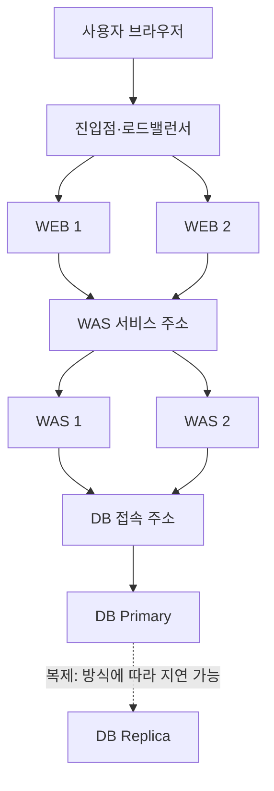

## 목차

- [[#1. 개요|1. 개요]]
- [[#2. WEB·WAS·DB를 나누는 이유|2. WEB·WAS·DB를 나누는 이유]]
- [[#3. 논리 계층과 배포·장애 영역|3. 논리 계층과 배포·장애 영역]]
- [[#4. 주문 조회 요청의 처리 흐름|4. 주문 조회 요청의 처리 흐름]]
- [[#5. 네트워크와 접근 경계|5. 네트워크와 접근 경계]]
- [[#6. 상태와 의존성을 고려한 확장 설계|6. 상태와 의존성을 고려한 확장 설계]]
- [[#7. 계층 분리의 장점과 비용|7. 계층 분리의 장점과 비용]]
- [[#8. 2-tier·단일 배포·마이크로서비스와의 차이|8. 2-tier·단일 배포·마이크로서비스와의 차이]]
- [[#9. 관련 문서|9. 관련 문서]]
- [[#10. 출처|10. 출처]]

## 1. 개요

3-Tier Architecture(3계층 아키텍처)는 애플리케이션의 표현·업무 처리·데이터 관리 책임을 세 실행 계층으로 분리해 배치하는 구조이다.[^tiers]

전통적인 웹 서비스에서는 [[Web Server|WEB]]·[[Web Application Server|WAS]]·[[Database|DB]]로 설명하는 경우가 많다. 다만 표현 계층의 일부는 브라우저에서 실행될 수 있고, 하나의 애플리케이션 서버가 웹 응답까지 제공할 수도 있다. 세 역할과 장비 세 대를 일대일로 대응시키면 실제 구성을 이해하기 어렵다.

이 문서는 계층별 책임과 요청 흐름, 그리고 그것을 VM·네트워크·스토리지에 배치하는 방법을 다룬다. 모든 서비스가 반드시 이 구조를 채택해야 한다는 뜻은 아니다.

## 2. WEB·WAS·DB를 나누는 이유

| 책임 | 수행하는 일 | 대표 구현 예시 |
|---|---|---|
| 표현·진입 | HTTP 요청 수신, 정적 파일, TLS·프록시 | 브라우저, NGINX·Apache HTTP Server |
| 업무 처리 | 사용자 권한·주문 규칙·계산·API 실행 | Tomcat 기반 Java 앱, 다른 언어 앱 서버 |
| 데이터 관리 | 지속 저장, 질의, 트랜잭션·동시성 | PostgreSQL·MySQL 등 DBMS |

분리하면 계층마다 변경 주기와 확장 방식, 접근 권한을 달리 설계할 수 있다. 예를 들어 이미지 요청이 늘었다고 DB 서버를 같은 비율로 늘릴 필요는 없고, DB의 재시작 정책도 WEB과 다르게 다룬다. 대신 계층 사이 네트워크 연결과 인증, 시간 초과, 배포 버전 간 호환성까지 관리해야 하므로 비용과 복잡성이 늘어난다.[^n-tier] 역할별로 나누는 이유와 이점, 비용, 한계는 [[Separation of Concerns]]에서 더 자세히 다룬다.

WEB은 정적, WAS는 동적이라는 구분은 입문 단계에서 역할을 단순화한 설명이다. Tomcat도 HTTP와 정적 콘텐츠를 처리할 수 있고 웹 서버는 역방향 프록시나 모듈로 애플리케이션 응답을 전달할 수 있다. 장비 이름보다 그 구간이 어떤 책임을 수행하는지를 확인한다.[^tomcat]

## 3. 논리 계층과 배포·장애 영역

논리적 layer는 코드와 책임의 구분이고, 배포 tier는 실행 환경의 분리이다. 코드가 세 layer로 나뉘어 있어도 한 프로세스·한 VM에 배포하면 엄밀한 의미의 분리된 3-tier 배치와는 다르다. 반대로 세 tier를 각각 여러 VM으로 구성하면 장비 수는 셋보다 많아진다.[^n-tier]

이 그림은 이해를 돕기 위한 배치 예시이다. 로드밸런서·서비스 주소·DB 접속 주소가 자동으로 고가용성을 제공한다는 뜻은 아니다. VM이 서로 다른 물리 호스트·전원·네트워크·가용 영역에 분산되는지에 따라 함께 실패할 수 있는 범위가 달라진다. Replica가 있다고 자동 장애 전환이나 데이터 무손실이 보장되는 것도 아니다.[^ha]

## 4. 주문 조회 요청의 처리 흐름

다음은 데이터 조회형 요청의 예이다. 실제 계층 간 프로토콜과 TLS 종료 위치는 설계에 따라 달라진다.

1. 브라우저가 DNS로 서비스 주소를 얻고 진입점과 전송 연결·TLS 통신을 준비한다.
2. WEB이 HTTP의 이름·경로·메서드를 보고 정적 파일을 제공하거나 WAS로 전달할 요청을 선택한다.
3. WAS가 사용자를 확인하고 주문 조회 권한과 입력을 검증한다.
4. WAS가 DB 연결 풀에서 연결을 얻고 필요한 질의를 실행한다.
5. DBMS가 실행 계획에 따라 테이블·인덱스와 필요한 메모리·디스크를 사용해 결과를 만든다.
6. WAS가 결과를 업무 응답으로 구성하고 WEB을 거쳐 브라우저에 반환한다.

정적 CSS 파일은 WEB이나 [[CDN]]의 캐시에서 바로 응답할 수 있어 모든 요청이 DB까지 도달하지 않는다. 반면 주문 생성 요청은 트랜잭션·중복 처리·실패 시 재시도 정책까지 고려해야 한다. TCP 재전송과 애플리케이션의 주문 재시도는 같은 기능이 아니다. 같은 HTTP 요청을 다시 보내는 것이 업무적으로 안전한지는 별도로 설계한다.[^http]

실제 장비에서는 이 단계가 서버 프로세스의 CPU 실행·RAM 접근, NIC와 스위치의 패킷 전달, DB 로그·데이터의 저장 I/O로 이어진다. 화면에서 논리적 화살표 하나로 보이는 WAS→DB도 실제로는 주소·포트·경로·방화벽·인증·DB 연결 수에 의존한다.

## 5. 네트워크와 접근 경계

대표 배치에서는 외부 요청을 받는 진입점과 WEB을 공개 구간에 두고 WAS·DB는 제한된 내부 연결로 접근한다. 여기서 공개 구간은 해당 클라우드의 라우팅 정의와 실제 공인 주소·로드밸런서 설정을 함께 봐야 한다. 모든 WEB VM을 반드시 인터넷에 직접 노출해야 한다는 의미는 아니다.[^webhosting]

| 구간 | 설계할 내용 | 불필요한 허용의 예 |
|---|---|---|
| 사용자→진입점 | 필요한 서비스 프로토콜과 인증서 | 관리 SSH까지 인터넷 전체에 개방 |
| WEB→WAS | WAS 서비스 주소·포트·요청 신뢰 경계 | 모든 WEB에서 내부 모든 포트 접근 |
| WAS→DB | DB 포트, 업무 계정과 최소 권한 | DB 관리자 계정을 모든 앱이 공유 |
| 운영 경로 | 승인된 관리 접속·감사·비밀값 관리 | 관리 포트를 서비스 요청 경로와 무차별 공유 |

경로가 있다는 사실과 접근이 허용된다는 사실은 다르다. 네트워크 정책이 허용되어도 DB 계정 인증이 실패할 수 있고, DB 계정이 맞아도 경로가 없으면 접속할 수 없다. TLS를 진입점에서 종료했다면 내부 구간 암호화를 별도로 설계할 수 있으며, 외부 HTTPS만 보고 내부까지 암호화됐다고 판단하지 않는다.[^tls-upstream]

## 6. 상태와 의존성을 고려한 확장 설계

WEB·WAS의 인스턴스를 늘리는 scale-out은 요청을 여러 대상에 분배할 수 있을 때 효과가 있다. WAS의 로그인 세션·임시 파일·업로드 결과를 각 인스턴스 메모리나 로컬 디스크에만 두면 다음 요청이 다른 인스턴스로 갔을 때 상태가 사라진 것처럼 보일 수 있다. 세션 공유·상태 외부화·고정 세션 등은 각각 일관성·가용성·운영 비용의 선택을 수반한다.[^session]

DB는 지속적으로 보존해야 하는 데이터를 관리하므로 단순히 프로세스를 여러 개 띄워 쓰기를 분산할 수 있다고 생각하면 안 된다. 읽기 복제본, 캐시, 더 큰 인스턴스, 인덱스와 질의 개선은 해결하는 병목이 서로 다르다. 읽기 복제본에는 복제 지연이 있어 “수정 직후 조회”의 결과가 Primary와 다를 수 있다.[^replication]

연결 풀도 전체 규모로 계산한다. WAS 4개가 DB 연결을 각 50개까지 사용하도록 구성하면 최대 연결 수요는 200개이다. 다른 업무·관리 연결과 DB의 처리 능력까지 감안해야 한다. 앱 서버를 늘렸는데 DB 연결 한도와 경쟁이 먼저 커지면 전체 지연이 악화될 수 있다. 이 숫자는 계산 예시이다.[^pool]

## 7. 계층 분리의 장점과 비용

계층을 나누면 화면 전달 방식, 업무 규칙, 데이터 관리 방식을 각각 발전시키기 쉽다. 예를 들어 모바일 앱을 추가해도 기존 업무 API를 재사용할 수 있고, 상품 이미지 요청이 늘면 웹·캐시 계층을 확장하는 방식을 검토할 수 있다. 책임 분리는 하나의 기능 변화가 시스템 전체의 변경으로 번지는 범위를 줄인다.[^n-tier]

반면 분리된 계층은 서로 통신해야 한다. WAS가 DB를 여러 번 호출하면 DB의 계산 시간뿐 아니라 통신과 대기 시간도 쌓인다. 중간 계층이 많다는 사실 자체가 좋은 설계를 뜻하지는 않으며, 작은 서비스에서는 하나의 실행 환경에 기능을 모으는 편이 단순할 수 있다.

계층이 독립적이라는 말도 서로 관계없다는 뜻은 아니다. WAS가 기대하는 DB 구조나 API 응답 형식이 달라지면 함께 동작하는 조건을 맞춰야 한다. 3-Tier 구조의 목적은 구성 요소의 수를 늘리는 것이 아니라, 변경·확장·접근을 나누어 관리할 수 있는 경계를 만드는 데 있다.

## 8. 2-tier·단일 배포·마이크로서비스와의 차이

클라이언트가 DB에 직접 접근하는 2-tier 방식은 구조가 단순할 수 있지만 다수 사용자 배포·보안·업무 규칙 변경을 어디서 관리할지 고민해야 한다. 3-tier는 중간 업무 계층을 두어 그 책임을 모을 수 있는 대신 네트워크 호출과 운영 대상이 늘어난다.

모놀리스·마이크로서비스는 주로 애플리케이션의 분해·배포 방식에 관한 구분이다. 모놀리스도 WEB·WAS·DB의 3-tier 배치를 사용할 수 있고, 마이크로서비스도 데이터 계층을 가진다. 서버리스 구현 역시 물리 서버를 직접 관리하지 않는다는 뜻이지 표현·업무·데이터 책임이 없다는 뜻은 아니다.[^serverless]

규모와 팀 역량에 비해 분리가 과하면 운영 부담만 커질 수 있다. 이 구조의 핵심은 구성 요소의 수가 아니라 책임·통신·상태·장애 경계의 명확한 구분과 필요한 수준의 분리에 있다.

## 9. 관련 문서

- [[Server]], [[Networking]], [[Storage]]
- [[Web Server]], [[Web Application Server]], [[Database]]
- [[Separation of Concerns]]
- [[Tenant]], [[Multi-tenancy]], [[Terraform]]

## 10. 출처

[^tiers]: [Microsoft — Using a Three-Tier Architecture Model](https://learn.microsoft.com/en-gb/windows/win32/cossdk/using-a-three-tier-architecture-model)
[^n-tier]: [Microsoft Azure Architecture Center — N-tier architecture style](https://learn.microsoft.com/en-us/azure/architecture/guide/architecture-styles/n-tier)
[^tomcat]: [Apache Tomcat — HTTP Connector](https://tomcat.apache.org/tomcat-10.1-doc/config/http.html)
[^ha]: [AWS Well-Architected — Fault isolation](https://docs.aws.amazon.com/wellarchitected/latest/reliability-pillar/use-fault-isolation-to-protect-your-workload.html)
[^http]: [IETF — RFC 9110: HTTP Semantics](https://www.rfc-editor.org/rfc/rfc9110.html)
[^webhosting]: [AWS — Traditional web hosting architecture](https://docs.aws.amazon.com/whitepapers/latest/web-application-hosting-best-practices/an-overview-of-traditional-web-hosting.html)
[^tls-upstream]: [NGINX — Securing HTTP Traffic to Upstream Servers](https://docs.nginx.com/nginx/admin-guide/security-controls/securing-http-traffic-upstream/)
[^session]: [Apache Tomcat — Clustering and Session Replication](https://tomcat.apache.org/tomcat-10.1-doc/cluster-howto.html)
[^replication]: [PostgreSQL — High Availability and Replication](https://www.postgresql.org/docs/current/high-availability.html)
[^pool]: [Apache Tomcat — JNDI Datasource and connection pooling](https://tomcat.apache.org/tomcat-10.1-doc/jndi-datasource-examples-howto.html)

[^serverless]: [AWS — Serverless Multi-Tier Architectures: Introduction](https://docs.aws.amazon.com/whitepapers/latest/serverless-multi-tier-architectures-api-gateway-lambda/introduction.html)

## 둘러보기

[[Knowledge Base/index|전체 개념 목록]] · [[Cloud 분류|Cloud]]
