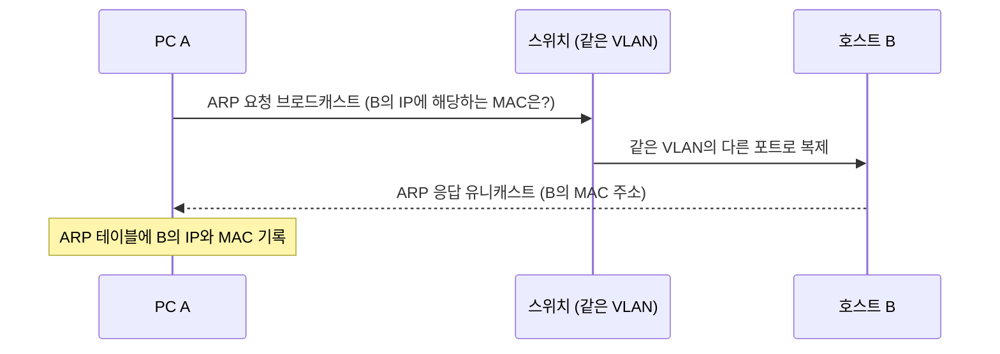

## 목차

- [[#1. 개요|1. 개요]]
- [[#2. IP 주소와 MAC 주소를 잇는 이유|2. IP 주소와 MAC 주소를 잇는 이유]]
- [[#3. 요청과 응답|3. 요청과 응답]]
- [[#4. 묻는 대상이 달라지는 경우|4. 묻는 대상이 달라지는 경우]]
- [[#5. ARP 테이블의 갱신과 만료|5. ARP 테이블의 갱신과 만료]]
- [[#6. 전달되는 범위|6. 전달되는 범위]]
- [[#7. 흔한 오해|7. 흔한 오해]]
- [[#8. 관련 문서|8. 관련 문서]]
- [[#9. 출처|9. 출처]]

## 1. 개요

ARP(Address Resolution Protocol)는 같은 로컬 네트워크에서 IP 주소에 해당하는 MAC 주소를 알아내는 프로토콜이다. 호스트가 프레임을 만들려면 목적지 MAC 주소가 필요한데, 호스트가 아는 것은 보통 IP 주소뿐이므로 그 사이를 이어 준다.

이 문서는 IPv4와 Ethernet 기준으로 설명한다. ARP가 알아내는 MAC 주소는 최종 목적지의 것이 아니라 이번 링크에서 프레임을 넘길 **다음 홉**의 것이다.

## 2. IP 주소와 MAC 주소를 잇는 이유

IP 패킷은 종단 사이에서 유지되는 주소로 목적지를 가리키고, 프레임은 링크마다 바뀌는 MAC 주소로 다음 전달 대상을 가리킨다. 호스트는 경로를 정한 뒤 "이 IP 주소로 보내려면 이 링크에서 누구에게 넘겨야 하는가"를 알아야 하며, 그 대상의 MAC 주소를 알아내는 단계가 ARP이다. 헤더 구조는 [[Encapsulation|캡슐화]]에서 설명한다.

## 3. 요청과 응답

ARP 테이블에 해당 IP의 항목이 없으면 호스트는 ARP 요청을 만들어 **같은 이더넷 케이블의 모든 스테이션에게 브로드캐스트**한다. 요청에는 보내는 쪽의 MAC 주소와 IP 주소, 그리고 MAC 주소를 알고 싶은 대상 IP 주소가 들어 있고, 알고 싶은 대상 MAC 주소 칸은 비워 둔다.[^rfc826]

요청을 받은 호스트 가운데 대상 IP가 자신의 주소인 호스트만 응답한다. 응답하는 호스트는 요청의 보내는 쪽 필드와 받는 쪽 필드를 맞바꾸고 자신의 주소를 채운 뒤, **요청한 호스트의 MAC 주소로 유니캐스트**한다.[^rfc826] 요청에 보내는 쪽 주소가 이미 들어 있으므로 응답은 브로드캐스트할 필요가 없다.

브로드캐스트를 만드는 쪽은 PC이고, 그 프레임을 여러 포트로 복제하는 일은 스위치가 한다. 스위치의 동작은 [[Switch|스위치]]에서 설명한다.

## 4. 묻는 대상이 달라지는 경우

ARP는 최종 목적지가 아니라 **다음 홉의 IP 주소**를 묻는다. 호스트는 마스크 계산으로 목적지가 같은 네트워크인지 다른 네트워크인지 먼저 판단하며, 이 판단이 ARP로 무엇을 물을지를 정한다.

| 목적지 | 마스크 판단 | ARP로 묻는 IP | 프레임 목적지 MAC | 패킷 목적지 IP |
|---|---|---|---|---|
| 같은 서브넷의 `192.168.10.37` | 같은 네트워크 | 192.168.10.37 | 그 호스트의 MAC | 192.168.10.37 |
| 다른 네트워크의 `8.8.8.8` | 다른 네트워크 | 기본 게이트웨이의 IP | 게이트웨이의 MAC | 8.8.8.8 |

두 번째 행에서 호스트는 `8.8.8.8`의 MAC 주소를 묻지 않고, 게이트웨이 IP의 MAC 주소를 묻는다. 패킷의 목적지 IP는 끝까지 `8.8.8.8`이다. 마스크 판단은 [[IP Address and Subnet|IP 주소와 서브넷]]에서, 게이트웨이의 역할은 [[Default Gateway|기본 게이트웨이]]에서 설명한다.

## 5. ARP 테이블의 갱신과 만료

ARP 요청을 받은 호스트는 요청자의 주소 쌍을 자신의 테이블에 반영한다. 이미 그 IP의 항목이 있으면 MAC 주소를 갱신하고, 대상이 자신이고 항목이 없으면 새로 추가한다.[^rfc826] 요청자는 응답을 받은 뒤 같은 IP로 다시 보낼 때 ARP를 반복하지 않고 테이블의 항목을 사용한다.

테이블의 항목은 영구적이지 않다. RFC 1122는 오래된 항목을 비울 수단을 반드시 제공하도록 요구하고, 방식으로 주기적 만료(Timeout), 유니캐스트 ARP 점검, 링크 계층의 전달 문제 통지, 상위 계층의 전달 문제 통지를 설명한다.[^rfc1122] 같은 IP에 대한 ARP 요청이 폭주하지 않도록 막는 장치도 필요하며, 권장 한도는 목적지당 초당 한 번 이하이다.[^rfc1122]

## 6. 전달되는 범위

ARP 요청은 브로드캐스트이므로 같은 L2 broadcast domain 안에서만 전달된다. 같은 VLAN이면 스위치가 몇 대여도 모두 받고, 라우터를 만나면 멈춘다. 브로드캐스트의 범위는 [[Unicast Broadcast Multicast Anycast|유니캐스트·브로드캐스트·멀티캐스트·애니캐스트]]에서 설명한다.

스위치 없이 PC 두 대를 케이블로 직접 연결한 경우에도 ARP는 동작한다. 요청은 그 케이블에 있는 모든 스테이션에게 가고, 그 케이블에는 상대 PC 한 대뿐이므로 그 PC가 받아 응답한다. 이때 호스트는 케이블 반대편이 스위치인지 PC인지를 구분하지 않고 완성된 프레임을 링크로 내보낸다. 스위치의 역할은 이 연결을 여러 대로 확장하는 것이다.

## 7. 흔한 오해

- **ARP가 목적지 서버의 MAC 주소를 알아낸다는 생각**: 다른 네트워크에 있는 서버의 MAC 주소는 알 수 없고 알 필요도 없다. 호스트는 다음 홉인 게이트웨이의 MAC 주소를 묻는다.
- **ARP 응답도 브로드캐스트라는 생각**: 요청이 보내는 쪽의 MAC 주소를 담고 있어서 응답은 그 MAC 주소로 유니캐스트한다.
- **다른 서브넷의 호스트에게도 ARP 요청이 도달한다는 생각**: 브로드캐스트는 라우터에서 멈춘다. 그래서 게이트웨이가 같은 서브넷에 없으면 ARP 응답을 받을 수 없다.
- **브로드캐스트를 스위치가 시작한다는 생각**: 목적지를 "모두"로 지정한 프레임은 보내는 PC가 만들고, 스위치는 그 프레임을 같은 VLAN의 다른 포트로 복제한다.

## 8. 관련 문서

- [[Networking|네트워크]] · [[Encapsulation|캡슐화]] · [[NIC]]
- [[Switch|스위치]] · [[Router|라우터]] · [[Default Gateway|기본 게이트웨이]]
- [[IP Address and Subnet|IP 주소와 서브넷]] · [[Unicast Broadcast Multicast Anycast|유니캐스트·브로드캐스트·멀티캐스트·애니캐스트]]

## 9. 출처

[^rfc826]: IETF, [RFC 826, An Ethernet Address Resolution Protocol](https://www.rfc-editor.org/rfc/rfc826.html). Packet Generation의 요청 구성과 브로드캐스트, Packet Reception의 테이블 갱신과 응답의 유니캐스트 전송.
[^rfc1122]: IETF, [RFC 1122, Requirements for Internet Hosts: Communication Layers](https://www.rfc-editor.org/rfc/rfc1122.html). 2.3.2.1 ARP Cache Validation의 항목 무효화 방식과 ARP 폭주 방지.

## 둘러보기

[[Knowledge Base/index|전체 개념 목록]] · [[Networking 분류|Networking]]
