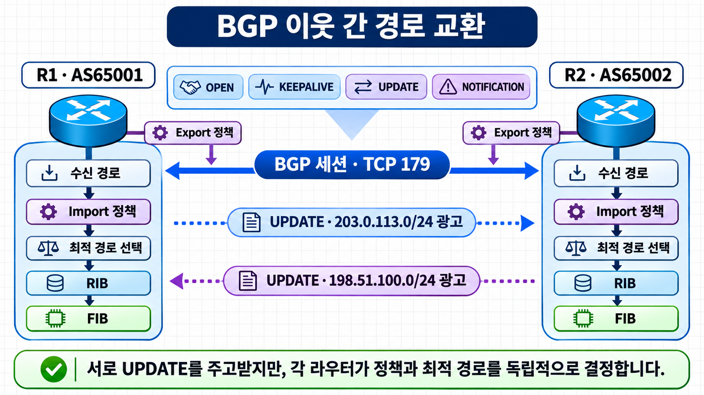
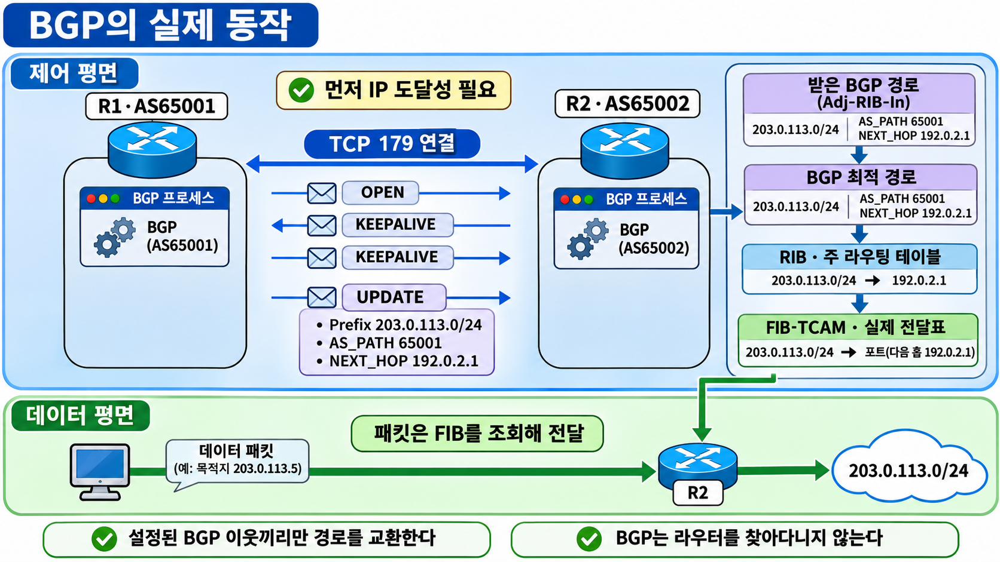
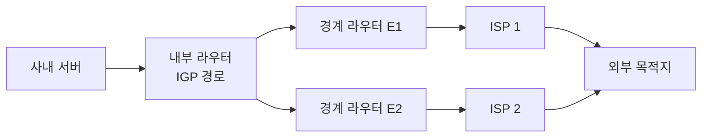

## 목차

- [[#1. 개요|1. 개요]]
- [[#2. AS·ASN·IP 프리픽스|2. AS·ASN·IP 프리픽스]]
- [[#3. BGP 프로세스와 경로 광고|3. BGP 프로세스와 경로 광고]]
- [[#4. 경로 선택과 정책|4. 경로 선택과 정책]]
- [[#5. 장애 감지와 경로 수렴|5. 장애 감지와 경로 수렴]]
- [[#6. eBGP와 iBGP|6. eBGP와 iBGP]]
- [[#7. OSPF·IS-IS와의 역할 분담|7. OSPF·IS-IS와의 역할 분담]]
- [[#8. 흔한 오해|8. 흔한 오해]]
- [[#9. 관련 문서|9. 관련 문서]]
- [[#10. 출처|10. 출처]]

## 1. 개요

BGP(Border Gateway Protocol)는 인터넷을 구성하는 자율 시스템들이 IP 프리픽스의 도달 경로와 정책 정보를 교환하는 라우팅 프로토콜이다.

BGP는 “Google 서버의 정확한 물리 위치”를 모든 라우터에 알려 주지 않는다. 대신 “이 IP 프리픽스는 어떤 AS 경로를 통해 도달할 수 있다”는 정보를 전달한다. 현재 표준 BGP-4는 TCP 179번 연결을 사용한다.[^rfc4271]



BGP 이웃은 한쪽만 다른 쪽을 갱신하는 관계가 아니다. 예시에서 R1은 `203.0.113.0/24`를 R2에 광고하고, R2도 자신이 알려 줄 수 있는 `198.51.100.0/24`를 R1에 광고한다. 다만 상대 라우터의 표를 원격으로 직접 고치는 것은 아니다. 각 라우터가 UPDATE를 받아 Import 정책을 적용하고 최적 경로를 선택한 뒤 RIB·FIB에 반영하며, 다시 광고할 때는 Export 정책을 적용한다.

## 2. AS·ASN·IP 프리픽스

- **AS(Autonomous System)**: 공통된 라우팅 정책과 관리 주체 아래 운영되는 네트워크 또는 네트워크 집합이다.
- **ASN(Autonomous System Number)**: AS를 구별하는 번호이다. IP 주소가 장치와 인터페이스를 식별한다면 ASN은 경로 정책의 관리 영역을 구별한다.
- **IP Prefix**: `203.0.113.0/24`처럼 주소 범위를 나타낸다. BGP는 개별 서버보다 프리픽스 단위의 도달 정보를 주로 교환한다.

프리픽스와 AS는 일대일 관계가 아니다. 한 AS가 여러 프리픽스를 광고할 수 있고, 다중 연결이나 Anycast 구성에서는 같은 프리픽스가 여러 위치에서 광고될 수도 있다.

AS는 특정 회사 유형이나 장비를 가리키는 말이 아니다. Google·Naver 같은 콘텐츠 사업자의 네트워크, SoftBank 같은 통신 사업자의 네트워크, 접속 ISP와 Transit 사업자의 네트워크가 모두 AS가 될 수 있다. 하나의 회사가 여러 AS를 운영할 수도 있고, 하나의 AS가 여러 국가와 데이터센터에 걸쳐 있을 수도 있다. 따라서 `회사 하나 = AS 하나`, `데이터센터 하나 = AS 하나`로 외우기보다 **어디까지를 하나의 관리 주체와 공통 라우팅 정책으로 운영하는가**를 기준으로 판단해야 한다.

IXP는 이들 AS보다 위에 있는 상위 AS가 아니다. 참가자 라우터들이 공용 L2 패브릭에서 서로 BGP 세션을 맺도록 연결해 주는 교환 기반이다. Route Server가 경로 교환을 위해 ASN을 사용할 수는 있지만 실제 사용자 패킷은 일반적으로 Route Server를 통과하지 않는다.

Route Server도 BGP 프로세스를 실행하는 컴퓨터이다. 참가자는 Route Server를 BGP 이웃으로 명시하고 경로를 교환하며, Route Server는 필터와 참가자별 정책을 적용해 다른 참가자에게 다시 광고한다. 여러 참가자와 각각 Bilateral 세션을 구성하는 부담을 줄이는 선택 기능이며, Route Server가 없어도 참가자 라우터끼리 직접 BGP Peering을 구성할 수 있다. 세부 구조는 [[IXP Peering and Transit#5. Route Server와 피어링 라우터의 차이|Route Server와 피어링 라우터의 차이]]에서 다룬다.

## 3. BGP 프로세스와 경로 광고

### BGP의 실체

BGP의 실체는 라우터나 서버의 운영체제에서 실행되는 **BGP 프로세스와 그 프로세스들이 주고받는 메시지 규칙**이다. BGP가 네트워크를 돌아다니며 다른 라우터의 표를 직접 수정하는 것은 아니다.

상용 라우터에서는 네트워크 운영체제의 라우팅 프로세스가 BGP를 구현한다. 범용 Linux 서버에도 FRRouting의 `bgpd`나 BIRD 같은 소프트웨어를 설치하면 BGP Speaker로 사용할 수 있다. 따라서 반드시 특별한 모양의 하드웨어가 필요한 것은 아니지만, 대규모 실제 트래픽을 빠르게 전달하려면 전용 ASIC·NPU와 큰 경로표를 처리할 메모리를 갖춘 라우터가 유리하다.



### 이웃 관계의 설정과 TCP 연결

BGP는 근처의 모든 라우터를 자동으로 찾아 경로를 뿌리는 브로드캐스트 프로토콜이 아니다. 운영자가 상대 라우터의 IP 주소와 ASN을 **BGP 이웃(Neighbor)** 으로 설정한 장비끼리만 경로를 교환한다.

BGP 이웃의 IP로 먼저 통신할 수 있어야 한다. 직접 연결 경로, 정적 경로 또는 OSPF·IS-IS 같은 IGP 경로가 이 초기 도달성을 제공한다. 그 위에서 한쪽 BGP 프로세스가 상대의 TCP 179번 포트로 연결을 만들고 다음 메시지를 교환한다.[^rfc4271]

1. **OPEN**: 자신의 ASN, BGP 버전, Hold Time과 기능을 알린다.
2. **KEEPALIVE**: 세션이 정상임을 주기적으로 확인한다.
3. **UPDATE**: 새 프리픽스와 경로 속성을 광고하거나 더 이상 유효하지 않은 경로를 철회한다.
4. **NOTIFICATION**: 치명적인 오류를 알리고 세션을 종료한다.

두 이웃은 같은 TCP 세션에서 양방향으로 UPDATE를 보낼 수 있지만, 반드시 같은 수의 경로나 같은 내용을 교환하는 것은 아니다. 한쪽은 전체 경로를 제공하고 다른 쪽은 자신이 소유한 프리픽스만 광고할 수도 있으며, Import·Export 정책에 따라 받은 경로와 다시 광고하는 경로가 달라진다.

세션이 수립될 때 필요한 경로를 교환한 뒤에는 보통 전체 경로표를 일정 간격마다 반복 전송하지 않는다. 새로운 경로와 속성 변경, 경로 철회처럼 변화가 있을 때 증분 UPDATE를 보내고, 세션 유지 확인은 KEEPALIVE가 맡는다. 세션이 재수립되거나 Route Refresh 같은 절차를 사용할 때는 경로를 다시 광고할 수 있다.[^rfc4271]

`ping`은 필요할 때 ICMP Echo Request를 보내 도달성과 응답을 확인한다. BGP는 이와 달리 라우터 사이에 **오래 유지되는 TCP 제어 세션**을 만들고, 경로가 처음 생기거나 달라질 때 UPDATE를 보낸다. 일반 사용자의 패킷마다 BGP 메시지가 함께 붙는 것은 아니다.

### 광고 메시지의 예시

R1의 AS65001이 `203.0.113.0/24`를 R2의 AS65002에 알리는 상황을 단순화하면 UPDATE에는 다음 의미의 정보가 들어간다.

```text
NLRI/Prefix: 203.0.113.0/24
AS_PATH:     65001
NEXT_HOP:    192.0.2.1
```

- **NLRI**: 도달할 수 있다고 알리는 프리픽스이다.
- **AS_PATH**: 해당 광고가 거친 AS의 순서이다.
- **NEXT_HOP**: R2가 이 경로를 사용할 때 패킷을 넘길 다음 홉이다.

R2의 BGP 프로세스는 이 메시지를 수신하더라도 원격 명령처럼 무조건 적용하지 않는다. Import Filter와 정책을 통과한 경로를 BGP 경로표에 보관하고, 다른 후보 경로와 비교하여 최적 경로를 선택한다.

### BGP 경로에서 실제 전달표까지

‘라우팅 테이블’이라는 말을 하나로 뭉뚱그리면 BGP의 역할이 모호해진다. 실제 장비에는 목적이 다른 여러 표가 존재할 수 있다.

| 정보 구조 | 들어 있는 내용 | 주된 사용자 |
|---|---|---|
| MAC 주소 테이블 | MAC 주소와 스위치 포트의 대응 | L2 스위치의 프레임 전달 기능 |
| BGP 경로표 | BGP 이웃에게 받은 후보 경로와 속성 | BGP 최적 경로 계산 |
| RIB·주 라우팅 테이블 | Connected·Static·OSPF·BGP 등에서 선택된 IP 경로 | 운영체제의 라우팅 관리자 |
| FIB·전달표 | 실제 패킷 전달에 필요한 다음 홉과 출력 정보 | ASIC·NPU·커널 데이터 평면 |

흐름을 줄이면 다음과 같다.

```text
BGP UPDATE 수신
→ BGP 정책 적용과 최적 경로 선택
→ 선택 경로를 RIB에 제안
→ 다른 라우팅 프로토콜의 경로와 비교
→ 최종 경로를 FIB·TCAM에 설치
→ 실제 데이터 패킷이 FIB를 조회하여 전달
```

따라서 “BGP가 라우팅 테이블을 바꾼다”는 말은 큰 흐름에서는 맞지만 정확하게는 **BGP가 받은 후보 중 최적 경로를 RIB에 제안하고, 장비의 라우팅 관리 체계가 선택한 결과를 FIB에 설치한다**고 표현하는 편이 좋다. Cisco IOS XR처럼 RIB와 FIB 설치를 확인한 뒤 경로를 광고하도록 연동하는 구현도 있다.[^ribfib]

### 간단한 설정 형태

다음은 R1이 AS65001로 동작하며 R2를 이웃으로 지정하고 프리픽스를 광고하는 형태를 단순화한 예시이다. 실제 명령은 Cisco IOS, Junos, FRRouting 등 구현에 따라 달라진다.

```text
router bgp 65001
  neighbor 192.0.2.2 remote-as 65002
  address-family ipv4 unicast
    network 203.0.113.0/24
```

`network` 명령이 해당 주소를 새로 만드는 것은 아니다. 일반적으로 장비의 RIB에 일치하는 경로가 먼저 있어야 BGP가 이를 광고 대상으로 삼는다. 운영 환경에서는 Prefix List, Route Map, Policy Statement 같은 Export·Import 정책으로 광고하고 받아들일 경로를 제한한다.

### 광고의 연쇄

목적지 AS가 자신의 프리픽스를 이웃에게 광고하면, 이웃 AS는 정책에 따라 해당 경로를 받아들이고 다른 이웃에게 다시 광고할 수 있다.


광고가 전달될수록 `AS_PATH`에는 거친 AS 번호가 기록된다. 자신의 ASN이 이미 경로에 있으면 순환 경로로 판단해 거부할 수 있다. 이것이 AS 간 루프 방지의 핵심 원리이다.

## 4. 경로 선택과 정책

BGP의 경로 선택은 단순히 물리적 거리가 가장 짧은 길을 고르는 일이 아니다. 사업자는 계약, 비용, 성능, 안정성과 트래픽 엔지니어링 정책을 반영한다.

대표적인 판단 정보는 다음과 같다. 실제 우선순위와 동작은 장비 구현과 설정에 따라 달라질 수 있다.

- **Local Preference**: 같은 AS 안에서 어느 출구를 선호할지 정하는 중요한 정책 값이다. 일반적으로 큰 값을 선호한다.
- **AS_PATH**: 거치는 AS의 목록이다. 다른 조건이 같다면 짧은 경로를 선호하는 과정에 사용될 수 있다.
- **MED**: 이웃 AS에 어느 진입점을 선호하는지 제안하는 값이다.
- **NEXT_HOP**: 해당 프리픽스로 보낼 다음 라우터 주소이다.
- **Community**: 경로에 정책 표식을 붙여 광고 범위나 우선순위 등을 제어하는 데 사용한다.

직접 Peering을 Transit보다 우선하도록 설계할 수 있지만 이는 BGP가 자동으로 보장하는 법칙이 아니다. 운영자가 Local Preference 등의 정책으로 정한다.

## 5. 장애 감지와 경로 수렴

직접 연결이 끊기거나 BGP 세션이 종료되면 해당 이웃에게서 배운 경로가 철회된다. 라우터는 남아 있는 후보 가운데 정책에 맞는 경로를 새 최적 경로로 선택하고 전파한다. 이 변화가 관련 라우터에 퍼져 전달 경로가 안정되는 과정을 수렴이라고 한다.

장애가 발생하자마자 모든 패킷이 무손실로 우회한다고 단정할 수는 없다. 장애 감지 시간, BGP 타이머, BFD 사용 여부, 경로 수와 정책에 따라 짧은 단절이나 손실이 생길 수 있다. BGP는 경로 가용성을 제공하는 기반이지 애플리케이션 세션을 대신 복구하는 기능은 아니다.

## 6. eBGP와 iBGP

- **eBGP**: 서로 다른 AS 사이에서 경로를 교환한다. ISP와 콘텐츠 사업자, 고객과 Transit 사업자 사이의 연결이 대표 사례이다.
- **iBGP**: 같은 AS 안에서 외부 경로 정보를 공유한다. 대규모 망에서는 모든 라우터의 완전 연결을 피하려고 Route Reflector를 사용할 수 있다.

IXP의 Route Server는 여러 참가자가 각각 양자 BGP 세션을 맺는 부담을 줄이지만, 한 조직 내부의 Route Reflector와는 운영 범위와 목적이 다르다.

## 7. OSPF·IS-IS와의 역할 분담

BGP가 “어느 AS 경계와 외부 경로를 사용할지” 정했다면, [[IGP]]인 [[OSPF]]·[[IS-IS]]는 “우리 AS 내부에서 그 경계 라우터까지 어떻게 갈지”를 계산한다.



- **BGP**: 외부 목적지 프리픽스로 나갈 출구와 AS 경로 선택
- **IGP**: 현재 라우터에서 선택된 출구와 BGP Next Hop까지의 내부 경로 제공

BGP가 E2를 최적 출구로 선택했어도 IGP가 E2까지 도달할 경로를 잃으면 해당 BGP 경로는 실제 전달에 사용할 수 없다. 라우터는 BGP Next Hop을 다시 RIB에서 조회하여 출력 인터페이스와 바로 다음 L3 장비를 확인한다. 이를 재귀적 Next Hop 조회라고 한다.

반대로 일반 내부 라우터가 인터넷의 모든 BGP 경로를 가질 필요는 없다. 내부 장비에는 경계 라우터를 향한 기본 경로 `0.0.0.0/0`이나 필요한 요약 경로만 제공하고, 경계 라우터가 방대한 외부 프리픽스를 구분하도록 설계할 수 있다. 인터넷 경로를 IGP에 무분별하게 재배포하면 LSDB·RIB가 커지고 외부 변화가 내부 전체에 퍼지며 잘못된 재배포로 루프가 생길 수 있다.

BGP와 IGP는 경쟁 관계가 아니라 서로 다른 범위를 맡는다. 소규모 망은 정적 경로와 기본 경로만으로도 동작할 수 있으므로 모든 조직이 OSPF·IS-IS·BGP를 전부 사용해야 하는 것은 아니다.

## 8. 흔한 오해

- **BGP 정보가 모든 가정용 공유기까지 전달된다**: 가정용 장비는 보통 ISP를 향한 기본 경로만 사용한다.
- **BGP는 가장 빠른 경로를 자동 선택한다**: 속도보다 정책과 경로 속성을 기준으로 선택한다.
- **IXP가 BGP의 상위 라우터이다**: IXP는 여러 참가자의 라우터가 연결되는 상호접속 기반 시설이다.
- **Route Server가 다른 라우터의 표를 직접 수정한다**: Route Server는 BGP UPDATE를 다시 광고하고, 참가자 라우터가 자신의 Import 정책과 경로 선택 절차를 거쳐 RIB·FIB에 반영한다.
- **Transit은 중간 라우터 한 대이다**: Transit은 사업자 AS가 다른 네트워크까지의 도달성과 운송을 제공하는 서비스이다.
- **BGP가 있으면 보안도 해결된다**: 잘못된 경로 광고와 탈취 위험이 있으므로 필터링과 RPKI 같은 별도 검증이 중요하다.

## 9. 관련 문서

- [[Internet Routing|인터넷의 통신 구조]] · [[Router|라우터]]
- [[IGP]] · [[OSPF]] · [[IS-IS]]
- [[IXP Peering and Transit|IXP·피어링·트랜짓]] · [[Backbone Network|백본 네트워크]]

## 10. 출처

[^rfc4271]: IETF, [RFC 4271 — A Border Gateway Protocol 4](https://www.rfc-editor.org/info/rfc4271/). BGP-4의 기본 동작, 경로 속성, TCP 사용과 메시지.
[^ribfib]: Cisco, [Implementing and Monitoring RIB](https://www.cisco.com/c/en/us/td/docs/routers/asr9000/software/711x/routing/configuration/guide/b-routing-cg-asr9000-711x/implementing-and-monitoring-rib.pdf). BGP 경로의 RIB·FIB 설치 확인과 광고 연동 사례.

- AWS, [Direct Connect routing policies and BGP communities](https://docs.aws.amazon.com/directconnect/latest/UserGuide/routing-and-bgp.html). 실제 서비스에서의 BGP 경로 정책과 Community 사례.
- FRRouting, [BGP](https://docs.frrouting.org/en/latest/bgp.html). 범용 운영체제에서 실행되는 BGP 구현과 이웃·주소군 설정 사례.
- IETF, [RFC 1997 — BGP Communities Attribute](https://www.rfc-editor.org/rfc/rfc1997.html). Community 속성의 표준.
- IETF, [RFC 4456 — BGP Route Reflection](https://www.rfc-editor.org/rfc/rfc4456.html). iBGP 확장과 Route Reflector.

## 둘러보기

[[Knowledge Base/index|전체 개념 목록]] · [[Networking 분류|Networking]]
