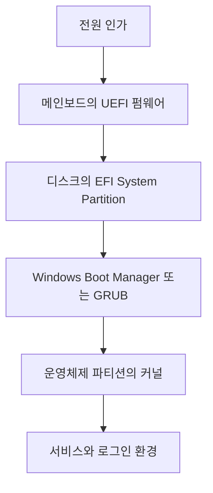

## 목차

- [[#1. 개요|1. 개요]]
- [[#2. 부팅 단계의 펌웨어 역할|2. 부팅 단계의 펌웨어 역할]]
- [[#3. EFI·UEFI·EFI System Partition의 구분|3. EFI·UEFI·EFI System Partition의 구분]]
- [[#4. BIOS와 UEFI의 차이|4. BIOS와 UEFI의 차이]]
- [[#5. Windows 운영체제 디스크의 부팅 관계|5. Windows 운영체제 디스크의 부팅 관계]]
- [[#6. 관련 문서와 출처|6. 관련 문서와 출처]]

## 1. 개요

BIOS와 UEFI는 운영체제보다 먼저 실행되어 컴퓨터의 기본 하드웨어를 초기화하고 부팅할 프로그램을 선택하는 플랫폼 펌웨어 방식이다.

BIOS는 전통적인 PC 부팅 인터페이스이고 UEFI는 이를 대체하는 현대적인 규격이다. 일상적으로 UEFI 설정 화면도 ‘BIOS 화면’이라고 부르지만 기술적으로는 구분된다.

## 2. 부팅 단계의 펌웨어 역할

```text
전원 인가
  ↓
CPU가 정해진 시작 지점의 펌웨어 실행
  ↓
메모리·CPU·부팅 장치 등 초기화
  ↓
부팅 순서와 부팅 항목 확인
  ↓
부트로더 실행
```

UEFI의 Boot Manager는 NVRAM에 저장된 `BootOrder`와 부팅 항목에 따라 UEFI 드라이버와 운영체제 로더 같은 UEFI 애플리케이션을 불러온다.[^uefi] UEFI가 운영체제를 스스로 완전히 실행하는 것이 아니라, 준비를 마친 뒤 [[Bootloader|부트로더]]에 제어권을 넘긴다고 이해하면 된다.

## 3. EFI·UEFI·EFI System Partition의 구분

EFI(Extensible Firmware Interface)는 기존 BIOS를 대체하기 위해 시작된 규격이고 UEFI(Unified EFI)는 이를 여러 기업이 함께 발전시킨 현대 표준이다. 현대 PC의 펌웨어는 대부분 UEFI지만, 실행 파일의 `.efi` 확장자와 EFI System Partition(ESP) 같은 이름에는 EFI가 남아 있다.

UEFI 펌웨어와 ESP는 저장 위치부터 다르다.

| 구성 요소 | 저장 위치 | 역할 |
|---|---|---|
| UEFI 펌웨어 | 메인보드의 플래시 메모리 | 하드웨어 초기화와 부팅 항목 선택 |
| EFI System Partition | HDD·SSD의 별도 파티션 | UEFI가 실행할 `.efi` 부트로더 파일 저장 |
| 운영체제 | Windows C: 또는 Linux 루트 파일시스템 | 커널·서비스·프로그램과 사용자 환경 제공 |



ESP는 일반적으로 FAT32를 사용한다. 하나의 ESP에 Microsoft와 Linux 배포판의 부트로더 디렉터리가 함께 있을 수 있다. ESP 자체가 UEFI 펌웨어나 운영체제 본체인 것은 아니다.[^windows]

## 4. BIOS와 UEFI의 차이

| 관점 | 전통 BIOS | UEFI |
|---|---|---|
| 부트 코드 발견 | 부팅 디스크의 정해진 영역에 의존 | EFI System Partition의 파일과 NVRAM 부팅 항목 사용 가능 |
| 인터페이스 | 오래된 PC 호환 방식 | 표준화된 부팅·런타임 서비스 제공 |
| 파티션과 확장성 | MBR 방식과 함께 쓰인 경우가 많음 | GPT와 함께 쓰는 구성이 일반적 |
| 보안 기능 | 표준 Secure Boot 없음 | Secure Boot 체인을 구성할 수 있음 |

UEFI와 GPT, BIOS와 MBR은 자주 함께 사용되지만 완전히 같은 개념은 아니다. 전자는 펌웨어와 부팅 인터페이스이고 후자는 디스크 파티션 정보 형식이다.

## 5. Windows 운영체제 디스크의 부팅 관계

일반적인 Windows UEFI·GPT 디스크에는 ESP, MSR, Windows 파티션, Recovery 파티션이 있다. Windows 운영체제 본체와 일반 프로그램·사용자 데이터는 같은 NTFS C 파티션에 함께 있을 수 있다. MSR은 디스크 관리를 위한 예약 공간이고 Recovery 파티션은 Windows 복구 환경을 보관한다.


## 6. 관련 문서와 출처

- [[Firmware|펌웨어]], [[Flash Memory|플래시 메모리]], [[Bootloader|부트로더]], [[Linux]]
- [[Disk|디스크]], [[Partition|파티션]], [[Filesystem|파일시스템]]

[^uefi]: [UEFI Forum — UEFI Specification 2.11, Boot Manager](https://uefi.org/specs/UEFI/2.11/03_Boot_Manager.html)
[^windows]: Microsoft Learn, [UEFI/GPT-based hard drive partitions](https://learn.microsoft.com/windows-hardware/manufacture/desktop/configure-uefigpt-based-hard-drive-partitions?view=windows-11), ESP·MSR·Windows·Recovery 파티션의 역할과 기본 배치.

## 둘러보기

[[Knowledge Base/index|전체 개념 목록]] · [[Compute 분류|Compute]]
