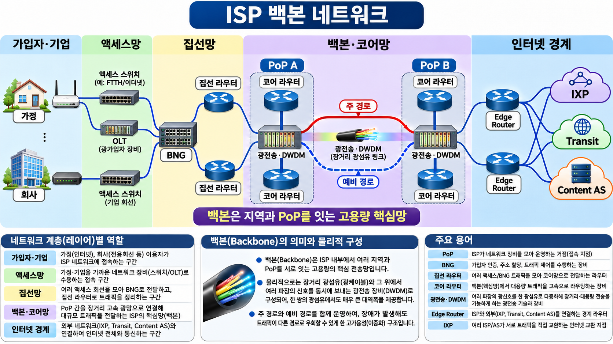

## 목차

- [[#1. 개요|1. 개요]]
- [[#2. 액세스·집선·백본·경계의 역할|2. 액세스·집선·백본·경계의 역할]]
- [[#3. 실제 물리 구성|3. 실제 물리 구성]]
- [[#4. PoP와 장거리 연결|4. PoP와 장거리 연결]]
- [[#5. 백본의 라우팅|5. 백본의 라우팅]]
- [[#6. 백본을 직접 보유한다는 의미|6. 백본을 직접 보유한다는 의미]]
- [[#7. IXP·Transit과의 관계|7. IXP·Transit과의 관계]]
- [[#8. 관련 문서|8. 관련 문서]]
- [[#9. 출처|9. 출처]]

## 1. 개요

Backbone Network(백본 네트워크)는 여러 지역·PoP·액세스망과 인터넷 경계를 고용량 회선과 코어 장비로 연결하여 대규모 트래픽을 운반하는 핵심망이다.

사람의 척추가 몸의 중심을 잇는 데서 나온 표현이다. 비유하면 액세스망이 골목길, 집선망이 간선도로라면 백본은 도시와 도시를 잇는 고속도로에 가깝다. 실제 백본은 한 줄의 케이블이 아니라 장애에 대비한 복수 경로와 여러 지역 거점으로 구성된다.



그림은 통신 사업자 네트워크를 단순화한 학습용 예시이다. 실제 장비 배치와 BNG·집선·코어의 경계는 사업자 설계에 따라 달라진다.

## 2. 액세스·집선·백본·경계의 역할

- **액세스망**: 가정, 회사, 기지국과 가까운 접속 장비까지 연결한다. Ethernet 스위치, OLT, 무선 장비 등이 사용될 수 있다.
- **집선망**: 여러 액세스 구간의 트래픽을 모아 상위 코어로 전달한다. 가입자 관리용 BNG가 이 구간이나 경계에 배치될 수 있다.
- **백본·코어망**: 지역 거점 사이의 대용량 트래픽을 빠르고 안정적으로 전달한다.
- **인터넷 경계**: [[IXP Peering and Transit|IXP, Peering, Transit]]과 고객 AS로 연결하고 외부 BGP 경로를 교환한다.

이 구분은 기능적 계층이다. 한 장비가 집선과 코어 역할을 함께 맡거나, 대규모 망에서 더 세분화할 수 있다.

## 3. 실제 물리 구성


과거의 ATM 스위치와 Cisco 라우터가 설치된 네트워크 코어 랙이다. 장비 세대는 오래되었지만 백본이 실제 랙 장비와 케이블로 구성된다는 점을 보여 준다. 사진: Patrick Finnegan, [Wikimedia Commons 원본](https://commons.wikimedia.org/wiki/File:Network_core_(14072854771).jpg), [CC BY 2.0](https://creativecommons.org/licenses/by/2.0/). 추가 편집 없이 사용했다.

현대 백본의 물리 구성에는 다음 요소가 포함될 수 있다.

- 고성능 코어·Provider 라우터와 고속 Line Card
- 단거리·장거리 광트랜시버와 광섬유
- 여러 파장의 광신호를 한 광섬유에 싣는 DWDM 장비
- 장거리 광신호의 증폭·재생 장비
- 전원, 냉각, 랙과 케이블 관리 설비
- 경로·트래픽·광신호 품질을 감시하는 운영 시스템

IP 라우터와 광전송 장비의 역할도 구분해야 한다. 라우터는 IP 패킷의 다음 경로를 선택하고, 광전송 장비는 그 비트를 장거리 광회선에 효율적으로 실어 나른다.

## 4. PoP와 장거리 연결

PoP(Point of Presence)는 사업자가 네트워크 장비를 설치하고 고객·다른 사업자·자체 백본과 접속하는 거점이다. 하나의 데이터센터 안에 있을 수도 있고 여러 시설에 분산될 수도 있다.

두 도시의 PoP 사이에는 서로 다른 관로와 사업자를 이용한 회선을 구성하여 단일 장애 지점을 줄일 수 있다. 도식에서 선이 두 개라고 해도 실제로 같은 관로를 공유하면 굴착 사고 한 번에 함께 끊길 수 있으므로 물리 경로 다양성까지 확인해야 한다.

## 5. 백본의 라우팅

백본 내부에서는 OSPF나 IS-IS 같은 IGP가 내부 장비와 링크의 도달성을 계산할 수 있다. MPLS·Segment Routing 등의 기술을 이용해 트래픽 경로와 서비스 전달을 제어하기도 한다. 인터넷 경계의 [[BGP]]는 외부 프리픽스와 출구를 선택하고, IGP는 선택된 출구까지 내부에서 도달할 경로를 제공한다.

모든 코어 라우터가 인터넷 전체 BGP 경로를 반드시 저장해야 하는 것은 아니다. 설계에 따라 경계 라우터가 전체 경로를 보유하고 코어는 내부 경로와 라벨 전달에 집중할 수 있다.

## 6. 백본을 직접 보유한다는 의미

조직이 “자체 백본을 보유한다”는 표현은 보통 여러 지역 거점, 고용량 장거리 연결, 코어 라우팅과 이를 운영할 인력·정책을 자체적으로 통제한다는 뜻이다. 반드시 모든 광섬유를 직접 소유한다는 의미는 아니다. 통신사로부터 Dark Fiber, 전용 파장이나 회선을 임차하면서 논리적 백본을 직접 운영할 수도 있다.

자체 대규모 백본이 없는 서비스 사업자는 고객 데이터센터, 통신사 회선, Colocation, IXP와 Transit을 활용하여 서비스를 제공할 수 있다. 이 방식이 열등하다는 뜻은 아니며 사업 범위, 투자 규모와 책임 경계가 다르다. 특정 기업이 어떤 구조를 사용하는지는 공식 자료나 실제 계약을 확인해야 한다.

## 7. IXP·Transit과의 관계

백본은 한 사업자 AS 내부의 핵심망이고, IXP는 여러 AS가 만나는 상호접속 기반 시설이다. Transit은 다른 네트워크까지의 도달성과 운송을 구매하는 서비스이다.

```text
자체 백본: 우리 네트워크의 지역과 거점을 연결
IXP·Peering: 다른 네트워크와 직접 교환
IP Transit: 직접 연결하지 않은 인터넷 목적지까지 도달
```

한 사업자는 세 요소를 함께 사용할 수 있다. 자체 백본으로 여러 도시의 트래픽을 모으고, 각 지역 IXP에서 콘텐츠 사업자와 Peering하며, 나머지 목적지를 위해 복수 Transit을 구매하는 구성이 가능하다.

## 8. 관련 문서

- [[Internet Routing|인터넷의 통신 구조]] · [[Router|라우터]]
- [[BGP]] · [[IXP Peering and Transit|IXP·피어링·트랜짓]]
- [[Switch|스위치]] · [[Networking]]

## 9. 출처

- Cisco, [Introduction to Cisco IOS XR Technical Foundation](https://www.cisco.com/c/en/us/td/docs/iosxr/ncs5500/system-management/75x/b-system-management-cg-ncs5500-75x/introduction-to-cisco-ios-xr-technical-foundation.html). 대규모 라우터의 제어·전달 구조 사례.
- IETF, [RFC 2328 — OSPF Version 2](https://www.rfc-editor.org/rfc/rfc2328.html). AS 내부 링크 상태 라우팅의 표준.
- IETF, [RFC 1195 — Use of OSI IS-IS for routing in TCP/IP and dual environments](https://www.rfc-editor.org/rfc/rfc1195.html). IP 환경에서 IS-IS 사용의 기반.
- Internet Society, [Internet Infrastructure](https://www.internetsociety.org/internet/infrastructure/). 상호 연결된 인터넷 기반 시설의 개요.

## 둘러보기

[[Knowledge Base/index|전체 개념 목록]] · [[Networking 분류|Networking]]
