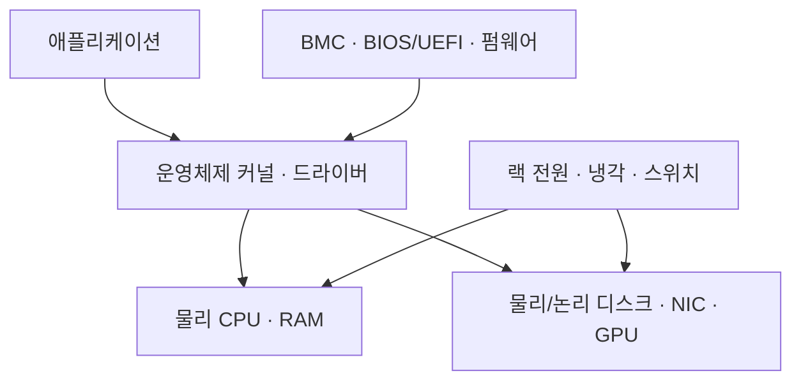
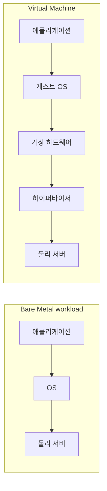
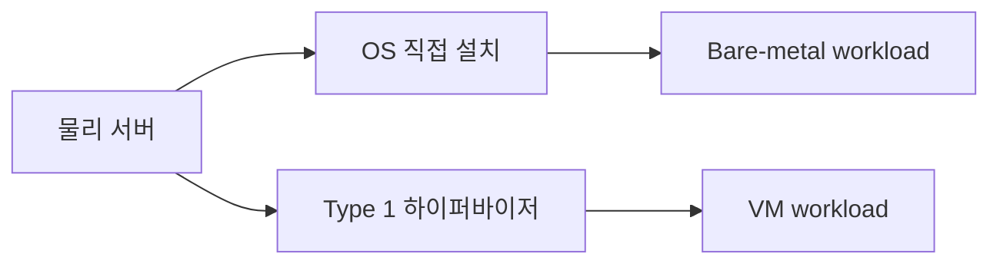

## 목차

- [[#1. 개요|1. 개요]]
- [[#2. 베어메탈에서 프로그램이 동작하는 과정|2. 베어메탈에서 프로그램이 동작하는 과정]]
- [[#3. 베어메탈과 VM의 구조 비교|3. 베어메탈과 VM의 구조 비교]]
- [[#4. 베어메탈을 선택하는 이유|4. 베어메탈을 선택하는 이유]]
- [[#5. 베어메탈의 비용과 한계|5. 베어메탈의 비용과 한계]]
- [[#6. 클라우드의 베어메탈|6. 클라우드의 베어메탈]]
- [[#7. Dedicated Host와 bare metal의 차이|7. Dedicated Host와 bare metal의 차이]]
- [[#8. 베어메탈과 Type 1 하이퍼바이저의 관계|8. 베어메탈과 Type 1 하이퍼바이저의 관계]]
- [[#9. 환경 선택의 판단 기준|9. 환경 선택의 판단 기준]]
- [[#10. 관련 문서|10. 관련 문서]]
- [[#11. 출처|11. 출처]]

## 1. 개요

Bare Metal(베어메탈)은 다른 사용자의 VM과 물리 자원을 나누는 일반적인 가상 서버가 아니라, 운영체제나 하이퍼바이저가 한 대의 물리 서버 하드웨어를 직접 사용하는 실행 환경을 뜻한다.

‘bare’는 CPU·메모리·디스크·NIC만 있고 소프트웨어가 전혀 없다는 뜻이 아니다. 운영체제를 물리 서버에 직접 설치해 애플리케이션을 실행할 수도 있고, Type 1 [[Hypervisor|하이퍼바이저]]를 물리 서버에 설치한 뒤 여러 [[Virtual Machine|VM]]을 운영할 수도 있다. 클라우드에서는 사업자가 전용 물리 서버를 API와 콘솔로 제공하는 상품을 bare metal이라고 부르기도 한다.[^ibm]

따라서 어떤 계층을 기준으로 하는지 문맥을 밝혀야 한다.

- **bare-metal workload**: 애플리케이션과 OS가 고객용 게스트 하이퍼바이저 없이 물리 장비에서 실행
- **bare-metal hypervisor**: 일반 호스트 OS 위가 아니라 물리 장비에서 직접 시작하는 Type 1 하이퍼바이저
- **bare-metal cloud service**: 클라우드 사업자가 한 고객에게 물리 서버를 제공하는 서비스

베어메탈에서 운영체제가 사용하는 CPU·메모리·PCIe 장치가 들어 있는 실제 서버의 예시이다. 2013년 촬영 장비로 현대 서버 전체의 구성을 대표하지 않는다. 사진: arichnad, [Wikimedia Commons 원본](https://commons.wikimedia.org/wiki/File:Inside_of_webserver.jpg), [CC BY-SA 4.0](https://creativecommons.org/licenses/by-sa/4.0/). 추가 편집 없이 사용했다.

## 2. 베어메탈에서 프로그램이 동작하는 과정

물리 서버에 전원이 들어오면 BMC와 시스템 펌웨어가 하드웨어를 초기화하고 POST를 수행한다. BIOS/UEFI가 부트 장치를 선택하면 부트로더와 OS 커널이 올라오고, 커널의 드라이버가 CPU·메모리·스토리지·NIC를 관리한다. 애플리케이션은 운영체제의 시스템 호출을 통해 이 자원을 사용한다. 실제 서버의 내부와 랙 구성은 [[Physical Server Configuration|물리 서버 구성]]에서 다룬다.

VM 환경과 달리 게스트용 vCPU·가상 메모리·가상 디스크라는 경계를 반드시 거치지는 않는다. 그러나 RAID 컨트롤러, LVM, SAN, VLAN, 컨테이너, 클라우드 관리 에이전트 같은 다른 추상화 계층은 여전히 존재할 수 있다. ‘베어메탈은 추상화가 전혀 없는 환경’이라는 설명은 틀리다.

## 3. 베어메탈과 VM의 구조 비교

| 기준 | 베어메탈 workload | VM |
|---|---|---|
| 자원 단위 | 물리 서버 한 대와 그 장치 중심 | vCPU·가상 메모리·가상 디스크·vNIC 중심 |
| 다른 사용자와 물리 공유 | 전용 상품이라면 일반적으로 공유하지 않음 | 공유 호스트일 수 있고 전용 호스트일 수도 있음 |
| 자원 크기 조절 | 부품 변경·서버 교체가 필요할 수 있음 | 지원 범위에서 가상 자원 변경이 빠름 |
| 생성 속도 | 설치·프로비저닝에 더 오래 걸릴 수 있음 | 이미지로 빠르게 생성 가능 |
| 장치 접근 | 특수 CPU 기능·GPU·NIC 등에 직접 접근하기 쉬움 | 가상 장치 또는 passthrough 조건 필요 |
| 격리 경계 | 물리 서버 단위 | VM과 하이퍼바이저의 논리 경계 |
| 이동·스냅샷 | OS·스토리지·도구에 별도 의존 | 플랫폼 기능으로 제공되는 경우가 많음 |
| 운영 책임 | 펌웨어·드라이버·OS 관리 범위가 큼 | 클라우드 VM에서는 공급자가 물리 호스트를 관리할 수 있음 |

베어메탈이 항상 VM보다 빠르다고 단정할 수는 없다. 가상화의 추가 경로와 공유 자원 경합을 줄일 수 있지만, 실제 성능은 CPU 세대·NUMA 배치·메모리·스토리지·NIC·드라이버·애플리케이션 병렬성에 달려 있다. 하드웨어 오프로딩이 많은 현대 가상화에서는 일반 업무의 차이가 작을 수도 있다. 특정 workload로 측정해야 한다.

## 4. 베어메탈을 선택하는 이유

### 예측 가능한 자원과 성능

물리 CPU·메모리와 로컬 장치를 한 tenant가 사용하면 다른 고객 VM의 부하로 인한 호스트 내부 noisy neighbor 가능성을 줄일 수 있다. 일정한 지연이 중요한 고성능 데이터베이스, HPC, 대규모 메모리 workload, 고속 패킷 처리 등이 후보가 된다. 하지만 SAN·네트워크·상위 스위치 같은 외부 자원을 공유하면 그 계층의 경합은 여전히 남는다.

### 특수 하드웨어와 낮은 수준의 기능

GPU·FPGA·고속 NIC, 특정 CPU 명령이나 성능 카운터, 중첩 가상화를 위한 VT-x/AMD-V 접근이 필요할 수 있다. passthrough와 nested virtualization으로 VM에서도 가능한 경우가 있으므로 ‘VM이면 불가능’이라고 먼저 단정하지 않고, 제품의 지원 범위와 성능·운영 제약을 확인한다.[^nested]

### 라이선스와 지원 조건

일부 상용 소프트웨어는 물리 프로세서·소켓·코어 수를 기준으로 라이선스를 계산하거나 특정 가상화 환경만 지원한다. 베어메탈이나 Dedicated Host가 필요한지는 기술 성능이 아니라 계약과 감사 가능성 때문일 수 있다. 실제 선택 전에는 공급사 라이선스 문서를 확인한다.

### 물리적 전용성과 규정

하나의 고객에게 서버를 전용하면 다른 tenant와 같은 물리 호스트를 쓰지 않는다는 요구를 충족하는 데 도움이 될 수 있다. 그러나 물리 전용이 곧 규정 준수나 완전한 보안을 의미하지 않는다. 펌웨어·BMC·OS·네트워크·계정·데이터 폐기와 공급자의 운영 절차도 통제 대상이다.

### 자체 가상화 플랫폼

조직이 VMware·KVM·Hyper-V 같은 가상화 환경을 직접 운영하려고 베어메탈 서버를 사용할 수 있다. 이때 물리 장비에는 Type 1 하이퍼바이저가 직접 설치되고, 업무는 그 위의 VM에서 실행된다. ‘베어메탈과 가상화는 서로 반대라 함께 쓸 수 없다’는 오해를 깨는 대표 사례이다.

## 5. 베어메탈의 비용과 한계

- **낮은 통합률 가능성**: 한 workload가 서버 전체를 항상 쓰지 않으면 남는 자원을 다른 VM에 세밀하게 나누기 어렵다.
- **느린 변경**: CPU·메모리·NIC를 바꾸거나 서버를 교체하는 일은 VM 크기 변경보다 오래 걸릴 수 있다.
- **운영 범위 증가**: BIOS·BMC·펌웨어·RAID·드라이버·OS·장애 부품까지 관리 책임이 커질 수 있다.
- **물리 장애**: 메인보드·PSU·NIC·디스크 장애가 곧 workload에 영향을 줄 수 있다. VM처럼 다른 호스트에서 재시작하려면 별도 클러스터나 복제 설계가 필요하다.
- **이미지 이동성 감소**: 장비 세대와 드라이버, 부팅 방식, 로컬 장치에 더 강하게 결합될 수 있다.
- **비용 단위 확대**: 필요한 자원이 일부여도 서버 한 대 단위의 계약과 전력·랙 비용을 부담할 수 있다.

베어메탈은 ‘최고 사양’의 다른 이름도 아니다. 낮은 사양의 전용 서버도 베어메탈이고, 매우 큰 VM이 특정 베어메탈 서버보다 빠를 수도 있다. 핵심은 사양이 아니라 물리 서버 사용 방식과 가상화 경계이다.

## 6. 클라우드의 베어메탈

클라우드 bare metal은 물리 서버를 사용하지만, 주문·이미지 배포·네트워크 연결·과금·모니터링은 클라우드 제어면이 제공할 수 있다. OpenStack Ironic도 물리 장비를 VM처럼 프로비저닝하는 bare metal 서비스를 제공한다.[^ironic]

AWS EC2의 Nitro 기반 metal 인스턴스는 고객 OS가 서버 CPU 위의 AWS 하이퍼바이저 없이 실행할 수 있지만, Nitro Card와 Nitro Controller가 네트워크·스토리지·관리·모니터링 기능을 계속 담당한다. 따라서 ‘bare metal이면 공급자 소프트웨어와 I/O 가상화가 전혀 없다’고 설명하면 안 된다.[^nitro]

Google Cloud Bare Metal Solution도 물리 서버와 네트워크 연결을 관리형 서비스로 제공하며, 고객은 OS 또는 하이퍼바이저, 애플리케이션, 데이터와 백업 등을 관리한다. 이는 베어메탈이 온프레미스 소유 장비에만 쓰이는 말이 아님을 보여 준다.[^google]

## 7. Dedicated Host와 bare metal의 차이

세 용어는 모두 ‘전용’처럼 보이지만 같은 상품이 아니다. AWS를 예로 들면 다음과 같다.[^dedicated]

| 형태 | 물리 호스트 전용 | 고객 OS의 실행 위치 | 핵심 차이 |
|---|---:|---|---|
| 일반 EC2 VM | 보통 아님 | AWS 하이퍼바이저가 제공하는 VM | 물리 배치를 공급자가 관리 |
| Dedicated Instance | 다른 계정과 하드웨어를 공유하지 않음 | VM | 호스트 자체의 세부 배치 제어는 제한적 |
| Dedicated Host | 고객 계정에 물리 호스트를 할당 | 그 호스트 위의 VM | 인스턴스 배치·host affinity와 라이선스 가시성 제공 |
| EC2 bare metal (`.metal`) | 물리 서버 단위 | 고객 OS가 호스트 CPU에서 비가상화 형태로 실행 | 낮은 수준 하드웨어 기능 접근, Nitro I/O·관리는 남음 |

Dedicated Host는 ‘고객 전용 물리 서버’이지만 그 위에 VM 인스턴스를 배치한다. 그러므로 전용 물리 호스트라는 계약과 non-hypervised bare metal 실행 방식은 구분해야 한다.

## 8. 베어메탈과 Type 1 하이퍼바이저의 관계

Type 1을 bare-metal hypervisor라고 부르는 이유는 하이퍼바이저가 일반 호스트 OS의 애플리케이션으로 올라가는 대신 물리 장비에서 직접 시작하기 때문이다. 그 위의 업무 VM은 베어메탈 workload가 아니라 가상화된 workload이다.

한편 VM 안에 다시 하이퍼바이저를 실행하는 nested virtualization도 있다. 교육·개발·가상화 플랫폼 시험에 유용하지만 CPU 기능 노출, 성능, 네트워크와 지원 범위가 제한될 수 있다. 베어메탈이 중첩 가상화에 유리한 경우가 있어도 ‘하이퍼바이저는 VM에서 절대 실행할 수 없다’는 표현은 틀리다.[^nested]

## 9. 환경 선택의 판단 기준

| 질문 | 베어메탈 쪽 근거 | VM 쪽 근거 |
|---|---|---|
| 특수 CPU·PCIe 기능이 꼭 필요한가? | 직접 접근과 제어가 중요 | 가상 장치·passthrough 지원으로 충분 |
| 부하가 크고 오래 일정한가? | 서버 전체를 지속 활용 | 수요 변화가 커서 크기 조절이 중요 |
| 지연의 변동을 얼마나 줄여야 하는가? | 호스트 내 tenant 경합 최소화 | 플랫폼 SLA와 전용 옵션으로 충족 가능 |
| 빠른 생성·폐기가 중요한가? | 자동 provisioning 지원 여부 확인 | 이미지 기반 생성과 자동화가 유리 |
| VM 이동·스냅샷이 필요한가? | 별도 솔루션을 설계해야 할 수 있음 | 플랫폼 기능 활용 가능 |
| 누가 펌웨어와 장애 부품을 관리하는가? | 조직 또는 bare metal 서비스 계약 확인 | 클라우드 사업자·가상화 운영팀이 담당 가능 |
| 라이선스가 물리 코어·소켓을 요구하는가? | 계약상 필요할 수 있음 | VM·Dedicated Host 조건으로 충족 가능성 확인 |

선택은 ‘베어메탈이 진짜 서버이고 VM은 가짜 서버’라는 구분이 아니다. 두 환경 모두 실제 물리 장비에서 실행된다. 필요한 성능 일관성, 장치 접근, 변화 속도, 장애 복구, 운영 책임과 비용 중 무엇을 우선하는지의 문제이다.

## 10. 관련 문서

- [[Virtualization]] · [[Hypervisor]] · [[Virtual Machine]]
- [[Server]] · [[Physical Server Configuration]]
- [[CPU]] · [[Memory]] · [[Disk]] · [[NIC]]
- [[Server Migration Types]] · [[Cloud 분류]]

## 11. 출처

[^ibm]: IBM Cloud Docs, [Bare metal server options](https://cloud.ibm.com/docs/bare-metal?topic=bare-metal-about-bm). 전용 물리 서버와 hypervisor 미설치 형태의 서비스 정의.
[^nested]: AWS, [Nested virtualization on Amazon EC2](https://docs.aws.amazon.com/AWSEC2/latest/UserGuide/amazon-ec2-nested-virtualization.html). 지원되는 중첩 가상화와 bare metal 사용 사례.
[^ironic]: OpenStack Ironic, [Bare Metal Service documentation](https://docs.openstack.org/ironic/latest/). 물리 서버를 API로 프로비저닝하는 사례.
[^nitro]: AWS, [The components of the Nitro System](https://docs.aws.amazon.com/whitepapers/latest/security-design-of-aws-nitro-system/the-components-of-the-nitro-system.html). Nitro Hypervisor·Cards·Controller와 bare metal 모드의 관계.
[^google]: Google Cloud, [Bare Metal Solution overview](https://docs.cloud.google.com/bare-metal/docs/bms-overview). 관리형 물리 서버와 공급자·고객 책임의 사례.
[^dedicated]: AWS, [Host and instance features — Logical Separation on AWS](https://docs.aws.amazon.com/whitepapers/latest/logical-separation/host-and-instance-features.html) 및 [Dedicated Hosts overview](https://docs.aws.amazon.com/AWSEC2/latest/UserGuide/dedicated-hosts-overview.html). Dedicated Instance·Dedicated Host·Bare Metal의 구분.

## 둘러보기

[[Knowledge Base/index|전체 개념 목록]] · [[Compute 분류|Compute]]
