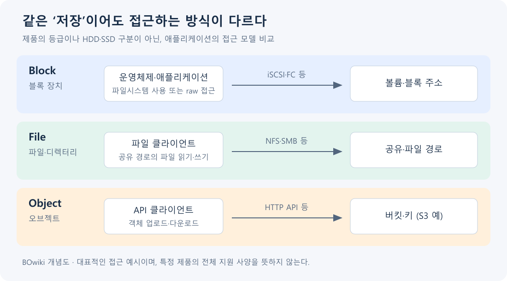

## 1. 개요

블록 스토리지(Block Storage)는 데이터를 주소가 있는 블록 단위로 읽고 쓰는 저장 방식이다.

운영체제나 애플리케이션은 제공된 볼륨을 블록 장치로 사용한다. 필요한 부분을 직접 읽고 쓸 수 있어 데이터베이스나 가상 머신의 디스크 등에 사용한다.[^1]

## 2. 물리 디스크에서 파일 쓰기까지

서버 내부의 SSD와 네트워크로 연결한 볼륨은 물리 위치가 다르지만, 운영체제에는 읽고 쓸 주소 공간을 가진 블록 장치로 노출될 수 있다. 애플리케이션이 파일에 데이터를 쓰면 파일시스템은 파일의 어느 부분이 어느 논리 블록에 대응하는지 관리하고, 운영체제의 I/O 계층이 장치로 요청을 전달한다. 네트워크 볼륨이라면 그 뒤에 스토리지 프로토콜과 네트워크, 스토리지 컨트롤러, 실제 매체가 이어진다. 이 계층 구분이 중요한 이유는 애플리케이션에서 느린 쓰기가 관측되더라도 원인이 항상 디스크 자체에 있지는 않기 때문이다.[^d-io]

Linux의 일반적인 버퍼드 읽기에서 필요한 파일 내용이 페이지 캐시에 있으면 실제 장치 I/O 없이 반환될 수 있다. 캐시에 없으면 파일시스템이 파일 범위를 블록 주소로 연결하고 장치 I/O가 필요해진다. 같은 파일의 반복 읽기와 첫 읽기의 속도가 다른 이유를 이렇게 설명할 수 있다. 파일 이름을 찾는 dentry·inode 캐시와 파일 내용 캐시는 역할도 다르다.[^d-vfs]

스토리지 어레이에서는 물리 드라이브 위에 RAID나 다른 데이터 보호 계층을 구성하고 풀·볼륨을 제공할 수 있다. 호스트는 볼륨의 논리 블록 주소를 다루며, 그 주소를 어느 물리 드라이브에 배치할지는 스토리지 쪽이 관리한다. RAID·풀을 거치는 정확한 순서와 지원 구성은 제품별로 다르다. 예를 들어 [[VPSA]]도 Storage Array와 Flash Array의 풀 구성을 구분한다.[^2]

이 그림은 논리적인 흐름이다. 네트워크 연결과 캐시 등은 실제 제품에 따라 중간에 추가된다. 파티션은 장치의 주소 범위를 나누는 구조이고, 파일시스템은 파일 이름·디렉터리·공간 할당을 관리하는 구조이다. 마운트는 만들어진 파일시스템을 운영체제의 경로에 연결하는 작업이므로, 볼륨 연결·파일시스템 생성·마운트는 서로 다른 상태 변화이다.[^v-use]

쓰기 성공의 의미도 계층마다 다르다. 애플리케이션의 버퍼에 넣은 상태, 운영체제 캐시에 전달한 상태, 저장장치에 영속화한 상태를 구별한다. 데이터베이스가 로그의 동기 쓰기 완료를 기다리는 이유는 장애 뒤에도 복구할 수 있어야 하는 데이터의 범위를 정하기 위해서다. 구체적인 영속성 보장은 운영체제 호출과 스토리지 제품의 규약을 함께 보아야 한다.

## 3. 파일을 저장하는 과정

블록 장치 자체가 파일과 폴더의 구조를 제공하는 것은 아니다. 일반적인 서버에서는 볼륨을 연결한 뒤 필요에 따라 파티션을 만들고 파일시스템을 구성해 마운트한다. 파티션 없이 볼륨 전체에 파일시스템을 만들 수도 있다.[^v-use] Kubernetes의 raw block volume처럼 애플리케이션에 파일시스템 없는 블록 장치를 직접 노출하는 방식도 있다.[^v-raw]

## 4. 연결 방식과 제품 예시

네트워크 블록 스토리지의 접근 방식에는 [[iSCSI]]와 Fibre Channel 등이 있다. 블록 스토리지라는 개념과 연결 프로토콜은 구분해야 한다. 모든 블록 스토리지가 iSCSI를 사용하는 것은 아니다.

[[VPSA]]는 iSCSI 등의 프로토콜로 블록 볼륨을 제공한다.[^2] AWS에서는 Amazon EBS가 EC2에 연결하는 블록 스토리지의 예시이다. EBS 볼륨과 연결할 인스턴스는 같은 가용 영역에 있어야 한다.[^3]

## 5. IOPS·처리량·지연을 함께 읽는 방법

IOPS는 초당 완료한 I/O 수이고 처리량은 초당 전송한 데이터의 양이다. 동일한 측정 구간에서 평균 I/O 크기와 IOPS를 곱하면 대략적인 처리량을 구할 수 있다. 예를 들어 4 KiB 요청 10,000건은 약 39 MiB/s지만 256 KiB 요청 1,000건은 약 250 MiB/s다. 후자의 IOPS가 낮아도 데이터 전송량은 더 크다. 이 계산은 설명용이며 실제 서비스는 큰 요청의 분할·작은 요청의 병합과 측정 위치에 따라 I/O를 다르게 계수할 수 있다.[^d-io]

지연은 요청 하나가 완료될 때까지 걸린 시간이고 큐 깊이는 아직 처리되지 않은 요청의 수이다. 큐가 너무 적으면 장치가 가진 병렬성을 활용하지 못할 수 있고, 처리 능력을 넘는 요청이 계속 쌓이면 대기 시간까지 늘어난다. 따라서 이용률이나 IOPS 수치 하나만 올리는 것이 목적이 아니라 애플리케이션이 요구하는 응답 시간을 지키며 필요한 처리량을 내는지가 중요하다.

작은 랜덤 I/O가 많은 DB와 큰 파일을 순차적으로 읽는 분석 작업은 서로 다른 지점을 먼저 소모할 수 있다. 전자는 IOPS·지연, 후자는 처리량·네트워크 대역폭이 주요 검토 대상이 된다. AWS EBS도 볼륨 한도 외에 인스턴스의 연결 대역폭과 실제 워크로드 특성을 함께 보도록 설명한다.[^d-perf]

## 6. 논리 여유 공간과 실제 공간의 차이

씬 프로비저닝에서는 호스트가 보는 볼륨의 논리 용량 전체를 같은 양의 물리 공간으로 미리 소비하지 않을 수 있다. 그래서 호스트 파일시스템에 100 GiB가 남아 있다는 표시와 풀에 새로운 데이터를 저장할 물리 공간이 100 GiB 남아 있다는 뜻은 다르다. 여러 볼륨이 같은 풀을 사용하면 다른 볼륨의 증가도 공통 물리 공간을 줄인다.

스냅샷이 변경 전 블록을 보존하는 구현에서는 현재 파일을 덮어써도 예전 블록이 스냅샷 때문에 남을 수 있다. 파일의 현재 크기가 같아도 보존 이력이 늘면 실제 소비 공간은 증가할 수 있다. 이런 방식의 구체적인 공간 공유·회수는 제품별로 다르며 VPSA 풀·볼륨 문서는 물리·가상 용량과 스냅샷 공유 관계를 설명한다.[^2][^d-pool]

물리 공간이 소진되면 새 블록 할당을 필요로 하는 쓰기가 실패하거나 서비스가 해당 상황의 보호 동작을 수행할 수 있다. 정확한 동작은 제품 정책에 따른다. 따라서 논리 provisioned 용량, 실제 할당·사용량, 물리 free, 스냅샷 보존량을 나누어야 “파일을 지웠는데 풀 공간이 바로 안 늘었다”는 현상도 설명할 수 있다. Linux의 블록 요청은 장치 큐를 통해 처리되므로 공간 문제와 큐·지연 문제 역시 구별해야 한다.[^d-queue]

## 7. 용량 확장과 장애를 계층으로 해석하기

스토리지에서 볼륨을 확장해도 호스트의 파티션이나 파일시스템이 같은 순간에 자동 확장된다고 가정할 수 없다. 제품의 논리 볼륨 크기, 운영체제가 인식한 장치 크기, 파일시스템이 사용할 수 있는 공간을 구별하면 “증설했는데 용량이 그대로다”라는 현상을 설명할 수 있다.[^v-use]

장치가 사라지는 현상은 연결·세션·경로 문제를, 장치는 보이지만 파일 접근이 실패하는 현상은 파일시스템·마운트·권한 문제를 의심할 수 있다. 읽기·쓰기는 가능하지만 지연이 늘어난다면 요청 큐, 호스트 CPU, 네트워크, 컨트롤러와 매체의 측정을 같은 시간축에서 비교한다. 이는 원인을 좁히는 해석 기준이며 특정 증상 하나가 원인을 확정하지는 않는다.

여러 서버가 같은 데이터에 파일 단위로 협업해야 한다면 처음부터 파일 공유가 자연스러운지, 블록 공유와 클러스터 파일시스템이 필요한지를 결정한다. 블록 볼륨을 여러 서버에 붙이는 기능은 연결 가능성을 제공하고, 동시 쓰기의 일관성은 그 위 계층이 제공한다.[^v-multi]

## 8. 다른 저장 방식과의 관계

BOwiki 자체 제작 개념도. 클라이언트에게 제공되는 인터페이스를 비교한 그림이며, S3의 버킷·키는 오브젝트 API의 한 예이다. 물리 저장장치 구성이나 모든 제품의 기능을 나타내지는 않는다.[^1]

[[File Storage|파일 스토리지]]는 파일과 디렉터리를 제공하고, [[Object Storage|오브젝트 스토리지]]는 키로 식별하는 오브젝트를 API로 제공한다. 블록 스토리지는 이보다 아래 계층의 블록 장치를 제공한다.

파일 서버가 블록 장치 위에 파일시스템을 구성하고 파일 공유를 제공할 수도 있다. 따라서 세 방식은 같은 시스템의 서로 다른 계층에서 함께 사용될 수 있다.

여러 서버에 같은 볼륨을 연결하는 것만으로 안전한 파일 공유가 되는 것은 아니다. 동시 접근을 지원하는 파일시스템이나 애플리케이션 구성이 필요하다.

블록 장치가 노출하는 논리 블록의 크기와 파일시스템이 공간을 할당하는 단위는 같은 개념이 아니다. 장치·파일시스템·애플리케이션 계층을 구별해야 한다.

예를 들어 EBS Multi-Attach는 지원 볼륨 유형과 인스턴스 조건을 만족해야 하며, 일반적인 ext4·XFS를 여러 서버에서 동시에 쓰는 구성을 안전한 공유로 바꾸어 주지 않는다. 클러스터 파일시스템이나 애플리케이션의 쓰기 조정이 필요하다.[^v-multi]

## 9. 관련 문서

- [[File Storage|파일 스토리지]]
- [[Object Storage|오브젝트 스토리지]]
- [[iSCSI]]
- [[VPSA]]

- [[Storage]]

- [[Server]]

## 10. 출처

[^1]: [AWS — Block, File, Object Storage 비교](https://aws.amazon.com/compare/the-difference-between-block-file-object-storage/)
[^2]: [Zadara — Volumes](https://guides.zadara.com/vpsa-guide/latest/volumes.html)
[^3]: [AWS — Amazon EBS](https://docs.aws.amazon.com/ebs/latest/userguide/what-is-ebs.html)

[^v-use]: [AWS — Make an EBS volume available](https://docs.aws.amazon.com/ebs/latest/userguide/ebs-using-volumes.html)

[^v-raw]: [Kubernetes — Persistent Volumes: raw block](https://kubernetes.io/docs/concepts/storage/persistent-volumes/#raw-block-volume-support)

[^v-multi]: [AWS — EBS Multi-Attach](https://docs.aws.amazon.com/ebs/latest/userguide/ebs-volumes-multi.html)

[^d-io]: [AWS — EBS I/O characteristics and monitoring](https://docs.aws.amazon.com/ebs/latest/userguide/ebs-io-characteristics.html)

[^d-perf]: [AWS — EBS volume performance](https://docs.aws.amazon.com/ebs/latest/userguide/ebs-performance.html)

[^d-vfs]: [Linux kernel — Virtual File System](https://docs.kernel.org/filesystems/vfs.html)

[^d-pool]: [Zadara — Pools: physical and virtual capacity](https://guides.zadara.com/vpsa-guide/latest/pools.html)

[^d-queue]: [Linux kernel — Multi-Queue Block I/O](https://docs.kernel.org/block/blk-mq.html)

## 둘러보기

[[Knowledge Base/index|전체 개념 목록]] · [[Storage 분류|Storage]]
