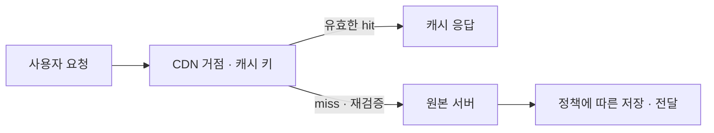

## 1. 개요

CDN(Content Delivery Network, 콘텐츠 전송 네트워크)은 여러 지역에 분산된 서버를 통해 콘텐츠를 전달하는 네트워크이다.

웹 콘텐츠를 사용자에게 효율적으로 전달하기 위해 여러 위치의 서버를 활용한다. 이미지·영상·정적 파일 등의 캐시를 사용자 요청을 처리하기 좋은 위치에서 제공해 응답 지연과 원본 서버의 부담을 줄일 수 있다.[^1]

## 2. 원본 집중 방식과 분산 전달의 차이

모든 사용자가 한 원본 서버에서 콘텐츠를 받으면 사용자와 원본 사이의 거리, 네트워크 연결, 원본 처리 능력이 응답에 영향을 준다. CDN은 여러 거점이 요청을 받고, 재사용 가능한 콘텐츠를 캐시에 두어 원본까지 가야 하는 요청을 줄이는 방식이다.[^1][^2]

예를 들어 여러 지역의 사용자가 같은 상품 이미지를 요청하면 거점에 저장된 이미지를 재사용할 수 있다. 반대로 사용자별 주문 내역은 사용자와 권한에 따라 내용이 달라지므로 같은 응답을 모두에게 재사용하면 안 된다. CDN은 원본을 복사해 놓는 단순한 저장소가 아니라 어떤 요청에 어떤 응답을 재사용할지 결정하는 전달 계층이다.

캐시 키는 재사용 가능한 응답을 구별하는 기준이다. 같은 경로여도 쿼리 문자열·쿠키·헤더에 따라 내용이 달라지면 그 차이를 반영해야 한다. 내용과 무관한 값을 모두 키에 넣으면 같은 콘텐츠가 여러 캐시 항목으로 나뉘어 재사용률이 낮아질 수 있다.[^d-key]

## 3. 주요 구성 요소

| 요소 | 역할 |
|---|---|
| Origin | 원본 콘텐츠를 제공하는 서버나 저장소 |
| Edge·POP | 사용자 요청을 받아 콘텐츠를 전달하는 분산 거점 |
| Cache | 재사용 가능한 응답을 저장하는 공간 |

Amazon CloudFront는 CDN 서비스의 한 예이다. CloudFront는 지연 시간 등을 고려한 거점으로 요청을 보내고, 캐시에 없으면 원본에서 가져와 전달한다.[^2]

## 4. 요청 처리 흐름

1. 사용자가 CDN 주소로 콘텐츠를 요청한다.
2. CDN이 요청을 처리할 거점으로 연결한다.
3. 유효한 캐시가 있으면 해당 응답을 전달한다.
4. 캐시가 없으면 원본에 요청하고 응답을 전달한다. 설정상 캐시 가능한 응답은 이후 요청을 위해 저장한다.

CDN 거점은 반드시 지리적으로 가장 가까운 서버만을 의미하지 않는다. 네트워크 상태와 서비스의 라우팅 정책이 영향을 준다.[^2]

## 5. 캐시의 유효기간과 재검증

CloudFront 같은 서비스는 사용자 요청을 받는 거점과 원본 사이에 리전별 엣지 캐시(regional edge cache) 같은 중간 계층을 사용할 수도 있다. 모든 요청이 같은 수의 서버를 거치는 것은 아니다.[^2]

TTL이 지나면 내용이 무조건 삭제되거나 원본의 내용이 자동으로 모든 거점에 복사되는 것이 아니다. 다음 요청에서 원본의 ETag·수정 시각 등으로 재검증할 수 있고, 변경이 없으면 304 응답을 통해 기존 내용을 재사용할 수 있다. 무효화는 해당 캐시를 더 이상 사용하지 않도록 하는 별도 동작이고 stale 제공은 오류·재검증 조건에 따라 만료된 응답을 허용하는 동작이다.[^v-cache]

이는 캐시 처리의 개념도이며 모든 CDN의 내부 구현을 고정하는 그림은 아니다.

## 6. 캐시와 원본 저장소

캐시 키, 유효기간과 캐시 무효화 정책은 콘텐츠의 최신성에 영향을 준다. 개인별 응답이나 인증이 필요한 데이터는 요청 조건과 캐시 정책을 함께 설계해야 한다.

[[Object Storage|오브젝트 스토리지]]는 원본 데이터를 보관하고 CDN은 사용자에게 전달하는 역할을 맡을 수 있다. 예를 들어 CloudFront는 Amazon S3 또는 HTTP 서버를 원본으로 사용할 수 있다.[^2] [[NGOS]]·[[ZIOS]]를 특정 CDN과 연결할 수 있는지는 엔드포인트·인증·원본 지원 조건을 별도로 확인해야 한다.

CDN 캐시는 원본 데이터의 백업을 대체하지 않는다. 원본 보관과 복구 계획은 별도로 관리한다.

CDN이 처리하는 콘텐츠가 모두 캐시되는 것은 아니다. 동적 응답을 전달하면서 캐시하지 않도록 설정할 수도 있다. CloudFront는 캐시 기간과 요청 정책을 통해 이런 동작을 조절한다.[^v-cache]

캐시는 만료 전에도 제거될 수 있으므로 영구 보존을 보장하지 않는다. 원본 오류 때 만료된 콘텐츠를 제공하는 기능도 조건과 설정에 따른 동작이며, 독립적인 데이터 보존·복구 수단은 아니다.[^v-cache]

## 7. 관련 문서

- [[Object Storage|오브젝트 스토리지]]
- [[NGOS]]
- [[ZIOS]]

- [[Web Server]]

- [[Networking]]

## 8. 출처

[^1]: [AWS — What is a CDN?](https://aws.amazon.com/what-is/cdn/)
[^2]: [AWS — How CloudFront delivers content](https://docs.aws.amazon.com/AmazonCloudFront/latest/DeveloperGuide/HowCloudFrontWorks.html)

[^v-cache]: [AWS — CloudFront cache expiration](https://docs.aws.amazon.com/AmazonCloudFront/latest/DeveloperGuide/Expiration.html)

[^d-key]: [AWS — CloudFront cache key](https://docs.aws.amazon.com/AmazonCloudFront/latest/DeveloperGuide/understanding-the-cache-key.html)

## 둘러보기

[[Knowledge Base/index|전체 개념 목록]] · [[Networking 분류|Networking]]
