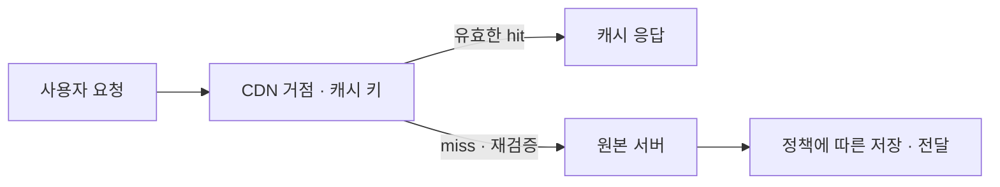

## 1. 개요

CDN(Content Delivery Network, 콘텐츠 전송 네트워크)은 여러 지역에 분산된 서버를 통해 콘텐츠를 전달하는 네트워크이다.

웹 콘텐츠를 사용자에게 효율적으로 전달하기 위해 여러 위치의 서버를 활용한다. 이미지·영상·정적 파일 등의 캐시를 사용자 요청을 처리하기 좋은 위치에서 제공해 응답 지연과 원본 서버의 부담을 줄일 수 있다.[^1]

## 2. 주요 구성 요소

| 요소 | 역할 |
|---|---|
| Origin | 원본 콘텐츠를 제공하는 서버나 저장소 |
| Edge·POP | 사용자 요청을 받아 콘텐츠를 전달하는 분산 거점 |
| Cache | 재사용 가능한 응답을 저장하는 공간 |

Amazon CloudFront는 CDN 서비스의 한 예이다. CloudFront는 지연 시간 등을 고려한 거점으로 요청을 보내고, 캐시에 없으면 원본에서 가져와 전달한다.[^2]

## 3. 요청 처리 흐름

1. 사용자가 CDN 주소로 콘텐츠를 요청한다.
2. CDN이 요청을 처리할 거점으로 연결한다.
3. 유효한 캐시가 있으면 해당 응답을 전달한다.
4. 캐시가 없으면 원본에 요청하고 응답을 전달한다. 설정상 캐시 가능한 응답은 이후 요청을 위해 저장한다.

CDN 거점은 반드시 지리적으로 가장 가까운 서버만을 의미하지 않는다. 네트워크 상태와 서비스의 라우팅 정책이 영향을 준다.[^2]

## 4. 캐시와 원본 저장소

캐시 키, 유효기간과 캐시 무효화 정책은 콘텐츠의 최신성에 영향을 준다. 개인별 응답이나 인증이 필요한 데이터는 요청 조건과 캐시 정책을 함께 설계해야 한다.

[[Object Storage|오브젝트 스토리지]]는 원본 데이터를 보관하고 CDN은 사용자에게 전달하는 역할을 맡을 수 있다. 예를 들어 CloudFront는 Amazon S3 또는 HTTP 서버를 원본으로 사용할 수 있다.[^2] [[NGOS]]·[[ZIOS]]를 특정 CDN과 연결할 수 있는지는 엔드포인트·인증·원본 지원 조건을 별도로 확인해야 한다.

CDN 캐시는 원본 데이터의 백업을 대체하지 않는다. 원본 보관과 복구 계획은 별도로 관리한다.

CDN이 처리하는 콘텐츠가 모두 캐시되는 것은 아니다. 동적 응답을 전달하면서 캐시하지 않도록 설정할 수도 있다. CloudFront는 캐시 기간과 요청 정책을 통해 이런 동작을 조절한다.[^v-cache]

캐시는 만료 전에도 제거될 수 있으므로 영구 보존을 보장하지 않는다. 원본 오류 때 만료된 콘텐츠를 제공하는 기능도 조건과 설정에 따른 동작이며, 독립적인 데이터 보존·복구 수단은 아니다.[^v-cache]

## 5. 요청이 거점과 원본 사이를 이동하는 과정

CDN을 사용하는 호스트 이름의 DNS·라우팅은 요청을 처리할 서비스 거점으로 사용자를 연결한다. 거점은 캐시 키로 재사용할 응답이 있는지 판단하고, 유효한 응답이 있으면 바로 전달한다. 없으면 원본에 요청하며, CloudFront 같은 서비스에서는 regional edge cache 등 중간 계층을 활용할 수도 있다. 모든 요청이 같은 수의 서버를 거친다는 뜻은 아니다.[^2]

TTL이 지나면 내용이 무조건 삭제되거나 원본의 내용이 자동으로 모든 거점에 복사되는 것이 아니다. 다음 요청에서 원본의 ETag·수정 시각 등으로 재검증할 수 있고, 변경이 없으면 304 응답을 통해 기존 내용을 재사용할 수 있다. 무효화는 해당 캐시를 더 이상 사용하지 않도록 하는 별도 동작이고 stale 제공은 오류·재검증 조건에 따라 만료된 응답을 허용하는 동작이다.[^v-cache]

이는 캐시 처리의 개념도이며 모든 CDN의 내부 구현을 고정하는 그림은 아니다.

## 6. 캐시 키가 보안과 성능에 동시에 영향을 주는 이유

원본이 query string·쿠키·헤더에 따라 다른 내용을 반환하면 그 차이를 캐시 식별에 반영해야 한다. 반대로 내용에 영향을 주지 않는 요청 값을 모두 키에 넣으면 같은 응답이 여러 조각으로 나뉘어 hit ratio가 낮아질 수 있다. CloudFront 문서는 응답을 바꾸는 요청 값을 키에 포함하고 불필요한 값은 줄이는 원칙을 설명한다.[^d-key]

원본에 어떤 값을 전달하는지와 캐시 키에 무엇을 넣는지도 별도 판단이다. 예를 들어 인증 쿠키를 원본에 전달해 개인화 응답을 받으면서 이를 여러 사용자에게 같은 캐시 키로 재사용하면 잘못된 응답 공유의 위험이 생긴다. 이는 가능한 설계 오류의 설명이며 모든 인증 응답이 항상 캐시된다는 뜻은 아니다. 개인화·권한이 있는 콘텐츠의 재사용 조건을 먼저 정한다.

운영 지표는 hit ratio·원본 요청 수·원본 응답 지연·첫 바이트 시간·4xx/5xx 오류율을 함께 본다. hit ratio 급락은 키 분산·새 버전 경로·TTL 변화의 단서이고, hit는 빠른데 miss만 느리면 원본이나 원본 연결 경로를 분리할 수 있다. 이전 내용 노출은 TTL·재검증·배포 파일명, 403은 뷰어·원본 인증·접근 정책, 5xx는 원본 서비스·연결·오류 캐시 정책이라는 범위를 비교한다. 긴 TTL은 원본 부하를 줄일 수 있지만 갱신 반영과 보존 정책을 같이 설계해야 한다.

## 7. 관련 문서

- [[Object Storage|오브젝트 스토리지]]
- [[NGOS]]
- [[ZIOS]]

- [[Web Server]]

- [[Networking]]

## 8. 출처

[^1]: [AWS — What is a CDN?](https://aws.amazon.com/what-is/cdn/)
[^2]: [AWS — How CloudFront delivers content](https://docs.aws.amazon.com/AmazonCloudFront/latest/DeveloperGuide/HowCloudFrontWorks.html)

[^v-cache]: [AWS — CloudFront cache expiration](https://docs.aws.amazon.com/AmazonCloudFront/latest/DeveloperGuide/Expiration.html)

[^d-key]: [AWS — CloudFront cache key](https://docs.aws.amazon.com/AmazonCloudFront/latest/DeveloperGuide/understanding-the-cache-key.html)

## 둘러보기

[[Knowledge Base/index|전체 개념 목록]] · [[Networking 분류|Networking]]
