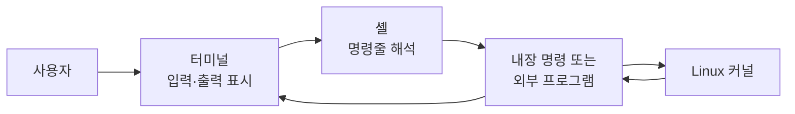
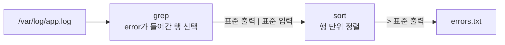

## 목차

- [[#1. 개요|1. 개요]]
- [[#2. 터미널·셸·CLI의 차이|2. 터미널·셸·CLI의 차이]]
- [[#3. 명령·옵션·인수|3. 명령·옵션·인수]]
- [[#4. 셸과 프로그램의 명령 해석 범위|4. 셸과 프로그램의 명령 해석 범위]]
- [[#5. 표준 입력·출력·오류|5. 표준 입력·출력·오류]]
- [[#6. 파이프와 리다이렉션|6. 파이프와 리다이렉션]]
- [[#7. 셸 스크립트와 같은 언어|7. 셸 스크립트와 같은 언어]]
- [[#8. 명령 사용법 확인|8. 명령 사용법 확인]]
- [[#9. 관련 문서|9. 관련 문서]]
- [[#10. 출처|10. 출처]]

## 1. 개요

CLI(Command-Line Interface)는 사용자가 문자로 명령과 옵션·인수를 입력하고 그 결과를 문자 데이터로 받아 컴퓨터를 조작하는 인터페이스 방식이다.

CLI는 특정 프로그램 하나가 아니다. [[Terminal|터미널]]이 문자 입출력을 전달·표시하고, [[Shell|셸]]이 명령줄 문법을 해석하며, `ls`·`grep`·`sort` 같은 프로그램이 실제 기능을 수행하면서 CLI 환경을 이룬다.



## 2. 터미널·셸·CLI의 차이

| 개념 | 역할 | 예시 |
|---|---|---|
| CLI | 문자 명령으로 조작하는 인터페이스 방식 | Linux 명령줄, 네트워크 장비 CLI |
| 터미널 에뮬레이터 | 키 입력을 전달하고 문자·커서·색상을 표시 | xterm, Windows Terminal, MobaXterm의 터미널 부분 |
| 셸 | 명령을 해석하고 프로그램·입출력을 연결 | Bash, Zsh, Fish |
| 명령 프로그램 | 파일 조회·검색·정렬 등 실제 기능 수행 | `ls`, `grep`, `sort` |

MobaXterm은 터미널 에뮬레이터만이 아니라 SSH 클라이언트와 X 서버, SFTP 탐색기 등을 함께 제공한다. SSH 접속에서는 로컬 MobaXterm이 키 입력과 화면을 담당하고, 원격 서버의 `sshd`·의사 터미널(PTY)·셸·명령 프로그램이 실제 Linux 환경에서 동작한다.

```text
키보드 → MobaXterm 터미널·SSH → 네트워크 → sshd → PTY → Bash → 명령 프로그램
```

## 3. 명령·옵션·인수

```bash
ls -la /etc
```

```text
ls       명령 이름
-la      옵션
/etc     인수이자 조회 대상 경로
```

`ls`는 일반적으로 `/usr/bin/ls`에 있는 외부 프로그램이다. 셸에 `alias ls='ls --color=auto'` 같은 별칭이 설정되어 있다면 입력한 이름을 먼저 치환한 뒤 실제 프로그램을 찾는다.

`-la`는 `-l`과 `-a`라는 짧은 옵션을 합친 표현이다. Bash가 각 옵션의 의미를 아는 것이 아니라 `ls` 프로그램의 코드가 이를 해석한다. 같은 `-a`라도 프로그램마다 뜻이 다를 수 있다.

`/etc`는 프로그램 실행 시 실제로 전달한 **인수(argument)**이며, `ls` 문법에서는 조회할 파일·디렉터리인 **피연산자(operand)**이다. 프로그램이나 함수 정의에서 값을 받을 자리를 매개변수(parameter), 실행할 때 그 자리에 전달한 실제 값을 인수라고 구분할 수 있다.

개념적으로 `ls`가 받는 문자열은 다음과 같다.

```text
argv[0] = "ls"
argv[1] = "-la"
argv[2] = "/etc"
```

## 4. 셸과 프로그램의 명령 해석 범위

셸은 공백과 따옴표, 변수, 와일드카드, 파이프와 리다이렉션 같은 **셸 문법**을 먼저 처리한다. 그 뒤 명령 이름을 내장 명령·함수·별칭·외부 프로그램 중에서 찾고, 프로그램이 받을 인수를 전달한다.[^bash]

```bash
grep "error" /var/log/app.log
```

- Bash는 따옴표를 이용해 `error`를 하나의 인수로 묶고 실행할 프로그램을 찾는다.
- `grep`은 전달받은 `error`를 검색 패턴으로, 로그 경로를 검색 대상 파일로 해석한다.
- 따옴표는 셸이 인수를 구성하기 위한 문법이므로 보통 `grep`에는 따옴표 자체가 전달되지 않는다.

따라서 셸이 모든 프로그램의 옵션과 기능을 이해하는 것이 아니다. 셸은 명령줄의 구조와 프로그램 연결을 담당하고, 각 프로그램은 자신의 옵션과 인수 의미를 담당한다.

## 5. 표준 입력·출력·오류

프로세스는 기본적으로 다음 세 통로를 사용할 수 있다.

| 통로 | 번호 | 기본 연결 | 역할 |
|---|---:|---|---|
| 표준 입력(stdin) | 0 | 키보드·터미널 입력 | 프로그램이 읽는 데이터 |
| 표준 출력(stdout) | 1 | 터미널 화면 | 정상 처리 결과 |
| 표준 오류(stderr) | 2 | 터미널 화면 | 오류·진단 메시지 |

정상 출력과 오류를 분리하면 결과는 파일이나 다음 프로그램으로 보내면서 오류는 화면에서 확인할 수 있다. 이 통로의 실제 연결은 셸이 파이프와 파일 기술자를 준비하여 바꿀 수 있다.

## 6. 파이프와 리다이렉션

```bash
grep "error" /var/log/app.log | sort > errors.txt
```

이 명령은 다음 순서와 데이터 흐름을 만든다.



1. `grep`이 파일에서 `error`가 들어간 **행**을 찾는다.
2. `|`가 `grep`의 표준 출력을 `sort`의 표준 입력에 연결한다.
3. `sort`가 전달받은 행들을 정렬한다.
4. `>`가 `sort`의 표준 출력을 터미널 대신 `errors.txt`에 기록한다.

`sort`는 각 행 안의 `error` 문자열만 정렬하는 것이 아니라 `grep`이 출력한 여러 행을 정렬한다. 파이프는 ‘두 명령을 차례로 실행한다’는 의미보다 **앞 프로그램의 데이터 출력을 뒤 프로그램의 입력에 연결한다**는 의미가 핵심이다. 두 프로세스는 파이프로 데이터를 주고받으며 겹쳐 실행될 수도 있다.

`|`와 `>`는 `grep`이나 `sort`의 옵션이 아니라 Bash가 해석하는 문법이다. 셸이 파이프와 출력 파일을 준비한 뒤 각 프로그램을 적절한 표준 입출력에 연결한다.

### 자주 사용하는 연결 문법

| 문법 | 의미 |
|---|---|
| `A \| B` | A의 표준 출력을 B의 표준 입력으로 전달 |
| `A > file` | A의 표준 출력으로 파일을 새로 쓰거나 기존 내용을 덮어씀 |
| `A >> file` | A의 표준 출력을 파일 끝에 추가 |
| `A < file` | 파일 내용을 A의 표준 입력으로 연결 |
| `A 2> file` | A의 표준 오류를 파일에 기록 |
| `A && B` | A가 성공한 경우에만 B 실행 |
| `A || B` | A가 실패한 경우에만 B 실행 |
| `A ; B` | A의 성공 여부와 관계없이 다음으로 B 실행 |
| `A &` | A를 백그라운드 작업으로 시작 |

따라서 `|`가 데이터 연결이라면, 논리적인 ‘그리고 성공하면 다음 명령’에 가까운 문법은 `&&`이다.

## 7. 셸 스크립트와 같은 언어

터미널에서 한 줄씩 입력하는 Bash 명령과 Bash 스크립트는 같은 명령 언어를 사용한다. 파이프·리다이렉션·변수·조건문·반복문을 파일에 모으면 반복 작업을 자동화할 수 있다.

```bash
#!/usr/bin/env bash

grep "error" /var/log/app.log | sort > errors.txt
```

다만 CLI 명령은 조회뿐 아니라 파일 삭제, 권한 변경, 서비스 중지와 같은 실제 변경도 수행할 수 있다. 실행 사용자, 대상 경로, 덮어쓰기 여부와 명령의 종료 상태를 확인해야 한다.

## 8. 명령 사용법 확인

```bash
type -a ls       # 셸이 ls를 어떤 명령으로 해석하는지 확인
command -v grep  # 실행할 명령의 위치·종류 확인
ls --help        # 프로그램의 간단한 옵션 도움말
man ls           # 매뉴얼 페이지
man bash         # Bash 문법과 기능
```

모든 옵션을 외우기보다 명령의 목적과 `명령 [옵션] [대상]` 구조를 이해하고, 필요할 때 공식 도움말과 `man` 페이지를 확인하는 것이 실무적인 사용 방법이다.

## 9. 관련 문서

- [[Linux]], [[Linux Structure|리눅스 구조]], [[Linux Directory Structure|리눅스 디렉터리 구조]]
- [[Terminal|터미널]], [[Shell|셸]], [[Shell Script|셸 스크립트]]
- [[Linux Basic Commands|리눅스 기본 명령어]]
- [[Program and Process|프로그램과 프로세스]], [[Kernel|커널]]

## 10. 출처

[^bash]: [GNU Project — Bash Reference Manual](https://www.gnu.org/software/bash/manual/bash.html)

- [GNU Project — Coreutils Manual](https://www.gnu.org/software/coreutils/manual/coreutils.html)
- [GNU Project — GNU Grep Manual](https://www.gnu.org/software/grep/manual/grep.html)

## 둘러보기

[[Knowledge Base/index|전체 개념 목록]] · [[Compute 분류|Compute]]
