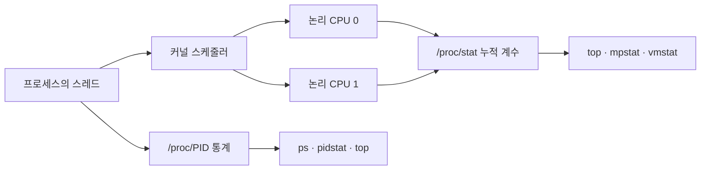
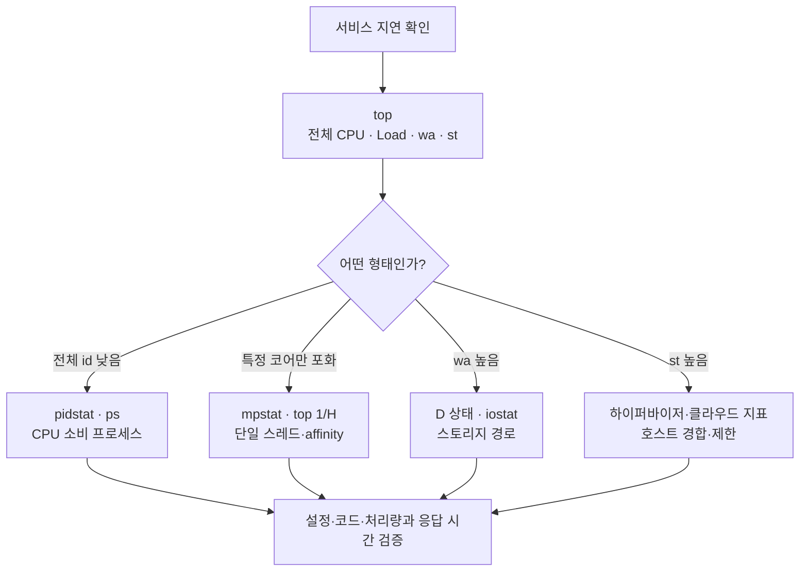

## 1. 개요

CPU 모니터링은 Linux가 기록한 실행 시간을 사용자 코드·커널·유휴·I/O 대기·가상화 대기로 나누고, 코어와 프로세스별 추세를 함께 확인하여 연산 자원이 실제 병목인지 판단하는 과정이다.

평균 CPU 사용률 하나만으로는 단일 코어 포화, 스토리지 지연, VM 호스트 경합을 구분할 수 없다. 실제 CPU 패키지·코어·SMT·vCPU 관계는 [[CPU]]에서, 프로세스와 스케줄러의 관계는 [[Program and Process|프로그램과 프로세스]]에서 다룬다.

## 2. 수치가 만들어지는 경로



도구는 순간을 직접 측정하는 대신 커널의 누적 계수를 일정 간격으로 읽어 그 차이를 비율로 계산하는 경우가 많다. 따라서 한 번의 화면보다 동일한 간격의 반복 관측과 서비스 응답 시간을 함께 보는 편이 좋다.[^cpu-load]

## 3. `top` 화면의 해석

```bash
top
```

```text
top - 14:20:01 up 3 days,  2 users,  load average: 3.80, 2.90, 1.50
Tasks: 210 total, 2 running, 207 sleeping, 0 stopped, 1 zombie
%Cpu(s): 20.0 us, 5.0 sy, 0.0 ni, 65.0 id, 10.0 wa, 0.0 hi, 0.0 si, 0.0 st
MiB Mem : 16384 total,  500 free, 12288 used, 3596 buff/cache
MiB Swap:  4096 total, 3072 free,  1024 used. 3276 avail Mem

 PID USER  PR NI   VIRT   RES  SHR S %CPU %MEM   TIME+ COMMAND
8201 Qbo   20  0  4096m  900m  40m R 100.0  5.5  20:14 myapp
```

상단은 서버 전체, 하단은 프로세스별 상태이다. `1` 키로 논리 CPU별 사용률을, `H` 키로 스레드 단위 목록을 볼 수 있다. `P`는 CPU 사용률순, `M`은 메모리 사용률순 정렬에 흔히 사용된다.[^top]

### CPU 시간 항목

| 항목 | 의미 | 높을 때의 첫 확인 |
|---|---|---|
| `us` | 사용자 공간 프로그램을 실행한 시간 | CPU를 많이 쓰는 프로세스·스레드 |
| `sy` | 커널 코드를 실행한 시간 | 시스템 콜, 패킷, 드라이버, 문맥 교환 |
| `ni` | nice 값이 조정된 사용자 작업 시간 | 낮은 우선순위 계산 작업 |
| `id` | 실행할 작업이 없어 유휴 상태였던 시간 | 높으면 전체 CPU 포화 가능성은 낮음 |
| `wa` | I/O 완료 대기 중 실행할 다른 작업이 없어 유휴로 계산된 시간 | D 상태 작업과 디스크·SAN·NFS 지연 |
| `hi` | 하드웨어 인터럽트 처리 시간 | 장치·네트워크 인터럽트 |
| `si` | 소프트웨어 인터럽트 처리 시간 | 네트워크 패킷 처리 등 |
| `st` | VM이 실행 가능했지만 하이퍼바이저가 물리 CPU를 주지 않은 시간 | 호스트 경합·오버커밋·CPU 제한 |

`wa`는 디스크 사용률 자체가 아니며 멀티코어 환경에서 해석상 한계가 있다. `st`는 다른 프로세스가 같은 VM 안에서 CPU를 사용한 시간이 아니라, 가상화 계층에서 vCPU 실행 기회를 받지 못한 시간이다.[^proc-stat]

## 4. Load Average와 코어 수

```text
load average: 3.80, 2.90, 1.50
              1분   5분   15분
```

Linux의 Load Average는 CPU에서 실행 중이거나 실행을 기다리는 `R` 상태와, 주로 I/O 완료를 기다리는 중단 불가능한 `D` 상태 작업 수의 평균이다.[^loadavg]

CPU 작업만 있다고 단순화하면 4개 논리 CPU에서 Load 4는 네 실행 단위가 바쁜 수준, Load 8은 실행 중인 작업 외에 기다리는 작업이 있을 가능성을 뜻한다. 그러나 `D` 상태도 포함되므로 Load 8만 보고 CPU 부족으로 확정하지 않는다.

```text
Load 높음 + id 낮음 + wa 낮음 → CPU 포화 가능성
Load 높음 + id 높음 + wa 높음 → I/O 대기 가능성
Load 상승 + 특정 코어만 100%   → 단일 스레드 병목 가능성
```

## 5. 프로세스 100%와 전체 100%의 차이

4개 논리 CPU 중 하나를 단일 스레드가 모두 사용하면 다음처럼 보일 수 있다.

```text
CPU 0: 100%  ← myapp
CPU 1:   0%
CPU 2:   0%
CPU 3:   0%
전체 평균: 약 25%
프로세스 myapp: 100%
```

프로세스의 `100%`는 도구 설정에 따라 논리 CPU 하나의 실행 시간을 모두 사용한다는 의미일 수 있다. 멀티스레드 프로세스가 네 논리 CPU를 모두 사용하면 약 `400%`로 표시될 수도 있다. 코어를 추가해도 프로그램이 작업을 병렬로 나눌 수 없거나 잠금·CPU affinity·cgroup 할당량에 묶여 있으면 빨라지지 않는다.

## 6. 명령별 화면과 용도

### 코어별 확인: `mpstat`

```bash
mpstat -P ALL 1
```

```text
14:30:01 CPU  %usr %nice %sys %iowait %irq %soft %steal %idle
14:30:02 all  25.0  0.0   5.0    2.0   0.0   1.0    0.0  67.0
14:30:02   0  96.0  0.0   3.0    0.0   0.0   1.0    0.0   0.0
14:30:02   1   2.0  0.0   1.0    1.0   0.0   0.0    0.0  96.0
```

`all`은 전체 평균이고 숫자 행은 논리 CPU별 결과이다. 이 예시는 전체 평균만 보면 여유가 있지만 CPU 0 하나가 포화된 상태이다. `mpstat`는 보통 `sysstat` 패키지에 포함된다.[^mpstat]

### 프로세스 변화: `pidstat`

```bash
pidstat -u 1
```

```text
Time      UID   PID  %usr %system %guest %wait %CPU CPU Command
14:31:01 1001  8201  94.0    5.0    0.0   0.0 99.0   0 myapp
```

- `%usr`, `%system`: 해당 작업의 사용자·커널 CPU 사용
- `%wait`: 실행 가능했지만 CPU를 기다린 시간의 비율
- `%CPU`: 해당 작업의 총 CPU 비율
- `CPU`: 표본 시점에 실행된 프로세서 번호

`pidstat -t -p 8201 1`은 해당 프로세스의 스레드를 나누어 관찰할 때 유용하다.[^pidstat]

### 순간 목록: `ps`

```bash
ps -eo pid,ppid,stat,psr,comm,%cpu --sort=-%cpu | head
```

```text
 PID  PPID STAT PSR COMMAND %CPU
8201     1 Rl     0 myapp   99.2
 842     1 Ss     2 sshd     0.2
```

`STAT`은 프로세스 상태, `PSR`은 최근 실행된 논리 CPU이다. `ps`의 CPU 비율은 실행 이후의 누적 비율 성격이 있어 `pidstat 1`의 구간 측정과 같지 않을 수 있다.

### 시스템 흐름: `vmstat`

```bash
vmstat 1
```

```text
procs --------memory-------- ---swap-- -----io---- -system-- ------cpu-----
 r  b   swpd  free buff cache   si so    bi   bo   in   cs us sy id wa st
 6  0      0  900m 120m 3.2g    0  0     2   10 1200 2400 80 10 10  0  0
```

CPU 분석에서는 `r` 실행 대기 작업, `b` 중단 불가능 대기 작업, `us·sy·id·wa·st`와 문맥 교환 `cs`를 함께 본다. 첫 행은 부팅 이후 평균일 수 있으므로 반복 출력의 이후 행을 중심으로 본다.[^vmstat]

### 과거 추세와 코드 수준 분석

```bash
sar -u 1 5       # 짧은 구간 CPU 표본 또는 수집된 과거 기록
perf top         # 권한과 도구가 준비된 환경에서 함수별 CPU 소비 관찰
```

`sar`는 사전에 통계 수집이 설정되어 있어야 과거 시점을 조회할 수 있다. `perf`는 운영 성능과 보안 정책에 영향을 줄 수 있으므로 승인된 환경에서 사용한다.

## 7. 실무 진단 흐름



고정된 숫자 하나를 모든 서버의 장애 기준으로 사용하지 않는다. 정상 시간대의 기준선, 코어 수, 워크로드 종류, 실제 응답 시간과 함께 판단한다.

## 8. 관련 문서

- [[CPU]] · [[Program and Process|프로그램과 프로세스]] · [[Kernel|커널]]
- [[Hypervisor|하이퍼바이저]] · [[Virtual Machine|가상 머신]] · [[Memory Monitoring|메모리 모니터링]]
- [[Disk|디스크]] · [[Linux Logging|Linux 로그]] · [[Server|서버]]

## 9. 출처

[^cpu-load]: Linux Kernel, [CPU load](https://docs.kernel.org/admin-guide/cpu-load.html).
[^top]: Linux man-pages, [`top(1)`](https://man7.org/linux/man-pages/man1/top.1.html).
[^proc-stat]: Linux man-pages, [`proc_stat(5)`](https://man7.org/linux/man-pages/man5/proc_stat.5.html).
[^loadavg]: Linux man-pages, [`proc_loadavg(5)`](https://man7.org/linux/man-pages/man5/proc_loadavg.5.html).
[^mpstat]: Linux man-pages, [`mpstat(1)`](https://man7.org/linux/man-pages/man1/mpstat.1.html).
[^pidstat]: Linux man-pages, [`pidstat(1)`](https://man7.org/linux/man-pages/man1/pidstat.1.html).
[^vmstat]: Linux man-pages, [`vmstat(8)`](https://man7.org/linux/man-pages/man8/vmstat.8.html).

## 둘러보기

[[Knowledge Base/index|전체 개념 목록]] · [[Compute 분류|Compute]]
