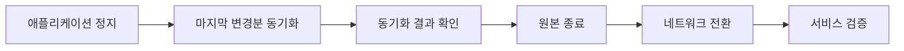

## 목차

- [[#1. 개요|1. 개요]]
- [[#2. 전환을 별도 단계로 구분하는 이유|2. 전환을 별도 단계로 구분하는 이유]]
- [[#3. 전환 순서의 예|3. 전환 순서의 예]]
- [[#4. 원본 종료와 보존|4. 원본 종료와 보존]]
- [[#5. 네트워크 전환과 DNS TTL|5. 네트워크 전환과 DNS TTL]]
- [[#6. 중단 시간을 좌우하는 요소|6. 중단 시간을 좌우하는 요소]]
- [[#7. 롤백|7. 롤백]]
- [[#8. 비슷한 용어와의 구분|8. 비슷한 용어와의 구분]]
- [[#9. 관련 문서|9. 관련 문서]]
- [[#10. 출처|10. 출처]]

## 1. 개요

Cutover는 마이그레이션에서 원본을 멈추고 마지막 데이터를 반영한 뒤, 서비스를 새 환경으로 넘기는 최종 전환 단계이다.[^3]

이사에 견주면 가구와 짐은 미리 새집으로 옮겨 둘 수 있지만, 계속 쓰는 냉장고처럼 마지막까지 쓰는 물건은 이사 당일에 옮기고 열쇠를 바꿔야 한다. 서버도 데이터를 미리 복제해 둘 수 있지만, 사용자의 요청을 받는 위치를 바꾸는 순간에는 서비스를 잠시 쓸 수 없는 구간이 생긴다. 이 구간을 흔히 cutover window라고 부르며, RackWare도 이 구간을 줄이는 것을 목표로 소개한다.[^1]

## 2. 전환을 별도 단계로 구분하는 이유

원본이 운영되는 동안에도 데이터는 계속 바뀐다. 처음 복제를 끝낸 시점의 새 환경은 이미 원본보다 오래된 사본이므로, 그대로 서비스를 옮기면 그 사이의 변경분이 사라진다.

그래서 이전은 보통 초기 복제, [[Delta Sync|변경분 동기화]]의 반복, 마지막 동기화와 전환의 순서로 진행한다. 변경분 동기화를 미리 반복해 두면 마지막에 옮길 양이 줄어서 전환 구간을 짧게 하는 데 도움이 된다.[^1] 다만 정지, 기동, 네트워크 전환은 변경분이 작아도 그대로 남는다.

## 3. 전환 순서의 예

전환의 세부 순서는 도구마다 다르다. IBM Cloud의 RackWare 이전 튜토리얼은 아래 순서를 안내한다.[^2]

- 애플리케이션 정지: 애플리케이션과 데이터베이스를 멈추고, 다른 사용자를 로그아웃시키고, 디스크에 아직 반영되지 않은 쓰기를 마무리한다.
- 마지막 변경분 동기화: 직전 동기화 이후 바뀐 내용만 새 환경에 반영한다. 이 예시에서는 RMM이 Linux는 LVM 스냅샷, Windows는 VSS 스냅샷을 만들어 한 시점의 일관된 상태를 확보한다.[^2]
- 동기화 결과 확인: 관리 화면에서 오류 없이 끝났는지 확인한다.
- 원본 종료: 원본 가상 머신을 끈다.
- 네트워크 전환: 사용자의 접속 위치를 새 환경으로 바꾼다.
- 서비스 검증: 애플리케이션 동작, 데이터 정합성, 성능, 사용자 접근을 확인한다.

원본을 끄는 시점은 도구마다 다르다. 위 예시는 마지막 동기화를 확인한 뒤 원본을 끄지만, Azure Migrate는 기본값으로 원본 가상 머신을 먼저 종료하고 그 뒤에 변경분을 동기화한다.[^4] Google Cloud의 Migrate to Virtual Machines도 원본을 멈춘 뒤 복제를 마무리하는 순서이다.[^3] 따라서 위 순서는 하나의 예시이며 모든 환경의 표준은 아니다.

## 4. 원본 종료와 보존

원본은 전환 과정에서 끄지만 바로 삭제하지는 않는다. 새 환경에 문제가 생겼을 때 되돌릴 대상이 필요하기 때문이다. 원본을 종료하는 목적을 직접 설명한 출처는 확인하지 못했다. 다만 원본과 새 환경이 동시에 서비스를 제공하면 같은 데이터를 두 곳에서 쓰는 혼선이 생길 수 있으므로, 한쪽만 운영 상태로 남기는 것이 일반적인 이해이다.

원본을 얼마나 오래 보존해야 하는지에 대한 표준 기간은 확인하지 못했다. 보존 기간은 롤백 기준과 함께 사전에 정해 두어야 하는 항목이다.

## 5. 네트워크 전환과 DNS TTL

사용자는 보통 주소 숫자가 아니라 이름(도메인)으로 접속하고, DNS는 그 이름이 가리키는 주소를 일정 시간 기억해 둔다. 이 기억 시간이 TTL이다. TTL이 길면 주소를 바꿔도 일부 사용자는 한동안 옛 주소로 접속한다.[^5]

그래서 사용 중인 이름은 전환 전에 TTL을 짧게 낮춰 두고, 전환이 확인된 뒤 다시 늘리는 방식이 안내된다.[^5] 다만 사용자의 단말과 중간 장비가 TTL보다 오래 캐시를 보관할 수 있어서 변경이 5분 이상 걸릴 수도 있다.[^6]

전환 방법은 환경에 따라 다르다. IBM 예시에서는 기존에 두 환경을 연결해 둔 방식에 따라 라우팅 변경, Transit Gateway의 prefix 필터 제거, VPN 트래픽 방향 변경 같은 방법을 들며 DNS를 직접 다루지는 않는다.[^2]

## 6. 중단 시간을 좌우하는 요소

Cutover의 중단 시간은 고정된 값이 아니며, 아래 요소가 전환 구간에 얼마나 포함되는지에 따라 길어진다. 아래 표에는 앞서 설명한 IBM 예시의 단계를 정리했다.[^2]

| 요소 | 영향 |
|---|---|
| 마지막 변경분의 양 | 직전 동기화 이후 데이터가 많이 바뀔수록 마지막 동기화가 길어짐 |
| 애플리케이션 종료와 기동 시간 | 데이터베이스 종료와 서비스 재시작이 오래 걸리면 중단이 길어짐 |
| 네트워크 전환 방식 | 경로 변경이나 DNS 캐시 갱신에 걸리는 시간이 더해짐 |
| 검증 범위 | 검증을 서비스 재개 전에 하는지 후에 하는지는 정책 선택이며, 검증에 실패하면 롤백 기준에 따라 원본으로 되돌림 |

RackWare는 연속 동기화 모드에서 near-zero RPO/RTO를 내세우지만 구체적인 수치와 조건은 제시하지 않는다.[^1] RPO(복구 시점 목표)는 전환이나 장애 시 허용하는 데이터 손실의 폭이고, RTO(복구 시간 목표)는 서비스가 돌아오기까지 허용하는 시간이다. 이런 문구는 실제 환경에서 측정한 중단 시간과 구분해서 읽어야 한다.

## 7. 롤백

롤백은 새 환경을 내리고 보존해 둔 원본을 다시 기동한 뒤 접속 위치를 되돌리는 절차이다. RackWare는 예약 실행과 롤백 기능을 소개하지만 세부 절차는 설명하지 않는다.[^1]

롤백 방식의 구체적인 예는 Google Cloud 문서에서 볼 수 있다. 이 문서는 새 가상 머신을 삭제하고 원본 가상 머신을 다시 시작하는 것을 롤백으로 설명하며, 이 과정이 자동으로 이루어지지 않는다고 밝힌다. 또한 전환 뒤 새 인스턴스에 쓰인 데이터는 원본으로 되돌려 반영되지 않는다.[^3] 따라서 되돌리기로 판단하는 기준, 되돌릴 수 있는 한계 시점, 전환 뒤 새로 쓰인 데이터의 처리 방침을 미리 정해 두어야 한다.

## 8. 비슷한 용어와의 구분

| 용어 | 의미 |
|---|---|
| Cutover | 계획된 시점에 서비스를 새 환경으로 넘기는 최종 전환 작업 |
| Failover | 운영 서버에 장애가 났을 때 대기 서버로 넘어가는 전환. 이전 운영 서버가 다시 살아나면 둘 다 운영 서버라고 여기는 split-brain 위험이 있음[^7] |
| Switchover | 점검 등을 위해 계획적으로 운영과 대기의 역할을 바꾸는 전환[^7] |
| Wave | 함께 이전하는 서버의 묶음. 하나 또는 여러 호스트로 구성되며 Cutover는 wave 단위로 실행할 수 있음[^2] |

Failover는 장애 대응 목적이라 최신 데이터의 일부를 잃을 수 있는 경우가 많고, 마이그레이션의 Cutover는 사전에 계획하고 마지막 변경분까지 반영하는 점에서 목적이 다르다. 데이터 손실 여부는 복제 방식에 따라 달라진다.[^7]

## 9. 관련 문서

- [[Rackware|RackWare]]

- [[Delta Sync]]

- [[Server Migration Types]]

- [[Server]]

- [[Networking]]

## 10. 출처

[^1]: [RackWare — Multi-Cloud Migration](https://www.rackwareinc.com/rackware-platform/migration). 벤더 소개 자료이다.
[^2]: [IBM Cloud — Migrating VMware VCF Classic to IBM Cloud VPC by using RackWare RMM](https://cloud.ibm.com/docs/virtualization-solutions?topic=virtualization-solutions-virt-sol-vpc-migration-design-rmm-tutorial). IBM Cloud 대상의 구체적인 예시이다.
[^3]: [Google Cloud — Migrate to Virtual Machines lifecycle](https://docs.cloud.google.com/migrate/virtual-machines/docs/5.0/discover/lifecycle)
[^4]: [Microsoft Learn — Migrate VMware VMs to Azure (agentless)](https://learn.microsoft.com/en-us/azure/migrate/tutorial-migrate-vmware)
[^5]: [AWS — Values specific for basic records (Route 53)](https://docs.aws.amazon.com/Route53/latest/DeveloperGuide/resource-record-sets-values-basic.html)
[^6]: [Cloudflare — Time to Live (TTL)](https://developers.cloudflare.com/dns/manage-dns-records/reference/ttl/)
[^7]: [PostgreSQL — Failover](https://www.postgresql.org/docs/current/warm-standby-failover.html)

## 둘러보기

[[Knowledge Base/index|전체 개념 목록]] · [[Cloud 분류|Cloud]]
