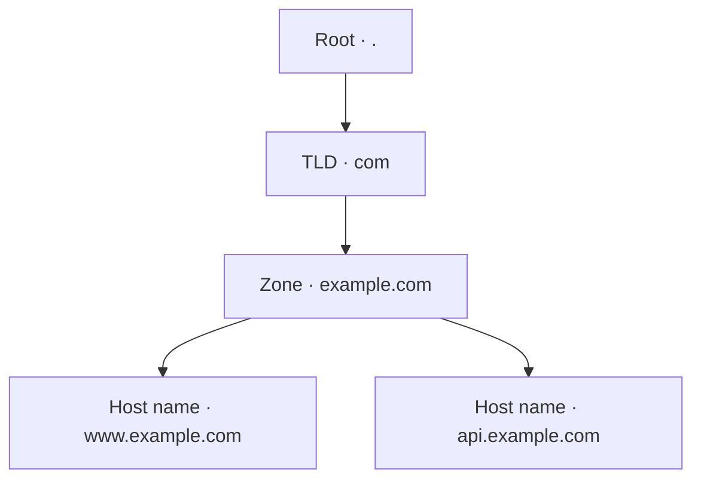
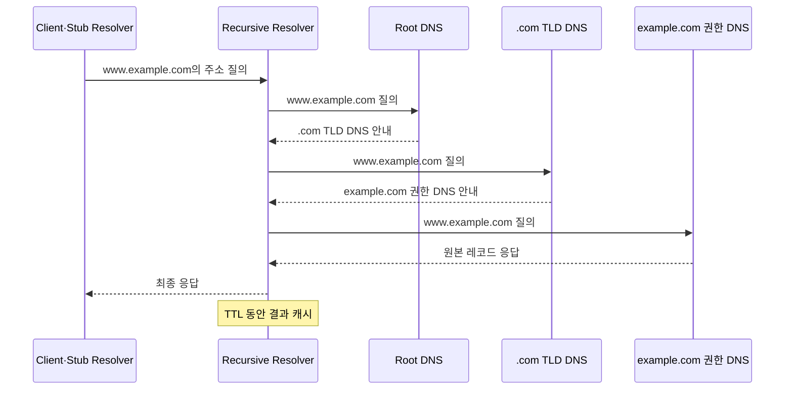

## 목차

- [[#1. 개요|1. 개요]]
- [[#2. 등장 배경과 핵심 구조|2. 등장 배경과 핵심 구조]]
- [[#3. 계층과 위임|3. 계층과 위임]]
- [[#4. DNS 서버의 역할과 실체|4. DNS 서버의 역할과 실체]]
- [[#5. 이름 조회 과정|5. 이름 조회 과정]]
- [[#6. 캐시와 TTL|6. 캐시와 TTL]]
- [[#7. 레코드의 의미|7. 레코드의 의미]]
- [[#8. 장애와 운영 설계|8. 장애와 운영 설계]]
- [[#9. 흔한 오해|9. 흔한 오해]]
- [[#10. 관련 문서|10. 관련 문서]]
- [[#11. 출처|11. 출처]]

## 1. 개요

DNS(Domain Name System)는 계층적으로 나눈 이름 공간의 관리 권한을 여러 조직에 위임하고, 이름에 연결된 정보를 분산하여 저장·조회하는 시스템이다.

DNS는 흔히 `도메인 이름을 IP 주소로 바꾸는 전화번호부`라고 설명한다. 이 비유는 조회 결과를 이해하는 데는 유용하지만 DNS의 핵심 구조를 모두 설명하지 못한다. DNS의 본질은 **하나의 중앙 서버가 모든 이름을 관리하지 않고, 이름 공간을 계층적으로 나누어 각 조직이 자신의 영역을 관리하도록 위임한 분산 데이터베이스**라는 데 있다.[^rfc1034]

DNS는 주소를 알려줄 뿐, 사용자의 HTTP 요청이나 파일을 목적지까지 운반하지 않는다. 이름을 주소로 해석한 뒤의 실제 통신은 [[IP Address and Subnet|IP 주소]], [[Router|라우팅]], TCP·UDP, 방화벽과 애플리케이션이 담당한다.

## 2. 등장 배경과 핵심 구조

초기 인터넷에서는 중앙의 `HOSTS.TXT` 파일에 호스트 이름과 주소를 기록해 배포했다. 호스트와 변경 요청이 늘어나자 한 파일을 중앙에서 관리·배포하는 방식은 확장하기 어려워졌다. DNS는 이름 공간을 계층화하고 관리 권한을 분산하여 이 문제를 해결하도록 설계되었다.[^rfc1034]

DNS 구조는 다음 네 요소가 결합된 결과이다.

1. **Namespace·이름 공간**: `www.example.com`과 같은 계층적 이름 체계
2. **Delegation·위임**: 상위 영역이 하위 영역의 관리 주체를 지정하는 구조
3. **Distributed Storage·분산 저장**: 각 조직이 자신의 Zone 데이터를 보관하는 구조
4. **Caching·캐시**: 조회 결과를 일정 시간 재사용하여 부하와 지연을 줄이는 구조

쉽게 설명하면 DNS는 전 세계 정보를 한 권에 모은 전화번호부가 아니라, 상위 안내소가 담당 기관을 알려주고 각 기관이 자기 구역의 원본 장부를 관리하는 체계에 가깝다.

## 3. 계층과 위임

`www.example.com.`은 오른쪽에서 왼쪽으로 관리 범위가 구체화된다. 마지막 점은 Root를 나타내지만 일상적인 표기에서는 생략하는 경우가 많다.



Root DNS가 전 세계 호스트의 최종 주소를 모두 보관하는 것은 아니다. Root는 `.com`을 담당하는 TLD DNS를 안내하고, `.com` TLD DNS는 `example.com`의 권한 DNS를 안내한다. 최종 원본 레코드는 해당 Zone의 Authoritative DNS가 제공한다.

### Domain과 Zone의 구분

Domain은 이름 공간에서 어떤 이름 아래에 있는 전체 영역을 뜻한다. Zone은 특정 관리자가 실제로 책임지고 DNS 데이터를 제공하는 관리 범위이다.

예를 들어 `example.com` 관리자가 `dev.example.com`을 다른 DNS 운영자에게 위임하면, 이름으로는 `example.com` 아래에 있지만 DNS 관리 범위는 별도의 Zone이 될 수 있다.

```text
이름 계층
example.com
└── dev.example.com

관리 범위
example.com Zone      → 운영자 A
dev.example.com Zone  → 운영자 B에게 위임
```

## 4. DNS 서버의 역할과 실체

DNS 서버는 특별한 종류의 물리 장비라기보다 일반 서버·VM·네트워크 장비에서 실행되는 DNS 프로그램과 데이터의 조합이다. BIND, Unbound, PowerDNS, Microsoft DNS Server와 dnsmasq 등이 대표적인 구현이다.

```text
DNS 서버
├── 물리 서버·VM·네트워크 장비
├── 운영체제
├── DNS 프로세스
└── Zone 데이터 또는 Resolver 캐시
```

Authoritative DNS와 Recursive Resolver는 장비 이름이 아니라 **역할**을 구분하는 용어이다.

| 역할 | 책임 |
|---|---|
| Stub Resolver | 애플리케이션의 요청을 받아 설정된 Recursive Resolver로 전달 |
| Recursive Resolver | 캐시를 확인하고 필요한 DNS 서버를 대신 찾아 최종 답을 구함 |
| Root DNS | TLD DNS의 위치를 안내 |
| TLD DNS | 하위 Domain의 권한 DNS를 안내 |
| Authoritative DNS | 자신이 책임지는 Zone의 원본 레코드로 답변 |

하나의 프로그램이 Recursive와 Authoritative 역할을 함께 수행하도록 구성할 수도 있다. 그러나 공개 권한 DNS와 내부 Resolver는 보안·부하·장애 범위가 다르므로 운영 환경에서는 역할을 분리하는 경우가 많다.

Linux의 `/etc/resolv.conf`에 있는 `nameserver` 항목은 현재 컴퓨터를 DNS 서버로 만드는 설정이 아니다. 이 컴퓨터가 질의를 보낼 Resolver 주소를 지정하는 클라이언트 설정이다. `127.0.0.53`이 보인다면 로컬의 `systemd-resolved` Stub이 상위 Resolver로 질의를 전달하는 구성일 수 있다.

## 5. 이름 조회 과정

Recursive Resolver의 캐시가 비어 있고 사용자가 `www.example.com`을 처음 조회하는 단순한 흐름은 다음과 같다.



Root와 TLD의 응답은 최종 주소가 아니라 다음 담당자를 알려주는 Referral이다. Recursive Resolver가 이 과정을 대신 수행하므로 일반 사용자의 PC가 Root부터 모든 서버에 직접 질의할 필요는 없다.

DNS는 일반적으로 53번 포트의 UDP와 TCP를 사용한다. 응답 크기, 재시도, Zone 전송과 암호화 방식 등 조건에 따라 실제 전송 방식은 달라질 수 있으므로 DNS를 UDP 전용 프로토콜로 단정하지 않는다.[^rfc1035]

## 6. 캐시와 TTL

TTL(Time To Live)은 Resolver가 DNS 응답을 재사용할 수 있는 시간을 나타낸다. 캐시는 Root·TLD·권한 DNS의 부하를 줄이고 사용자의 조회 지연을 줄인다.

```text
api.example.com → 203.0.113.10
TTL             → 3,600초
```

관리자가 원본 레코드를 `203.0.113.20`으로 바꾸어도, 이전 답을 받아 둔 Resolver는 남은 TTL 동안 기존 주소를 반환할 수 있다.

```text
Resolver A: 기존 캐시 2시간 남음  → 이전 주소
Resolver B: 캐시 만료              → 새 주소 조회
Resolver C: 처음 조회              → 새 주소 조회
```

흔히 말하는 `DNS 전파`는 새로운 정보가 한 중앙 서버에서 세계로 순서대로 복사되는 모습이라기보다, 여러 Resolver와 클라이언트에 남아 있는 이전 답이 각자의 TTL에 따라 만료되는 과정인 경우가 많다. 존재하지 않는 이름이라는 부정 응답도 일정 시간 캐시될 수 있다.[^rfc2308]

서비스 전환 직전에 TTL을 낮춰도 이미 저장된 긴 TTL에는 소급 적용되지 않는다. 계획된 전환에서는 기존 TTL이 만료될 수 있도록 미리 값을 낮추고, 전환 후에도 이전 주소를 사용하는 사용자를 고려하여 기존 환경을 일정 시간 유지한다. 이 과정은 [[Cutover|컷오버]]와 직접 연결된다.

## 7. 레코드의 의미

DNS는 이름과 IP 주소만 저장하지 않는다. 레코드는 이름에 연결된 정보의 **종류와 값**을 표현한다.

| 레코드 | 주요 의미 |
|---|---|
| A | 이름에 대응하는 IPv4 주소 |
| AAAA | 이름에 대응하는 IPv6 주소 |
| CNAME | 다른 정규 이름을 가리키는 별칭 |
| NS | Zone을 담당하는 권한 DNS 서버 |
| MX | 메일을 받을 서버와 우선순위 |
| TXT | 정책 검증 등에서 사용하는 문자열 정보 |
| SRV | 특정 서비스의 호스트와 포트·우선순위 |

레코드는 `누구에게 어떤 질문을 했는가`에 따라 의미가 달라진다. DNS가 A 레코드를 반환했다고 해서 해당 주소로 가는 경로, 방화벽 허용, 서버 프로세스와 애플리케이션 정상 상태까지 보장되는 것은 아니다.

## 8. 장애와 운영 설계

권한 DNS가 잠시 중단되어도 Recursive Resolver의 유효한 캐시가 남아 있다면 일부 사용자는 계속 기존 답을 받을 수 있다. 그러나 캐시가 없거나 TTL이 만료된 Resolver는 새 답을 얻지 못할 수 있다.

DNS는 서비스 진입점이므로 다음 구조를 함께 고려한다.

- 여러 권한 DNS 서버와 서로 다른 장애 영역
- Recursive Resolver의 이중화
- Zone 데이터 동기화와 변경 관리
- 적절한 TTL과 전환 계획
- 내부 이름과 외부 이름의 관리 범위
- DNS 서버까지의 라우팅·방화벽·보안 정책

작은 네트워크에서는 라우터나 방화벽의 dnsmasq가 로컬 이름 해석·전달·캐시를 함께 맡을 수 있다. 규모와 가용성 요구가 커지면 [[내부 DNS 배치 기준]]처럼 역할 분리와 장애 범위를 다시 판단한다.

## 9. 흔한 오해

- **Root DNS가 최종 IP 주소를 모두 보관한다는 생각**: Root는 주로 TLD 담당자를 안내한다.
- **DNS 서버는 전용 장비라는 생각**: 일반 서버·VM·라우터에서 실행되는 소프트웨어 서비스일 수 있다.
- **`/etc/resolv.conf`를 설정하면 DNS 서버가 된다는 생각**: 질의를 보낼 Resolver를 지정하는 클라이언트 설정이다.
- **DNS 변경은 전 세계 서버에 새 값을 복사하는 과정이라는 생각**: 기존 캐시가 서로 다른 시점에 만료되는 영향이 크다.
- **TTL을 전환 직전에 낮추면 즉시 적용된다는 생각**: 이미 캐시된 긴 TTL에는 소급 적용되지 않는다.
- **DNS가 정상이라면 서비스도 정상이라는 생각**: DNS는 이름에 대한 정보를 제공하며 실제 연결과 애플리케이션 상태는 별도이다.

## 10. 관련 문서

- [[Networking|네트워크]], [[IP Address and Subnet|IP 주소와 서브넷]], [[Unicast Broadcast Multicast Anycast|애니캐스트]]
- [[Internet Routing|인터넷의 통신 구조]], [[Cutover|컷오버]]
- [[내부 DNS 배치 기준]], [[서버 마이그레이션의 네트워크 준비와 전환 시점]]

## 11. 출처

[^rfc1034]: IETF, [RFC 1034 — Domain Names: Concepts and Facilities](https://www.rfc-editor.org/rfc/rfc1034.html). DNS의 이름 공간, 위임, Resolver와 Name Server, 캐시의 기본 구조.
[^rfc1035]: IETF, [RFC 1035 — Domain Names: Implementation and Specification](https://www.rfc-editor.org/rfc/rfc1035.html). DNS 메시지와 전송·구현의 기본 규격.
[^rfc2308]: IETF, [RFC 2308 — Negative Caching of DNS Queries](https://www.rfc-editor.org/rfc/rfc2308.html). 존재하지 않는 이름과 데이터에 대한 부정 응답 캐시.

## 둘러보기

[[Knowledge Base/index|전체 개념 목록]] · [[Networking 분류|Networking]]
