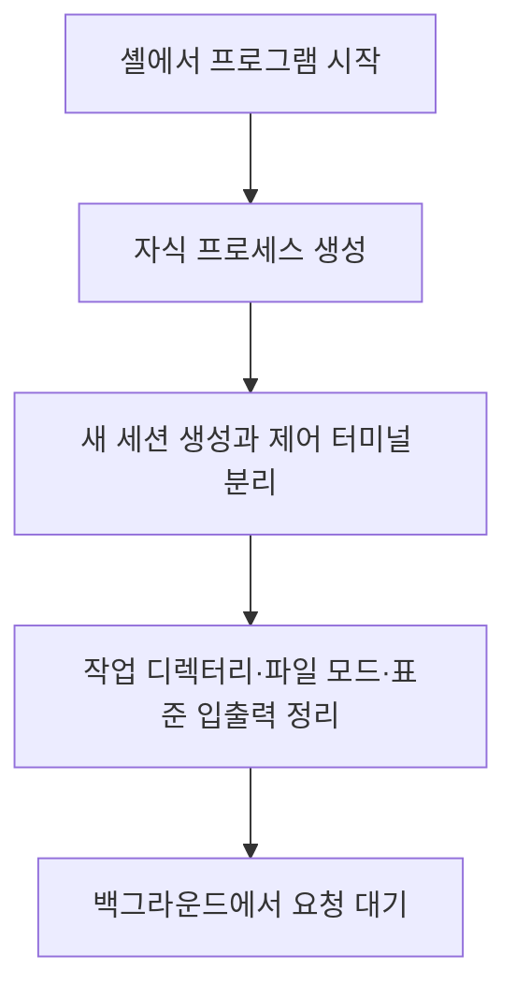
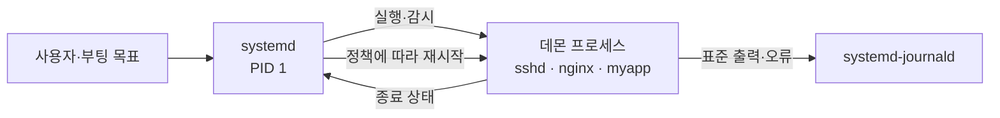

## 목차

- [[#1. 개요|1. 개요]]
- [[#2. 이름의 유래|2. 이름의 유래]]
- [[#3. 백그라운드 작업과의 차이|3. 백그라운드 작업과의 차이]]
- [[#4. 전통적인 데몬화 방식|4. 전통적인 데몬화 방식]]
- [[#5. systemd가 관리하는 현대적 방식|5. systemd가 관리하는 현대적 방식]]
- [[#6. 데몬·서비스·서비스 계정|6. 데몬·서비스·서비스 계정]]
- [[#7. 상태 확인과 해석|7. 상태 확인과 해석]]
- [[#8. 관련 문서|8. 관련 문서]]
- [[#9. 출처|9. 출처]]

## 1. 개요

Daemon(데몬)은 사용자의 일회성 명령을 처리하고 끝나는 대신, 사용자 터미널과 독립적으로 장시간 실행되며 요청이나 시스템 사건을 기다려 서비스를 제공하는 프로세스이다.

`sshd`는 원격 접속을, NGINX는 설정에 따라 웹·리버스 프록시·로드밸런싱 기능을, `systemd-journald`는 로그 수집을 제공한다. 데몬은 프로세스의 **역할과 수명**을 설명하는 말이고, 백그라운드는 셸이 프로세스의 종료를 기다리는지 설명하는 **실행 방식**이다.

## 2. 이름의 유래

`daemon`은 악마를 뜻하는 현대 영어 `demon`과 동일한 의미로 붙인 이름이 아니다. 고대 그리스의 `daimōn`은 보이지 않는 곳에서 사람의 일을 돕는 존재에 가까웠고, 초기 컴퓨팅에서는 보이지 않게 분자를 분류하는 가상의 존재인 Maxwell's demon에 빗대어 뒤에서 시스템 작업을 처리하는 프로그램을 데몬이라 불렀다고 알려져 있다.[^name]

UNIX 계열에서는 데몬 이름 끝에 `d`를 붙이는 관례가 생겼다. `sshd`, `httpd`, `named`, `systemd`가 예시이지만 모든 데몬이 이 관례를 따르는 것은 아니다.

## 3. 백그라운드 작업과의 차이

```bash
sleep 300 &
```

`&`는 현재 셸이 `sleep`의 종료를 기다리지 않고 프롬프트를 돌려주게 한다. 이 프로세스는 백그라운드 작업이지만 지속적인 서비스를 제공하지 않으므로 일반적으로 데몬이라 부르지 않는다.

| 구분 | 판단 기준 | 예시 |
|---|---|---|
| 포그라운드·백그라운드 | 실행 주체가 프로세스를 기다리고 직접 추적하는 방식 | `sleep 300 &` |
| 데몬 | 장시간 살아 있으면서 시스템 서비스를 제공하는 역할 | `sshd`, `systemd-journald` |

전통적인 데몬은 스스로 터미널에서 분리되고 백그라운드로 이동했다. 현대 Linux에서는 [[Daemon#5. systemd가 관리하는 현대적 방식|systemd가 데몬을 직접 관리]]하므로 프로그램이 포그라운드 형태로 실행되어도 데몬 역할을 할 수 있다. 따라서 두 개념을 완전한 포함 관계로 외우기보다 기준이 다른 분류로 이해하는 편이 정확하다.

## 4. 전통적인 데몬화 방식

전통적인 UNIX 데몬은 시작한 셸과 독립적으로 살아남기 위해 개념적으로 다음 과정을 사용했다.[^daemon]



구현마다 세부 절차는 다르며, 현대 서비스 관리 환경에서 애플리케이션이 이 절차를 직접 수행해야 하는 것은 아니다. 프로그램이 스스로 분리되면 관리자가 실제 서비스 프로세스를 추적하기 복잡해질 수 있기 때문이다.

## 5. `systemd`가 관리하는 현대적 방식

현대 Linux 배포판에서는 PID 1인 `systemd`가 서비스 프로세스를 직접 시작하고 상태를 추적할 수 있다. 데몬은 스스로 숨어들기보다 포그라운드에서 실행되고, 수명 관리는 `systemd`에 맡길 수 있다.[^systemd-service]



```ini
[Unit]
Description=Example application
After=network-online.target

[Service]
User=appsvc
ExecStart=/usr/local/bin/myapp
Restart=on-failure

[Install]
WantedBy=multi-user.target
```

- `User=`: 프로세스를 실행할 서비스 계정
- `ExecStart=`: 실행할 프로그램과 인수
- `Restart=`: 종료 원인에 따른 재시작 정책
- `After=`: 실행 순서를 정하는 관계이며 서비스 준비 완료 자체를 보장하는 표현은 아님
- `WantedBy=`: 활성화할 때 연결할 부팅 목표

`sshd -D`나 `nginx -g 'daemon off;'`처럼 프로그램의 자체 데몬화를 끄는 실행 방식은 서비스 관리자가 주 프로세스를 직접 추적하기 쉽게 한다. 사용자에게는 뒤에서 동작하는 시스템 서비스로 보이지만, `systemd` 관점에서는 직접 관리하는 포그라운드 자식 프로세스이다.

## 6. 데몬·서비스·서비스 계정

- **데몬**: 실제로 실행 중인 장기 프로세스의 성격
- **서비스**: 사용자나 다른 시스템에 제공하는 기능 또는 운영체제가 관리하는 단위
- **서비스 계정**: 그 프로세스에 필요한 최소 권한만 부여하기 위한 실행 신원

예를 들어 `sshd`는 SSH 서비스를 제공하는 데몬 프로세스이며, `sshd.service`는 `systemd`가 시작·중지·감시하는 서비스 단위이다. 웹 애플리케이션을 `appsvc`로 실행하면 사람이 그 계정으로 로그인하지 않아도 커널은 해당 UID·GID를 프로세스의 권한으로 사용한다. 자세한 계정 구성은 [[Linux Accounts and Permissions|Linux 계정·권한]]에서 다룬다.

## 7. 상태 확인과 해석

```bash
systemctl status sshd
```

```text
● sshd.service - OpenSSH server daemon
     Loaded: loaded (...; enabled)
     Active: active (running)
   Main PID: 842 (sshd)
```

- `Loaded`: 서비스 단위 파일을 읽었는지와 활성화 상태
- `enabled`: 부팅 시 연결되도록 설정되었다는 뜻이며 현재 실행 중이라는 뜻은 아님
- `Active`: 현재 서비스 상태
- `Main PID`: `systemd`가 추적하는 주 프로세스

```bash
systemctl is-active sshd
systemctl is-enabled sshd
journalctl -u sshd --since "10 minutes ago"
```

프로세스가 실행 중이라는 사실만으로 서비스가 정상이라고 단정할 수 없다. 포트가 요청을 받고 있는지, 의존 서비스가 준비됐는지, 실제 요청이 성공하는지까지 연결해서 확인해야 한다.

## 8. 관련 문서

- [[Program and Process|프로그램과 프로세스]] · [[Kernel|커널]] · [[Linux Structure|Linux 구조]]
- [[Linux Accounts and Permissions|Linux 계정·권한]] · [[Linux Logging|Linux 로그]]
- [[SSH]] · [[Web Server|웹 서버]] · [[Web Application Server|WAS]]

## 9. 출처

[^name]: FreeBSD Project, [The BSD Daemon](https://www.freebsd.org/copyright/daemon/) 및 [FreeBSD Handbook — Daemons](https://docs.freebsd.org/en/books/handbook/basics/#basics-daemons).
[^daemon]: Linux man-pages, [`daemon(7)`](https://man7.org/linux/man-pages/man7/daemon.7.html). 전통적인 SysV 방식과 현대 서비스 관리자 방식을 구분한다.
[^systemd-service]: systemd, [`systemd.service`](https://www.freedesktop.org/software/systemd/man/latest/systemd.service.html), [`systemd.exec`](https://www.freedesktop.org/software/systemd/man/latest/systemd.exec.html).

## 둘러보기

[[Knowledge Base/index|전체 개념 목록]] · [[Compute 분류|Compute]]
