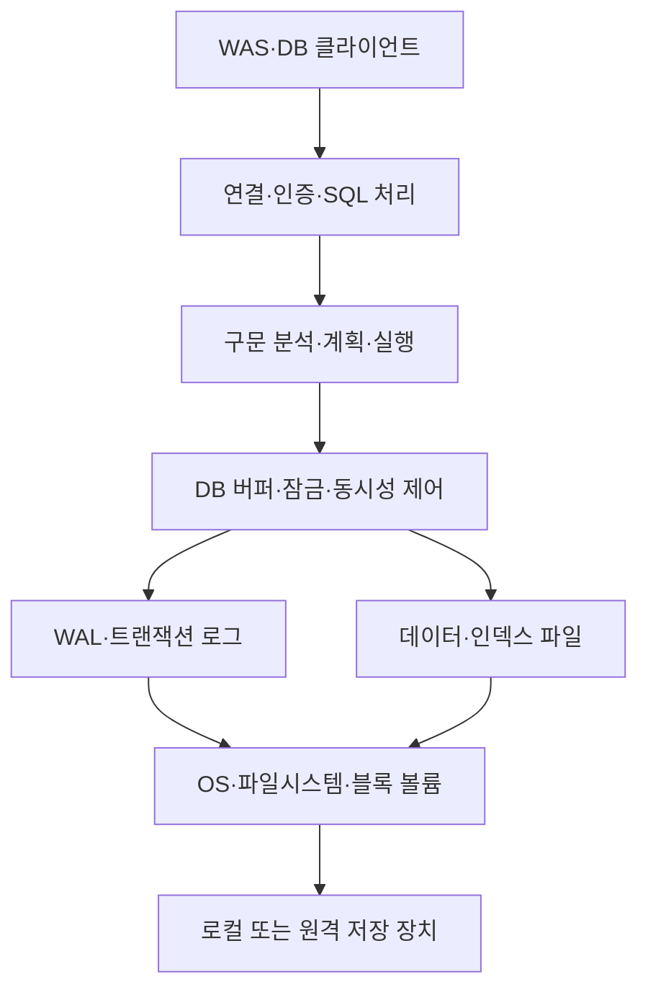

## 목차

- [[#1. 개요|1. 개요]]
- [[#2. 테이블·키·인덱스의 역할|2. 테이블·키·인덱스의 역할]]
- [[#3. 물리 장비와 DBMS 내부의 연결|3. 물리 장비와 DBMS 내부의 연결]]
- [[#4. 질의 하나의 처리 과정|4. 질의 하나의 처리 과정]]
- [[#5. 트랜잭션과 ACID|5. 트랜잭션과 ACID]]
- [[#6. 동시성·잠금·MVCC|6. 동시성·잠금·MVCC]]
- [[#7. 데이터가 저장되는 시점과 WAL|7. 데이터가 저장되는 시점과 WAL]]
- [[#8. 복제·고가용성·백업의 목적과 차이|8. 복제·고가용성·백업의 목적과 차이]]
- [[#9. 관계형 데이터베이스의 등장과 확장|9. 관계형 데이터베이스의 등장과 확장]]
- [[#10. 파일 저장과 DBMS의 차이|10. 파일 저장과 DBMS의 차이]]
- [[#11. 관련 문서|11. 관련 문서]]
- [[#12. 출처|12. 출처]]

## 1. 개요

Database(데이터베이스)는 관련 데이터를 정해진 구조와 규칙에 따라 저장·조회·변경할 수 있도록 조직한 데이터의 집합이다.

데이터 자체가 DB이고 이를 관리하는 소프트웨어가 DBMS(Database Management System)이다. 현장에서는 DBMS 프로세스나 설치된 서버까지 “DB”라고 부르므로 문맥을 구별한다. PostgreSQL·MySQL은 DBMS의 예이고, [[Storage]]의 SSD·볼륨·파일 공유와 동일한 종류의 이름이 아니다.[^architecture]

이 문서는 관계형 DB를 중심으로, PostgreSQL을 구체적 동작 예시로 사용한다. 제품마다 프로세스·로그·복제·일관성 모델이 다르므로 PostgreSQL의 구현을 모든 DB의 공통 구조로 일반화하지 않는다.

## 2. 테이블·키·인덱스의 역할

| 용어 | 의미 | 주문 서비스의 예 |
|---|---|---|
| 테이블·행·열 | 같은 구조의 데이터를 행과 속성으로 표현 | 주문 테이블, 주문 한 건, 주문 금액 |
| 스키마 | 데이터 구조를 뜻하거나 제품의 이름 공간을 뜻함 | 열·타입 설계, PostgreSQL의 schema 이름 공간 |
| Primary Key | 행을 고유하게 식별하도록 정의한 키 | 주문 ID |
| Foreign Key | 참조 대상 키와 관계의 무결성 유지 | 주문이 참조하는 고객 ID |
| 제약 조건 | 허용할 데이터 상태의 규칙 | NOT NULL, UNIQUE, CHECK 등 |
| 인덱스 | 조건에 맞는 데이터를 찾는 별도 접근 구조 | 주문 ID로 특정 주문 찾기 |

기본 키는 단순한 “첫 번째 열”이 아니고 외래 키는 두 테이블을 자동으로 빠르게 조인해 주는 기능과 다르다. 외래 키는 데이터 관계의 제약이며 인덱스는 접근 성능과 관련된 구조이다. PostgreSQL에서 기본 키·고유 제약은 인덱스와 연결되지만 참조하는 외래 키 열의 인덱스가 모두 자동 생성되는 것은 아니다.[^constraints]

문서형·키-값형·그래프 등 비관계형 데이터 모델도 있다. SQL 사용 여부 하나만으로 모든 특성을 정할 수 없고, 트랜잭션·일관성·질의·확장 기능은 제품과 구성별로 본다. 데이터 모델은 업무 데이터의 관계와 접근 패턴을 표현하는 선택이다.

## 3. 물리 장비와 DBMS 내부의 연결

이 그림은 PostgreSQL 기반 관계형 DB의 주요 역할을 단순화했다. DBMS는 호스트의 CPU·RAM을 사용해 질의·정렬·해시·동시성 제어 등을 실행하고, 데이터 파일과 로그를 저장 경로에 남긴다. 버퍼에 이미 있는 데이터를 읽으면 저장 장치에서 같은 데이터를 다시 읽지 않을 수 있다. 따라서 SQL 실행 수와 물리 디스크 I/O 수는 같지 않다.[^architecture][^buffers]

서버와 클라이언트는 서로 다른 장비에 있을 수 있다. 클라이언트의 파일 경로와 DB 서버의 파일 경로를 혼동하면 안 되며, SQL로 파일에 접근하는 기능도 DB 서버 권한과 실행 위치에 영향을 받는다. PostgreSQL의 일반 모델은 접속별 서버 프로세스를 사용하지만 모든 DBMS가 같은 프로세스 모델을 쓰는 것은 아니다.[^architecture]

## 4. 질의 하나의 처리 과정

1. 클라이언트가 DB 서버에 연결하고 인증·접근 조건을 충족한다.
2. DBMS가 SQL을 해석하고 필요한 객체와 권한을 확인한다.
3. 플래너가 통계·질의 조건 등을 사용해 실행 계획을 선택한다.
4. 실행기가 테이블·인덱스·버퍼와 필요한 동시성 제어를 사용한다.
5. 결과를 반환하거나 변경 사항을 트랜잭션의 완료 규칙에 따라 반영한다.[^querypath]

이 흐름은 교육용 요약이다. 미리 준비한 SQL 문(prepared statement)·실행 계획 캐시·병렬 처리 등 실제 경로는 더 다양하다. 중요한 것은 “SQL 한 줄”도 접속·계획·실행·대기·전송으로 시간이 나뉜다는 점이다. DB가 빨리 계산했어도 WAS가 연결을 얻는 데 오래 걸리거나 큰 결과를 전송하는 데 시간이 들 수 있다.

인덱스는 별도 구조에서 후보 데이터의 위치를 찾아 접근량을 줄일 수 있다. 하지만 많은 행을 읽는 질의에는 순차 스캔이 더 효율적일 수 있고, 인덱스 유지에는 저장 공간과 쓰기 비용이 든다. `EXPLAIN`의 비용은 임의 비용 단위이며 밀리초 그 자체가 아니다. `EXPLAIN ANALYZE`는 실제 질의를 실행하므로 데이터 변경문·부하 영향까지 고려해야 한다.[^plan]

대표적인 B-tree 인덱스는 정렬 가능한 키를 균형 잡힌 여러 갈래의 트리 구조로 관리한다. 원하는 키가 속할 범위를 위에서부터 좁혀 내려가므로, 소수의 주문 ID를 찾을 때 테이블의 모든 행을 차례로 비교하는 일을 줄일 수 있다. 정렬 순서를 활용하므로 같은 값뿐 아니라 범위 조건에도 사용할 수 있다.[^btree]

하지만 조건에 해당하는 행이 대부분이면 인덱스를 읽고 많은 테이블 페이지를 다시 찾아가는 비용이 커질 수 있다. 이때 플래너는 순차적으로 읽는 경로가 더 저렴하다고 판단할 수 있다. 조건이 얼마나 적은 행을 골라내는지, 즉 선택도와 데이터 배치·통계·캐시 등이 판단에 영향을 준다. 모든 조건에 인덱스를 추가하는 것보다 실제 실행 계획과 요청 패턴을 보는 이유이다.[^indexintro][^plan]

## 5. 트랜잭션과 ACID

트랜잭션은 여러 데이터 작업을 하나의 완료·취소 단위로 묶는다. 계좌 이체에서 출금만 반영되고 입금이 빠지면 안 되는 것처럼, 관련 변경의 경계를 정하는 데 사용한다.[^transactions]

| 속성 | 설명 | 혼동하기 쉬운 점 |
|---|---|---|
| Atomicity | 트랜잭션의 변경을 전부 반영하거나 취소 | 실패한 업무의 모든 외부 효과까지 자동 취소되는 것은 아님 |
| Consistency | 정의한 데이터 규칙을 지키는 상태 전이 | 복제본이 즉시 같은 값을 보인다는 의미의 일관성과 다름 |
| Isolation | 동시 트랜잭션 간 관측·간섭을 정한 수준으로 제어 | 모든 수준이 완전한 직렬 실행과 같은 결과를 보장하지 않음 |
| Durability | 완료한 변경을 요구된 장애 조건에서 보존 | 동기화·저장 장치·복제 설정과 연결됨 |

업무 규칙을 DB 제약과 애플리케이션 로직으로 올바르게 정의해야 하며 DBMS가 업무 의도를 스스로 알아내지는 않는다. 또한 DB 트랜잭션은 외부 API·파일·메시지의 효과까지 자동으로 하나의 원자적 작업으로 만들어 주지 않는다. 이 표는 속성을 이해하기 위한 일반 설명이며 구체적 보장 범위는 DBMS와 설정에 따른다.

## 6. 동시성·잠금·MVCC

여러 요청이 같은 데이터를 동시에 바꾸면 마지막 값이 의도와 다르거나 서로의 작업을 오래 기다릴 수 있다. PostgreSQL은 MVCC를 사용해 트랜잭션이 보는 데이터 버전을 관리하고, 필요한 작업에서는 잠금도 사용한다. MVCC가 있다는 이유로 모든 잠금·충돌이 사라지는 것은 아니다.[^mvcc]

긴 트랜잭션은 잠금·정리·연결 점유에 영향을 줄 수 있고, 서로 상대가 가진 자원을 기다리면 교착 상태가 생길 수 있다. 격리 수준을 높이면 허용하는 이상 현상은 줄어들 수 있지만 실패·재시도와 처리 비용을 다뤄야 한다. 같은 Read Committed라는 이름도 제품별 세부 동작을 비교해야 한다.[^isolation]

실무에서는 “DB가 느리다”를 질의 계산이 긴 상황, 잠금 대기, I/O 대기, 연결 대기와 구분한다. 잠금을 기다리는 세션을 무조건 종료하거나 VM CPU를 늘리기 전에 어떤 트랜잭션이 무엇을 기다리는지 확인하는 것이 원인을 파악하는 첫 단계이다.

## 7. 데이터가 저장되는 시점과 WAL

PostgreSQL의 WAL(Write-Ahead Logging)은 변경된 데이터 페이지를 저장하기 전에 복구에 필요한 로그를 안정적인 저장소에 남기는 원칙을 사용한다. 장애 후에는 로그로 아직 데이터 파일에 반영되지 않은 변경을 재적용할 수 있어, 커밋 때마다 변경한 모든 데이터 파일을 즉시 저장할 필요를 줄인다.[^wal]

다만 커밋 성공의 의미는 설정에 따른다. 비동기 커밋, 로컬 동기화, 동기 복제의 설정은 응답을 기다리는 범위가 다르다. WAL 파일이 존재한다는 사실만으로 모든 최근 커밋이 어떤 장애에서도 보존된다는 결론을 내리면 안 된다. 저장 장치가 동기화 요청을 올바르게 수행하고 필요한 로그·백업을 확보하는 조건도 중요하다.[^commit]

DB 데이터와 로그가 원격 블록 볼륨에 있으면 그 영속성과 지연은 [[iSCSI]]·컨트롤러·매체 등 저장 경로와 연결된다. WAL의 동기 쓰기가 느릴 때 서버 CPU만 증설해도 커밋 대기가 해결되지 않을 수 있다.

## 8. 복제·고가용성·백업의 목적과 차이

| 수단 | 해결하려는 문제 | 추가로 필요한 판단 |
|---|---|---|
| Replica | 다른 DB에 데이터 상태 유지 | 동기·비동기, 지연, 읽기 일관성 |
| 장애 전환 | Primary 장애 시 서비스 역할 이전 | 탐지·선출·접속 주소·동시 Primary 방지 |
| 백업 | 과거의 복구 가능한 사본 확보 | 보존·독립 위치·복원 절차·검증 |
| PITR | 백업과 로그로 특정 시점까지 복구 | 기준 백업과 연속된 필요한 로그 확보 |

복제본이 삭제·잘못된 변경을 그대로 반영하면 그것만으로 과거 데이터를 되돌릴 수 없다. 반대로 백업이 있어도 즉시 서비스 역할을 넘겨받는 실행 환경까지 자동 준비되는 것은 아니다. 비동기 복제에서는 Primary 완료 응답 뒤 Replica에 아직 반영되지 않은 변경이 있을 수 있다.[^ha]

PostgreSQL은 SQL dump·파일시스템 수준 백업·연속 로그 아카이빙을 구분한다. 실행 중 데이터 파일 일부를 임의로 복사하는 것은 일관된 백업과 같지 않다. PITR에는 복구 시작점이 되는 백업과 필요한 WAL이 함께 필요하다.[^backup][^pitr]

RPO·RTO는 업무 목표이고 제품 기능 이름이 아니다. 필요한 데이터 범위·복구 대상 시점·복구 환경의 용량·접속 전환까지 확인해야 목표 달성 여부를 말할 수 있다.

## 9. 관계형 데이터베이스의 등장과 확장

데이터를 파일에 보관할 수 있어도, 데이터 사이의 관계를 찾는 방법이 파일의 물리 배치에 강하게 묶이면 새로운 질문을 할 때마다 프로그램을 바꾸어야 한다. 관계형 모델은 사용자가 저장 위치를 직접 따라가지 않고 데이터의 값과 관계를 바탕으로 질의하도록 하는 접근이다.

IBM 연구원 Edgar F. Codd는 1970년 관계형 데이터 모델을 제안했다. 이후 IBM의 System R 연구와 SQL 개발 등은 선언적인 질의를 실제 실행 계획으로 바꾸는 기술의 발전으로 이어졌다. “어떤 데이터를 원하는가”를 표현하고 DBMS가 “어떻게 찾을 것인가”를 계획한다는 점이 관계형 DB를 이해하는 핵심이다.[^history]

예를 들어 주문 테이블과 고객 테이블을 고객 ID로 연결하면, 파일이 저장된 디스크 위치를 몰라도 특정 고객의 주문 목록을 조회할 수 있다. 인덱스는 조회 경로를, 트랜잭션은 변경의 완료 단위를, 동시성 제어는 여러 사용자의 접근을 관리한다. 이 기능들은 각각 다른 문제를 해결하면서 하나의 DBMS 안에서 함께 동작한다.

관계형 DB 외에도 문서형·키-값형·그래프형 등 다양한 데이터 모델이 사용된다. 또 DBMS를 직접 설치하는 방식과 관리형 클라우드 서비스를 이용하는 방식이 공존한다. 데이터 모델은 정보를 어떻게 표현할지의 선택이고, 관리형 서비스는 누가 DB 기반 환경을 관리할지의 선택이므로 서로 구분해야 한다.

## 10. 파일 저장과 DBMS의 차이

파일은 데이터를 보관하는 기반이지만 여러 프로그램이 같은 데이터를 동시에 바꾸고 관계를 유지하며 원하는 조건으로 찾으려면 추가 규칙이 필요하다. DBMS는 그 구조·질의·동시성·복구를 공통 기능으로 제공한다. [[Data Warehouse]]는 분석 목적의 데이터 통합·질의에, [[Data Lake]]는 다양한 데이터의 보관·활용에 중점을 둔 시스템이므로 일반 업무 DB와 목적을 구분한다.

모든 데이터에 관계형 DB가 필요한 것은 아니다. 이미지·대규모 원본 파일은 [[Object Storage]]나 [[File Storage]]에 두고 DB에는 식별자·상태·관계를 저장하는 구성도 가능하다. 선택은 데이터의 크기·관계·변경 패턴·조회·일관성 요구를 기준으로 설명해야 한다.

## 11. 관련 문서

- [[Server]], [[Networking]], [[Storage]], [[3-Tier Architecture]]
- [[Web Application Server]], [[Block Storage]], [[iSCSI]]
- [[Data Lake]], [[Data Warehouse]]

## 12. 출처

[^history]: [IBM — The relational database](https://www.ibm.com/history/relational-database)

[^architecture]: [PostgreSQL — Architectural Fundamentals](https://www.postgresql.org/docs/current/tutorial-arch.html)
[^constraints]: [PostgreSQL — Constraints](https://www.postgresql.org/docs/current/ddl-constraints.html)
[^buffers]: [PostgreSQL — Resource Consumption: Memory](https://www.postgresql.org/docs/current/runtime-config-resource.html)
[^plan]: [PostgreSQL — Using EXPLAIN](https://www.postgresql.org/docs/current/using-explain.html)
[^transactions]: [PostgreSQL — Transactions tutorial](https://www.postgresql.org/docs/current/tutorial-transactions.html)
[^mvcc]: [PostgreSQL — Concurrency Control](https://www.postgresql.org/docs/current/mvcc.html)
[^isolation]: [PostgreSQL — Transaction Isolation](https://www.postgresql.org/docs/current/transaction-iso.html)
[^wal]: [PostgreSQL — Write-Ahead Logging](https://www.postgresql.org/docs/current/wal-intro.html)
[^commit]: [PostgreSQL — Asynchronous Commit](https://www.postgresql.org/docs/current/wal-async-commit.html)
[^ha]: [PostgreSQL — High Availability and Replication](https://www.postgresql.org/docs/current/high-availability.html)
[^backup]: [PostgreSQL — Backup and Restore](https://www.postgresql.org/docs/current/backup.html)
[^pitr]: [PostgreSQL — Continuous Archiving and PITR](https://www.postgresql.org/docs/current/continuous-archiving.html)

[^querypath]: [PostgreSQL — The Path of a Query](https://www.postgresql.org/docs/current/query-path.html)
[^btree]: [PostgreSQL — B-tree implementation](https://www.postgresql.org/docs/current/btree.html) · [Index Types](https://www.postgresql.org/docs/current/indexes-types.html)
[^indexintro]: [PostgreSQL — Introduction to Indexes](https://www.postgresql.org/docs/current/indexes-intro.html)

## 둘러보기

[[Knowledge Base/index|전체 개념 목록]] · [[Database 분류|Database]]
