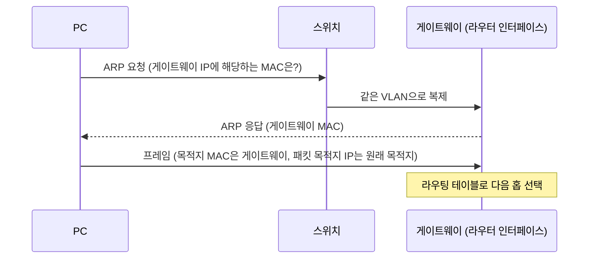

## 목차

- [[#1. 개요|1. 개요]]
- [[#2. 게이트웨이를 쓰는 판단|2. 게이트웨이를 쓰는 판단]]
- [[#3. 게이트웨이로 보낼 때의 프레임|3. 게이트웨이로 보낼 때의 프레임]]
- [[#4. 게이트웨이의 위치와 주소|4. 게이트웨이의 위치와 주소]]
- [[#5. 기본 경로와의 관계|5. 기본 경로와의 관계]]
- [[#6. 설정과 개수|6. 설정과 개수]]
- [[#7. 흔한 오해|7. 흔한 오해]]
- [[#8. 관련 문서|8. 관련 문서]]
- [[#9. 출처|9. 출처]]

## 1. 개요

Default Gateway(기본 게이트웨이)는 호스트가 다른 네트워크로 보낼 패킷을 가장 먼저 넘기는, 같은 서브넷에 있는 라우터 인터페이스의 IP 주소이다.

게이트웨이는 별도 종류의 장비가 아니라 **역할**이다. 라우터나 L3 스위치의 한 인터페이스가 그 서브넷에서 게이트웨이 주소를 가지며, 호스트는 이 주소를 설정해 두고 "목적지가 같은 네트워크에 없으면 이 주소로 넘긴다"는 규칙으로 사용한다.

## 2. 게이트웨이를 쓰는 판단

호스트는 목적지 주소와 자신의 주소에 같은 서브넷 마스크를 적용하고, 결과가 같으면 같은 네트워크로 보고 목적지에 직접 보낸다. 결과가 다르면 목적지는 게이트웨이를 통해서만 도달할 수 있다고 판단한다.[^rfc1122] 마스크는 호스트 주소마다 따로 가지며, 이 판단은 호스트가 내린다. 스위치는 IP 주소를 보지 않는다. 계산 방법은 [[IP Address and Subnet|IP 주소와 서브넷]]에서 설명한다.

같은 네트워크로 판단된 목적지에는 게이트웨이가 필요하지 않다. RFC 1122는 호스트의 IP 계층이 게이트웨이가 하나도 없는 고립된 네트워크에서도 동작해야 한다고 규정한다.[^rfc1122]

## 3. 게이트웨이로 보낼 때의 프레임

호스트는 다른 네트워크로 가는 패킷을 만들 때 프레임의 목적지 MAC 주소에 **게이트웨이의 MAC 주소**를 넣는다. 이 MAC 주소는 게이트웨이 IP 주소를 대상으로 한 [[ARP]] 요청으로 알아낸다. 패킷의 목적지 IP 주소는 원래 목적지 그대로 유지된다.

PC에서 스위치까지는 케이블로 직접 연결된 링크이므로 게이트웨이가 필요하지 않다. 스위치는 프레임의 목적지가 아니라 중계 장비이고, 같은 서브넷의 프레임은 스위치만 거쳐 전달된다. 게이트웨이는 그 서브넷을 벗어나는 패킷에만 쓰인다. 프레임과 패킷의 변화는 [[Encapsulation|캡슐화]]와 [[Router|라우터]]에서 설명한다.

## 4. 게이트웨이의 위치와 주소

게이트웨이는 호스트가 직접 연결된 네트워크, 즉 같은 서브넷에 있어야 한다. RFC 1122는 로컬 호스트가 아닌 목적지로 가는 트래픽이 "연결된 네트워크에 있는 게이트웨이로 라우팅되어야 한다"고 설명한다.[^rfc1122] 호스트는 ARP로 직접 닿을 수 있는 상대에게만 프레임을 넘길 수 있기 때문이다.

서브넷 밖의 주소를 게이트웨이로 설정한 가상의 예를 보자. `192.168.10.200/24` PC의 게이트웨이를 `192.168.20.1`로 설정했다고 하자.

- `192.168.10.37`은 같은 네트워크로 판단되므로 게이트웨이를 거치지 않아 통신이 된다.
- `8.8.8.8`은 다른 네트워크로 판단되어 `192.168.20.1`로 보내야 한다. 호스트는 그 MAC 주소를 얻으려고 ARP 요청을 브로드캐스트하지만, 브로드캐스트는 같은 VLAN 안에만 퍼지고 그 VLAN에는 `192.168.20.1`을 가진 장치가 없어 응답이 오지 않는다. MAC 주소를 모르므로 프레임을 만들 수 없다.

위 예는 작성자가 설명을 위해 만든 것이고, 실제 운영체제는 서브넷 밖의 게이트웨이 설정을 거부하거나 경고하는 등 동작이 다를 수 있다.

게이트웨이 주소를 서브넷의 첫 번째 주소로 두는 것은 관례이며 표준이 정한 규칙이 아니다. 같은 서브넷 안의 어떤 주소든 게이트웨이로 쓸 수 있다. 게이트웨이가 주소 하나를 쓰므로 단말에 줄 수 있는 주소는 그만큼 줄어든다.

쉽게 설명하면 같은 건물의 복도는 직접 걸어가고, 건물 밖으로 나갈 때만 정문을 거치는 구조이다. 이 비유는 정문이 여러 개일 수 있다는 점이나, 정문 안쪽에서 경로를 다시 고른다는 점까지 설명하지는 못한다.

## 5. 기본 경로와의 관계

호스트가 사용할 경로 정보가 없고 목적지도 연결된 네트워크에 있지 않으면 IP 계층은 기본 게이트웨이 목록에서 하나를 골라 보낸다.[^rfc1122] 경로표 관점에서는 `0.0.0.0/0`이라는 기본 경로의 다음 홉이 게이트웨이 주소이다. 더 구체적인 경로가 있으면 그쪽이 먼저 선택되며, 이 규칙이 Longest Prefix Match이다. 자세한 내용은 [[IP Address and Subnet|IP 주소와 서브넷]]에서 설명한다.

따라서 기본 게이트웨이는 모든 패킷이 무조건 지나는 장비가 아니라, 다른 경로가 없을 때 사용하는 기본 다음 홉이다.

## 6. 설정과 개수

호스트는 IP 주소, 마스크, 그리고 우선순위가 지정된 기본 게이트웨이 목록을 설정할 수 있어야 하며, 수동 입력 방법을 제공해야 한다. 동적으로 받는 방법도 가능하다.[^rfc1122] RFC 1122는 호스트가 여러 개의 기본 게이트웨이를 지원해야 한다고 규정하고, 동작을 시작하려면 최소 하나가 필요하다고 설명한다.[^rfc1122]

게이트웨이가 최적의 다음 홉이 아니면 라우터는 패킷을 전달하면서 Redirect 메시지를 보내고, 호스트는 이를 받아 이후 같은 목적지로 가는 트래픽을 더 나은 게이트웨이로 보내도록 경로 캐시를 갱신한다.[^rfc1122]

## 7. 흔한 오해

- **게이트웨이가 별도의 장비 종류라는 생각**: 라우터나 L3 스위치의 인터페이스가 맡는 역할이다.
- **게이트웨이가 서브넷의 첫 번째 주소여야 한다는 생각**: 관례일 뿐이며 같은 서브넷의 어떤 주소든 쓸 수 있다.
- **서브넷 밖의 주소도 게이트웨이로 쓸 수 있다는 생각**: 게이트웨이는 호스트가 직접 닿을 수 있는 같은 서브넷에 있어야 한다. 그렇지 않으면 ARP 응답을 받을 수 없다.
- **모든 통신이 게이트웨이를 지난다는 생각**: 같은 서브넷의 통신은 스위치만 거치고 게이트웨이를 거치지 않는다.
- **호스트가 목적지 서버의 MAC 주소를 알아낸다는 생각**: 호스트가 아는 것은 게이트웨이의 MAC 주소이고 목적지 IP는 패킷 안에 그대로 유지된다.

## 8. 관련 문서

- [[Networking|네트워크]] · [[Encapsulation|캡슐화]] · [[ARP]]
- [[Router|라우터]] · [[Switch|스위치]] · [[IP Address and Subnet|IP 주소와 서브넷]]
- [[VLAN]] · [[Internet Routing|인터넷의 통신 구조]]

## 9. 출처

[^rfc1122]: IETF, [RFC 1122, Requirements for Internet Hosts: Communication Layers](https://www.rfc-editor.org/rfc/rfc1122.html). 3.3.1 Routing Outbound Datagrams의 게이트웨이 위치, 3.3.1.1 Local/Remote Decision의 마스크 판단과 게이트웨이 없는 네트워크에서의 동작, 3.3.1.2 Gateway Selection의 기본 게이트웨이·경로 캐시·Redirect, 3.3.1.6 Initialization의 기본 게이트웨이 설정.

## 둘러보기

[[Knowledge Base/index|전체 개념 목록]] · [[Networking 분류|Networking]]
