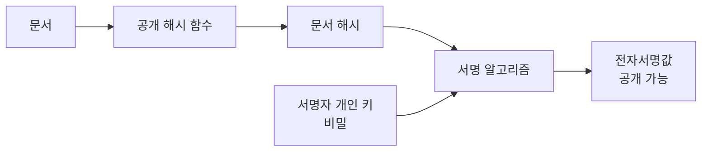
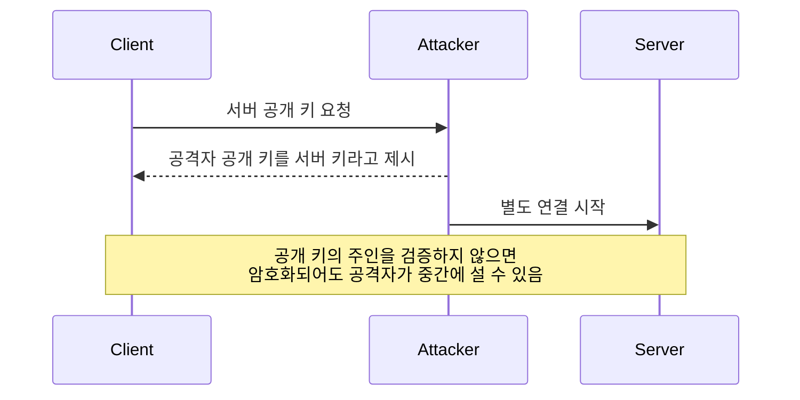
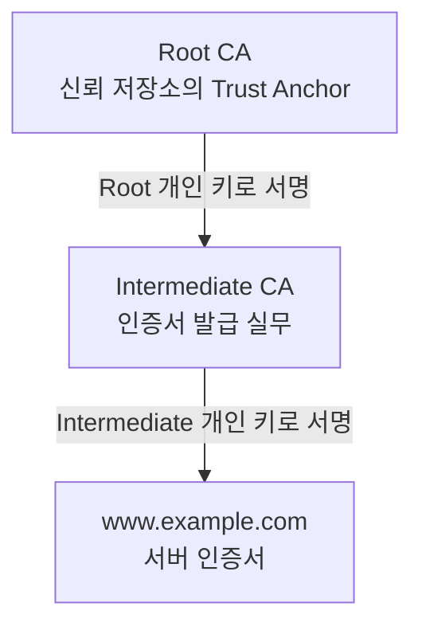

## 목차

- [[#1. 개요|1. 개요]]
- [[#2. 공개 키와 개인 키의 역할|2. 공개 키와 개인 키의 역할]]
- [[#3. 전자서명의 생성과 검증|3. 전자서명의 생성과 검증]]
- [[#4. 인증서가 필요한 이유|4. 인증서가 필요한 이유]]
- [[#5. 인증기관과 신뢰 체인|5. 인증기관과 신뢰 체인]]
- [[#6. 브라우저의 인증서 검증|6. 브라우저의 인증서 검증]]
- [[#7. 작은 RSA 수학 예시|7. 작은 RSA 수학 예시]]
- [[#8. 비유의 적용 범위|8. 비유의 적용 범위]]
- [[#9. 관련 문서|9. 관련 문서]]
- [[#10. 출처|10. 출처]]

## 1. 개요

전자서명은 개인 키로 데이터에 대한 서명값을 만들고 대응하는 공개 키로 작성자와 무결성을 검증하는 암호 기술이다. 인증서는 서비스 이름·조직 등 주체 정보와 공개 키를 묶고 인증기관(CA)의 전자서명을 붙인 공개 문서이다.

```text
전자서명    이 내용은 해당 개인 키 보유자가 서명했고 이후 바뀌지 않았는가
인증서      이 공개 키는 어떤 이름·주체의 키인가
CA          그 이름과 공개 키의 관계를 누가 보증했는가
신뢰 저장소 어떤 CA를 최초 신뢰점으로 인정하는가
```

## 2. 공개 키와 개인 키의 역할

공개 키와 개인 키는 수학적으로 연결된 비대칭 키 쌍이다. 공개 키는 배포할 수 있고 개인 키는 소유자만 보관한다.

```text
암호화 용도의 직관
공개 키로 보호 → 대응하는 개인 키로 해제

서명 용도
개인 키로 서명 생성 → 대응하는 공개 키로 서명 검증
```

자물쇠와 열쇠 비유는 공개 키 암호화의 방향을 이해하는 데 유용하지만 전자서명을 정확히 설명하지는 못한다. 서명에서는 개인 키를 `서명 생성 장치`, 공개 키를 `서명 검증 도구`로 이해하는 편이 낫다.

모든 비대칭 알고리즘이 암호화와 서명을 모두 지원하지는 않는다. RSA는 서로 다른 안전한 규칙으로 암호화와 서명에 활용할 수 있지만, ECDSA·EdDSA는 서명용이고 ECDH는 키 합의용이다. 같은 공개·개인 구조라고 해서 키를 용도 사이에 무분별하게 재사용해서는 안 된다.

## 3. 전자서명의 생성과 검증

해시 함수와 서명 알고리즘은 공개되어 있고 개인 키만 비밀이다. 보안은 계산 방법을 감추는 데 의존하지 않는다.



검증자는 원문·전자서명·공개 키를 서명 검증 알고리즘에 넣는다.

```text
Verify(공개 키, 원문 또는 원문의 해시, 서명값)
→ 유효한 서명 / 유효하지 않은 서명
```

단순화한 RSA 설명에서는 공개 키 연산으로 서명에 포함된 해시 표현을 확인하는 모양이 나타난다. 실제 RSA-PSS는 원문과 인코딩·Salt를 함께 검증하고, ECDSA·EdDSA는 해시값이 그대로 되돌아오는 방식이 아니라 수학적 관계의 성립 여부를 확인한다.[^rfc8017]

## 4. 인증서가 필요한 이유

서버가 공개 키만 보내면 공격자가 중간에서 자신의 공개 키로 바꾸어 보낼 수 있다.



인증서는 공개 키에 이름과 유효기간·용도 등을 붙이고 CA가 서명하여 `이 공개 키가 누구의 것인지`를 검증할 수 있게 한다.

```text
서버 인증서
├── Subject·서비스 이름
├── 서버 공개 키
├── 발급자
├── 유효기간
├── 확장 용도와 제약
└── 발급 CA의 전자서명
```

인증서는 비밀 파일이 아니다. 서버의 개인 키는 인증서 밖에 별도로 보관한다. 공격자가 인증서를 복사해도 대응하는 개인 키로 현재 연결에 서명하지 못하면 서버 행세를 할 수 없다.

## 5. 인증기관과 신뢰 체인

CA(Certificate Authority)는 주체와 공개 키의 관계를 확인하고 인증서에 서명하는 기관이다. 공개 웹 PKI에서는 Root CA가 중간 CA 인증서에 서명하고, 중간 CA가 서버 인증서를 발급하는 계층을 흔히 사용한다.[^rfc5280]



브라우저는 서버가 보낸 체인을 아래에서 위로 검증하고, 최종적으로 운영체제·브라우저의 신뢰 저장소에 있는 Trust Anchor에 도달하는지 확인한다. Root CA가 모든 서버 인증서에 직접 서명하지 않으면 Root 개인 키의 사용을 줄이고 발급 체계를 분리할 수 있다.

## 6. 브라우저의 인증서 검증

대표적인 확인 항목은 다음과 같다.

- 접속한 DNS 이름이 인증서의 허용 이름과 일치하는가
- 인증서의 유효기간과 용도가 적절한가
- 각 인증서 서명이 상위 CA 공개 키로 검증되는가
- 체인이 신뢰하는 Root CA에 도달하는가
- 인증서가 폐기되었거나 정책상 허용되지 않는 상태가 아닌가
- 현재 서버가 인증서 공개 키와 짝인 개인 키를 실제로 보유했는가

CA는 일반적인 TLS 접속마다 실시간으로 통신에 참여하는 중계 서버가 아니다. CA는 미리 인증서를 발급하고 서명하며, 클라이언트가 로컬의 신뢰 정보와 서버가 제시한 체인을 이용해 검증한다.

## 7. 작은 RSA 수학 예시

다음 예시는 서명과 검증의 방향을 눈으로 확인하기 위한 장난감 계산이다. 숫자가 너무 작고 실제 RSA-PSS의 안전한 인코딩도 생략했으므로 보안 용도로 사용할 수 없다.

```text
공개 키: (e=3, n=55)
개인 키: (d=27, n=55)
문서 해시를 작은 수 7이라고 가정
```

서명자는 개인 키 지수로 계산한다.

```text
서명 s = 7²⁷ mod 55 = 28
```

검증자는 공개 키 지수로 검산한다.

```text
28³ mod 55 = 7
```

원문에서 다시 계산한 해시 표현 `7`과 일치한다. 공격자가 문서를 바꾸어 해시가 `8`이 되면 기존 서명 검산값 `7`과 맞지 않는다.

```text
변조 문서 해시: 8
기존 서명 검산: 7
결과: 불일치
```

이 작은 예에서는 모든 값을 대입해 위조 서명을 찾을 수 있다. 실제 RSA는 매우 큰 정수와 안전한 서명 인코딩을 사용하여 공개 키에서 개인 키를 구하거나 새 서명을 위조하는 계산을 현실적으로 어렵게 만든다. 현대 서명 검증의 일반적인 출력은 복호화한 원문이 아니라 `유효함` 또는 `유효하지 않음`이다.

## 8. 비유의 적용 범위

| 비유 | 설명하는 부분 | 설명하지 못하는 부분 |
|---|---|---|
| 공개 자물쇠와 개인 열쇠 | 공개 키로 보호하고 개인 키로 해제하는 방향 | 서명 알고리즘·키 합의 전체 |
| 개인 인감과 공개 감별기 | 개인 키로 서명하고 공개 키로 검증 | 수학적 위조 난이도와 인증서 체인 |
| 여권과 발급기관 | 인증서와 CA의 신뢰 관계 | TLS 연결마다 수행하는 키 합의 |

비유하면 인증서는 공개된 신분증이고 CA 서명은 발급기관만 만들 수 있는 위조 방지 표식이다. 그러나 실제 보안은 물리 도장 모양이 아니라 공개된 알고리즘과 큰 수의 계산 난이도에 기반한다.

## 9. 관련 문서

- [[TLS]] · [[HTTP and HTTPS|HTTP와 HTTPS]] · [[SSH]]
- [[DNS]] · [[Security 분류]]

## 10. 출처

[^rfc5280]: IETF, [RFC 5280, Internet X.509 Public Key Infrastructure Certificate and CRL Profile](https://www.rfc-editor.org/rfc/rfc5280.html). X.509 인증서·CA·인증 경로·Trust Anchor와 폐기 구조.
[^rfc8017]: IETF, [RFC 8017, PKCS #1: RSA Cryptography Specifications Version 2.2](https://www.rfc-editor.org/rfc/rfc8017.html). RSA-PSS 서명 생성과 공개 키 검증 절차. 본문의 작은 수 계산은 원리만 보이기 위해 안전한 인코딩을 생략한 교육용 예시.

## 둘러보기

[[Knowledge Base/index|전체 개념 목록]] · [[Security 분류|Security]]
