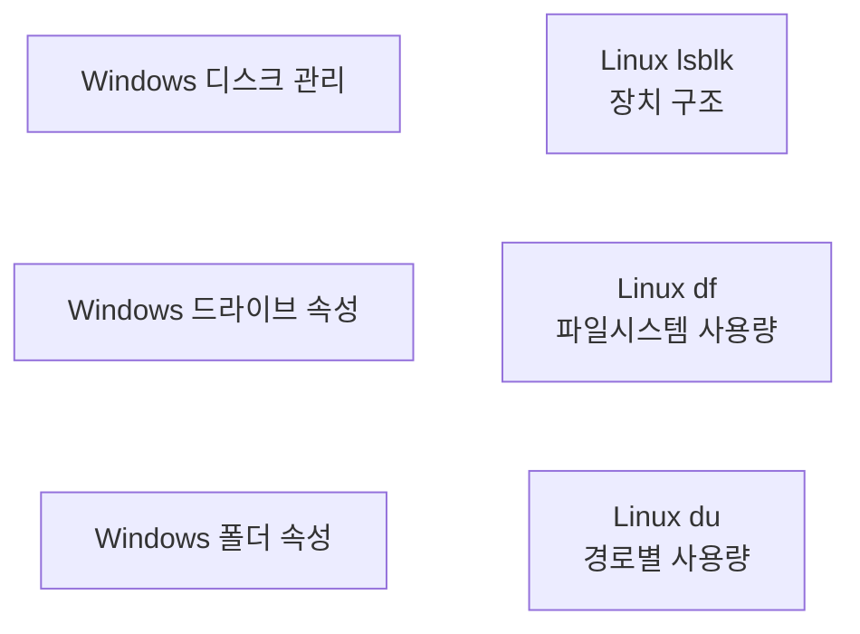
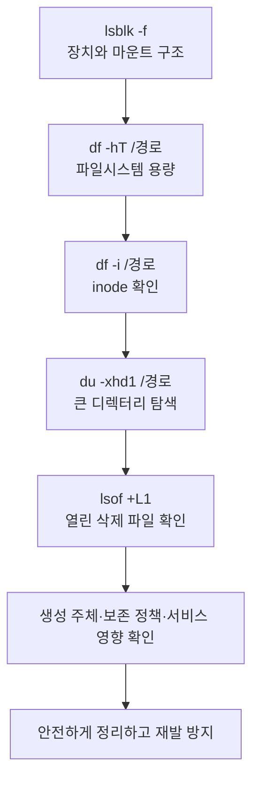

## 목차

- [[#1. 개요|1. 개요]]
- [[#2. Windows와 Linux 비교|2. Windows와 Linux 비교]]
- [[#3. lsblk — 장치 구조|3. lsblk — 장치 구조]]
- [[#4. df — 파일시스템의 전체 사용량|4. df — 파일시스템의 전체 사용량]]
- [[#5. du — 디렉터리와 파일의 사용량|5. du — 디렉터리와 파일의 사용량]]
- [[#6. inode 고갈과 파일 생성 실패|6. inode 고갈과 파일 생성 실패]]
- [[#7. df와 du가 다른 이유|7. df와 du가 다른 이유]]
- [[#8. 용량 부족 점검 순서|8. 용량 부족 점검 순서]]
- [[#9. 관련 문서|9. 관련 문서]]
- [[#10. 출처|10. 출처]]

## 1. 개요

Linux 디스크 용량 확인은 장치 구조, 파일시스템의 남은 공간, 디렉터리별 사용량과 inode를 서로 다른 명령으로 구분하여 해석하는 작업이다.

## 2. Windows와 Linux 비교

Windows와 Linux의 저장 원리는 다르지 않다. Windows의 GUI에서 보던 항목을 Linux에서는 명령으로 구분해 확인한다.

| 확인 목적 | Windows | Linux |
|---|---|---|
| 물리 디스크와 파티션 구조 | 디스크 관리 | `lsblk -f` |
| 드라이브 전체·사용·남은 공간 | C·D 드라이브 우클릭 → 속성 | `df -hT` |
| 특정 폴더가 차지하는 공간 | 폴더 우클릭 → 속성 | `du -sh 경로` |
| 하위 폴더별 사용량 | 폴더별 속성·저장소 설정 | `du -xhd1 경로` |
| 파일 개수 관리 자원 | GUI에서 직접 보기 어려움 | `df -i` |



## 3. `lsblk` — 장치 구조

```bash
lsblk -f
```

디스크·파티션·파일시스템 종류·UUID·마운트 지점을 한눈에 본다. 용량이 얼마 남았는지를 판단하는 주 명령은 아니다.

## 4. `df` — 파일시스템의 전체 사용량

```bash
df -hT /data
```

```text
Filesystem     Type  Size  Used Avail Use% Mounted on
/dev/sdb1      ext4  500G  470G   30G  94% /data
```

| 열 | 의미 |
|---|---|
| `Filesystem` | 파일시스템의 원본 장치·논리 볼륨·원격 공유 |
| `Type` | ext4·XFS·NFS·tmpfs 등의 종류 |
| `Size` | 파일시스템이 관리하는 전체 용량 |
| `Used` | 사용 중인 블록 |
| `Avail` | 일반적으로 추가 사용 가능한 공간 |
| `Use%` | 파일시스템 사용률 |
| `Mounted on` | 디렉터리 트리에 연결된 위치 |

파티션 하나에 파일시스템을 전체 크기로 만들어 사용한 일반적인 구성에서는 `Use% 94%`를 해당 파티션 위 파일시스템의 94% 사용으로 이해할 수 있다. 그러나 `df`는 파티션이 아니라 **파일시스템** 기준이다. 파티션만 확장하고 파일시스템을 확장하지 않았거나, LVM·RAID·NFS 위에 있다면 두 크기는 다를 수 있다.

`Size - Used`가 `Avail`과 항상 일치하지는 않는다. 파일시스템 메타데이터, ext 계열의 예약 블록과 계산 방식이 영향을 줄 수 있다.[^df]

## 5. `du` — 디렉터리와 파일의 사용량

```bash
sudo du -xhd1 /data | sort -hr
```

```text
470G    /data
270G    /data/backup
180G    /data/logs
12G     /data/app
8G      /data/temp
```

| 옵션 | 의미 |
|---|---|
| `-x` | 다른 파일시스템으로 넘어가지 않음 |
| `-h` | K·M·G 단위 표시 |
| `-d1` | 바로 아래 한 단계까지 출력 |
| `-s` | 지정한 경로의 합계만 출력 |
| `sort -hr` | 사람이 읽는 단위를 이해해 큰 값부터 정렬 |

`du`는 남은 공간을 보여 주는 명령이 아니다. 어떤 경로가 공간을 얼마나 사용했는지 계산한다. 파일이 매우 많은 서버에서는 재귀 순회 자체가 I/O 부하를 만들 수 있으므로 `-x -d1`로 범위를 한 단계씩 좁힌다.[^du]

`du`는 기본적으로 할당된 디스크 공간을 보고, `--apparent-size`는 파일이 나타내는 논리적 크기를 본다. Sparse file에서는 두 값이 크게 다를 수 있다.

## 6. inode 고갈과 파일 생성 실패

```bash
df -i /data
```

파일시스템의 데이터 공간이 남았더라도 [[Inode|inode]]를 모두 사용하면 새 파일이나 디렉터리를 만들 수 없다. 작은 세션·캐시·로그 파일이 대량으로 쌓인 환경에서 발생할 수 있다.

```bash
sudo du --inodes -x -d1 /data | sort -nr
```

## 7. `df`와 `du`가 다른 이유

`df`는 파일시스템이 할당한 블록을 집계하고 `du`는 디렉터리 경로에서 찾을 수 있는 파일을 순회한다. 따라서 값이 정확히 일치하지 않을 수 있다.

대표적인 원인은 다음과 같다.

- 파일시스템 메타데이터와 예약 공간
- 권한 부족으로 `du`가 읽지 못한 경로
- Sparse file의 논리 크기와 실제 할당량
- 마운트로 가려진 루트 파일시스템의 기존 데이터
- 스냅샷 또는 파일시스템 고유 구조
- 삭제됐지만 프로세스가 계속 열고 있는 파일

### 삭제됐지만 열린 파일

프로세스가 로그 파일을 연 상태에서 이름을 삭제하면 디렉터리에서는 사라져 `du`가 찾지 못하지만, 열린 파일 디스크립터가 inode를 참조하는 동안 블록은 반환되지 않아 `df`에는 계속 사용 중으로 남을 수 있다.

```bash
sudo lsof +L1
```

서비스가 제공하는 로그 재열기 절차나 신호를 우선 사용하고, 필요하면 영향 범위를 확인한 뒤 서비스를 재시작한다. 프로세스 강제 종료나 `/proc/<PID>/fd`를 통한 임의 조작은 일반적인 첫 조치가 아니다.

## 8. 용량 부족 점검 순서



파일을 무작정 삭제하지 않는다. 로그 로테이션, 캐시 정책, 백업 보존 기간, 애플리케이션 세션·큐·잠금 여부를 확인하고 정상적인 정리 절차를 사용한다.

## 9. 관련 문서

- [[Disk|디스크]] · [[Partition|파티션]] · [[Filesystem|파일시스템]]
- [[Mount|마운트]] · [[Fstab|fstab]] · [[Inode|inode]]
- [[CPU Monitoring|CPU 모니터링]] · [[Memory Monitoring|메모리 모니터링]] · [[Linux Logging|Linux 로그]]

## 10. 출처

[^df]: GNU Coreutils, [df invocation](https://www.gnu.org/software/coreutils/manual/html_node/df-invocation.html), 파일시스템 공간 사용량과 출력 필드.
[^du]: GNU Coreutils, [du invocation](https://www.gnu.org/software/coreutils/manual/html_node/du-invocation.html), 경로별 디스크 사용량과 `--apparent-size`·`--one-file-system` 동작.

## 둘러보기

[[Knowledge Base/index|전체 개념 목록]] · [[Storage 분류|Storage]]
