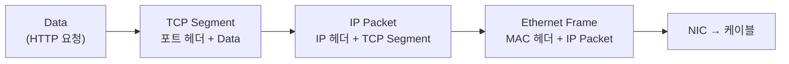

## 목차

- [[#1. 개요|1. 개요]]
- [[#2. 계층별 헤더와 주소|2. 계층별 헤더와 주소]]
- [[#3. 송신 호스트의 캡슐화|3. 송신 호스트의 캡슐화]]
- [[#4. 중간 장비를 지날 때의 변화|4. 중간 장비를 지날 때의 변화]]
- [[#5. 수신 호스트의 역캡슐화|5. 수신 호스트의 역캡슐화]]
- [[#6. 세 가지 주소가 필요한 이유|6. 세 가지 주소가 필요한 이유]]
- [[#7. 대기 중인 프로세스가 없는 포트|7. 대기 중인 프로세스가 없는 포트]]
- [[#8. 흔한 오해|8. 흔한 오해]]
- [[#9. 관련 문서|9. 관련 문서]]
- [[#10. 출처|10. 출처]]

## 1. 개요

Encapsulation(캡슐화)은 상위 계층의 데이터를 하위 계층의 헤더로 감싸 전송 단위를 만드는 방식이며, 수신 측에서 헤더를 바깥쪽부터 차례로 벗겨 내는 과정을 역캡슐화(Decapsulation)라고 한다.

TCP/IP 프로토콜 모음은 링크, 인터넷, 전송, 애플리케이션의 네 계층으로 나뉜다. 전송 계층의 메시지는 IP 데이터그램 안에 담겨 이동하고, IP 패킷은 링크 계층의 프레임 안에 담겨 이동한다.[^rfc1122] 각 계층은 자신이 맡은 일에 필요한 정보만 헤더에 기록하고, 안쪽 내용은 해석하지 않은 채 그대로 운반한다.

## 2. 계층별 헤더와 주소

웹 브라우저가 `https://example.com`으로 요청을 보낼 때 만들어지는 전송 단위는 계층마다 이름이 다르다.

| 단계 | 전송 단위 | 헤더가 담는 핵심 정보 | 이 정보가 답하는 질문 |
|---|---|---|---|
| 1 | Data (HTTP 요청) | 없음 | 무엇을 보낼 것인가 |
| 2 | TCP Segment | 출발지·목적지 포트 | 호스트 안의 어느 프로그램인가 |
| 3 | IP Packet | 출발지·목적지 IP 주소 | 어느 호스트까지 가는가 |
| 4 | Ethernet Frame | 출발지·목적지 MAC 주소 | 이번 링크에서 누구에게 넘기는가 |

TCP 헤더의 출발지 포트와 목적지 포트는 각각 16비트 필드이다.[^rfc9293] IP 헤더의 출발지 주소와 목적지 주소는 각각 32비트 필드이며, 출발지는 보내는 호스트를, 목적지는 받을 호스트를 가리킨다.[^rfc791] 이 표의 네 단계는 헤더가 붙는 순서를 보여 주는 것이고, 네 단계가 곧 TCP/IP 네 계층과 일대일로 대응하는 것은 아니다. Data는 헤더가 붙기 전의 내용이며, 가장 아래 계층은 헤더뿐 아니라 NIC와 케이블이 신호를 내보내는 부분까지 포함한다.

## 3. 송신 호스트의 캡슐화

송신 호스트에서는 안쪽부터 바깥쪽 순서로 헤더가 붙는다.

프레임의 목적지 MAC 주소에는 최종 서버가 아니라 다음 홉의 MAC 주소가 들어간다. 목적지가 다른 네트워크에 있으면 호스트는 경로표가 고른 기본 게이트웨이의 MAC 주소를 사용한다. 같은 링크에서 IP 주소에 대응하는 MAC 주소를 알아내는 프로토콜이 ARP이다. 모르는 주소가 필요할 때 호스트는 자신의 주소와 찾는 IP 주소를 담은 요청을 브로드캐스트하고, 해당 호스트가 자신의 MAC 주소를 담아 응답한다.[^rfc826] 인터넷 너머 서버의 MAC 주소는 로컬 링크에서 알 수 없고 알 필요도 없다.

## 4. 중간 장비를 지날 때의 변화

중간 장비는 자신의 역할에 필요한 헤더까지만 해석한다.

- **L2 스위치**: Ethernet 헤더의 MAC 주소를 보고 프레임을 전달하며 안쪽의 IP 패킷은 열어 보지 않는다. 동작은 [[Switch|스위치]]에서 설명한다.
- **라우터**: 받은 프레임의 링크 계층 헤더를 제거하고 IP 헤더를 확인한 뒤 새 링크 계층 헤더를 붙여 내보낸다.[^rfc1812] 이때 TTL 값은 줄어들며, 값이 0이 되면 패킷은 폐기된다.[^rfc791]

결과적으로 NAT 같은 주소 변환이 없는 기본 상황에서는 IP 주소가 끝까지 유지되고 MAC 주소는 홉마다 바뀐다. 장비별 처리 범위는 [[네트워크 장비별 처리 계층]]에서 비교한다.

쉽게 설명하면 IP 주소는 상자에 붙은 최종 배송지이고, MAC 주소는 구간마다 새로 붙이는 운송장이다. 이 비유는 TTL이 줄어드는 점, 즉 IP 헤더도 완전히 그대로 유지되지는 않는다는 점까지 설명하지는 못한다.

## 5. 수신 호스트의 역캡슐화

수신 호스트는 바깥쪽 헤더부터 확인하며 해당 계층의 질문에 답한다.

1. **링크 계층**: 프레임의 목적지가 이 인터페이스로 온 것인지 확인하고 프레임 헤더를 벗긴다.
2. **인터넷 계층**: 목적지 IP가 자신이 가진 주소인지 확인한다. 호스트는 목적지가 자신이 아닌 데이터그램을 조용히 폐기해야 한다. 목적지로 인정하는 범위는 호스트 자신의 IP 주소, 연결된 네트워크의 유효한 브로드캐스트 주소, 호스트가 가입한 멀티캐스트 그룹이다.[^rfc1122]
3. **전송 계층**: TCP 헤더의 목적지 포트로 어느 프로세스에 전달할지 정한다. TCP는 순서와 확인 응답을 처리하여 조각난 데이터를 순서대로 이어 붙인다.
4. **애플리케이션 계층**: 완성된 HTTP 요청이 웹 서버 프로그램에 전달된다.

서버의 최종 수신자는 사용자가 아니라 서버 프로세스이다. 응답은 반대 방향으로 다시 캡슐화되어 돌아가고, 요청을 보낸 PC에서 같은 역캡슐화가 일어난 뒤 브라우저가 화면을 그린다.

## 6. 세 가지 주소가 필요한 이유

세 주소는 서로 다른 단위를 가리킨다.

- **MAC 주소**: Ethernet 링크에서 인터페이스를 식별한다. 컴퓨터 한 대가 아니라 NIC마다 존재하므로 NIC가 여러 개면 MAC 주소도 여러 개이다. VM의 vNIC도 각자 MAC 주소를 가진다.
- **IP 주소**: 네트워크 간 전달에 쓰이며 인터페이스에 설정된다. 한 인터페이스에 여러 IP를 설정할 수도 있다. 구체적인 설명은 [[NIC]]에 있다.
- **포트 번호**: 한 호스트 안에서 어느 프로그램의 통신인지 구분한다. 같은 숫자의 TCP 포트와 UDP 포트는 서로 다른 전송 프로토콜의 통신 지점이다.

NIC가 여러 개인 호스트가 다른 인터페이스로 들어온 패킷의 목적지 IP를 어떻게 취급할지는 표준이 하나로 정하지 않았다. RFC 1122는 이를 선택 사항으로 두고 Strong ES와 Weak ES라는 두 모델을 구분하여 언급한다.[^rfc1122] 실제 동작은 운영체제와 설정에 따라 달라질 수 있다.

## 7. 대기 중인 프로세스가 없는 포트

목적지 IP가 맞아도 해당 포트에서 대기 중인 프로세스가 없으면 패킷이 조용히 사라지지 않고 거절 응답이 돌아온다.

- **TCP**: 연결이 존재하지 않는 상태에서 들어온 세그먼트에 대해 호스트는 리셋(RST)으로 응답한다. 들어온 세그먼트 자체가 리셋이면 응답하지 않는다.[^rfc9293rst]
- **UDP**: 대기 중인 프로세스가 없는 포트로 데이터그램이 도착하면 ICMP Port Unreachable 메시지를 보내야 한다.[^rfc1122]

방화벽이나 보안 그룹이 규칙에 맞지 않는 트래픽을 버리도록 되어 있으면 이런 거절 응답조차 돌아오지 않는다. 두 경우의 차이는 [[연결 거부와 시간 초과의 차이]]에서 다룬다.

## 8. 흔한 오해

- **MAC 주소가 끝까지 유지되고 IP 주소가 바뀐다는 생각**: 반대이다. NAT 같은 변환이 없다면 IP 주소가 종단 간 유지되고 MAC 주소는 링크마다 바뀐다.
- **패킷과 프레임이 같은 말이라는 생각**: IP 계층의 전송 단위가 패킷이고 Ethernet 계층의 전송 단위가 프레임이다. 프레임이 패킷을 담는다.
- **PC가 서버의 MAC 주소를 알아낸다는 생각**: 다른 네트워크에 있는 서버의 MAC 주소는 알 수 없다. PC는 기본 게이트웨이의 MAC 주소를 ARP로 알아낸다.
- **IP 주소가 호스트 하나에 하나씩 붙는다는 생각**: IP 주소는 인터페이스에 설정되며, 한 호스트에 여러 개가 있을 수 있다.

## 9. 관련 문서

- [[Networking|네트워크]] · [[NIC]] · [[Switch|스위치]] · [[Router|라우터]]
- [[Internet Routing|인터넷의 통신 구조]]
- [[ARP]] · [[Default Gateway|기본 게이트웨이]] · [[IP Address and Subnet|IP 주소와 서브넷]]
- [[네트워크 장비별 처리 계층]] · [[연결 거부와 시간 초과의 차이]] · [[ping 실패와 서비스 연결의 차이]]

## 10. 출처

[^rfc1122]: IETF, [RFC 1122 — Requirements for Internet Hosts: Communication Layers](https://www.rfc-editor.org/rfc/rfc1122.html). 1.1.3 Internet Protocol Suite의 네 계층, 1.3.3 Terminology의 캡슐화 설명, 3.2.1.3 Addressing의 목적지 판단, 3.3.4.2 Multihoming Requirements의 Strong·Weak ES 모델, 4.1.3.1 UDP Ports의 Port Unreachable 응답.
[^rfc9293]: IETF, [RFC 9293 — Transmission Control Protocol (TCP)](https://www.rfc-editor.org/rfc/rfc9293.html). 3.1 Header Format의 포트 필드와 2.2 Key TCP Concepts의 포트 번호 용도.
[^rfc9293rst]: IETF, [RFC 9293 — 3.5.2 Reset Generation](https://www.rfc-editor.org/rfc/rfc9293.html). 연결이 없는 상태(CLOSED)에서의 리셋 응답.
[^rfc791]: IETF, [RFC 791 — Internet Protocol](https://www.rfc-editor.org/rfc/rfc791.html). 출발지·목적지 주소 필드와 Time to Live의 감소 및 폐기.
[^rfc826]: IETF, [RFC 826 — An Ethernet Address Resolution Protocol](https://www.rfc-editor.org/rfc/rfc826.html). 같은 로컬 네트워크에서 프로토콜 주소에 대응하는 하드웨어 주소를 찾는 요청과 응답.
[^rfc1812]: IETF, [RFC 1812 — Requirements for IP Version 4 Routers](https://www.rfc-editor.org/rfc/rfc1812.html). 1 Introduction의 링크 계층 헤더 제거와 재부착.

## 둘러보기

[[Knowledge Base/index|전체 개념 목록]] · [[Networking 분류|Networking]]
