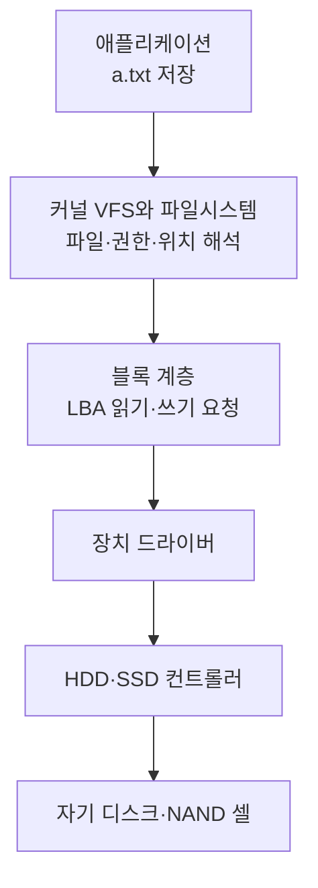
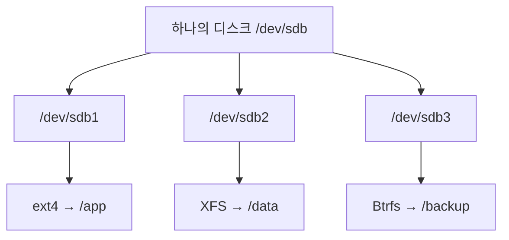

## 목차

- [[#1. 개요|1. 개요]]
- [[#2. mkfs의 파일시스템 구조 생성|2. mkfs의 파일시스템 구조 생성]]
- [[#3. 이름·inode·데이터의 연결|3. 이름·inode·데이터의 연결]]
- [[#4. 파일시스템 해석 주체와 저장장치의 역할|4. 파일시스템 해석 주체와 저장장치의 역할]]
- [[#5. 마운트 시 파일시스템 정보 해석|5. 마운트 시 파일시스템 정보 해석]]
- [[#6. 운영체제와 파일시스템 종류|6. 운영체제와 파일시스템 종류]]
- [[#7. 파일시스템을 선택하는 이유|7. 파일시스템을 선택하는 이유]]
- [[#8. 파티션과 마운트의 관계|8. 파티션과 마운트의 관계]]
- [[#9. 관련 문서|9. 관련 문서]]
- [[#10. 출처|10. 출처]]

## 1. 개요

Filesystem(파일시스템)은 블록 저장 공간에서 파일·디렉터리·이름·권한·빈 공간과 실제 데이터 위치를 기록하고 해석하는 규칙과 자료구조이다.

파일시스템은 디스크가 스스로 이해하는 추상 개념이 아니다. CPU가 실행하는 커널의 파일시스템 코드와 디스크에 기록된 메타데이터가 함께 동작한다.


## 2. `mkfs`의 파일시스템 구조 생성

```bash
sudo mkfs.ext4 /dev/sdb1
```

`mkfs.ext4` 프로그램이 `/dev/sdb1`에 ext4 형식의 관리 구조를 실제로 기록한다.

쉽게 설명하면, 빈 저장 공간에 ext4라는 이름표만 붙이는 작업이 아니다. 파일의 위치와 빈 공간을 관리할 수 있도록 장부와 색인에 해당하는 구조를 저장 공간 안에 새로 기록하는 작업이다.

| 구조 | 역할 |
|---|---|
| Superblock | 파일시스템의 종류·크기·상태와 주요 설정 |
| Block bitmap | 사용 중인 블록과 빈 블록 구분 |
| Inode bitmap | 사용 중인 inode 구분 |
| Inode table | 파일의 유형·권한·크기·데이터 위치 등 메타데이터 |
| Journal | 변경 작업과 장애 복구에 필요한 기록 |
| Data blocks | 파일과 디렉터리의 실제 내용 |


디스크의 물리적 외형은 바뀌지 않지만 HDD의 자기 상태나 SSD NAND의 전기적 상태가 달라져 비트와 바이트가 기록된다.

### 파일시스템 UUID의 생성 목적

파일시스템을 만들면 일반적으로 파일시스템 UUID가 생성된다. `/dev/sdb1` 같은 장치 이름은 검색 순서에 따라 달라질 수 있지만 UUID는 파일시스템을 새로 만들기 전까지 유지되므로 [[Fstab|fstab]]과 마운트에서 안정적인 식별자로 사용한다.

```bash
lsblk -f
sudo blkid /dev/sdb1
```

GPT 파티션의 `PARTUUID`와 파일시스템의 `UUID`는 다른 계층이다. 파티션을 유지한 채 `mkfs`를 다시 실행하면 PARTUUID는 유지될 수 있지만 파일시스템 UUID는 바뀔 수 있다.

## 3. 이름·inode·데이터의 연결

파일 이름, 메타데이터, 실제 내용은 한 덩어리가 아니다. 디렉터리가 이름을 [[Inode|inode]] 번호에 연결하고, inode가 권한·소유자·크기와 데이터 블록 위치를 관리한다.


## 4. 파일시스템 해석 주체와 저장장치의 역할

프로그램이 `/data/a.txt`에 쓸 때 파일 이름과 권한을 이해하는 것은 커널의 파일시스템 코드이다. 저장장치가 받는 요청은 더 낮은 계층의 논리 블록 읽기·쓰기 명령이다.



HDD와 SSD 컨트롤러에도 프로세서와 펌웨어가 있지만 일반적으로 ext4의 파일 이름을 해석하지는 않는다. HDD 컨트롤러는 헤드·섹터·오류 수정을, SSD 컨트롤러는 FTL·wear leveling·garbage collection·불량 블록 등을 관리한다.

## 5. 마운트 시 파일시스템 정보 해석

커널은 파일에 접근할 때마다 파일시스템 전체를 처음부터 다시 읽지 않는다. 마운트할 때 Superblock 등 주요 구조를 확인하고, 자주 사용하는 메타데이터와 파일 내용을 RAM의 캐시에 보관한다. 필요한 정보가 캐시에 없을 때 디스크에서 추가로 읽는다.[^vfs]

메모리의 변경 내용과 디스크의 상태가 항상 같은 시점에 갱신되는 것은 아니다. 갑작스러운 전원 중단 뒤 일관성을 회복하기 위해 저널링과 동기화 요청이 필요하다. `fsync`는 파일의 변경 내용을 저장장치에 반영하도록 요청하지만, 최종적인 지속성에는 파일시스템·장치 캐시·flush와 전원 보호도 관여한다.[^fsync]

## 6. 운영체제와 파일시스템 종류

Linux만 파일시스템을 사용하는 것이 아니다. 현대 운영체제는 블록 저장장치의 데이터를 파일과 디렉터리로 제공하기 위해 파일시스템을 사용한다.

| 환경 | 대표적인 파일시스템 | 일반적인 용도 |
|---|---|---|
| Linux | ext4, XFS, Btrfs | 시스템·서버·일반 데이터 |
| Windows | NTFS, ReFS | Windows 시스템과 서버 데이터 |
| macOS | APFS | macOS와 Apple 장치 |
| 여러 운영체제 | FAT32, exFAT | EFI 파티션·USB·이동식 저장장치 |

하나의 디스크를 여러 파티션으로 나누면 각 파티션에 다른 파일시스템을 만들 수 있다.



일반적으로 같은 파티션을 ext4와 XFS가 동시에 관리할 수는 없다. 기존 ext4 파티션에 `mkfs.xfs`를 실행하면 새 파일시스템 메타데이터가 기존 구조를 덮어써 데이터 접근과 복구를 어렵게 만들 수 있다.

## 7. 파일시스템을 선택하는 이유

파일시스템은 데이터 배치, 메타데이터, 저널링, 체크섬, 스냅샷, 확장·축소 지원과 장애 복구 방식이 서로 다르다.

| 파일시스템 | 입문 단계에서 기억할 점 |
|---|---|
| ext4 | 범용적이고 안정적인 Linux 파일시스템이며 확장·축소 절차를 제공 |
| XFS | 대용량과 병렬 I/O 환경에서 널리 사용하며 확장은 가능하지만 일반적인 직접 축소는 지원하지 않음 |
| Btrfs | 체크섬·서브볼륨·스냅샷 등 여러 기능을 파일시스템 계층에서 제공 |
| NTFS | Windows의 대표 파일시스템으로 권한·저널링·MFT를 사용 |
| FAT32 | 호환성은 높지만 단일 파일 크기 등 제약이 있음 |
| exFAT | 대용량 이동식 저장장치와 운영체제 간 호환에 널리 사용 |

선택은 이름이나 막연한 성능 순위가 아니라 운영체제 지원, 데이터 크기와 수, I/O 패턴, 복구 도구, 확장·축소 계획, 조직의 운영 경험을 함께 고려해야 한다.

## 8. 파티션과 마운트의 관계

파일시스템을 생성해도 아직 Linux의 디렉터리 트리에는 연결되지 않았다. 일반 사용자가 `/data/report.txt` 같은 경로로 접근하려면 파일시스템을 `/data`에 [[Mount|마운트]]해야 한다.

```text
/dev/sdb1
→ ext4 파일시스템 생성
→ /data에 마운트
→ /data/report.txt로 접근
```

파티션 없이 디스크 전체에 파일시스템을 만들 수도 있고, LVM 논리 볼륨이나 RAID 장치처럼 운영체제가 하나의 블록 장치로 제공하는 대상 위에 파일시스템을 만들 수도 있다.

## 9. 관련 문서

- [[Disk|디스크]] · [[Partition|파티션]] · [[Block Storage|블록 스토리지]]
- [[Mount|마운트]] · [[Fstab|fstab]] · [[Inode|inode]] · [[Disk Capacity Check|디스크 용량 확인]]
- [[Linux Directory Structure|Linux 디렉터리 구조]] · [[Kernel|커널]] · [[Memory|메모리]]

## 10. 출처

[^vfs]: Linux Kernel, [Overview of the Linux Virtual File System](https://docs.kernel.org/filesystems/vfs.html), 파일시스템 객체와 커널 캐시의 관계.
[^fsync]: Linux man-pages, [fsync(2)](https://man7.org/linux/man-pages/man2/fsync.2.html), 파일 데이터와 메타데이터의 동기화 의미.

## 둘러보기

[[Knowledge Base/index|전체 개념 목록]] · [[Storage 분류|Storage]]

