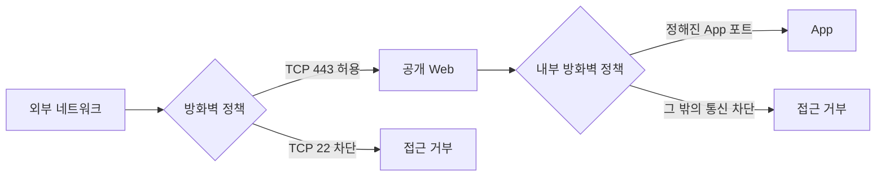
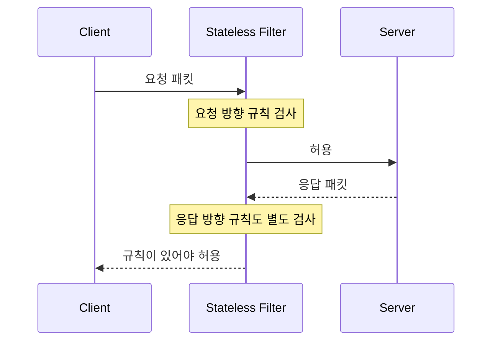
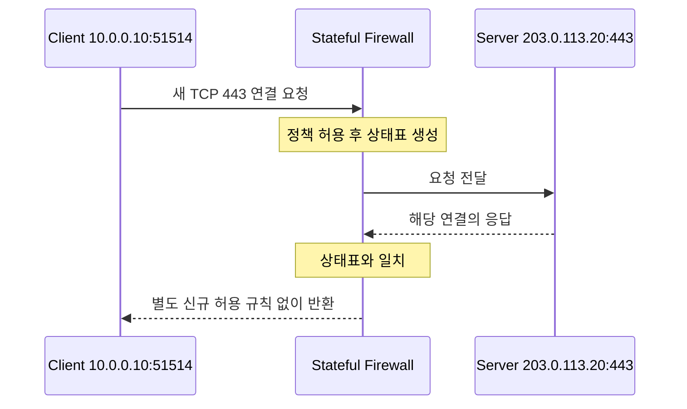

## 목차

- [[#1. 개요|1. 개요]]
- [[#2. 등장 배경과 경계의 의미|2. 등장 배경과 경계의 의미]]
- [[#3. 패킷 필터링의 판단 정보|3. 패킷 필터링의 판단 정보]]
- [[#4. 무상태 기반 필터링|4. 무상태 기반 필터링]]
- [[#5. 상태 기반 필터링|5. 상태 기반 필터링]]
- [[#6. NAT·라우터·보안 그룹과의 차이|6. NAT·라우터·보안 그룹과의 차이]]
- [[#7. 실제 구현 형태|7. 실제 구현 형태]]
- [[#8. 설계와 운영의 주의점|8. 설계와 운영의 주의점]]
- [[#9. 관련 문서|9. 관련 문서]]
- [[#10. 출처|10. 출처]]

## 1. 개요

방화벽은 서로 다른 신뢰 영역 사이의 통신을 보안 정책과 현재 연결 상태에 따라 허용하거나 차단하는 장비 또는 소프트웨어이다. 일반적으로 출발지·목적지 IP, 프로토콜, 포트와 연결 상태를 검사하며 제품에 따라 애플리케이션 내용, 사용자와 위협 정보까지 확인한다.

방화벽의 위치를 단순히 인터넷 앞쪽 장비 하나로만 이해하면 부족하다. 인터넷과 조직망 사이, DMZ와 내부망 사이, 서버 운영체제 안, 클라우드 가상 NIC 앞 등 통신 정책이 필요한 여러 경계에 둘 수 있다.

## 2. 등장 배경과 경계의 의미

라우터는 목적지까지 전달할 경로를 선택하지만 그 통신을 업무상 허용해도 되는지는 기본적으로 판단하지 않는다. 네트워크가 커지고 외부와 연결되면서 `갈 수 있는 경로`와 `가도 되는 통신`을 분리해 관리할 필요가 생겼다.



경계는 반드시 물리 장비 한 대를 뜻하지 않는다. 하나의 방화벽 어플라이언스가 여러 인터페이스와 Zone을 가질 수도 있고, 호스트 방화벽이나 분산 가상 방화벽처럼 각 서버 가까이에서 정책을 적용할 수도 있다.

## 3. 패킷 필터링의 판단 정보

기본 패킷 필터는 다음 정보를 조합해 규칙과 비교한다.

```text
출발지 IP · 목적지 IP · IP 프로토콜
출발지 포트 · 목적지 포트 · 수신 인터페이스 · 방향
```

예를 들어 `인터넷에서 Web 서버의 TCP 443으로 들어오는 통신 허용` 규칙은 목적지와 서비스 포트를 제한한다. `TCP 443 허용`만으로는 어느 서버·어느 방향·어느 출발지를 의미하는지 부족하므로 실제 정책에서는 적용 범위를 함께 명시해야 한다.

## 4. 무상태 기반 필터링

무상태 기반(Stateless) 필터는 각 패킷을 앞뒤 문맥과 독립적으로 평가한다. 요청이 허용되어도 응답 패킷은 반대 방향 규칙과 별도로 비교한다.



장점은 판단 구조가 단순하고 패킷별 정책을 명확히 표현할 수 있다는 점이다. 반면 임시 클라이언트 포트와 양방향 흐름을 운영자가 함께 고려해야 하며, 정상 연결을 가장한 패킷을 문맥 없이 판단할 수 있다.

## 5. 상태 기반 필터링

상태 기반(Stateful) 방화벽은 허용된 연결의 출발지·목적지 주소, 포트, 프로토콜과 TCP 상태 등을 상태표에 기록한다. 이후 패킷을 정책뿐 아니라 기존 연결의 예상 흐름과 비교한다.[^nist]



`상태를 기억한다`는 표현은 모든 애플리케이션 내용을 영구 저장한다는 뜻이 아니다. 일반적으로 현재 흐름을 식별하고 유효성을 판단할 연결 정보를 일정 시간 보관한다. UDP는 TCP처럼 연결 절차가 없지만 주소·포트의 흐름과 만료 시간을 이용해 의사 상태를 관리할 수 있다.

## 6. NAT·라우터·보안 그룹과의 차이

| 기능 | 중심 질문 | 대표 상태 |
|---|---|---|
| 라우팅 | 목적지로 어느 다음 홉을 선택하는가 | 라우팅 테이블 |
| NAT | 주소·포트를 무엇으로 바꾸고 응답을 어디로 돌리는가 | 변환 상태표 |
| 방화벽 | 이 통신을 정책상 허용할 것인가 | 규칙과 연결 상태표 |
| Security Group | 클라우드 자원의 가상 인터페이스에 어떤 흐름을 허용할 것인가 | 제품별 규칙과 세션 상태 |

한 장비가 라우팅·NAT·방화벽을 모두 수행할 수 있지만 기능의 목적은 다르다. NAT로 외부 주소를 숨기는 효과가 생길 수 있어도 NAT 자체를 완전한 보안 정책으로 간주하면 안 된다.

## 7. 실제 구현 형태

- 전용 방화벽 어플라이언스와 가상 어플라이언스
- Linux `nftables`·Windows Defender Firewall 같은 호스트 방화벽
- 하이퍼바이저·가상 네트워크에 분산된 방화벽
- 클라우드의 [[Security Group]]·Network ACL·관리형 Network Firewall
- L7 Proxy·WAF와 결합하여 HTTP 요청 내용을 검사하는 구성

물리 장비도 CPU·메모리·NIC와 운영체제 또는 전용 데이터 평면을 가진 컴퓨터이다. 고성능 제품은 ASIC·NPU와 병렬 처리 구조로 규칙·상태표 검색을 가속한다.

## 8. 설계와 운영의 주의점

- 필요한 출발지·목적지·서비스만 허용하는 최소 허용 원칙을 적용한다.
- 상태 기반 장비를 이중화할 때는 경로와 세션 상태 동기화를 함께 검토한다.
- 왕복 경로가 서로 다른 비대칭 라우팅에서는 한쪽 방화벽이 연결 상태를 보지 못할 수 있다.
- 허용 규칙만 만들지 말고 로그·흐름 기록과 변경 이력을 운영한다.
- 방화벽 통과는 애플리케이션 인증 성공을 의미하지 않는다. 네트워크 허용과 사용자 권한은 별도 계층이다.

## 9. 관련 문서

- [[Security Group]] · [[NAT]] · [[Router|라우터]]
- [[Public and Private IP|공인 IP와 사설 IP]] · [[SSH]] · [[TLS]]

## 10. 출처

[^nist]: NIST, [SP 800-41 Rev. 1, Guidelines on Firewalls and Firewall Policy](https://csrc.nist.gov/pubs/sp/800/41/r1/final). 패킷 필터, 상태표와 Stateful Inspection의 구조 및 방화벽 정책 지침.

## 둘러보기

[[Knowledge Base/index|전체 개념 목록]] · [[Security 분류|Security]] · [[Networking 분류|Networking]]
