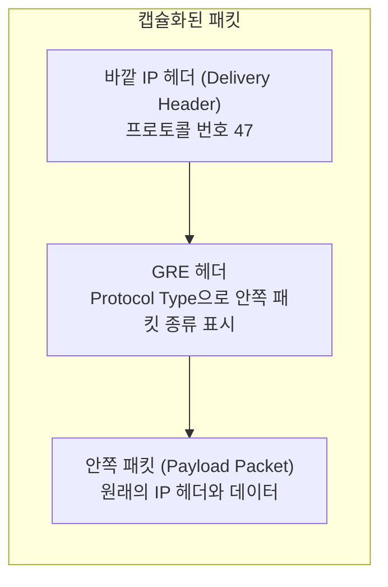

## 목차

- [[#1. 개요|1. 개요]]
- [[#2. 패킷 캡슐화의 구조|2. 패킷 캡슐화의 구조]]
- [[#3. 바깥 주소와 안쪽 주소|3. 바깥 주소와 안쪽 주소]]
- [[#4. IP 프로토콜 번호 47과 방화벽|4. IP 프로토콜 번호 47과 방화벽]]
- [[#5. 보안: GRE가 정의하지 않는 것과 IPsec 결합|5. 보안: GRE가 정의하지 않는 것과 IPsec 결합]]
- [[#6. 캡슐화 오버헤드와 MTU|6. 캡슐화 오버헤드와 MTU]]
- [[#7. 사이트 간 연결과 겹치는 IP 대역|7. 사이트 간 연결과 겹치는 IP 대역]]
- [[#8. IPv6와 Linux 구현상 유의점|8. IPv6와 Linux 구현상 유의점]]
- [[#9. 다른 터널링 방식과의 비교|9. 다른 터널링 방식과의 비교]]
- [[#10. 관련 문서|10. 관련 문서]]
- [[#11. 출처|11. 출처]]

## 1. 개요

GRE(Generic Routing Encapsulation)는 어떤 네트워크 계층 프로토콜의 패킷이든 다른 네트워크 계층 프로토콜 위에 실어 보내도록 만든 캡슐화 프로토콜이다.[^1] RFC 2784가 기본 명세이고, 헤더에 Key와 Sequence Number를 선택적으로 넣는 확장은 RFC 2890이 정의한다.[^2]

택배에 견주면 이해하기 쉽다. 보내려는 물건(원래 패킷)에 GRE 헤더라는 안내표를 붙이고, 이를 운송장이 붙은 큰 택배 상자(바깥 IP 헤더)에 넣어 보낸다. 중간의 택배사는 바깥 운송장만 보고 옮기고, 도착한 곳에서 바깥 상자를 뜯어 안쪽 택배를 꺼내 원래 수신자에게 전달한다. 이렇게 두 지점 사이에 가상의 직통 통로를 만드는 것을 터널링이라고 한다. 다만 GRE 터널은 연결 상태를 유지하는 회선이 아니라 패킷마다 캡슐을 씌우는 방식이다.

GRE 자체는 암호화나 인증 기능을 정의하지 않는다. 그래서 보안이 필요하면 IPsec 같은 다른 프로토콜과 함께 쓴다(5절).

## 2. 패킷 캡슐화의 구조

RFC 2784는 안에 실을 원래 패킷을 payload packet, 바깥을 감싸는 프로토콜을 delivery protocol이라고 부른다. 먼저 payload가 GRE 패킷으로 캡슐화되고, 그 GRE 패킷이 다시 delivery protocol로 캡슐화되어 전달된다.[^1] 이 문서에서는 delivery header를 바깥 헤더, payload packet을 안쪽 패킷이라고 부른다.

그림은 RFC 2784에 나온 세 층의 순서(Delivery Header, GRE Header, Payload packet)를 다시 구성했다.[^1] RFC 2784의 GRE 헤더 정의에는 포트 필드가 없다.

GRE 헤더의 기본 형태는 다음과 같다.[^1]

- Checksum Present 비트: 켜져 있으면 Checksum과 Reserved1 필드가 뒤따른다.
- Version: 값은 0이어야 한다.
- Protocol Type: 안쪽 패킷의 종류를 나타내며, IPv4를 싣는 경우에는 0x800으로 지정한다.

RFC 2890은 Reserved0 필드의 비트 일부를 재정의해 Key Present와 Sequence Number Present 비트를 만들고, 4바이트 Key와 4바이트 Sequence Number를 선택적으로 넣게 한다. Key는 터널 안에서 개별 트래픽 흐름을 구분하는 용도이다. Sequence Number는 수신 측이 패킷이 송신된 순서를 파악하는 데 쓰며, RFC 2890은 용도를 "unreliable but in-order delivery", 즉 신뢰성은 보장하지 않으면서 순서대로 전달하는 것이라고 설명한다.[^2] 손실된 패킷을 다시 보내 주는 기능은 아니다.

## 3. 바깥 주소와 안쪽 주소

터널에는 두 종류의 주소가 등장한다.

- 바깥 주소(outer IP): 터널 양 끝 장비가 실제 네트워크에서 서로를 찾아가는 주소이다. 바깥 IP 헤더의 출발지와 목적지가 된다. 중간 라우터는 이 주소만 보고 패킷을 전달한다.
- 안쪽 주소(inner IP): 터널 안으로 들어가는 원래 패킷의 출발지와 목적지 주소이다. 터널 양 끝에 도착하기 전까지는 중간 장비에게 보이지 않는다.

Linux의 `ip tunnel` 명령에서는 `local`과 `remote`가 터널 양 끝의 주소를 가리키고, 캡슐화하는 쪽 주소 체계를 바깥(outer) 주소 체계라고 부른다.[^3] 터널 끝에서 캡슐이 풀리면 안쪽 패킷은 일반 패킷처럼 목적지 주소를 기준으로 다음 경로가 정해진다. 안쪽 패킷의 목적지가 터널 반대편 끝 자신이면 루프가 생길 수 있어서, 이 경우에는 패킷을 폐기해야 한다.[^1]

## 4. IP 프로토콜 번호 47과 방화벽

GRE를 IPv4 위에 실을 때는 IP 프로토콜 번호 47을 쓴다.[^1] IANA의 프로토콜 번호 표에도 47번이 GRE로 등록되어 있다.[^4]

프로토콜 번호는 IP 헤더가 안에 무엇이 들었는지 알려 주는 필드이고, 포트 번호는 TCP나 UDP 헤더에 들어 있다. GRE 헤더 정의에는 포트가 없으므로 방화벽에서 "TCP 몇 번 포트"를 여는 것으로는 GRE를 지정할 수 없다. 이는 작성자의 정리이며, GRE를 통과시키려면 프로토콜 47을 허용하는 규칙이 따로 필요하다.

RFC 2784의 보안 고려사항은 GRE 패킷을 필터링하려면 GRE 패킷 안을 검사해야 한다는 점을 다룬다. 방화벽이 GRE 패킷 안을 검사하거나 터널 양 끝 장비에서 필터링해야 하며, 이것이 문제가 되는 환경에서는 방화벽에서 터널을 종단하는 방법을 고려할 수 있다고 한다.[^1]

## 5. 보안: GRE가 정의하지 않는 것과 IPsec 결합

GRE 자체는 암호화나 인증 기능을 정의하지 않는다. RFC 2784의 헤더 정의에는 이를 위한 필드가 없고, Checksum은 오류 검출용이다.[^1] RFC 2890은 Key 필드가 이름과 달리 어떤 보안에도 관여하지 않는다고 명시한다.[^2] RFC 2784의 보안 절은 GRE를 쓰는 네트워크의 보안이 일반 IPv4 네트워크와 비슷한 수준이라고 서술한다.[^1] 따라서 별도 보호가 없으면 안쪽 패킷은 경로상에서 그대로 읽힐 수 있다. 이 마지막 문장은 작성자의 설명이다.

RFC 2890은 Sequence Number 필드를 쓸 때 임의의 번호를 가진 패킷을 끼워 넣어 서비스 거부 공격을 할 수 있다고 지적한다. 이를 막기 위해 이 확장을 쓰는 경우 IPsec의 ESP 또는 AH로 GRE 헤더와 터널링되는 payload를 보호해야 한다고 규정한다.[^2] 이 요구는 RFC 2890 확장의 보안 고려사항이며, 확장을 쓰지 않는 기본 GRE 전반에 대한 규정은 아니다.

IPsec은 IP 계층에서 접근 제어, 무결성, 데이터 출처 인증, 재전송 탐지, 기밀성 등을 제공하는 보안 구조이다.[^5] ESP는 기밀성과 무결성, 출처 인증을 제공하고,[^6] AH는 암호화 없이 무결성과 출처 인증만 제공한다.[^7] GRE 패킷을 IPsec으로 보호하면 GRE는 무엇을 담아 어디로 보낼지를, IPsec은 그 내용을 어떻게 보호할지를 맡게 된다. 이 역할 구분은 작성자의 정리이다.

## 6. 캡슐화 오버헤드와 MTU

캡슐화는 헤더를 덧붙이므로 같은 링크에 실을 수 있는 안쪽 패킷의 최대 크기가 줄어든다. 아래 계산은 바깥 헤더가 옵션 없는 IPv4이고, GRE 선택 필드를 쓰지 않으며, 경로 MTU가 1500바이트라고 가정한 값이다.

IPv4 헤더는 옵션이 없을 때 20바이트(IHL의 최솟값 5 × 4바이트)이고,[^8] 기본 GRE 헤더는 4바이트이다.[^1] 따라서 오버헤드는 20 + 4 = 24바이트이고, 안쪽 패킷은 계산하면 1500 - 24 = 1476바이트까지 담을 수 있다. Checksum(Reserved1 포함 4바이트), Key(4바이트), Sequence Number(4바이트)를 모두 켜면 GRE 헤더는 최대 16바이트가 되어 오버헤드는 계산상 36바이트, 안쪽 최대 크기는 1464바이트가 된다.[^1][^2] 이 값들은 헤더 도식의 크기에서 도출한 것이며 RFC가 합계를 직접 적지는 않는다. 또한 GRE 패킷을 IPsec으로 보호하면 ESP 또는 AH 헤더가 더해져 안쪽 패킷의 최대 크기가 더 줄어든다. 줄어드는 폭은 모드와 알고리즘에 따라 다르다.

안쪽 패킷이 이보다 크면 바깥 패킷이 조각나서(fragmentation) 도착 지점에서 다시 조립되거나, Don't Fragment 비트가 켜진 패킷은 버려질 수 있다. 조각화는 조각마다 IP 헤더가 붙는 오버헤드와 조립 연산 부담을 만든다.[^9]

RFC 2784는 알려진 문제로, 당시 구현이 Path MTU Discovery를 하지 않고 바깥 헤더에 DF 비트를 설정하지 않아 큰 패킷이 터널 안에서 조각난다고 적는다. 또한 터널 입구가 PMTU Discovery를 쓰려면 ICMP 오류를 원래 송신자에게 중계해야 하는데, 이를 제대로 하지 않으면 송신자가 같은 크기로 계속 재전송하고 패킷이 계속 버려질 수 있다고 설명한다.[^1] Linux의 `ip tunnel`에는 터널별로 Path MTU Discovery를 끄는 `nopmtudisc`, DF 비트를 무시하는 `ignore-df` 옵션이 있다.[^3] 터널 MTU 문제는 구현마다 다룰 수 있는 범위가 달라서, 실제로 쓰는 장비의 문서로 확인해야 한다.

## 7. 사이트 간 연결과 겹치는 IP 대역

GRE의 대표적인 용도에는 서로 다른 두 사이트의 네트워크를 이어 하나의 경로처럼 사용하는 구성이 있다. 사이트 A와 B의 경계 장비가 서로 도달 가능한 주소를 바깥 주소로 삼아 터널을 만들고, 두 사이트의 내부 대역 사이를 터널로 라우팅한다. RFC 2663은 사설 네트워크가 공용 백본으로 분리된 경우를 설명하며, 이때 주소 변환 없이 사설 네트워크의 패킷을 외부 네트워크의 터널로 전달만 한다고 서술한다.[^10]

이 구성은 각 사이트가 서로 겹치지 않는 주소를 쓴다는 전제 위에 있다. 라우팅은 안쪽 목적지 주소로 이루어지므로 같은 대역이 양쪽에 있으면 어느 쪽을 가리키는 주소인지 구분되지 않고, 터널만으로는 이 충돌이 해결되지 않는다. 이런 경우에는 대역을 새로 배정하거나 주소 변환을 쓰는 등의 설계가 따로 필요하다. 이 문단은 위 전제에서 이어지는 작성자의 설명이며, 어느 대역을 어떻게 대응시킬지는 환경마다 설계해야 한다.

## 8. IPv6와 Linux 구현상 유의점

RFC 2784는 IPv6를 delivery나 payload 프로토콜로 쓰는 경우를 당시 배포된 GRE의 범위에 포함하지 않았다.[^1] Linux의 `ip tunnel`은 IPv6를 바깥 주소 체계로 쓰는 모드로 `ip6gre`를 제공한다.[^3] IPv6 바깥 헤더는 IPv4와 크기가 달라 6절의 계산이 그대로 맞지 않는다.

`ip tunnel`의 `seq` 옵션은 GRE 터널에서 패킷을 직렬화하는 기능이지만, 매뉴얼은 이 옵션이 동작하지 않으니 쓰지 말라고 적고 있다.[^3]

## 9. 다른 터널링 방식과의 비교

| 방식 | 싣는 대상 | 바깥 전송 | 암호화 | 특징 |
|---|---|---|---|---|
| GRE | 임의의 네트워크 계층 패킷[^1] | IP 프로토콜 47[^1] | 정의하지 않음[^1] | 단순하고 범용적이며 보호가 필요하면 IPsec과 결합 |
| IPsec(터널 모드) | IP 패킷[^5] | ESP 또는 AH[^6][^7] | ESP는 제공, AH는 제공하지 않음[^6][^7] | 인증, 재전송 탐지, 무결성 제공. 기밀성은 ESP가 담당 |
| VXLAN | 이더넷 프레임(Layer 2)[^11] | UDP, 목적지 포트 4789[^11] | 자체 정의 없음, IPsec 등으로 보호 가능[^11] | 24비트 VNI로 최대 약 1,600만 개의 세그먼트를 구분 |
| WireGuard | IP 패킷[^12] | UDP[^12] | 제공[^12] | 공개 키 교환만으로 연결하는 단순한 VPN |

- GRE와 VXLAN은 둘 다 캡슐화 방식이지만 대상이 다르다. VXLAN은 Layer 3 네트워크 위에 Layer 2 네트워크를 겹쳐 올리는 오버레이이고,[^11] GRE는 계층을 가리지 않는 범용 캡슐화이다.
- WireGuard는 터널과 암호화를 함께 제공하고, IPsec은 ESP를 쓰면 보호까지 함께 제공한다. GRE는 터널만 제공하므로 보호 계층이 따로 필요하다.
- GRE는 프로토콜 번호로, VXLAN과 WireGuard는 UDP 포트로 전달된다. 따라서 방화벽에서 열어야 할 대상이 다르다.

## 10. 관련 문서

- [[Networking]]

- [[Server Migration Types]]

- [[Rackware|RackWare]]: 서버 이전 구성에서 사이트 간 연결에 쓰일 수 있다.

## 11. 출처

[^1]: [IETF — RFC 2784 Generic Routing Encapsulation (GRE)](https://www.rfc-editor.org/rfc/rfc2784)
[^2]: [IETF — RFC 2890 Key and Sequence Number Extensions to GRE](https://www.rfc-editor.org/rfc/rfc2890)
[^3]: [ip-tunnel(8) manual page](https://man7.org/linux/man-pages/man8/ip-tunnel.8.html)
[^4]: [IANA — Protocol Numbers](https://www.iana.org/assignments/protocol-numbers/protocol-numbers.xhtml)
[^5]: [IETF — RFC 4301 Security Architecture for the Internet Protocol](https://www.rfc-editor.org/rfc/rfc4301)
[^6]: [IETF — RFC 4303 IP Encapsulating Security Payload (ESP)](https://www.rfc-editor.org/rfc/rfc4303)
[^7]: [IETF — RFC 4302 IP Authentication Header](https://www.rfc-editor.org/rfc/rfc4302)
[^8]: [IETF — RFC 791 Internet Protocol](https://www.rfc-editor.org/rfc/rfc791)
[^9]: [IETF — RFC 4459 MTU and Fragmentation Issues with In-the-Network Tunneling](https://www.rfc-editor.org/rfc/rfc4459)
[^10]: [IETF — RFC 2663 IP Network Address Translator (NAT) Terminology and Considerations](https://www.rfc-editor.org/rfc/rfc2663)
[^11]: [IETF — RFC 7348 Virtual eXtensible Local Area Network (VXLAN)](https://www.rfc-editor.org/rfc/rfc7348)
[^12]: [WireGuard — Fast, Modern, Secure VPN Tunnel](https://www.wireguard.com/)

## 둘러보기

[[Knowledge Base/index|전체 개념 목록]] · [[Networking 분류|Networking]]
