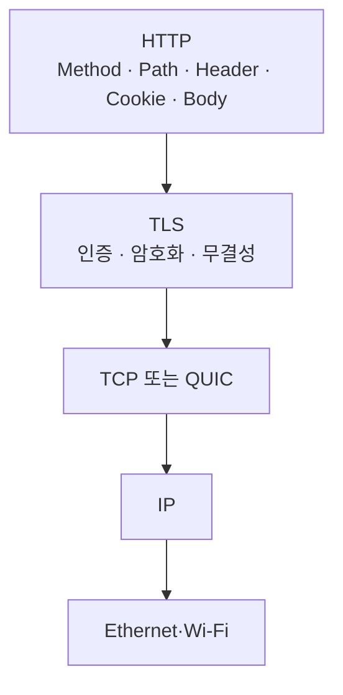
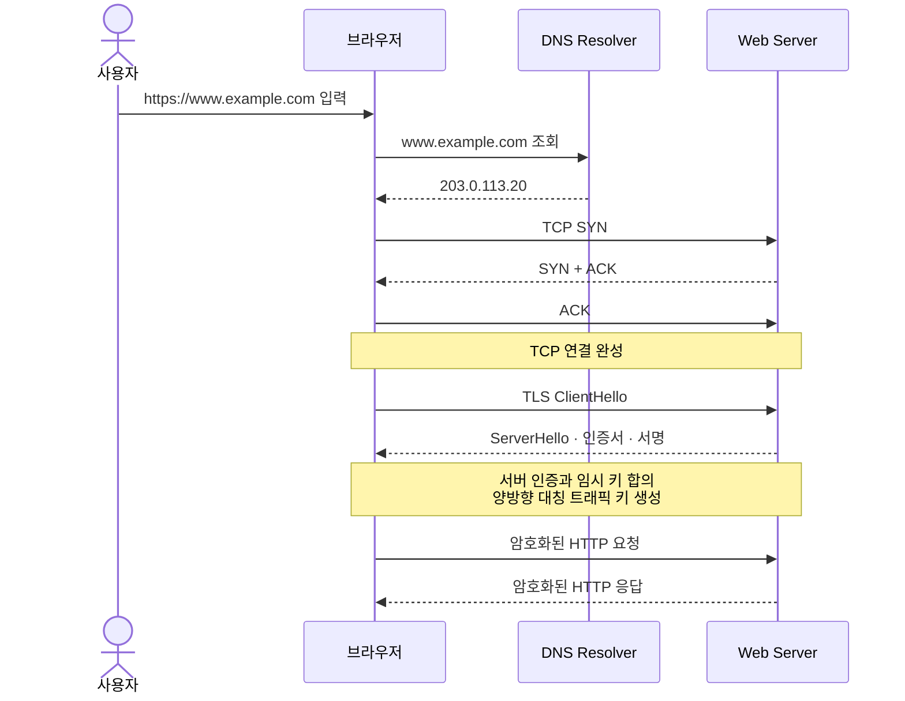

## 목차

- [[#1. 개요|1. 개요]]
- [[#2. HTTP 요청과 응답|2. HTTP 요청과 응답]]
- [[#3. HTTPS의 구성|3. HTTPS의 구성]]
- [[#4. HTTPS 접속 순서|4. HTTPS 접속 순서]]
- [[#5. 암호화되는 정보와 남는 관찰 정보|5. 암호화되는 정보와 남는 관찰 정보]]
- [[#6. HTTP 버전에 따른 운반 방식|6. HTTP 버전에 따른 운반 방식]]
- [[#7. 흔한 오해|7. 흔한 오해]]
- [[#8. 관련 문서|8. 관련 문서]]
- [[#9. 출처|9. 출처]]

## 1. 개요

HTTP(Hypertext Transfer Protocol)는 클라이언트가 자원에 대한 요청을 보내고 서버가 상태·헤더·내용으로 응답하는 응용 계층 프로토콜이다. HTTPS는 별개의 웹 의미 체계가 아니라, 서버 신원 확인·기밀성·무결성이 제공되는 TLS 연결을 통해 HTTP를 주고받는 방식이다.[^rfc9110]

```text
HTTP     요청·응답의 의미와 형식
TLS      서버 인증·기밀성·무결성
TCP·QUIC 전송과 연결 관리
IP       목적지까지 패킷 전달
Ethernet 현재 링크의 다음 장비까지 전달
```

## 2. HTTP 요청과 응답

HTTP 요청은 어떤 자원에 무슨 동작을 원하는지 표현한다.

```http
GET /account HTTP/1.1
Host: www.example.com
Cookie: session=example-token
```

서버는 상태 코드, 응답 헤더와 표현 데이터를 돌려준다.

```http
HTTP/1.1 200 OK
Content-Type: text/html

<html>...</html>
```

HTTP는 요청과 응답의 의미를 정하지만 그 자체로 전송 중 암호화를 제공하지 않는다. 평문 HTTP 연결을 관찰할 수 있는 위치에서는 요청 경로·헤더·쿠키·본문과 응답을 읽거나 바꿀 가능성이 있다.

## 3. HTTPS의 구성

HTTPS에서는 HTTP 메시지를 TLS가 보호한다.



TLS는 HTTP 요청의 뜻을 처리하지 않는다. HTTP는 인증서와 암호 알고리즘을 결정하지 않는다. 각 계층이 역할을 나누기 때문에 같은 TLS를 웹뿐 아니라 다른 응용 프로토콜에서도 활용할 수 있다.

## 4. HTTPS 접속 순서

HTTP/1.1 또는 HTTP/2를 새 TCP 연결로 사용하는 대표적인 순서는 다음과 같다.



TCP 3-way handshake는 순서와 재전송이 있는 바이트 통로를 준비한다. TLS handshake는 그 통로 위에서 서버 신원을 확인하고 암호화 키를 만든다. 실제 HTTP 요청은 TLS 연결이 준비된 뒤 전송한다.

이미 DNS 캐시나 기존 TCP·TLS 연결이 있으면 일부 단계는 재사용하거나 생략될 수 있다. HTTP/3은 TCP 대신 UDP 위의 QUIC를 사용하므로 이 순서와 다르다.

## 5. 암호화되는 정보와 남는 관찰 정보

다음 URL을 예로 든다.

```text
https://shop.example.com/order?id=123
```

| 정보 | 일반적인 네트워크 관찰자에게 보이는 정도 | 설명 |
|---|---|---|
| 출발지·목적지 IP | 보임 | 라우터가 패킷을 전달하는 데 필요 |
| 전송 프로토콜·포트 | 보임 | TCP·UDP 흐름을 식별하는 외부 헤더 |
| 도메인 | 환경에 따라 드러날 수 있음 | 평문 DNS 질의, TLS ClientHello의 서버 이름 정보 등 |
| HTTP Method | 암호화 | `GET`, `POST` 등 |
| Path·Query | 암호화 | `/order?id=123` |
| HTTP Header·Cookie | 암호화 | `Host`, 인증 토큰 등 |
| 요청·응답 Body | 암호화 | HTML·JSON·업로드·다운로드 내용 |
| 패킷 크기·시각·방향 | 관찰 가능 | TLS는 통신의 존재와 모든 메타데이터를 숨기는 익명화 기술이 아님 |

`URL이 보인다`는 표현은 구성 요소를 나누어 확인해야 한다. HTTPS의 HTTP 요청 안에 있는 Path와 Query는 암호화되지만, 목적지 IP와 통신 형태는 남는다. 도메인도 DNS와 TLS 설정에 따라 외부에 드러날 수 있다.

## 6. HTTP 버전에 따른 운반 방식

| 버전 | 대표적인 전송 구조 | 특징 |
|---|---|---|
| HTTP/1.1 | HTTP → TLS → TCP | 텍스트 기반 메시지 형식과 지속 연결 지원 |
| HTTP/2 | HTTP/2 Frame → TLS → TCP | 하나의 연결에서 여러 Stream을 다중화 |
| HTTP/3 | HTTP/3 → QUIC·TLS 1.3 → UDP | Stream별 손실 영향 분리와 QUIC 연결 관리 |

HTTP/3은 일반적인 TCP 3-way handshake를 사용하지 않는다. QUIC가 UDP 위에서 연결·신뢰성·암호화를 통합하며 TLS 1.3을 사용한다.[^rfc9114]

## 7. 흔한 오해

- HTTPS는 HTTP 본문만 암호화하는 기능이 아니다. Header·Cookie·Path·Query도 TLS 내부에서 보호한다.
- HTTPS가 목적지 IP, 통신 시각과 크기까지 모두 숨기는 것은 아니다.
- TCP 연결만으로 보안 통로가 생기지 않는다. TCP와 TLS handshake의 역할은 다르다.
- HTTPS 인증서는 웹사이트가 안전한 사업이라는 보증서가 아니라 접속한 서비스 이름과 공개 키의 신뢰 관계를 검증하는 자료이다.
- 443번 포트를 사용한다고 자동으로 TLS가 성립하는 것은 아니다. 실제 프로토콜 협상과 인증서 검증이 성공해야 한다.

## 8. 관련 문서

- [[TLS]] · [[Digital Signature and Certificate|전자서명과 인증서]]
- [[DNS]] · [[Encapsulation|캡슐화]] · [[L4 and L7 Load Balancing|L4·L7 로드 밸런싱]]
- [[Web Server|WEB 서버]] · [[Firewall]] · [[Security Group]]

## 9. 출처

[^rfc9110]: IETF, [RFC 9110, HTTP Semantics](https://www.rfc-editor.org/rfc/rfc9110.html). HTTP 요청·응답의 의미와 HTTP·HTTPS URI, HTTPS의 서버 인증·기밀성·무결성 요구사항.
[^rfc9114]: IETF, [RFC 9114, HTTP/3](https://www.rfc-editor.org/rfc/rfc9114.html). QUIC 위에서 동작하는 HTTP/3 구조와 TLS 1.3 사용.

## 둘러보기

[[Knowledge Base/index|전체 개념 목록]] · [[Networking 분류|Networking]] · [[Security 분류|Security]]
