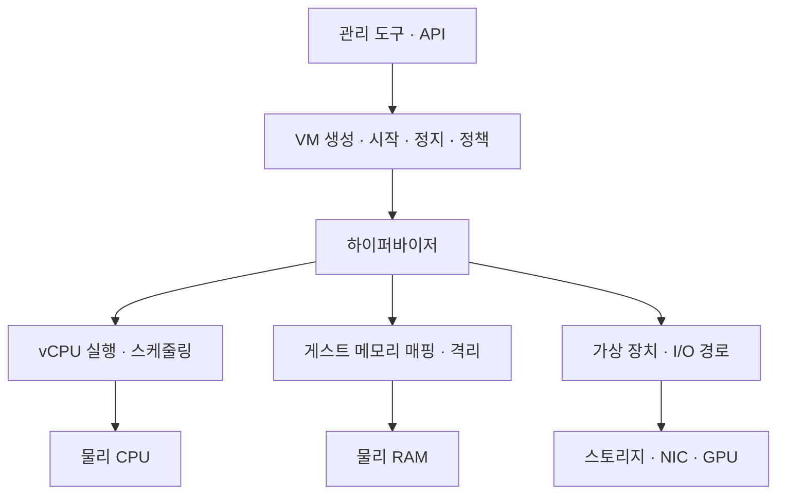
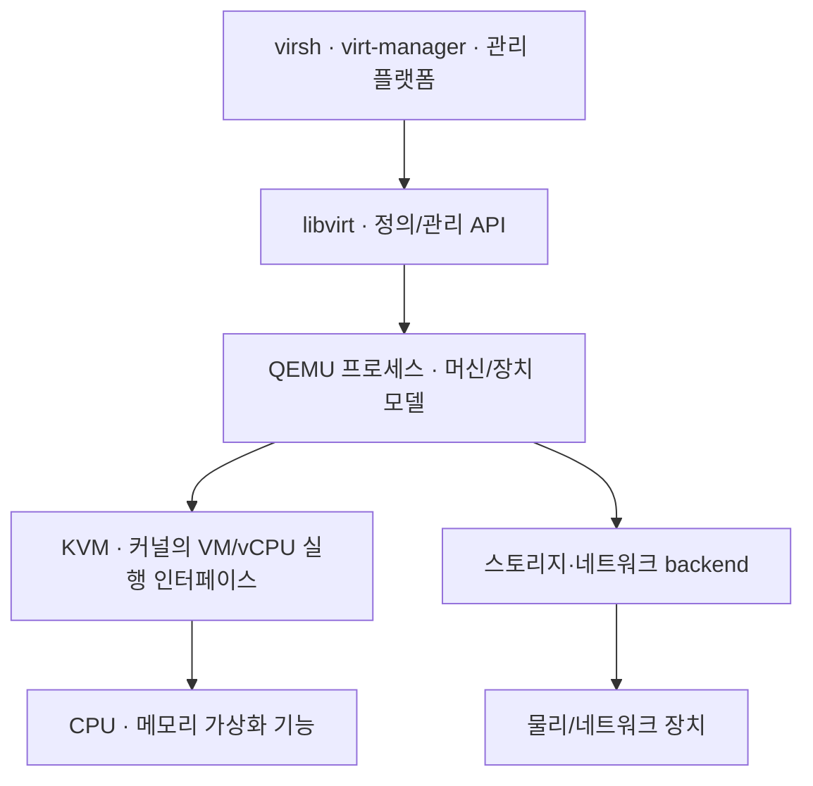

## 1. 개요

Hypervisor(하이퍼바이저)는 여러 가상 머신이 물리 CPU·메모리·장치에 접근하도록 가상 실행 환경을 만들고, 그 접근을 중재하고 격리하는 소프트웨어 계층이다.

Virtual Machine Monitor(VMM)라고도 한다. 하이퍼바이저는 물리 자원을 VM에 그대로 잘라 붙이는 단순 분배기가 아니다. 게스트 운영체제에 가상 하드웨어를 보여 주고, 여러 VM의 실행 시간을 배정하며, 주소 변환과 특권 동작을 통제한다. 실제 저장장치·네트워크 I/O는 하이퍼바이저 핵심부뿐 아니라 호스트 커널, 관리 파티션, 사용자 공간 장치 모델이 나누어 처리할 수 있다.[^hyperv]

## 2. 하이퍼바이저가 필요한 이유

운영체제는 자신이 CPU의 특권 제어와 메모리·장치를 관리한다고 전제한다. 운영체제 여러 개를 같은 장비에서 그대로 실행하면 서로 같은 자원을 통제하려고 충돌한다. 하이퍼바이저는 각 게스트 OS에 독립된 컴퓨터처럼 보이는 인터페이스를 제공하면서, 실제 장비에 영향을 주는 동작을 자신이 통제한다.

예를 들어 두 VM이 모두 ‘메모리 주소 0x1000’을 사용해도 실제 RAM에서는 서로 다른 페이지에 연결할 수 있다. 각 VM이 ‘디스크 0번’에 쓰는 데이터도 서로 다른 이미지나 볼륨으로 보낸다. 한 VM의 vNIC가 보낸 프레임은 가상 스위치 정책에 따라 같은 호스트의 VM이나 물리 NIC로 전달된다. 이 매핑과 경계를 유지하는 것이 핵심이다.

하이퍼바이저가 있다고 고가용성이 자동으로 생기는 것은 아니다. 호스트 한 대에 VM을 여러 개 만들면 환경은 분리되지만 물리 호스트·전원·스토리지·관리 계층은 공유한다. 호스트 장애에 대비하려면 다른 호스트로의 재시작, 클러스터, 데이터 복제와 애플리케이션 수준 복구를 별도로 설계해야 한다.

## 3. Type 1과 Type 2 분류

| 구분 | 배치 방식 | 대표 사용 | 예시 |
|---|---|---|---|
| Type 1 · bare-metal | 하이퍼바이저가 물리 하드웨어를 직접 통제하고 그 위에 게스트가 실행 | 데이터센터·서버 통합 | VMware ESXi, Microsoft Hyper-V, Xen 계열 |
| Type 2 · hosted | 일반 호스트 OS 위의 애플리케이션·모듈 형태로 실행 | 개인 PC의 개발·시험 | Oracle VirtualBox, VMware Workstation 계열 |

이 구분은 입문용 배치 모델이지 성능·보안·구조를 모두 설명하는 법칙이 아니다. Type 1이라고 무조건 더 빠르고 안전한 것도 아니며, Type 2라고 모든 게스트 명령이 호스트 OS를 여러 번 거치는 것도 아니다. 현대 CPU의 가상화 지원을 이용하면 두 유형 모두 게스트의 많은 명령을 물리 CPU에서 직접 실행할 수 있다.

특히 구현을 화면 모양으로 분류하면 틀리기 쉽다. Hyper-V에는 Windows가 실행되는 root partition이 있지만, Microsoft 구조에서 그 partition도 하이퍼바이저 위에 있다. root partition이 장치 드라이버와 관리 스택을 맡고 child partition의 I/O를 지원한다. 따라서 관리용 Windows가 보인다는 이유만으로 Hyper-V를 Type 2라고 할 수 없다.[^hyperv]

KVM도 한 단어로 Type 1/2를 단정하기보다 구조를 설명하는 편이 정확하다. KVM은 Linux 커널에 VM과 vCPU 실행 기능을 제공하고, QEMU는 사용자 공간에서 가상 머신과 장치 모델을 제공하며, libvirt는 VM 정의와 관리 API를 제공한다. Linux가 일반 운영체제이면서 하이퍼바이저 역할을 함께 수행하기 때문에 단순 층 그림만으로는 이 분업이 보이지 않는다.[^kvm-api][^qemu][^libvirt]

## 4. CPU 명령이 실행되는 원리

### 하드웨어 보조 가상화

Intel VT-x와 AMD-V 같은 기능은 게스트 실행 모드와 하이퍼바이저 제어 모드를 구분하고, 통제가 필요한 사건이 생겼을 때 하이퍼바이저로 제어를 넘긴다. 게스트의 일반 계산 명령은 가능한 한 실제 CPU에서 실행되며, 특정 제어 레지스터 접근·I/O·예외 등은 VM exit를 일으켜 하이퍼바이저나 장치 모델이 처리할 수 있다.

그러므로 ‘VM의 모든 명령을 소프트웨어가 한 줄씩 번역한다’는 설명은 현대의 같은 CPU 아키텍처를 사용하는 하드웨어 가속 가상화에 맞지 않는다. 반대로 QEMU의 TCG처럼 다른 CPU 아키텍처를 소프트웨어로 에뮬레이션할 때는 명령 변환이 핵심이 될 수 있다. QEMU는 에뮬레이터이면서 KVM 같은 가속기와 결합하는 가상 머신 모델이기도 하다.[^qemu]

### vCPU 스케줄링

게스트 OS는 vCPU에 자신의 프로세스와 스레드를 배치한다. 그 바깥에서 호스트는 각 vCPU가 물리 논리 CPU에서 실행될 시간을 정한다. 이중 스케줄링 때문에 VM 안에서는 CPU가 유휴해 보이거나, 반대로 게스트가 실행하려는데 호스트에서 차례를 기다릴 수 있다.

vCPU pinning은 특정 물리 CPU 집합에서 실행하도록 후보를 제한하는 설정이다. 다른 작업이 그 CPU를 사용할 수 있다면 pinning만으로 전용 코어가 보장되지는 않는다. NUMA 호스트에서는 vCPU와 메모리, 장치의 위치가 서로 멀어지지 않게 배치하는 것도 성능에 영향을 준다.[^libvirt]

## 5. 메모리와 I/O를 중재하는 원리

게스트가 보는 주소는 게스트 가상 주소 → 게스트 물리 주소 → 호스트 물리 주소의 두 단계로 연결된다. EPT·NPT 같은 SLAT 기능은 두 번째 변환을 하드웨어로 돕는다. 하이퍼바이저는 한 VM의 주소가 다른 VM의 메모리에 임의로 연결되지 않도록 매핑과 권한을 관리한다.[^kvm-mmu]

I/O에는 여러 경로가 있다.

1. **장치 에뮬레이션**: 실제 하드웨어와 비슷한 가상 장치를 제공해 오래된 게스트도 사용할 수 있게 한다. 호환성이 좋지만 추가 처리가 필요하다.
2. **준가상화 장치**: virtio나 Hyper-V synthetic device처럼 가상화 환경을 아는 드라이버가 효율적인 큐와 통신 경로를 사용한다.
3. **장치 직접 할당**: PCI passthrough나 SR-IOV VF를 VM에 연결해 중간 처리를 줄인다. IOMMU가 DMA 주소를 격리하는 데 쓰인다.[^vfio]

직접 할당은 성능만 얻고 비용은 없는 방식이 아니다. VM 이동, 저장 상태 캡처, 오버커밋, 장치 공유가 제한될 수 있다. 실제 지원 여부는 CPU·메인보드·펌웨어·IOMMU 그룹·장치·하이퍼바이저·게스트 드라이버를 함께 확인해야 한다.

## 6. KVM·QEMU·libvirt의 역할 구분

- **KVM**: `/dev/kvm` 인터페이스를 통해 VM과 vCPU를 만들고 게스트 실행을 커널과 CPU 가상화 기능에 연결한다.
- **QEMU**: CPU·메모리·칩셋·가상 장치를 포함한 머신 모델을 제공한다. KVM과 결합할 때 CPU 실행을 가속하고, TCG를 쓸 때는 CPU를 에뮬레이션한다.
- **libvirt**: CPU·메모리·디스크·NIC 같은 VM 구성을 정의하고 여러 가상화 드라이버를 관리하는 API와 도구 계층이다.

세 이름을 모두 ‘하이퍼바이저 제품’이라고 뭉뚱그리면 장애 위치를 찾기 어렵다. 게스트가 실행되지 않는 문제, 가상 디스크 backend 문제, 관리 API 연결 문제는 서로 다른 계층에 있을 수 있다.

## 7. 대표 하이퍼바이저와 생태계

| 구현 | 핵심 역할 | 함께 구분할 이름 |
|---|---|---|
| VMware ESXi | 물리 서버에서 VM을 실행하는 하이퍼바이저 | vCenter는 여러 호스트 관리, vSphere는 관련 플랫폼·기능 묶음 |
| Microsoft Hyper-V | partition 기반으로 VM을 실행하는 Type 1 하이퍼바이저 | root partition의 Windows가 관리·드라이버 역할 수행 |
| KVM | Linux 커널의 하드웨어 가속 VM 실행 기반 | QEMU 장치 모델, libvirt 관리 계층과 결합 |
| Xen | hypervisor와 관리 domain을 분리하는 구조 | dom0와 guest domain의 역할 구분 필요 |
| Oracle VirtualBox | 호스트 OS 위에서 실행하는 hosted 하이퍼바이저 | 개발 PC의 다중 OS 시험 사례 |
| IBM z/VM | IBM 메인프레임용 가상화 운영 환경 | x86 하이퍼바이저와 다른 역사·아키텍처 계보 |

기업 이름보다 ‘어느 계층을 말하는가’를 먼저 본다. 예를 들어 ESXi와 vCenter, KVM과 libvirt, Hyper-V와 Failover Clustering은 서로 같은 범주의 이름이 아니다.

## 8. 격리와 보안의 범위

하이퍼바이저는 VM별 CPU 상태·메모리 매핑·장치 접근 경계를 제공한다. 하지만 VM 격리가 완전한 보안을 뜻하지는 않는다. 하이퍼바이저나 장치 에뮬레이터 취약점, 잘못 연결한 가상 네트워크, 과도한 관리 권한, 오래된 펌웨어, 관리 API 노출이 경계를 약화할 수 있다.[^nist]

관리 계층은 VM 메모리·디스크·콘솔과 전원을 제어할 수 있어 높은 권한을 가진다. 그래서 일반 서비스망과 관리망의 분리, 최소 권한, 다중 인증, 보안 업데이트, 감사 로그, 이미지 출처 검증이 중요하다. 게스트 OS의 패치와 방화벽도 여전히 필요하며 하이퍼바이저가 대신하지 않는다.

성능 간섭과 보안 침해도 구분해야 한다. 한 VM이 공유 CPU나 스토리지를 많이 사용해 다른 VM이 느려지는 noisy neighbor는 자원 경쟁 문제이고, 다른 VM의 데이터에 접근한 보안 침해와 같은 뜻이 아니다. 둘 다 격리 설계의 대상이지만 대응 수단은 다르다.[^noisy]

## 9. 운영자가 확인할 핵심 지표

| 영역 | 확인할 현상 | 잘못된 단정 |
|---|---|---|
| CPU | vCPU 실행 대기, 호스트 포화, NUMA 배치 | 게스트 CPU 100%면 물리 CPU만 증설하면 해결 |
| 메모리 | 호스트 여유, balloon·reclaim·swap, NUMA locality | VM 할당량 합이 RAM보다 커도 사용량이 낮으니 항상 안전 |
| 스토리지 | 지연 시간, IOPS·처리량, 큐, snapshot chain | 가상 디스크 크기만 보면 성능을 알 수 있음 |
| 네트워크 | vNIC·가상 스위치·물리 uplink의 드롭과 대역폭 | VM끼리 통신하면 항상 물리 스위치를 지남 |
| 장애 영역 | 호스트·랙·스토리지·관리 서버의 공유 범위 | VM이 여러 대면 물리 이중화도 완료 |

하이퍼바이저 문제를 볼 때는 게스트 내부 지표와 호스트 지표를 함께 본다. 게스트에서 CPU가 바빠 보이지 않아도 호스트에서 vCPU가 실행 차례를 기다릴 수 있고, 게스트 디스크 지연은 이미지 파일·호스트 파일시스템·SAN·물리 디스크 중 어느 계층에서나 생길 수 있다.

## 10. 관련 문서

- [[Virtualization]] · [[Virtual Machine]] · [[Bare Metal]]
- [[CPU]] · [[Memory]] · [[Disk]] · [[NIC]]
- [[Physical Server Configuration]] · [[Server Migration Types]]

## 11. 출처

[^hyperv]: Microsoft Learn, [Hyper-V architecture](https://learn.microsoft.com/en-us/virtualization/hyper-v-on-windows/reference/hyper-v-architecture). hypervisor, root·child partition, VMBus와 장치 경로.
[^kvm-api]: Linux Kernel, [The KVM API](https://docs.kernel.org/virt/kvm/api.html). VM·vCPU 생성, 메모리 영역과 `KVM_RUN` 인터페이스.
[^qemu]: QEMU Project, [About QEMU](https://www.qemu.org/docs/master/about/) 및 [System emulation introduction](https://www.qemu.org/docs/master/system/introduction.html). KVM 가속, TCG, 머신·장치 모델.
[^libvirt]: libvirt, [Domain XML format](https://libvirt.org/formatdomain.html). vCPU pinning, 디스크·네트워크·장치 등 VM 정의.
[^kvm-mmu]: Linux Kernel, [The x86 KVM shadow MMU](https://docs.kernel.org/virt/kvm/x86/mmu.html). 게스트 주소와 호스트 물리 주소의 변환 계층.
[^vfio]: Linux Kernel, [VFIO - Virtual Function I/O](https://docs.kernel.org/driver-api/vfio.html). IOMMU 기반 장치 직접 할당과 격리 단위.
[^nist]: NIST SP 800-125, [Guide to Security for Full Virtualization Technologies](https://csrc.nist.gov/pubs/sp/800/125/final). 하이퍼바이저·가상 네트워크·관리 보안의 범위.
[^noisy]: Microsoft Azure Architecture Center, [Noisy Neighbor antipattern](https://learn.microsoft.com/en-us/azure/architecture/antipatterns/noisy-neighbor/noisy-neighbor). 공유 자원 경합에 따른 성능 간섭.

## 둘러보기

[[Knowledge Base/index|전체 개념 목록]] · [[Compute 분류|Compute]]
