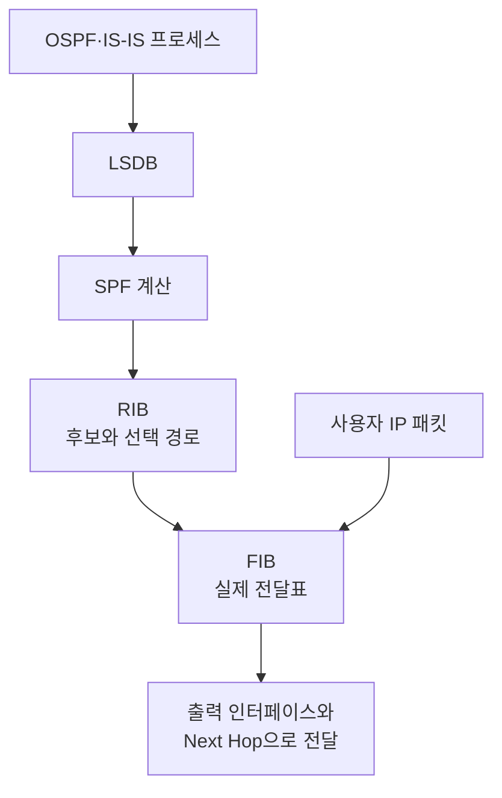
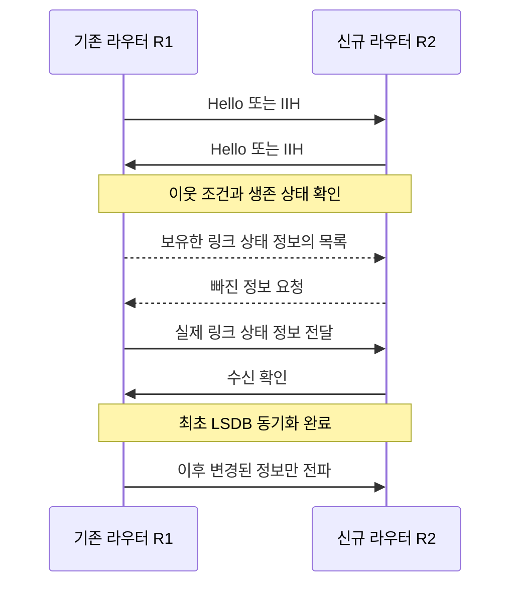
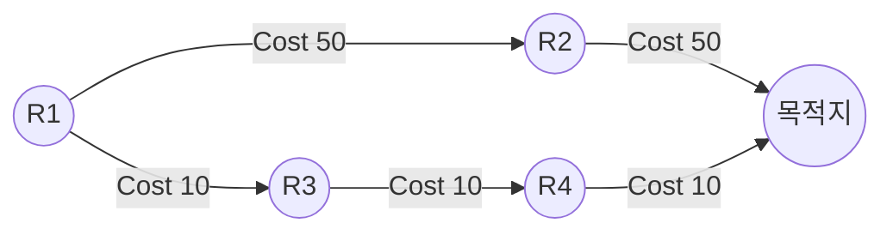
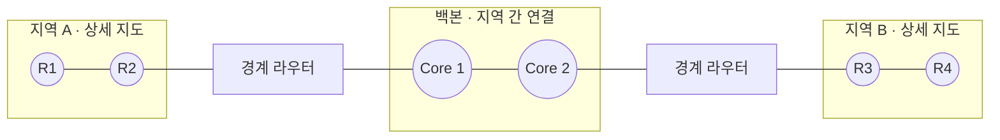
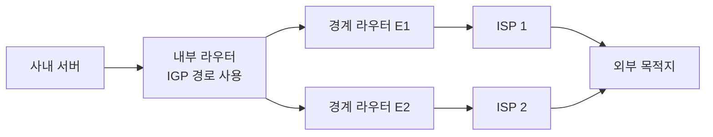
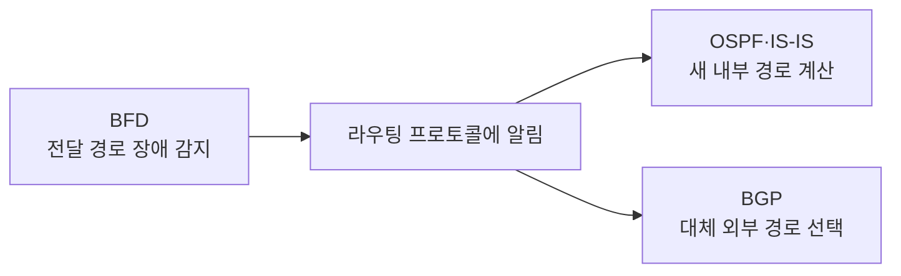

## 목차

- [[#1. 개요|1. 개요]]
- [[#2. 분산된 네트워크 지도의 본질|2. 분산된 네트워크 지도의 본질]]
- [[#3. 제어 평면과 데이터 평면의 연결|3. 제어 평면과 데이터 평면의 연결]]
- [[#4. 이웃 관계와 지도 동기화|4. 이웃 관계와 지도 동기화]]
- [[#5. Metric과 경로 선택|5. Metric과 경로 선택]]
- [[#6. 영역 분리와 계층화|6. 영역 분리와 계층화]]
- [[#7. BGP와의 역할 분담|7. BGP와의 역할 분담]]
- [[#8. 장애 수렴과 빠른 복구|8. 장애 수렴과 빠른 복구]]
- [[#9. 흔한 오해|9. 흔한 오해]]
- [[#10. 관련 문서|10. 관련 문서]]
- [[#11. 출처|11. 출처]]

## 1. 개요

IGP(Interior Gateway Protocol)는 하나의 AS 또는 한 조직의 관리 영역 안에서 라우터들이 내부 목적지까지의 경로를 배우고 선택하는 라우팅 프로토콜의 범주이다.

IGP는 특정 프로토콜 하나의 이름이 아니다. [[OSPF]]와 [[IS-IS]]는 네트워크의 링크 상태를 공유한 뒤 각 라우터가 최단 경로를 계산하는 Link-State IGP이다. RIP처럼 이웃에게 목적지까지의 거리와 방향을 전달하는 Distance-Vector 계열도 IGP에 포함된다. 이 문서에서는 현재 대규모 네트워크의 내부 라우팅을 이해하는 데 중요한 OSPF와 IS-IS를 중심으로 설명한다.

## 2. 분산된 네트워크 지도의 본질

OSPF와 IS-IS의 본질은 **라우터들이 내부 네트워크의 지도를 함께 만들고, 각자 자신의 위치에서 목적지까지의 최적 경로를 계산하는 것**이다. 중앙 서버가 모든 패킷의 길을 실시간으로 지시하는 구조가 아니다.

같은 지도를 가진 라우터도 출발 위치가 다르므로 최적 Next Hop은 서로 다를 수 있다. 교통 지도가 같아도 서울과 부산에서 같은 목적지로 출발하는 경로가 다른 것과 같다.

### 링크 상태 정보와 LSDB

- **링크 상태 정보**: 어떤 라우터와 어떤 링크가 연결되어 있는지, 링크를 이용하는 비용은 얼마인지 나타낸다.
- **Flooding**: 새 정보가 영역 안의 다른 라우터로 빠짐없이 퍼지도록 전달하는 절차이다. 사용자 데이터의 브로드캐스트와는 다르다.
- **LSDB(Link-State Database)**: 라우터가 수집한 링크 상태 정보로 구성한 토폴로지 데이터베이스이다.
- **SPF(Shortest Path First)**: LSDB를 바탕으로 자신을 루트로 하는 최단 경로 트리를 계산하는 절차이다.

OSPF는 링크 상태 정보를 `LSA`로, IS-IS는 `LSP`로 전달한다. 이름은 다르지만 네트워크 지도에 반영할 사실을 운반한다는 목적은 같다.

## 3. 제어 평면과 데이터 평면의 연결

라우팅 프로토콜이 직접 모든 사용자 패킷을 처리하는 것은 아니다. OSPF·IS-IS 프로세스는 경로를 배우고 계산하는 제어 평면에서 동작하며, 실제 패킷은 그 결과를 정리한 FIB를 조회하는 데이터 평면에서 전달된다.

- **RIB(Routing Information Base)**: Connected·Static·OSPF·IS-IS·BGP 등에서 얻은 경로를 비교하고 선택하는 라우팅 정보 구조이다.
- **FIB(Forwarding Information Base)**: 실제 패킷을 빠르게 전달하도록 선택 경로를 Next Hop과 출력 인터페이스 중심으로 정리한 표이다.
- **Hop**: 패킷이 한 L3 장비에서 다음 L3 장비로 전달되는 한 단계이다. 일반적인 L2 스위치 통과는 Hop으로 세지 않는다.

라우팅 프로토콜이 새 경로를 계산하는 동안 기존 FIB가 즉시 사라지는 것은 아니다. 다만 기존 경로가 실제로 끊어진 상태라면 새 FIB가 설치되기 전까지 일부 패킷이 유실될 수 있다.

## 4. 이웃 관계와 지도 동기화

새 라우터가 연결되었다고 바로 안전하게 경로를 계산할 수는 없다. 먼저 이웃을 확인하고, 기존 라우터가 가진 지도를 맞춘 뒤, 이후 변경분을 계속 반영해야 한다.

OSPF는 `DBD·LSR·LSU·LSAck`를, IS-IS는 `CSNP·PSNP·LSP`를 사용하여 목록 비교, 누락 정보 요청, 실제 정보 전달과 수신 확인을 수행한다. 약어 자체보다 **이웃 확인 → 최초 지도 동기화 → 변경분 전파 → 누락 확인과 재전송**이라는 흐름이 중요하다.

## 5. Metric과 경로 선택

Metric은 여러 후보 경로의 선호도를 비교하는 값이며, OSPF와 IS-IS는 일반적으로 경로를 구성하는 링크 Metric의 합이 낮은 쪽을 선호한다. 따라서 지나가는 라우터 수가 더 많더라도 전체 Cost가 낮으면 그 경로를 선택할 수 있다.

위 예시에서는 위쪽 경로의 합이 100이고 아래쪽 경로의 합이 30이므로, Hop 수가 더 많은 아래쪽 경로가 선택된다. OSPF는 인터페이스 대역폭을 바탕으로 기본 Cost를 산출할 수 있고 운영자가 값을 조정할 수도 있다. IS-IS Metric도 운영 정책에 맞게 설정할 수 있다. 두 경로의 비용이 같고 장비가 지원하면 ECMP(Equal-Cost Multi-Path)로 함께 사용할 수 있다.

Metric은 실시간 혼잡도를 자동으로 정확히 반영하는 값이라고 볼 수 없다. 기본 계산과 운영자의 설계 의도를 반영하는 정책 값에 가깝다.

## 6. 영역 분리와 계층화

라우터 수가 매우 많은 네트워크를 하나의 LSDB와 Flooding 범위로 유지하면 작은 장애도 넓게 전파되고 많은 라우터가 SPF를 다시 계산한다. OSPF는 `Area`, IS-IS는 `Level`을 이용해 상세 지도의 범위를 나눈다.

지역 내부의 상세한 링크 변화는 가능한 한 해당 지역 안에서 처리하고, 다른 지역에는 그 지역으로 도달하는 데 필요한 정보만 전달한다. 이 구조는 LSDB 크기, Flooding 범위와 SPF 계산 부담을 줄이고 장애 영향 범위를 분리하는 데 도움이 된다.

## 7. BGP와의 역할 분담

[[BGP]]는 AS 사이에서 외부 프리픽스의 도달 경로와 정책을 교환한다. IGP는 같은 AS 안에서 선택된 경계 라우터와 BGP Next Hop까지 도달하는 내부 경로를 제공한다.[^rfc4271]

- **BGP**: 외부 목적지로 나갈 출구와 AS 경로 선택
- **IGP**: 현재 위치에서 선택된 출구까지의 내부 경로 계산

BGP가 E2를 최적 출구로 선택했어도 IGP가 E2의 Next Hop까지 도달할 경로를 제공하지 못하면 해당 BGP 경로는 실제 전달에 사용할 수 없다. 반대로 내부 라우터가 인터넷의 모든 BGP 프리픽스를 알 필요는 없다. 일반 내부 장비에는 경계 라우터를 향한 기본 경로 `0.0.0.0/0`이나 필요한 요약 경로만 제공할 수 있다.

인터넷의 방대한 BGP 경로를 IGP에 무분별하게 재배포하면 LSDB·RIB가 커지고 외부 변화가 내부 전체에 영향을 주며 잘못된 재배포로 루프가 발생할 수 있다. 두 프로토콜의 책임을 분리하는 이유이다.

## 8. 장애 수렴과 빠른 복구

Convergence(수렴)는 장애가 발생한 뒤 관련 라우터가 변경된 토폴로지와 새 경로를 반영하여 전달 상태가 다시 안정되는 과정이다.

전체 복구 시간에는 장애 감지, 정보 전파, 경로 계산과 FIB 반영이 모두 포함된다. 실제 링크가 끊어진 뒤 프로토콜이 오랫동안 알아차리지 못하면 나머지 과정이 빨라도 전체 복구는 늦어진다.

### Hello와 BFD의 차이

OSPF Hello와 IS-IS IIH는 이웃의 생존뿐 아니라 Area·Level과 타이머 등 라우팅 프로토콜의 이웃 조건을 확인한다. BFD(Bidirectional Forwarding Detection)는 매체와 라우팅 프로토콜에 독립적으로 두 Forwarding Engine 사이의 양방향 경로 장애를 매우 짧은 지연으로 감지하기 위한 별도 프로토콜이다.[^rfc5880]

BFD가 Hello를 완전히 대체하는 것은 아니다. Hello는 이웃 관계 관리를 계속 담당하고, 빠른 장애 복구가 필요한 구간에서는 BFD가 장애 감지를 보조한다.

### Fast Reroute

Fast Reroute는 장애 이후에야 모든 계산을 시작하는 대신, 안전한 예비 Next Hop을 미리 계산해 두었다가 장애가 감지되면 우선 전환하는 방식이다. 이후 전체 네트워크가 정상적인 수렴 절차를 완료한다. IP Fast Reroute의 Loop-Free Alternate는 분산 수렴이 끝날 때까지 사용할 수 있는 루프 없는 예비 Next Hop을 미리 계산하여 패킷 손실을 줄인다.[^rfc5286]

## 9. 흔한 오해

- **IGP는 프로토콜 하나의 이름이다**: IGP는 AS 내부 라우팅 프로토콜의 범주이며 OSPF와 IS-IS 등이 포함된다.
- **모든 라우터는 하나의 기본 게이트웨이만 사용한다**: 라우터는 목적지 프리픽스별로 여러 Next Hop을 가진다. 더 구체적인 경로가 없을 때만 기본 경로를 사용한다.
- **Link-State 프로토콜은 최종 경로만 알려 준다**: 라우터들은 링크 상태 사실을 공유하고 각자 자신의 위치에서 SPF를 계산한다.
- **Flooding은 사용자 패킷을 모든 곳에 뿌리는 동작이다**: 여기서 Flooding은 라우팅 제어 정보를 영역 안에 전달하는 절차이다.
- **Hop은 케이블이나 스위치 하나를 지나는 횟수이다**: 일반적으로 한 L3 전달 단계를 뜻한다.
- **BFD가 새 경로를 계산한다**: BFD는 장애 감지를 담당하며 새 경로 계산은 OSPF·IS-IS·BGP가 수행한다.

## 10. 관련 문서

- [[OSPF]] · [[IS-IS]] · [[BGP]]
- [[Router|라우터]] · [[Internet Routing|인터넷의 통신 구조]]
- [[Backbone Network|백본 네트워크]] · [[Default Gateway|기본 게이트웨이]]

## 11. 출처

[^rfc4271]: IETF, [RFC 4271 — A Border Gateway Protocol 4](https://www.rfc-editor.org/rfc/rfc4271.html). AS 사이의 도달성 정보와 BGP 경로 교환의 표준.
[^rfc5880]: IETF, [RFC 5880 — Bidirectional Forwarding Detection](https://www.rfc-editor.org/rfc/rfc5880.html). 라우팅 프로토콜과 독립적인 양방향 전달 경로 장애 감지의 표준.
[^rfc5286]: IETF, [RFC 5286 — Basic Specification for IP Fast Reroute: Loop-Free Alternates](https://www.rfc-editor.org/rfc/rfc5286.html). 미리 계산한 예비 Next Hop을 이용한 빠른 로컬 복구의 표준.

- IETF, [RFC 2328 — OSPF Version 2](https://www.rfc-editor.org/rfc/rfc2328.html). Link-State IGP, LSDB, SPF, Area와 ECMP의 기본 동작.
- IETF, [RFC 1195 — Use of OSI IS-IS for Routing in TCP/IP and Dual Environments](https://www.rfc-editor.org/rfc/rfc1195.html). Integrated IS-IS의 IP IGP 동작과 계층 구조.

## 둘러보기

[[Knowledge Base/index|전체 개념 목록]] · [[Networking 분류|Networking]]
