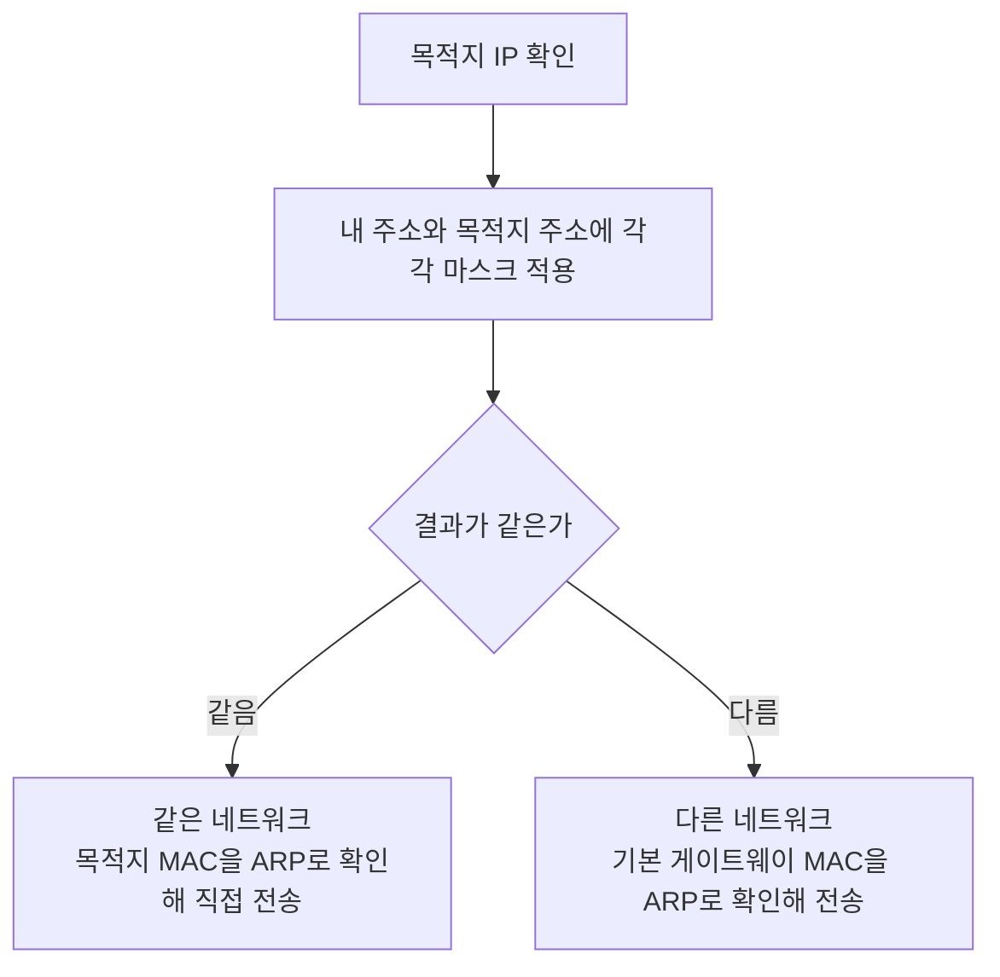

## 목차

- [[#1. 개요|1. 개요]]
- [[#2. 네트워크 부분과 호스트 부분|2. 네트워크 부분과 호스트 부분]]
- [[#3. 서브넷 마스크의 판단|3. 서브넷 마스크의 판단]]
- [[#4. 비트로 읽는 주소 블록|4. 비트로 읽는 주소 블록]]
- [[#5. 클래스 기반 주소의 한계와 CIDR|5. 클래스 기반 주소의 한계와 CIDR]]
- [[#6. 서브네팅과 슈퍼네팅|6. 서브네팅과 슈퍼네팅]]
- [[#7. 경로 선택과 Longest Prefix Match|7. 경로 선택과 Longest Prefix Match]]
- [[#8. 흔한 오해|8. 흔한 오해]]
- [[#9. 관련 문서|9. 관련 문서]]
- [[#10. 출처|10. 출처]]

## 1. 개요

IPv4 주소는 32비트 값이며, 앞쪽 일부는 네트워크를 가리키고 나머지는 그 네트워크 안의 호스트를 가리킨다. 서브넷 마스크와 CIDR 프리픽스는 이 32비트를 어디에서 나눌지 정하는 표기이다.

IPv4는 주소의 형식과 패킷 전달 규칙을 정한 프로토콜이고, CIDR(Classless Inter-Domain Routing)은 그 주소를 가변 길이 프리픽스로 나누어 할당하고 경로를 묶는 방식이다. 두 용어는 같은 뜻이 아니다. `192.168.10.0/24`라는 표기에서 `192.168.10.0`은 IPv4 주소이고, `/24`가 CIDR의 프리픽스 길이이다.

## 2. 네트워크 부분과 호스트 부분

주소의 앞쪽 비트는 네트워크 번호이고 뒤쪽 비트는 호스트 번호이다. 서브넷을 쓰면 원래의 호스트 번호 일부를 서브넷 번호로 떼어 쓰며, 호스트 번호는 최소 1비트 이상 남아야 한다.[^rfc950]

예를 들어 `192.168.10.200/24`에서 앞 24비트 `192.168.10`이 네트워크 부분이고, 마지막 8비트 `200`이 호스트 부분이다. 마지막 8비트가 항상 호스트 부분인 것은 아니며, 프리픽스 길이가 `/28`이면 마지막 4비트만 호스트 부분이 된다.

## 3. 서브넷 마스크의 판단

호스트는 자신의 IP 주소와 함께 마스크 값을 저장한다. 데이터를 보낼 때는 목적지 주소와 자신의 주소에 각각 마스크를 적용해 결과를 비교한다. 결과가 같으면 같은 로컬 네트워크이므로 직접 전달하고, 다르면 게이트웨이로 보낸다.[^rfc950] 인터페이스가 여러 개이면 주소와 마스크도 인터페이스마다 따로 둔다.

`192.168.10.200/24` 호스트에게 `192.168.10.37`은 같은 네트워크이고 `192.168.20.5`는 다른 네트워크이다. 이 판단은 호스트가 내리며, 스위치는 IP 주소를 보지 않고 MAC 주소 테이블만 사용한다. 서브넷이 달라도 스위치의 MAC 테이블 학습에는 영향이 없다. 동작은 [[Switch|스위치]]와 [[Encapsulation|캡슐화]]에서 설명한다.

서로 다른 서브넷의 두 호스트가 같은 스위치에 연결되어도 통신이 되지 않는 이유는 스위치가 막아서가 아니라 송신 호스트가 상대의 MAC 주소로 프레임을 보내지 않기 때문이다. 송신 호스트는 게이트웨이로 보내려 하지만 같은 스위치에 게이트웨이가 없으면 전달되지 않는다.

## 4. 비트로 읽는 주소 블록

`192.168.10.37/28`을 예로 계산한다. 마스크는 `255.255.255.240`이고, 마지막 옥텟 37은 이진수로 `00100101`이다. 앞 4비트 `0010`이 네트워크 부분이므로 이 주소가 속한 블록은 32부터 시작하며 블록 크기는 16이다.

| 항목 | 값 | 계산 |
|---|---|---|
| 네트워크 주소 | 192.168.10.32 | 호스트 비트를 모두 0으로 만든 주소 |
| 브로드캐스트 주소 | 192.168.10.47 | 호스트 비트를 모두 1로 만든 주소 |
| 할당 가능한 주소 | 192.168.10.33 ~ 192.168.10.46 | 16 - 2 = 14개 |
| 게이트웨이를 하나 쓸 때 단말용 | 13개 | 게이트웨이가 주소 하나를 사용한다고 가정 |

호스트 비트가 모두 0인 값은 네트워크 자체를, 모두 1인 값은 그 네트워크의 모든 호스트를 가리킨다.[^rfc950][^rfc919] 그래서 호스트 비트가 n개이면 일반적으로 할당 가능한 주소는 `2^n - 2`개이다. 호스트 비트가 1개나 0개인 `/31`, `/32` 같은 경우는 별도 규칙이 있어 이 문서에서는 다루지 않는다.

같은 계산을 옥텟 경계가 아닌 곳에 적용해도 같다. `192.168.0.0/22`는 호스트 비트가 10개이므로 주소는 1024개이고, 3번째 옥텟 0부터 3까지가 하나의 블록이다. 이 블록의 브로드캐스트 주소는 `192.168.3.255`이다.

## 5. 클래스 기반 주소의 한계와 CIDR

초기 IPv4는 주소 앞부분의 비트로 Class A, B, C를 구분하는 고정 크기 체계를 사용했다. Class A는 네트워크 번호가 7비트, B는 14비트, C는 21비트이다.[^rfc791]

이 체계는 세 가지 문제를 낳았다. Class C는 많은 조직에 너무 작고 Class B는 너무 커서 Class B 공간이 고갈되고 있었으며, 전역 라우팅 테이블이 라우터와 운영자가 감당하기 어려울 만큼 커지고 있었고, 32비트 주소 공간이 결국 부족해질 것이었다.[^rfc4632] CIDR의 목표는 라우팅 테이블의 증가를 늦추고 주소 소모 속도를 줄이는 것이었으며, 장기적인 주소 고갈 자체를 해결하지는 못했다.[^rfc4632]

CIDR은 고정된 클래스 크기를 가변 길이 프리픽스로 바꾸었다. 프리픽스 길이는 앞쪽 몇 비트가 네트워크 부분인지를 나타내며, `172.16.0.0/16`은 옛 Class B, `192.168.99.0/24`는 옛 Class C 크기에 해당한다. 2의 거듭제곱 크기의 블록이라면 어떤 크기든 정의할 수 있다.[^rfc4632]

| 프리픽스 | 마스크 | 호스트 비트 | 주소 수 |
|---|---|---|---|
| /22 | 255.255.252.0 | 10 | 1024 |
| /24 | 255.255.255.0 | 8 | 256 |
| /28 | 255.255.255.240 | 4 | 16 |

## 6. 서브네팅과 슈퍼네팅

서브네팅은 프리픽스를 길게 하여 큰 블록을 작은 블록으로 나누는 일이고, 슈퍼네팅은 프리픽스를 짧게 하여 여러 블록을 하나로 묶는 일이다. 묶인 경로를 하나의 광고로 내보내는 것을 경로 집약(Route Aggregation)이라고 한다. 집약을 하면 상위 네트워크에 알리는 경로 수가 줄어든다.[^rfc4632]

`192.168.0.0/24`부터 `192.168.3.0/24`까지 네 블록은 `192.168.0.0/22` 하나로 묶인다. 3번째 옥텟을 이진수로 쓰면 이유가 보인다.

| 블록 | 3번째 옥텟 |
|---|---|
| 192.168.0.0/24 | 000000**00** |
| 192.168.1.0/24 | 000000**01** |
| 192.168.2.0/24 | 000000**10** |
| 192.168.3.0/24 | 000000**11** |

네 블록 모두 3번째 옥텟의 앞 6비트가 `000000`으로 같다. 앞 16비트에 이 6비트를 더한 22가 새 프리픽스 길이이고, 나머지 2비트가 네 블록을 구분한다.

연속된 블록이라고 해서 항상 묶이는 것은 아니다. `192.168.1.0/24`부터 `192.168.4.0/24`까지는 3번째 옥텟이 `00000001`, `00000010`, `00000011`, `00000100`이라 앞 6비트가 같지 않으므로 `/22` 하나로 묶을 수 없다. 억지로 묶으면 `/21`(0~7)이 되어 소유하지 않은 블록까지 포함한다. 집약하려는 블록은 연속적이어야 하고 비트 경계에 맞게 정렬되어야 하며, 마스크는 왼쪽부터 연속이어야 한다.[^rfc4632] 4개 블록을 `/22`로 묶으려면 시작 번호가 4의 배수여야 한다.

인터넷에서는 이 집약이 사업자 단위로 일어난다. RFC 4632의 예에서 사업자는 `10.24.0.0/13`을 보유하고 고객에게 그 안의 작은 블록을 나누어 주며, 외부에는 `/13` 하나만 광고한다.[^rfc4632] 이 경로 광고는 [[BGP]]가 AS 사이에서 교환한다. 다만 사업자를 바꾼 사이트가 주소를 새로 부여받지 않으면 기존 사업자의 집약 경로에 구멍을 내는 더 구체적인 경로가 생겨 집약이 약해진다.[^rfc4632]

## 7. 경로 선택과 Longest Prefix Match

한 목적지에 해당하는 경로가 여러 개이면 라우터는 가장 구체적인 경로, 즉 가장 긴 프리픽스를 가진 경로를 사용해야 한다.[^rfc1812] 이 규칙을 Longest Prefix Match라고 한다.

경로표가 다음과 같다고 하자.

| 목적지 프리픽스 | 다음 홉 방향 |
|---|---|
| 192.168.0.0/22 | A |
| 192.168.2.0/24 | B |
| 0.0.0.0/0 | C |

| 목적지 | 해당하는 경로 | 선택 | 방향 |
|---|---|---|---|
| 192.168.2.77 | /22, /24, /0 | 가장 긴 /24 | B |
| 192.168.3.10 | /22, /0 | 더 긴 /22 | A |
| 8.8.8.8 | /0 | /0 | C |

`192.168.2.77`은 3번째 옥텟이 `00000010`이라 `/22`와 `/24` 모두에 포함되지만 `/24`가 더 길어서 B로 간다. `192.168.3.10`은 3번째 옥텟이 `00000011`이라 `/24`(2번 블록)에는 해당하지 않고 `/22`에 해당한다. 이처럼 큰 블록 안의 일부만 다른 방향에 둘 수 있으며, 앞 장에서 말한 "집약 경로에 구멍을 내는 더 구체적인 경로"가 바로 이 `/24`이다.

`0.0.0.0/0`은 프리픽스 길이가 0이므로 비교할 비트가 하나도 없어 모든 주소에 해당한다. 가장 짧은 프리픽스라서 더 구체적인 경로가 없을 때만 선택되며, 이 경로가 기본 경로(Default Route)이다. 기본 경로의 다음 홉이 기본 게이트웨이이다. 동작은 [[Router|라우터]]에서 설명한다.

쉽게 설명하면 택배 분류표에 "서울시 전체는 A 트럭", "서울시 강남구 역삼동은 B 트럭"이 함께 있을 때 역삼동 주소는 B 트럭에 싣는 것과 같다. 이 비유는 이진수 비트 단위로 일치 여부를 비교하는 점과, 경로 하나가 사라지면 다음으로 긴 경로로 넘어가는 점을 설명하지는 못한다.

## 8. 흔한 오해

- **IPv4가 곧 CIDR이라는 생각**: IPv4는 프로토콜과 32비트 주소 형식이고, CIDR은 그 주소를 가변 길이 프리픽스로 나누고 묶는 방식이다. 지금 쓰는 `/24` 표기가 CIDR이라서 같은 것처럼 느껴질 뿐이다.
- **연속된 /24 네 개는 언제나 /22 하나로 합쳐진다는 생각**: 시작 블록이 4의 배수로 정렬되어 있어야 한다. `1.0`부터 `4.0`까지는 합쳐지지 않는다.
- **서브넷이 다르면 스위치가 막는다는 생각**: 스위치는 IP를 보지 않는다. 송신 호스트가 마스크로 "다른 네트워크"라고 판단해 게이트웨이로 보내려 하기 때문에 직접 전달되지 않는다.
- **같은 IP를 다른 마스크로 함께 쓸 수 있다는 생각**: 호스트 주소로는 같은 L2에 같은 IP를 둘 수 없다. 마스크가 서로 다르면 호스트마다 "같은 네트워크"의 범위가 달라 한쪽에서만 도달되는 비대칭 통신이 생길 수 있다. 반면 `/24`와 그 안의 `/28`은 경로로는 함께 존재할 수 있으며 Longest Prefix Match가 구체적인 쪽을 고른다.
- **브로드캐스트 주소도 호스트에 줄 수 있다는 생각**: 호스트 비트가 모두 1인 주소는 네트워크 전체를 가리키므로 호스트에 할당하지 않는다.

## 9. 관련 문서

- [[Networking|네트워크]] · [[NIC]] · [[Encapsulation|캡슐화]]
- [[Switch|스위치]] · [[Router|라우터]] · [[Internet Routing|인터넷의 통신 구조]]
- [[BGP]] · [[Unicast Broadcast Multicast Anycast|유니캐스트·브로드캐스트·멀티캐스트·애니캐스트]]
- [[ARP]] · [[Default Gateway|기본 게이트웨이]]

## 10. 출처

[^rfc950]: IETF, [RFC 950, Internet Standard Subnetting Procedure](https://www.rfc-editor.org/rfc/rfc950.html). 2.1절 Interpretation of Internet Addresses의 네트워크·서브넷·호스트 필드와 예약된 모두 0·모두 1 값, 2.2절 Changes to Host Software to Support Subnets의 마스크를 이용한 로컬 여부 판단.
[^rfc919]: IETF, [RFC 919, Broadcasting Internet Datagrams](https://www.rfc-editor.org/rfc/rfc919.html). 7절의 호스트 번호가 모두 1인 Directed Broadcast 정의.
[^rfc791]: IETF, [RFC 791, Internet Protocol](https://www.rfc-editor.org/rfc/rfc791.html). 3.2절 Addressing의 Class A, B, C 주소 형식.
[^rfc4632]: IETF, [RFC 4632, Classless Inter-domain Routing (CIDR): The Internet Address Assignment and Aggregation Plan](https://www.rfc-editor.org/rfc/rfc4632.html). 2절 History and Problem Description의 클래스 기반 체계의 문제, 3.1절 Basic Concept and Prefix Notation의 가변 길이 프리픽스, 4절 Address Assignment and Routing Aggregation과 4.1절의 집약 조건과 한계, 6절의 사업자 집약 예시.
[^rfc1812]: IETF, [RFC 1812, Requirements for IP Version 4 Routers](https://www.rfc-editor.org/rfc/rfc1812.html). 2.2.5.2절 Classless Inter Domain Routing (CIDR)의 가장 구체적인 일치 경로 사용.

## 둘러보기

[[Knowledge Base/index|전체 개념 목록]] · [[Networking 분류|Networking]]
