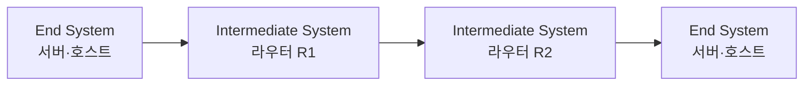
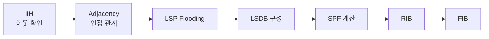
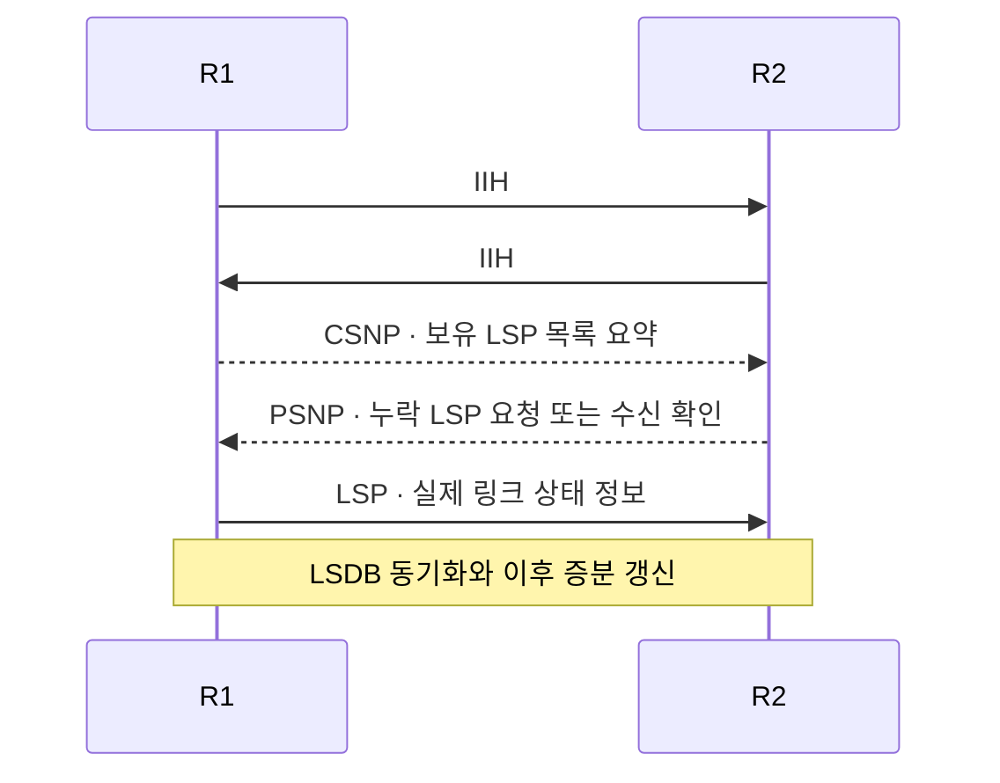
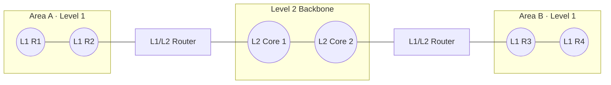
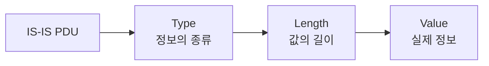

## 목차

- [[#1. 개요|1. 개요]]
- [[#2. 이름과 등장 배경|2. 이름과 등장 배경]]
- [[#3. IS-IS의 본질|3. IS-IS의 본질]]
- [[#4. 이웃 관계와 LSDB 동기화|4. 이웃 관계와 LSDB 동기화]]
- [[#5. Level 1과 Level 2|5. Level 1과 Level 2]]
- [[#6. TLV 기반 확장|6. TLV 기반 확장]]
- [[#7. OSPF와의 차이|7. OSPF와의 차이]]
- [[#8. 적용 환경과 이해 범위|8. 적용 환경과 이해 범위]]
- [[#9. 관련 문서|9. 관련 문서]]
- [[#10. 출처|10. 출처]]

## 1. 개요

IS-IS(Intermediate System to Intermediate System)는 하나의 라우팅 도메인 안에서 라우터들이 링크 상태를 공유하고 최단 경로를 계산하는 Link-State IGP이다.

IS-IS는 OSI 네트워크를 위해 만들어졌으며, Integrated IS-IS가 IP 경로 정보도 함께 전달하도록 확장되었다. RFC 1195는 하나의 IS-IS 프로토콜로 순수 IP, 순수 OSI와 두 환경이 함께 있는 네트워크를 지원할 수 있도록 정의한다.[^rfc1195]

## 2. 이름과 등장 배경

OSI 용어에서 `Intermediate System`은 패킷을 중간에서 전달하는 라우터를 뜻하고, `End System`은 통신의 종단인 호스트를 뜻한다. 따라서 IS-IS는 이름 그대로 **라우터와 라우터 사이의 내부 경로 교환 프로토콜**이다.

현재의 IP 네트워크에서 이름이 낯설게 느껴지는 이유는 OSI 체계에서 유래했기 때문이다. 실제 목적은 OSPF와 마찬가지로 내부 네트워크의 도달 경로를 계산하는 것이다.

## 3. IS-IS의 본질

IS-IS 라우터는 같은 Level의 이웃과 인접 관계를 만들고 LSP를 Flooding하여 LSDB를 구성한다. 각 라우터는 동일한 토폴로지 정보를 바탕으로 자신의 위치에서 SPF를 실행하고, 선택된 경로를 RIB와 FIB에 반영한다.

- **IIH(IS-IS Hello)**: 이웃의 존재와 인접 관계 조건을 확인한다.
- **LSP(Link State PDU)**: 라우터의 링크와 도달 정보를 전달한다.
- **LSDB**: 수신한 LSP로 구성한 토폴로지 데이터베이스이다.
- **SPF**: LSDB를 바탕으로 자신을 출발점으로 최단 경로를 계산한다.

여기서 `PDU(Protocol Data Unit)`는 특정 계층이나 프로토콜이 주고받는 데이터 단위를 뜻한다. 전원 분배 장치인 PDU와는 문맥이 다르다.

## 4. 이웃 관계와 LSDB 동기화

새 라우터는 IIH로 이웃을 확인한 뒤, 현재 보유한 LSP 목록과 실제 LSP를 교환하여 LSDB를 맞춘다.

아래 그림은 목록 비교와 누락 보충의 목적을 단순화한 것이다. 실제 CSNP·PSNP 교환 방식과 주기는 Point-to-Point·Broadcast 같은 네트워크 유형과 구현에 따라 달라질 수 있다.

- **CSNP(Complete Sequence Number PDU)**: LSDB에 있는 LSP 목록을 요약하여 비교한다.
- **PSNP(Partial Sequence Number PDU)**: 필요한 LSP를 요청하거나 일부 LSP의 수신을 확인한다.
- **LSP(Link State PDU)**: 실제 링크 상태와 도달 정보를 운반한다.

세부 PDU 이름보다 **목록 비교 → 누락 확인 → 실제 정보 전달 → 최신 상태 유지**라는 목적을 먼저 이해해야 한다. 정보가 유실되면 목록과 Sequence Number를 대조하여 요청하고 다시 받을 수 있다.

## 5. Level 1과 Level 2

IS-IS는 큰 라우팅 도메인을 Level 1과 Level 2로 계층화한다.

- **Level 1 Router**: 자신의 Area 내부 상세 경로를 계산한다.
- **Level 2 Router**: Area 사이의 Backbone 경로를 계산한다.
- **L1/L2 Router**: Level 1 Area와 Level 2 Backbone을 연결한다.

지역 내부의 작은 변화는 가능한 한 Level 1 범위에서 처리하고, 다른 지역으로 가는 경로는 Level 2를 이용한다. OSPF의 Area와 목적은 비슷하지만 구조와 경로 전파 방식이 완전히 같은 것은 아니다.

쉽게 비유하면 Level 1은 한 도시의 상세 도로 지도이고 Level 2는 도시 사이를 연결하는 고속도로 지도이다. 한 라우터가 L1/L2 역할을 함께 맡으면 도시 내부 도로와 고속도로 진입점을 연결한다.

## 6. TLV 기반 확장

IS-IS는 정보를 `TLV(Type-Length-Value)` 구조로 실어 보낸다.

PDU 안에는 IP 도달 정보, Metric, IPv6 정보, Traffic Engineering 속성처럼 목적이 다른 TLV를 추가할 수 있다. RFC 5305는 IS-IS LSP에 링크 대역폭과 Traffic Engineering Metric 등 추가 정보를 넣기 위한 TLV와 Sub-TLV 확장을 정의한다.[^rfc5305]

TLV 구조는 새로운 기능을 추가할 때 기존 메시지 형식 전체를 다시 설계하지 않고 새로운 정보 항목을 확장하기 쉽게 한다. 이 특성은 MPLS, IPv6와 Traffic Engineering 기능을 함께 운용하는 사업자 네트워크에서 유용하다.

## 7. OSPF와의 차이

[[OSPF]]와 IS-IS는 서로 다른 언어처럼 보이지만 핵심 원리는 같다.

| 구분 | OSPF | IS-IS |
|---|---|---|
| 이웃 확인 | Hello | IIH |
| 링크 상태 정보 | LSA | LSP |
| 지도 | LSDB | LSDB |
| 경로 계산 | SPF | SPF |
| 계층 구조 | Area와 Area 0 | Level 1과 Level 2 |
| 제어 메시지 전달 | IP 위에서 전달 | 같은 링크의 L2에서 직접 전달 |
| 확장 | LSA와 규격 확장 | TLV·Sub-TLV 추가 |

IS-IS가 L2에서 제어 메시지를 전달한다는 말은 사용자 IP 패킷을 L2 스위칭만으로 목적지까지 보낸다는 뜻이 아니다. IS-IS 제어 PDU가 직접 연결된 이웃 사이에서 IP 라우팅에 의존하지 않는다는 의미이며, 계산 결과는 여전히 IP 패킷을 전달하는 RIB와 FIB에 반영된다.

OSPF는 기업·캠퍼스 네트워크에서 상대적으로 친숙하고, IS-IS는 대형 ISP와 통신사 Backbone에서 상대적으로 흔하다. 그러나 OSPF가 소규모 전용이거나 IS-IS가 언제나 더 빠르다는 뜻은 아니다. 둘 다 규모 있는 네트워크를 구성할 수 있다.

## 8. 적용 환경과 이해 범위

클라우드 엔지니어는 IS-IS의 모든 PDU와 설정 명령을 암기하기보다 다음 관계를 이해하는 것이 중요하다.

- ISP·통신사 Backbone 내부에서도 라우터가 자동으로 길을 아는 것이 아니라 IGP가 내부 토폴로지를 배운다.
- BGP가 외부 AS 경로와 출구를 선택하면 IS-IS가 현재 라우터에서 해당 출구까지의 내부 경로를 제공할 수 있다.
- 내부 링크 장애가 발생하면 LSP가 전파되고 SPF와 FIB가 갱신된다.
- Level 분리는 상세 장애 정보와 계산 범위를 줄이는 계층 설계이다.
- BFD는 빠른 장애 감지를 보조하지만 새 IS-IS 경로를 직접 계산하지 않는다.[^rfc5880]

실제로 IS-IS를 설정하거나 통신사망을 운영할 때는 NET, System ID, Circuit Type, Metric, 인증과 PDU 세부 동작을 추가로 학습해야 한다.

## 9. 관련 문서

- [[IGP]] · [[OSPF]] · [[BGP]]
- [[Backbone Network|백본 네트워크]] · [[Router|라우터]]
- [[Internet Routing|인터넷의 통신 구조]]

## 10. 출처

[^rfc1195]: IETF, [RFC 1195 — Use of OSI IS-IS for Routing in TCP/IP and Dual Environments](https://www.rfc-editor.org/rfc/rfc1195.html). Integrated IS-IS의 IP 지원, 계층 구조, 인접 관계와 PDU의 기본 동작.
[^rfc5305]: IETF, [RFC 5305 — IS-IS Extensions for Traffic Engineering](https://www.rfc-editor.org/rfc/rfc5305.html). Traffic Engineering을 위한 TLV·Sub-TLV 확장.
[^rfc5880]: IETF, [RFC 5880 — Bidirectional Forwarding Detection](https://www.rfc-editor.org/rfc/rfc5880.html). 라우팅 프로토콜과 독립적인 빠른 경로 장애 감지.

## 둘러보기

[[Knowledge Base/index|전체 개념 목록]] · [[Networking 분류|Networking]]
