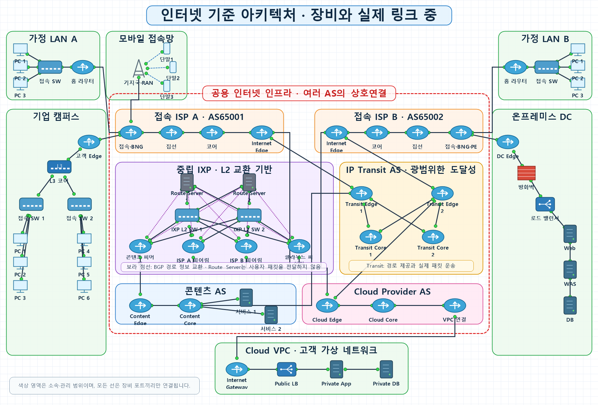
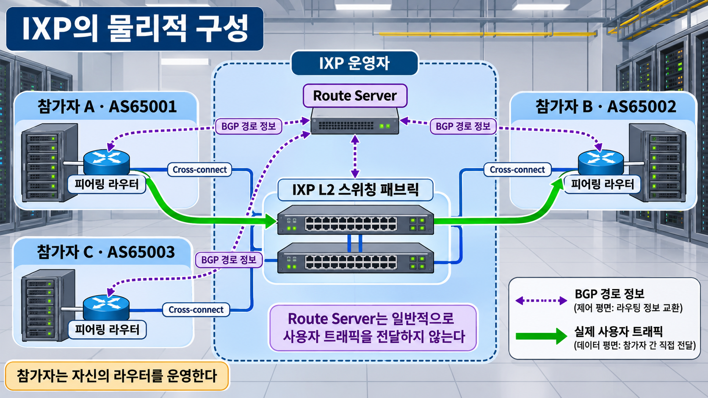
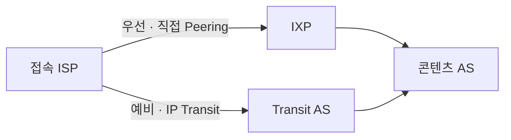

## 목차

- [[#1. 개요|1. 개요]]
- [[#2. IXP의 물리적 구성|2. IXP의 물리적 구성]]
- [[#3. Peering의 의미|3. Peering의 의미]]
- [[#4. IP Transit의 의미|4. IP Transit의 의미]]
- [[#5. Route Server와 피어링 라우터의 차이|5. Route Server와 피어링 라우터의 차이]]
- [[#6. 직접 Peering과 Transit의 조합|6. 직접 Peering과 Transit의 조합]]
- [[#7. 운영 주체와 실제 사례|7. 운영 주체와 실제 사례]]
- [[#8. 관련 문서|8. 관련 문서]]
- [[#9. 출처|9. 출처]]

## 1. 개요

IXP(Internet Exchange Point)는 서로 다른 네트워크 사업자들이 트래픽을 직접 교환할 수 있도록 공용 상호접속 기반을 제공하며, Peering과 Transit은 AS 사이의 도달 경로와 트래픽 교환 관계를 뜻한다.

세 용어는 서로 연관되지만 같은 뜻이 아니다.

- **IXP**: 여러 참가자가 만나는 물리·논리적 접속 장소와 L2 기반 시설
- **Peering**: 두 네트워크가 서로 합의한 프리픽스의 트래픽을 직접 교환하는 관계
- **IP Transit**: 한 사업자가 고객에게 인터넷의 광범위한 목적지까지 도달하는 경로와 트래픽 운송을 제공하는 서비스



그림의 붉은 점선 안은 하나의 거대한 회사망이 아니라 접속 ISP·IXP·Transit·콘텐츠 사업자·Cloud Provider처럼 서로 독립된 여러 AS가 연결된 공용 인터넷 인프라를 나타낸다. 점선 밖의 가정 LAN·기업 캠퍼스·온프레미스 데이터센터·고객 Cloud VPC도 각각 네트워크이지만, 일반적으로 자체 공인 ASN으로 인터넷 전체와 BGP를 수행하지는 않는다.

그림을 읽을 때는 선과 색상 영역의 역할을 구분해야 한다.

- **검은 선과 초록 접점**: 실제 장비 포트 사이의 전달 가능한 링크
- **보라색 점선**: Route Server와 참가자 피어링 라우터 사이의 BGP 제어 세션
- **색상 영역**: 장비의 소속과 관리 범위이며 패킷이 접속하는 대상이 아님

따라서 “IXP와 Transit 중 어느 장비를 거치는가”를 묻기 전에 **경로 정보를 교환하는 제어 평면**과 **실제 패킷을 운반하는 데이터 평면**을 나누어 보아야 한다.

기준 그림은 특정 요청의 경로를 색으로 덧칠하지 않았다. 같은 링크 지도에서도 목적지 프리픽스와 BGP 정책에 따라 IXP Peering 또는 Transit을 선택할 수 있기 때문이다. 가정 B와 온프레미스 데이터센터처럼 목적지가 같은 ISP B 내부에서 도달 가능하면 외부 AS와 만나는 Internet Edge·IXP·Transit을 거치지 않고 ISP 내부 전달만으로 끝날 수 있다.

## 2. IXP의 물리적 구성



IXP는 여러 AS가 각자 별도의 전용 회선을 일일이 설치하지 않고도 공용 접속 기반에서 트래픽을 교환하도록 만든 상호접속 시설이다. 일반적인 중심 구성은 이중화된 Ethernet L2 스위칭 패브릭이며, 규모가 큰 IXP는 여러 데이터센터와 스위치를 하나의 분산된 패브릭처럼 운영할 수도 있다.[^isoc]

### 물리적으로 연결되는 구성 요소

1. **참가자의 피어링 라우터**: ISP·CDN·Cloud Provider가 직접 소유하고 운영한다.
2. **Cross-connect 또는 전송 회선**: 참가자 라우터의 포트를 IXP 접속 포트까지 연결한다.
3. **IXP L2 스위칭 패브릭**: 참가자 라우터 사이의 Ethernet 프레임을 MAC 주소에 따라 전달한다.
4. **Peering LAN**: 참가자 라우터와 Route Server가 사용하는 공용 IP 서브넷이다.
5. **Route Server**: 선택 서비스로 제공되는 BGP 경로 중개 시스템이다. 운영 안정성을 위해 두 대 이상으로 구성할 수 있다.
6. **운영 설비**: 모니터링, 포트 관리, DDoS 대응 지원, 통계와 정책 관리 시스템 등이 포함될 수 있다.

IXP 운영자가 참가자의 라우터를 대신 소유하거나 라우팅 정책을 결정하는 것은 아니다. 각 참가자는 자신의 라우터에서 어떤 프리픽스를 광고할지, 누구의 경로를 받을지, 어느 경로를 우선할지를 정한다. IXP는 이들이 만날 수 있는 공통 기반을 제공한다.

### 실제 패킷의 전달

그림의 실제 사용자 트래픽 경로를 단순화하면 다음과 같다.

```text
ISP A의 Edge Router
→ IXP L2 스위치1
→ Google 예시 AS의 Edge Router
→ Google 서비스 서버
```

IXP 스위치는 IP 경로를 계산하여 목적지를 고르는 라우터가 아니다. 이미 BGP로 선택된 다음 홉 라우터의 MAC 주소를 향해 Ethernet 프레임을 전달한다. 따라서 IXP를 “여러 AS의 라우터를 연결해 놓은 대형 L2 스위치망”으로 이해하는 것은 대체로 맞다.

다만 모든 IXP가 스위치 한 대와 Route Server 한 대만 사용하는 것은 아니다. 실제 환경에서는 장애와 용량을 고려해 여러 스위치·여러 장소·복수 Route Server를 사용할 수 있으며, Route Server 없이 참가자끼리 직접 BGP 세션만 구성할 수도 있다.

## 3. Peering의 의미

Peering은 두 AS가 합의한 범위의 경로와 트래픽을 직접 교환하는 관계이다. 일반적으로 상대 AS와 그 고객망에 도달하는 경로를 교환하며, 상대에게 인터넷 전체의 운송을 요구하는 관계는 아니다. 구체적인 광고 범위, 비용 정산, 트래픽 비율과 접속 지점은 계약과 정책에 따라 달라진다.[^isoc-interconnection]

- **Private Peering**: 두 사업자가 전용 회선이나 Cross-connect로 직접 연결한다.
- **Public Peering**: IXP의 공용 스위칭 패브릭을 통해 연결한다.
- **Bilateral Peering**: 두 참가자가 서로 직접 BGP 세션을 맺는다.
- **Multilateral Peering**: IXP Route Server와 세션을 맺어 여러 참가자의 경로를 교환한다.

Peering은 반드시 무료라는 뜻이 아니다. 접속 포트, Cross-connect, 데이터센터와 운영 비용이 발생하며, 관계에 따라 Paid Peering도 가능하다.

### Route Server가 없는 Bilateral Peering

```text
ISP A Edge ══ eBGP 세션 ══ Google Edge
ISP A Edge ── IXP L2 패브릭 ── Google Edge
```

두 라우터는 서로 직접 BGP 세션을 맺는다. 참가자가 많아지면 각 상대와 세션과 정책을 따로 관리해야 한다.

### Route Server를 이용하는 Multilateral Peering

```text
BGP 경로 정보: ISP A Edge ↔ Route Server ↔ 여러 참가자 Edge
실제 패킷:     ISP A Edge → IXP L2 패브릭 → 선택된 참가자 Edge
```

참가자는 Route Server와 몇 개의 세션만 구성하면서 여러 참가자의 경로를 받을 수 있다. 그러나 누구와도 무조건 트래픽을 교환해야 한다는 뜻은 아니며, IXP와 참가자가 제공하는 정책 기능에 따라 경로 송수신 범위를 제한할 수 있다.

## 4. IP Transit의 의미

IP Transit은 고객 AS가 직접 Peering하지 않은 목적지를 포함하여 광범위한 인터넷에 도달하도록 **BGP 경로와 실제 패킷 운송을 함께 제공하는 상업 서비스**이다. RIPE와 APNIC 자료에서도 Peering은 제한된 상호 경로 교환, Transit은 고객이 인터넷의 광범위한 목적지와 데이터를 교환하도록 제공하는 고객·사업자 관계로 구분한다.[^ripe-transit][^apnic]

“여러 라우터가 뭉쳐 경로 정보를 제공한다”는 이해에는 맞는 부분이 있다. Transit 사업자는 실제로 여러 PoP, Edge Router, Core Router, 장거리 광회선, Peering, 다른 Transit 연결과 운영 시스템을 가진 하나의 AS이다. 그러나 경로 정보만 알려 주고 끝나는 것은 아니다.

### 제어 평면에서 제공하는 것

고객과 Transit 사업자는 BGP 세션을 맺는다.

```text
고객 AS → Transit: 고객이 소유한 프리픽스 광고
Transit → 고객 AS: 전체 경로·부분 경로 또는 기본 경로 제공
```

대규모 고객은 전체 BGP 경로표를 받을 수 있고, 단순한 환경은 `0.0.0.0/0` 기본 경로만 받을 수도 있다. 계약과 장비 규모에 따라 선택이 달라진다. Transit 사업자는 고객의 프리픽스를 자신의 고객·Peer·상위 사업자에게 다시 광고하여 외부 네트워크가 고객에게 돌아올 경로도 알 수 있게 한다.[^juniper-transit]

### 데이터 평면에서 제공하는 것

경로가 선택된 뒤 실제 패킷은 Transit 사업자의 장비와 회선을 통과한다.

```text
ISP A Edge
→ Transit Edge
→ Transit 사업자의 Backbone·Core·PoP
→ 목적지와 연결된 Transit Edge
→ Google 예시 AS의 Edge
```

기준 그림에서는 접속 ISP의 Internet Edge와 Transit Edge·Core, 콘텐츠 AS의 Edge가 모두 실제 링크로 연결되어 있다. Transit 사업자는 BGP 경로를 안내하는 동시에 자신의 백본과 다른 AS 연결을 사용해 패킷을 실제로 운반한다. 쉽게 설명하면 목적지 목록만 제공하는 지도 회사가 아니라, 지도와 전국 운송망을 함께 제공하는 물류 사업자에 가깝다.

### Transit을 구매하는 이유

- 모든 AS와 직접 Peering 계약과 회선을 구성하기 어렵기 때문이다.
- Peering하지 않은 나머지 인터넷 목적지에도 도달해야 하기 때문이다.
- 직접 Peering 장애 시 사용할 대체 경로가 필요할 수 있기 때문이다.
- 여러 지역의 PoP와 장거리 백본을 직접 구축하는 비용을 줄일 수 있기 때문이다.

Transit이 물리적으로 먼 거리의 신호를 증폭하는 장비라는 뜻은 아니다. 신호 전송은 광전송 장비와 회선이 담당하고, Transit은 여러 네트워크까지의 도달성과 운송을 제공하는 사업·라우팅 관계이다.

## 5. Route Server와 피어링 라우터의 차이

Route Server는 IXP 참가자들과 eBGP 세션을 맺고 경로 정보를 정책에 따라 다시 배포하여 세션 수와 운영 부담을 줄이는 중개 시스템이다.[^rfc7947] 일반적인 Route Server는 제어 평면에만 참여하며 실제 사용자 패킷의 다음 홉이 되지 않는다.

```text
BGP 경로 정보: 참가자 A ↔ Route Server ↔ 참가자 B
사용자 트래픽: 참가자 A 라우터 → IXP 스위칭 패브릭 → 참가자 B 라우터
```

피어링 라우터는 참가자 네트워크의 경계에서 실제 패킷을 주고받는다. Route Server가 장애 나더라도 이미 설치된 경로가 즉시 모두 사라지는지는 장비와 세션 상태에 따라 달라지지만, 새로운 경로 학습과 변경 전파에는 영향을 줄 수 있다.

### Route Server를 통한 경로 교환 순서

1. ISP A Edge가 자신의 프리픽스를 Route Server에 광고한다.
2. Google Edge도 자신의 서비스 프리픽스를 Route Server에 광고한다.
3. Route Server는 필터와 참가자별 정책을 적용해 경로를 상대 참가자에게 다시 광고한다.
4. ISP A Edge는 받은 후보 가운데 정책에 맞는 경로를 선택해 RIB와 FIB에 설치한다.
5. 실제 사용자 패킷은 Route Server가 아니라 Google Edge를 다음 홉으로 삼는다.
6. IXP L2 스위칭 패브릭이 ISP A Edge에서 Google Edge로 Ethernet 프레임을 전달한다.

RFC 7947은 Route Server가 데이터 전달에 참여하지 않으므로 `NEXT_HOP`을 일반적으로 변경하지 않아야 한다고 설명한다. 또한 Route Server 자신의 ASN을 일반 eBGP 라우터처럼 `AS_PATH`에 추가하지 않는 동작을 권고한다. 이것이 참가자 라우터가 Route Server가 아닌 실제 상대 라우터로 패킷을 보내게 하는 핵심이다.[^rfc7947]

### 사용자의 이해에서 보완할 부분

“IXP의 많은 L2 스위치에 Route Server 하나를 연결한다”는 그림은 기본 원리를 이해하는 데 유용하다. 실제 구성에서는 다음 차이가 있을 수 있다.

- Route Server는 필수 구성 요소가 아니며 Bilateral Peering만으로도 IXP를 사용할 수 있다.
- Route Server는 안정성을 위해 보통 복수로 제공될 수 있다.
- 분산 IXP는 여러 데이터센터의 스위치를 하나의 Peering Fabric으로 연결할 수 있다.
- Route Server는 경로를 중개하지만 패킷을 중계하지 않는다.
- 참가자는 Route Server를 이용하면서 별도의 직접 Bilateral Peering도 함께 운영할 수 있다.

## 6. 직접 Peering과 Transit의 조합

한 ISP가 콘텐츠 네트워크와 직접 Peering하면서 별도의 Transit도 구매할 수 있다. 직접 경로는 지연과 비용 측면에서 유리할 수 있고, Transit은 직접 연결되지 않은 목적지와 예비 경로를 제공한다.



직접 링크가 끊기면 [[BGP]]가 해당 경로를 철회하고 남은 Transit 경로로 수렴할 수 있다. 하지만 대체 경로는 더 멀거나 혼잡할 수 있고, 수렴 중 일시적인 손실도 가능하다. “연결이 두 개”라는 사실만으로 같은 성능과 무중단이 보장되지는 않는다.

위 구조도에서는 기업 캠퍼스에서 Google 예시 AS로 가는 두 경로를 비교할 수 있다.

- **파란 직접 Peering 경로**: 기업 → ISP A → IXP L2 패브릭 → Google Edge
- **주황 IP Transit 경로**: 기업 → ISP A → Transit Edge·Core → Google Edge

두 경로 모두 BGP가 제공하는 후보가 될 수 있다. 운영자는 Local Preference와 Import Policy 등을 사용해 직접 Peering을 우선하고 Transit을 예비로 둘 수 있다. 이는 자동 법칙이 아니라 각 AS의 정책이다. 목적지에 직접 Peer가 없으면 처음부터 Transit 경로만 사용할 수도 있다.

| 구분 | IXP를 통한 Peering | IP Transit |
|---|---|---|
| 관계 | 참가 AS 사이의 합의 | 고객과 Transit 사업자의 상업 서비스 |
| 제공 경로 | 보통 Peer와 그 고객 범위 | 전체 인터넷, 부분 경로 또는 기본 경로 |
| 실제 패킷 | 참가자 라우터 사이에서 직접 교환 | Transit 사업자 백본을 통과 |
| Route Server | 선택적으로 경로 교환을 중개 | 필수 구성 요소가 아님 |
| 주요 목적 | 직접 연결, 지연·비용·지역성 개선 | Peering하지 않은 목적지까지 광범위한 도달성 확보 |
| 한계 | 참가자·정책 범위 밖 목적지는 도달하지 못할 수 있음 | 사용량·회선·계약 비용과 사업자 경로에 의존 |

## 7. 운영 주체와 실제 사례

IXP는 중립적 상호접속 전문 사업자, 통신 사업자 연합, 비영리 조직 등 다양한 주체가 운영한다.

- **KINX**: 국내에서 중립적인 L2 기반 IX 서비스를 운영한다고 공개 자료에서 설명한다.[^kinx]
- **DE-CIX**, **AMS-IX**, **LINX**: 유럽을 중심으로 여러 지역의 IX 서비스를 운영하는 대표 사례이다.

구성 자료에 KINX 같은 사업자 이름이 등장하더라도 IX·IDC·Cross-connect·회선 중 어떤 역할을 맡았는지는 별도로 확인해야 한다. 사업자 이름만으로 실제 연결 방식과 계약 범위를 단정해서는 안 된다.

IP Transit 사업자의 공개 사례로는 Arelion, NTT, Cogent, GTT, Lumen 등이 있다. 각 사업자의 도달 범위와 접속 지점, SLA와 상품 조건은 시점과 계약에 따라 달라진다.

## 8. 관련 문서

- [[BGP]] · [[Internet Routing|인터넷의 통신 구조]]
- [[Router|라우터]] · [[Switch|스위치]] · [[Backbone Network|백본 네트워크]]

## 9. 출처

[^isoc]: Internet Society, [Explainer: What is an Internet Exchange Point?](https://www.internetsociety.org/resources/doc/2020/explainer-what-is-an-internet-exchange-point-ixp/). IXP의 목적과 기본 구성.
[^rfc7947]: IETF, [RFC 7947 — Internet Exchange BGP Route Server](https://datatracker.ietf.org/doc/html/rfc7947). IXP Route Server의 구조와 동작.
[^kinx]: KINX, [Company Introduction](https://company.kinx.net/wp-content/uploads/2021/02/KINX_Introduction_210224_EN.pdf). 중립 L2 IX와 네트워크 상호접속 서비스 소개.
[^isoc-interconnection]: Internet Society, [Policy Brief: Internet Interconnection](https://www.internetsociety.org/policybriefs/internetinterconnection/). Peering과 자율적인 상호접속 관계.
[^ripe-transit]: RIPE Labs, [What Do Network Operators Sell to Each Other?](https://labs.ripe.net/author/uta_meier_hahn/what-do-network-operators-sell-to-each-other/). Peering과 Transit이 제공하는 도달 범위의 차이.
[^apnic]: APNIC, [Internet peering and settlements](https://www.apnic.net/community/ecosystem/iorgs/number-misuse/internet-peering-and-settlements/). Peering과 고객·Transit 사업자 관계의 구분.
[^juniper-transit]: Juniper Networks, [Accepting and Announcing Routes](https://www.juniper.net/documentation/en_US/day-one-books/topics/topic-map/accepting-and-announcing-routes.html). Transit에서 전체 경로·기본 경로를 받고 고객 경로를 외부에 광고하는 방식.

- DE-CIX, [About DE-CIX](https://www.de-cix.net/en/about-de-cix)
- AMS-IX, [About AMS-IX](https://www.ams-ix.net/ams/about-ams-ix)
- LINX, [About LINX](https://www.linx.net/about/)
- Arelion, [IP Transit](https://www.arelion.com/products-and-services/internet-and-cloud/ip-transit)

## 둘러보기

[[Knowledge Base/index|전체 개념 목록]] · [[Networking 분류|Networking]]
