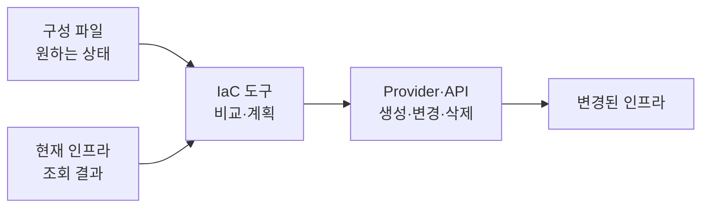

## 목차

- [[#1. 개요|1. 개요]]
- [[#2. 등장 배경과 해결하려는 문제|2. 등장 배경과 해결하려는 문제]]
- [[#3. 실행 가능한 인프라 명세|3. 실행 가능한 인프라 명세]]
- [[#4. 선언형 구성과 명령형 절차|4. 선언형 구성과 명령형 절차]]
- [[#5. 인프라 변경 흐름|5. 인프라 변경 흐름]]
- [[#6. 프로비저닝과 구성 관리|6. 프로비저닝과 구성 관리]]
- [[#7. 적용 범위와 흔한 오해|7. 적용 범위와 흔한 오해]]
- [[#8. 관련 문서|8. 관련 문서]]
- [[#9. 출처|9. 출처]]

## 1. 개요

Infrastructure as Code(IaC)는 서버·네트워크·스토리지와 같은 인프라의 구성을 사람이 반복해서 화면에 입력하는 대신, 도구가 읽고 적용할 수 있는 파일로 정의하고 관리하는 방식이다.[^1]

IaC는 특정 제품 하나를 뜻하지 않는다. [[Terraform]]은 IaC를 구현하는 도구 가운데 하나이며, 도구마다 원하는 상태를 선언하는 방식, 작업 절차를 기술하는 방식, 관리 대상과 상태 추적 방법이 다를 수 있다.

## 2. 등장 배경과 해결하려는 문제

관리 화면에서 VM을 여러 대 생성하려면 이미지, CPU, 메모리, 디스크, 서브넷, 보안 정책과 인증 정보를 반복해서 선택해야 한다. 같은 구성을 다른 환경에 다시 만들 때에는 별도 문서를 참고해 사람이 값을 재입력해야 한다.

이 방식은 작업 시간이 길고 항목 누락과 입력 오류가 발생하기 쉽다. 실제 환경이 처음 작성한 문서와 같은지 지속적으로 확인하기도 어렵다. IaC는 인프라 구성을 기계가 읽을 수 있는 파일로 남겨 반복 적용, 검토, 재사용과 변경 이력 관리를 가능하게 한다.[^1]

## 3. 실행 가능한 인프라 명세

엑셀이나 일반 문서에 적은 서버 사양은 사람이 읽는 명세다. 작업자는 명세를 보고 관리 화면이나 CLI에서 다시 자원을 생성해야 한다.

IaC 구성 파일은 도구가 해석할 수 있는 명세다. 필요한 자원과 속성, 자원 사이의 참조를 작성하면 IaC 도구가 대상 플랫폼의 API를 통해 인프라를 조회하거나 생성·변경·삭제한다.

구성 파일은 텍스트이므로 Git과 같은 버전 관리 시스템에서 변경 전후의 차이, 변경자와 변경 이유를 관리할 수 있다. IaC 도구 자체가 버전 관리 시스템인 것은 아니며, 코드 검토와 승인 절차는 사용하는 저장소와 조직의 작업 흐름으로 구성한다.

## 4. 선언형 구성과 명령형 절차

명령형 방식은 `네트워크 생성 → 서브넷 생성 → VM 생성`처럼 수행할 작업과 순서를 기술한다. 선언형 방식은 `특정 네트워크와 서브넷이 존재하고 VM이 해당 서브넷에 연결되어 있어야 한다`처럼 원하는 결과를 표현한다.

Terraform의 구성 언어는 선언형이다. 사용자는 원하는 최종 상태와 자원 참조를 작성하고, Terraform은 관리 중인 상태와 실제 인프라를 조회해 필요한 변경과 의존 순서를 계산한다.[^2]



선언형 도구가 모든 내부 절차를 임의로 해결하는 것은 아니다. 도구와 Provider가 지원하는 자원·속성·API 범위 안에서만 변경을 계산할 수 있으며, 일부 속성은 수정 대신 자원 교체가 필요할 수 있다.

## 5. 인프라 변경 흐름

Terraform을 예로 들면 IaC 작업은 다음 흐름으로 진행된다.[^1]

1. 관리할 인프라의 범위를 정한다.
2. 필요한 자원과 속성을 구성 파일에 작성한다.
3. 대상 플랫폼과 통신할 Provider와 작업 환경을 초기화한다.
4. 현재 상태와 원하는 상태를 비교한 변경 계획을 확인한다.
5. 검토한 계획을 적용한다.
6. 실제 자원과 구성의 차이를 지속적으로 확인한다.

같은 구성을 다시 실행했을 때 이미 원하는 상태라면 불필요한 추가 생성을 계획하지 않는 것이 선언형 관리의 중요한 특성이다. 실제 동작은 자원 종류, Provider 구현, 저장된 상태와 외부 변경 여부에 따라 달라진다.

## 6. 프로비저닝과 구성 관리

Provision은 필요한 것을 미리 준비해 제공한다는 뜻이다. IT에서 프로비저닝은 CPU·메모리·디스크·NIC·네트워크와 같은 자원을 할당해 사용할 수 있는 상태로 만드는 과정이다.

Terraform은 주로 VM·네트워크·볼륨과 같은 인프라 객체의 프로비저닝과 생명주기를 관리한다. Ansible과 같은 구성 관리 도구는 준비된 VM에 접속해 패키지, 계정, 설정 파일과 서비스를 원하는 상태로 관리하는 데 주로 사용된다. 도구의 기능은 일부 겹칠 수 있으므로 작업의 지속적인 관리 주체와 실패·재실행 방식을 기준으로 역할을 정한다.

```text
Terraform
VM·네트워크·볼륨 준비
        ↓
Ansible 등의 구성 관리 도구
패키지 설치·설정 파일 배치·서비스 관리
```

## 7. 적용 범위와 흔한 오해

IaC는 인프라 구성을 다시 만들 수 있게 돕지만 애플리케이션 데이터의 백업을 대신하지 않는다. 삭제된 VM을 같은 사양으로 다시 프로비저닝해도 기존 디스크나 데이터베이스 내용이 자동으로 복원되는 것은 아니다.

Terraform은 일반적으로 구성과 State를 통해 관리 대상으로 연결한 객체를 다룬다. 같은 계정에 존재하더라도 관리 관계가 없는 객체까지 자동으로 발견해 코드에 맞춰 삭제하지 않는다. 기존 객체를 관리 대상으로 편입하려면 Resource 구성과 Import 같은 절차가 필요하다.[^3]

IaC를 사용해도 검토와 승인이 사라지지 않는다. 변경 계획에 생성·수정·교체·삭제가 어떻게 표시되는지 확인하고, 실제 서비스와 데이터에 미치는 영향을 판단한 뒤 적용해야 한다.

## 8. 관련 문서

- [[Terraform]]
- [[Shell Script|셸 스크립트]]
- [[AWS CLI]]
- [[Zadara Symphony API]]

## 9. 출처

[^1]: [HashiCorp — What is Infrastructure as Code with Terraform?](https://developer.hashicorp.com/terraform/tutorials/aws-get-started/infrastructure-as-code)
[^2]: [HashiCorp — Terraform Configuration Language](https://developer.hashicorp.com/terraform/language)
[^3]: [HashiCorp — Import existing resources](https://developer.hashicorp.com/terraform/cli/import)

## 둘러보기

[[Knowledge Base/index|전체 개념 목록]] · [[IaC 분류|IaC]] · [[Cloud 분류|Cloud]]
