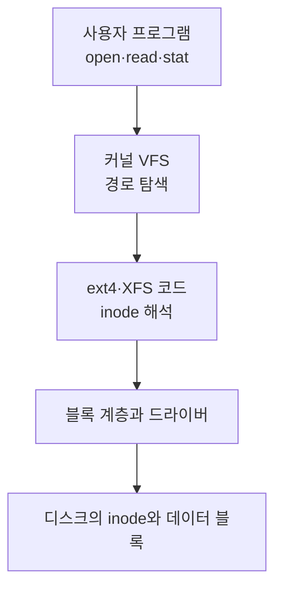
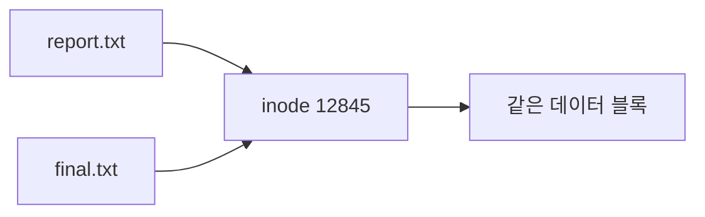

## 목차

- [[#1. 개요|1. 개요]]
- [[#2. inode의 주요 메타데이터|2. inode의 주요 메타데이터]]
- [[#3. inode의 저장 위치와 해석 주체|3. inode의 저장 위치와 해석 주체]]
- [[#4. inode 확인과 고갈|4. inode 확인과 고갈]]
- [[#5. 하드 링크와 열린 삭제 파일|5. 하드 링크와 열린 삭제 파일]]
- [[#6. 관련 문서|6. 관련 문서]]
- [[#7. 출처|7. 출처]]

## 1. 개요

Inode(아이노드)는 Linux 파일시스템에서 파일·디렉터리 같은 객체의 유형·권한·소유자·크기와 실제 데이터 위치를 관리하는 메타데이터 구조이다.

파일 이름 자체는 일반적으로 inode에 저장되지 않는다. 디렉터리가 이름과 inode 번호를 연결한다.


## 2. inode의 주요 메타데이터

- 파일 유형
- UID와 GID
- 읽기·쓰기·실행 권한
- 파일 크기
- 접근·수정·메타데이터 변경 시각
- 하드 링크 수
- 데이터 블록을 찾기 위한 정보

디렉터리와 심볼릭 링크도 파일시스템 객체이므로 inode를 사용한다.

## 3. inode의 저장 위치와 해석 주체

ext4에서는 파일시스템이 여러 Block Group으로 나뉘며 각 그룹의 inode table에 inode가 저장된다. XFS 등 다른 파일시스템은 배치와 할당 방식이 다르다.[^ext4]



사용자 프로그램과 디스크 컨트롤러가 inode의 의미를 직접 해석하는 것이 아니다. 프로그램은 시스템 호출을 사용하고, 커널의 VFS와 해당 파일시스템 코드가 이름→inode→데이터 블록 순서로 접근한다.[^vfs]

자주 쓰는 디렉터리 항목과 inode는 RAM의 dentry·inode cache에 보관될 수 있으므로 매번 디스크에서 다시 읽지 않는다.

## 4. inode 확인과 고갈

```bash
ls -li /data/report.txt
stat /data/report.txt
df -i /data
```

`df -i`의 주요 열은 다음과 같다.

| 열 | 의미 |
|---|---|
| `Inodes` | 전체 inode 수 |
| `IUsed` | 사용 중인 inode 수 |
| `IFree` | 남은 inode 수 |
| `IUse%` | inode 사용률 |

작은 파일이 매우 많이 쌓이면 데이터 블록 용량이 남아 있어도 inode가 먼저 소진될 수 있다. 빈 파일도 일반적으로 inode 하나가 필요하므로 새 파일 생성 시 `No space left on device`가 발생한다.

```bash
sudo du --inodes -x -d1 /data | sort -nr
```

파일 수가 매우 많은 경로의 재귀 조사는 I/O 부하를 만들 수 있으므로 한 단계씩 범위를 좁힌다. 정리 전에는 세션·큐·잠금·캐시 등 애플리케이션이 사용하는 파일인지 확인한다.

## 5. 하드 링크와 열린 삭제 파일

여러 파일 이름이 같은 inode를 가리키는 하드 링크를 만들 수 있다.



파일 이름을 삭제하는 `unlink`는 이름과 inode의 연결 하나를 제거한다. 하드 링크나 프로세스의 열린 파일 디스크립터가 inode를 계속 참조하면 데이터 블록은 즉시 반환되지 않을 수 있다.[^unlink]

## 6. 관련 문서

- [[Filesystem|파일시스템]] · [[Disk Capacity Check|디스크 용량 확인]]
- [[Linux Directory Structure|Linux 디렉터리 구조]] · [[Program and Process|프로그램과 프로세스]]

## 7. 출처

[^ext4]: Linux Kernel, [ext4 Data Structures and Algorithms](https://docs.kernel.org/filesystems/ext4/), Block Group과 inode table을 포함한 ext4 구조.
[^vfs]: Linux Kernel, [Overview of the Linux Virtual File System](https://docs.kernel.org/filesystems/vfs.html), dentry·inode 객체와 캐시.
[^unlink]: Linux man-pages, [unlink(2)](https://man7.org/linux/man-pages/man2/unlink.2.html), 링크 수와 열린 프로세스 참조가 남을 때 파일 공간이 유지되는 조건.

## 둘러보기

[[Knowledge Base/index|전체 개념 목록]] · [[Storage 분류|Storage]]
