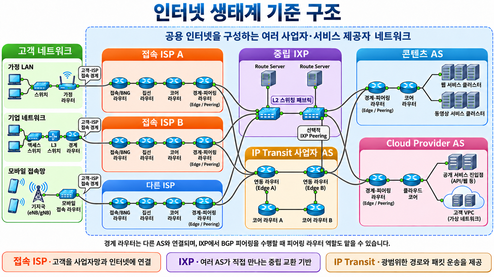
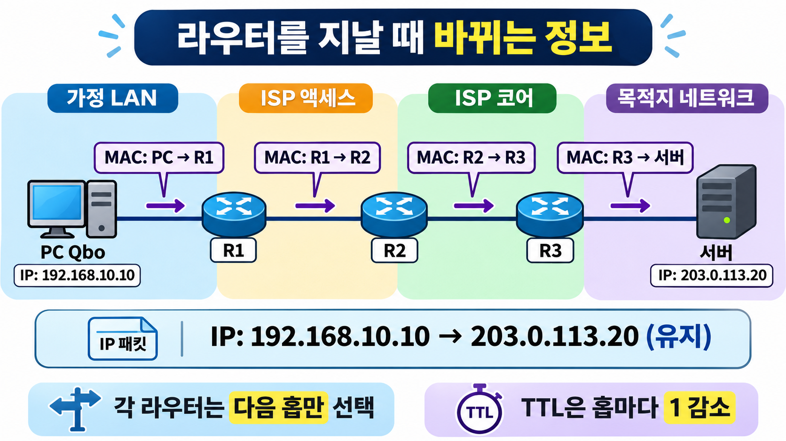

## 목차

- [[#1. 개요|1. 개요]]
- [[#2. 하나의 거대한 L2 네트워크가 아닌 이유|2. 하나의 거대한 L2 네트워크가 아닌 이유]]
- [[#3. PC에서 인터넷 서버까지의 전달 과정|3. PC에서 인터넷 서버까지의 전달 과정]]
- [[#4. 가정용 라우터가 모든 인터넷 경로를 몰라도 되는 이유|4. 가정용 라우터가 모든 인터넷 경로를 몰라도 되는 이유]]
- [[#5. 인터넷의 계층과 메시 구조|5. 인터넷의 계층과 메시 구조]]
- [[#6. 물리적으로 이어지는 경로|6. 물리적으로 이어지는 경로]]
- [[#7. 관련 문서|7. 관련 문서]]
- [[#8. 출처|8. 출처]]

## 1. 개요

Internet Routing(인터넷 라우팅)은 서로 독립적으로 운영되는 수많은 IP 네트워크가 경로 정보를 교환하고, 각 라우터가 다음 홉을 선택하여 패킷을 목적지까지 전달하는 체계이다.

인터넷은 하나의 회사가 소유한 거대한 망도 아니고, 최상위 라우터 한 대 아래에 모든 장비가 매달린 피라미드도 아니다. 통신 사업자, 기업, 대학, 클라우드와 콘텐츠 사업자가 각자의 네트워크를 운영하고 [[IXP Peering and Transit|Peering과 Transit]]으로 연결한다.

### 장비와 링크 중심의 기준 아키텍처



기준 그림은 가정·기업·모바일 고객망이 접속 ISP를 통해 공용 인터넷을 구성하는 여러 사업자·서비스 제공자 네트워크와 연결되는 모습을 단순화한 개념 지도이다. 특정 국가나 사업자의 실제 토폴로지를 그대로 옮긴 것이 아니며, 인터넷을 지휘하는 중앙 기관이나 최상위 라우터를 뜻하지도 않는다.

선은 장비 포트 사이의 물리적 또는 논리적 상호접속을 나타낸다. 색상 영역은 소속과 관리 범위를 구분하고, 파란 점선은 ISP·IXP·Transit 사업자·콘텐츠·클라우드 사업자가 서로 연결되어 공용 인터넷을 구성한다는 개념적 범위를 나타낸다. 보안 경계나 공인 IP가 시작되는 정확한 물리 경계는 아니다.

### 기준 그림의 역할 구분

- **접속 ISP**: 고객 회선을 수용하고, 집선·코어망을 거쳐 다른 AS와 연결되는 경계 라우터까지 패킷을 운반한다.
- **IXP**: 여러 AS의 피어링 라우터가 하나의 L2 스위칭 패브릭에서 직접 Peering할 수 있게 한다. Route Server는 선택적으로 BGP 경로 교환을 중개한다.
- **IP Transit 사업자 AS**: 고객 AS에 광범위한 인터넷 경로와 실제 패킷 운송을 유료로 제공한다. `IP Transit`은 서비스 이름이고, 이를 운영하는 주체가 Transit 사업자이다.
- **콘텐츠·클라우드 AS**: 자신의 서비스 프리픽스를 Peering 또는 Transit 관계를 통해 외부에 알리고 실제 요청을 서비스 진입점으로 받는다.

한 AS는 상대에 따라 여러 역할을 동시에 가질 수 있다. 그림의 Transit 사업자도 고객 ISP에는 Transit을 판매하면서 IXP에서는 다른 참가자와 Peering할 수 있다. `선택적 IXP Peering` 링크는 이러한 관계를 나타내며, IXP와 Transit이 반드시 차례로 이어지는 단계라는 뜻은 아니다.

### 경계와 라우터의 역할

`고객–ISP 접속 경계`는 고객 장비와 ISP의 접속·BNG 라우터가 만나는 서비스·관리 책임의 접점이다. 사용자의 관점에서는 이 지점을 지나 ISP 망으로 들어가므로 흔히 “인터넷으로 나간다”고 표현한다.

`경계 라우터(Edge Router)`는 한 AS가 다른 AS와 만나는 라우터를 넓게 가리킨다. 이 라우터가 IXP나 전용 회선에서 다른 AS와 BGP Peering을 수행하면 `피어링 라우터` 역할도 맡는다. 역할에 따라 같은 물리 장비를 함께 사용할 수도 있고, 고객 연결·Peering·Transit용 장비를 분리할 수도 있다.

접속 ISP의 가입자망·집선망·코어망도 ISP가 운영하는 사업자 네트워크이며 인터넷 연결을 구성한다. 그러나 그 안의 모든 장비와 주소가 외부에 직접 공개된다는 뜻은 아니다. **인터넷을 구성하는 망인가**와 **공용 인터넷에서 직접 접근 가능한가**는 별개의 질문이다.

### 기준 그림에서 경로 읽기

기준 그림은 특정 트래픽 경로를 색으로 고정하지 않았다. 목적지 프리픽스와 BGP 정책에 따라 같은 링크 지도에서도 Peering 또는 Transit 경로가 선택될 수 있기 때문이다.

| 통신 예시 | 장비 흐름 | 핵심 의미 |
|---|---|---|
| 가정 LAN → 콘텐츠 서비스 | 가정 라우터 → ISP A의 접속·집선·코어·경계 라우터 → IXP 또는 Transit → 콘텐츠 AS의 경계·코어 라우터 → 서비스 클러스터 | 같은 목적지에도 여러 후보 경로가 존재할 수 있음 |
| 기업 네트워크 → Cloud 공개 서비스 | 기업 경계 라우터 → ISP B → IXP 또는 Transit → Cloud Provider 경계·코어 → 공개 서비스 진입점 | 공개 진입점과 고객 VPC의 내부 자원은 같은 범위가 아님 |
| 모바일 단말 → 외부 서비스 | 기지국·모바일 접속 라우터 → 다른 ISP → Peering 또는 Transit → 목적지 AS | 무선 구간 뒤에서도 사업자 접속·코어·AS 간 라우팅이 이어짐 |

기업 PC에서 콘텐츠 AS까지 IXP Peering 경로를 이용하는 과정을 단순화하면 다음과 같다.

```text
기업 PC
→ Access Switch와 L3 Switch
→ 기업 경계 라우터
→ 접속 ISP의 BNG·집선·코어
→ 접속 ISP의 경계·피어링 라우터
→ IXP L2 스위칭 패브릭
→ 콘텐츠 AS의 경계·피어링 라우터
→ 콘텐츠 코어와 서비스 클러스터
```

직접 Peering 경로를 사용할 수 없거나 정책상 선택하지 않으면 다음과 같은 Transit 경로를 사용할 수 있다.

```text
접속 ISP의 경계 라우터
→ IP Transit 사업자의 Edge·Core
→ 콘텐츠 AS의 경계 라우터
→ 콘텐츠 서비스 클러스터
```

IXP Route Server는 BGP 경로 정보 교환을 돕지만 실제 사용자 패킷의 중간 경유지가 아니다. 실제 데이터는 참가자의 피어링 라우터와 IXP L2 스위칭 패브릭을 통해 직접 전달된다.

## 2. 하나의 거대한 L2 네트워크가 아닌 이유

[[Switch|L2 스위치]]는 같은 링크의 MAC 주소를 학습하며, 알 수 없는 유니캐스트와 브로드캐스트를 같은 VLAN 안에 전달한다. 전 세계 장치를 하나의 L2 네트워크로 묶으면 다음 문제가 생긴다.

- 모든 장치의 MAC 주소를 학습해야 하므로 테이블과 제어 범위가 지나치게 커진다.
- 브로드캐스트와 장애의 영향 범위가 전 세계로 확장될 수 있다.
- 주소만 보고 국가·사업자·지역 단위로 경로를 묶기 어렵다.
- 조직별 정책과 보안 경계를 독립적으로 운영하기 어렵다.

IP 주소는 프리픽스로 묶을 수 있다. 라우터는 `203.0.113.0/24`처럼 여러 주소를 하나의 경로로 다루므로 규모를 키우기 쉽다. L2는 현재 링크의 전달을, L3는 여러 네트워크 사이의 전달을 맡는 이유이다.

## 3. PC에서 인터넷 서버까지의 전달 과정

Qbo의 PC가 목적지 서버에 접속하는 과정을 단순화하면 다음과 같다.

1. DNS 조회로 서비스 이름에 대응하는 IP 주소를 얻는다.
2. PC는 목적지 IP가 자신의 서브넷 밖에 있음을 확인한다.
3. PC는 기본 게이트웨이의 MAC 주소를 ARP로 알아내고 첫 Ethernet 프레임을 보낸다.
4. 가정용 라우터는 기본 경로를 이용해 고객–ISP 접속 경계로 전달한다. 환경에 따라 사설 주소를 공인 주소로 바꾸는 NAT도 수행한다.
5. ISP의 Provider Edge·BNG가 가입자 트래픽을 받아 집선망과 백본으로 보낸다.
6. ISP 내부의 코어 라우터들이 해당 트래픽을 ISP의 Internet Edge까지 전달한다.
7. Internet Edge Router가 BGP로 선택된 직접 Peering, IXP 또는 Transit 경로로 다른 AS에 넘긴다.
8. 패킷은 목적지 AS의 Edge Router와 내부 라우팅을 거쳐 서버에 도달한다.



NAT가 없는 단순한 예에서는 출발지·목적지 IP가 유지되고 MAC 주소가 링크마다 바뀐다. 실제 가정망에서는 NAT 때문에 사설 출발지 IP가 공인 IP로 변환될 수 있다.

## 4. 가정용 라우터가 모든 인터넷 경로를 몰라도 되는 이유

가정용 라우터는 보통 `0.0.0.0/0`, 즉 더 구체적인 경로가 없을 때 ISP로 보내는 기본 경로만 있으면 된다. 인터넷 전체 프리픽스를 저장할 필요가 없다.

반면 ISP의 인터넷 경계 라우터는 [[BGP]]를 통해 많은 프리픽스와 경로를 배울 수 있다. ISP 내부의 모든 장비가 동일한 전체 BGP 경로를 들고 있어야 하는 것도 아니다. 역할에 따라 기본 경로, 요약 경로, 내부 경로 또는 전체 경로를 나누어 가진다.

비유하면 PC와 가정용 라우터는 “일단 지역 물류센터로 보낸다”만 알면 된다. ISP의 경계 장비는 목적지 권역별 운송사를 선택하고, 각 중간 거점은 다음 거점만 선택한다. 실제 라우팅은 우편과 달리 계약, 혼잡, 장애와 정책까지 반영한다는 차이가 있다.

## 5. 인터넷의 계층과 메시 구조

가정에서 바라보면 `PC → 공유기 → ISP → 인터넷`처럼 계층적으로 보인다. 그러나 ISP와 콘텐츠 사업자 사이에는 직접 Peering, IXP, 복수 Transit, 사설 상호접속이 얽혀 있어 전체 모습은 메시 구조에 가깝다.

계층은 장비의 운영 역할을 설명하는 데 유용하다.

- **가입자·액세스 구간**: 가정과 회사를 ISP에 연결한다.
- **집선 구간**: 여러 가입자와 액세스 장비의 트래픽을 모은다.
- **백본·코어 구간**: 지역과 PoP 사이의 대용량 트래픽을 전달한다.
- **인터넷 경계**: 다른 AS와 BGP 경로를 교환하고 트래픽을 넘긴다.

그러나 이 계층이 전 세계 공통의 지휘 체계라는 뜻은 아니다. 각 AS가 자체 구조와 정책을 정한다.

## 6. 물리적으로 이어지는 경로

인터넷 통신은 결국 구리 케이블, 광섬유, 무선 링크, 해저 케이블과 장비 포트를 지난다. 먼 거리라고 해서 신호 약화를 해결하려고 Transit을 사용하는 것은 아니다. 장거리 전송에는 광전송 장비와 증폭기·재생기 등이 사용되고, Transit은 다른 AS의 수많은 목적지까지 경로와 패킷 운송을 제공하는 상업적·운영적 관계이다.

논리적 경로와 물리적 경로도 구분해야 한다. BGP에서 한 AS가 다음 AS로 보이더라도 실제 패킷은 그 사업자의 여러 PoP와 코어 라우터, 광전송망을 통과할 수 있다.

## 7. 관련 문서

- [[Switch|스위치]] · [[Router|라우터]] · [[BGP]]
- [[IXP Peering and Transit|IXP·피어링·트랜짓]] · [[Backbone Network|백본 네트워크]]
- [[Networking]] · [[CDN]]

## 8. 출처

- IETF, [RFC 1812 — Requirements for IP Version 4 Routers](https://www.rfc-editor.org/rfc/rfc1812.html). IPv4 라우터의 기본 전달 동작.
- IETF, [RFC 4632 — Classless Inter-domain Routing](https://www.rfc-editor.org/rfc/rfc4632.html). CIDR 프리픽스와 경로 집약의 배경.
- Internet Society, [How Does the Internet Work?](https://www.internetsociety.org/internet/how-it-works/). 독립 네트워크들이 상호 연결되는 인터넷의 기본 구조.

## 둘러보기

[[Knowledge Base/index|전체 개념 목록]] · [[Networking 분류|Networking]]
