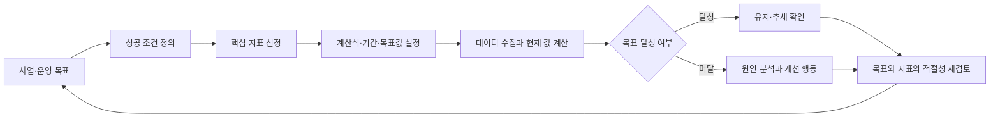

## 목차

- [[#1. 개요|1. 개요]]
- [[#2. KPI의 본질|2. KPI의 본질]]
- [[#3. KPI의 구성 요소|3. KPI의 구성 요소]]
- [[#4. 목표에서 행동까지의 흐름|4. 목표에서 행동까지의 흐름]]
- [[#5. 선행 지표와 후행 지표|5. 선행 지표와 후행 지표]]
- [[#6. 분야별 KPI 예시|6. 분야별 KPI 예시]]
- [[#7. 좋은 KPI의 조건|7. 좋은 KPI의 조건]]
- [[#8. 흔한 오해와 부작용|8. 흔한 오해와 부작용]]
- [[#9. 관련 문서|9. 관련 문서]]
- [[#10. 출처|10. 출처]]

## 1. 개요

KPI(Key Performance Indicator, 핵심 성과 지표)는 조직이나 개인이 중요한 목표를 얼마나 잘 달성하고 있는지 판단하기 위해 선택한 정량적 지표이다.[^1][^2]

측정할 수 있는 숫자라고 해서 모두 KPI가 되는 것은 아니다. KPI는 단순한 수치에 그치지 않고 **달성하려는 목표, 실제 측정값, 목표값, 측정 기간과 판정 기준**을 함께 가진다. Microsoft와 Oracle의 설명에서도 KPI는 측정값을 목표와 비교하고 임계값에 따라 상태를 해석하는 구조로 제시된다.[^1][^2]

쉽게 설명하면 자동차 계기판에는 속도·회전수·연료량 등 여러 숫자가 표시되지만, 목적지에 제시간에 도착하는 것이 목표라면 남은 거리와 예상 도착 시간이 더 중요한 판단 기준이 된다. 계기판의 모든 숫자가 Metric이라면, 현재 목표를 판단하기 위해 특별히 선택한 숫자가 KPI에 가깝다.

## 2. KPI의 본질

KPI의 핵심은 많이 측정하는 것이 아니라 **목표 달성 여부를 판단하고 다음 행동을 결정하는 데 필요한 소수의 지표를 고르는 것**이다.

예를 들어 서버의 CPU 사용률, 메모리 사용량, 요청 수와 디스크 사용량은 모두 유용한 Metric이다. 그러나 조직의 목표가 `사용자가 안정적으로 서비스를 이용할 수 있게 한다`라면 CPU 사용률 하나만으로 목표 달성 여부를 판단하기는 어렵다. CPU 사용률이 낮아도 애플리케이션 오류 때문에 요청이 실패할 수 있고, CPU 사용률이 높아도 서비스가 정상적으로 처리될 수 있기 때문이다.

반면 다음과 같이 목표와 판정 기준이 연결되면 KPI가 된다.

> 월간 전체 요청 중 정상 처리된 요청의 비율을 99.9% 이상으로 유지한다.

이 문장에는 목표, 계산 대상, 측정 기간과 목표값이 들어 있다. 실제 값이 목표에 미달하면 원인을 분석하고 용량 증설, 장애 제거, 배포 방식 개선 같은 행동을 검토할 수 있다.

따라서 다음 관계로 이해할 수 있다.

> 모든 KPI는 Metric을 바탕으로 하지만, 측정되는 모든 Metric이 KPI인 것은 아니다.

## 3. KPI의 구성 요소

KPI를 이름과 숫자만으로 정의하면 사람마다 다른 방식으로 계산할 수 있다. 최소한 다음 내용을 함께 정해야 한다.[^1][^3]

| 구성 요소 | 확인할 내용 | 예시 |
|---|---|---|
| 목표 | 어떤 결과를 개선하거나 유지하려는가 | 안정적인 서비스 제공 |
| 지표 | 무엇을 측정하는가 | 정상 처리된 요청의 비율 |
| 계산식과 단위 | 어떤 데이터를 어떤 방식으로 계산하는가 | 정상 요청 수 ÷ 전체 요청 수 × 100, 단위 `%` |
| 측정 범위 | 어떤 서비스·사용자·지역을 포함하는가 | 운영 환경의 외부 HTTP 요청 |
| 측정 기간 | 어느 기간의 값을 판단하는가 | 매월 |
| 목표값 | 어느 수준을 달성해야 하는가 | 99.9% 이상 |
| 임계값 | 정상·주의·위험을 어떻게 나누는가 | 99.9% 이상 정상, 99.5~99.9% 주의 |
| 데이터 출처 | 어느 시스템의 기록을 사용하는가 | 로드 밸런서 요청 로그와 모니터링 시스템 |
| 책임과 검토 주기 | 누가 언제 확인하고 대응하는가 | 운영팀이 매주 추세 확인, 월간 결과 검토 |

같은 이름의 KPI라도 계산식과 범위가 다르면 결과를 직접 비교할 수 없다. 예를 들어 `가용성`에서 정기 점검 시간을 제외하는지, 전체 서버를 평균하는지, 실제 사용자 요청을 기준으로 하는지에 따라 값이 달라진다.

## 4. 목표에서 행동까지의 흐름

KPI는 보고서에 숫자를 표시하는 것으로 끝나지 않는다. 목표에서 지표를 고르고, 측정 결과에 따라 행동한 뒤 다시 결과를 확인하는 순환 구조가 필요하다.

숫자가 나빠졌다고 즉시 담당자를 평가하거나 자원을 증설해서는 안 된다. 먼저 계산 오류, 데이터 누락, 트래픽 구성 변화와 같은 조건을 확인하고 실제 목표에 영향을 준 원인을 분석해야 한다.

## 5. 선행 지표와 후행 지표

KPI는 결과가 나타나는 시점을 기준으로 선행 지표와 후행 지표로 구분하기도 한다.

- **후행 지표(Lagging Indicator)**는 이미 발생한 결과를 보여 준다. 월간 가용성, 장애로 인한 손실액과 고객 이탈률 등이 해당할 수 있다.
- **선행 지표(Leading Indicator)**는 미래 결과에 영향을 줄 가능성이 있는 과정이나 행동을 보여 준다. 변경 전 자동 시험 통과율, 복구 훈련 성공률과 위험 변경의 사전 검토율 등이 해당할 수 있다.

후행 지표는 실제 결과를 확인하기 좋지만 결과가 나빠진 뒤에야 문제를 알 수 있다. 선행 지표는 더 일찍 개입할 수 있지만 원하는 결과와 실제로 연관되는지 검증해야 한다.

한 지표가 언제나 선행 또는 후행으로 고정되는 것은 아니다. `배포 실패율`은 해당 배포의 결과를 설명하는 후행 지표이면서, 향후 서비스 안정성을 예측하는 참고 지표로도 활용될 수 있다. 따라서 이름보다 **어떤 목표와 시간 관계에서 사용하는지**가 중요하다.

## 6. 분야별 KPI 예시

KPI는 기업 전체뿐 아니라 부서·팀·프로젝트와 개인의 목표에도 사용할 수 있다. 다음은 개념 이해를 위한 예시이며 모든 조직에 그대로 적용하는 표준값은 아니다.

| 분야와 목표 | KPI 예시 | 함께 확인할 Metric |
|---|---|---|
| 영업의 매출 확대 | 분기 매출 목표 달성률 100% 이상 | 상담 건수, 계약 건수, 평균 계약 금액 |
| 고객 지원의 만족도 향상 | 월간 고객 만족도 4.5점 이상 | 문의 건수, 최초 응답 시간, 재문의율 |
| 생산의 품질 향상 | 월간 불량률 1% 이하 | 생산량, 공정별 불량 건수, 재작업 시간 |
| 프로젝트의 일정 준수 | 주요 이정표의 기한 내 완료율 95% 이상 | 완료 작업 수, 지연 일수, 미해결 위험 수 |
| 서비스 운영의 안정성 향상 | 월간 정상 요청 비율 99.9% 이상 | 오류 건수, 응답 시간, 장애 구간 |
| 인재 유지 | 연간 자발적 퇴사율을 정한 목표 이내로 유지 | 근속 기간, 조직별 퇴사 수, 만족도 조사 결과 |

예를 들어 영업팀이 계약 건수만 높이면 금액이 작은 계약에 집중하거나 수익성이 낮은 계약을 늘릴 수 있다. 따라서 매출·이익·고객 유지처럼 본래 목표를 더 잘 나타내는 결과와 함께 판단해야 한다.

같은 숫자도 목표에 따라 역할이 달라진다. `월간 문의 건수`는 업무량을 파악하는 일반 Metric일 수 있지만, 고객 접점 확대가 핵심 목표인 조직에서는 목표값과 기간을 붙여 KPI로 사용할 수 있다.

## 7. 좋은 KPI의 조건

좋은 KPI는 조직의 목적과 연결되고, 계산 방식이 투명하며, 일정한 기준으로 반복 측정할 수 있어야 한다.[^4][^5] 다음 질문에 분명하게 답할 수 있는지 확인하면 도움이 된다.

1. 이 지표는 어떤 목표와 연결되는가?
2. 계산식·단위·범위·기간을 다른 사람도 똑같이 이해할 수 있는가?
3. 데이터가 신뢰할 수 있는 출처에서 반복적으로 수집되는가?
4. 값이 나빠졌을 때 담당자가 취할 수 있는 행동이 있는가?
5. 한 가지 숫자를 개선하면서 다른 중요한 품질을 훼손하지 않는가?
6. 환경과 목표가 바뀌었을 때 지표의 유효성을 다시 검토하는가?

특히 `이 수치가 빨간색이 되면 무엇을 다르게 할 것인가?`에 답할 수 없다면 핵심 성과 지표가 아니라 참고용 Metric일 가능성이 크다.

목표값은 희망 사항만으로 정하지 않고 현재 기준값, 사용자 기대, 비용, 위험과 기술적 제약을 함께 고려해야 한다. 처음 정한 KPI가 완벽할 필요는 없으며 실제 운영 결과를 확인하면서 계산식과 임계값을 개선할 수 있다.

## 8. 흔한 오해와 부작용

### 많은 KPI가 더 정확하다는 오해

지표가 너무 많으면 무엇이 정말 중요한지 판단하기 어려워진다. 핵심 목표마다 소수의 KPI를 두고, 원인 분석에 필요한 세부 값은 보조 Metric으로 관리하는 편이 명확하다.

### 측정하기 쉬운 숫자의 선택

수집하기 쉽다는 이유로 CPU 사용률이나 처리 건수만 선택하면 사용자 경험이나 실제 사업 결과와 멀어질 수 있다. 측정 가능한 숫자에서 목표를 찾는 것이 아니라, 먼저 목표를 정한 뒤 이를 가장 잘 나타내는 지표를 선택해야 한다.

### 목표값 달성과 목적 달성의 혼동

티켓 처리 건수를 KPI로 삼으면 어려운 문제를 해결하기보다 간단한 티켓을 많이 닫는 행동이 유리해질 수 있다. 평균 복구 시간만 낮추려고 심각한 장기 장애를 통계에서 제외하는 상황도 생길 수 있다. KPI 하나를 개선하는 행동이 전체 목적을 해치지 않는지 함께 확인해야 한다.

### 평균값만 확인하는 문제

평균값은 일부 집단이 겪는 심각한 문제를 가릴 수 있다. 회사 전체의 평균 고객 만족도가 높아도 특정 제품이나 지역의 만족도는 매우 낮을 수 있다. 필요하면 평균뿐 아니라 구간별 분포, 최댓값·최솟값과 세부 집단별 결과를 함께 확인해야 한다.

## 9. 관련 문서

- [[CPU Monitoring|CPU 모니터링]]
- [[Memory Monitoring|Memory 모니터링]]
- [[SNMP]]
- [[Load Balancing|로드 밸런싱]]
- [[MOU]]

## 10. 출처

[^1]: [Microsoft Learn — KPIs in Analysis Services tabular models](https://learn.microsoft.com/en-us/analysis-services/tabular-models/kpis-ssas-tabular?view=sql-analysis-services-2025). KPI의 Base Value, Target Value와 Status Threshold 구성을 설명한다.
[^2]: [Oracle — What's the difference between key performance indicator and performance measure?](https://docs.oracle.com/en/cloud/saas/project-management/26b/oapfm/what-s-the-difference-between-key-performance-indicator-and.html). 일반적인 측정값과 핵심 활동의 성과를 목표·임계값으로 해석하는 KPI의 차이를 설명한다.
[^3]: [IBM Documentation — Key Performance Indicators](https://www.ibm.com/docs/en/webmethods-bpm/wm-optimize/10.15.0?topic=concepts-key-performance-indicators). KPI의 측정 단위, 계산 방식과 데이터 수집 간격을 설명한다.
[^4]: [Australian Government Department of Finance — Key performance indicator](https://www.finance.gov.au/about-us/glossary/pgpa/term-key-performance-indicator-kpi). KPI를 목적 달성 과정에서 활동의 효율성과 효과성을 평가하는 성과 측정으로 정의한다.
[^5]: [UK Government — Sustainability Reporting Concepts, Principles and Foundations](https://assets.publishing.service.gov.uk/media/6a57c02e2f6185941a9a65fb/26-27_Appendix_A_Sustainability_Reporting_Concepts__Principles_and_Foundations.pdf). 성과 지표가 전략과 연결되고, 계산 방식이 투명하며, 맥락과 함께 제시되고, 신뢰할 수 있고 일관되어야 한다는 원칙을 설명한다.

## 둘러보기

[[Knowledge Base/index|전체 개념 목록]]
 · [[Business 분류|Business]]
