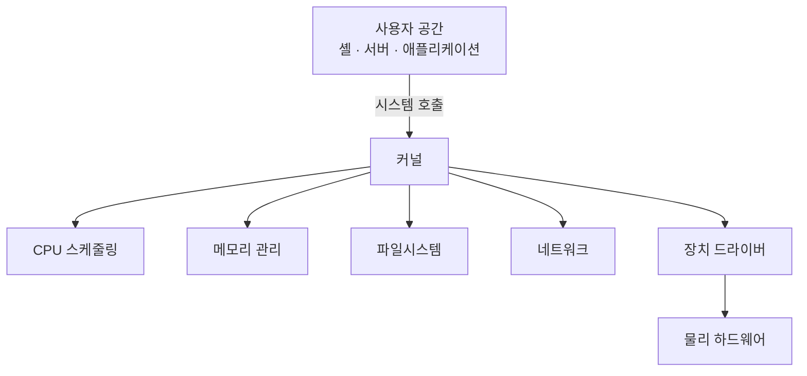

## 목차

- [[#1. 개요|1. 개요]]
- [[#2. 커널과 프로세스의 차이|2. 커널과 프로세스의 차이]]
- [[#3. Linux와 Linux 커널|3. Linux와 Linux 커널]]
- [[#4. 관련 문서와 출처|4. 관련 문서와 출처]]

## 1. 개요

Kernel(커널)은 CPU·메모리·장치 같은 하드웨어 자원을 관리하고, 사용자 프로그램이 시스템 호출을 통해 그 자원을 사용하도록 중재하는 운영체제의 핵심 소프트웨어이다.

커널은 단순히 모든 프로그램 아래에 놓인 파일 하나가 아니라 실행 중인 시스템 전체의 자원 관리자이다. 어떤 프로세스에 CPU를 줄지 결정하고, 각 프로세스의 메모리 주소를 격리하며, 파일시스템·네트워크·장치 드라이버를 통해 하드웨어 접근을 통제한다.

## 2. 커널과 프로세스의 차이

프로세스는 사용자 공간에서 실행되는 프로그램의 인스턴스이고, 커널은 그 프로세스들의 생성·실행·종료와 자원 사용을 관리한다. 커널은 일반 프로세스처럼 PID를 가진 최상위 부모가 아니다. 부팅 후 커널이 시작하는 첫 사용자 공간 프로세스가 PID 1이며, 이후 프로세스 부모·자식 관계가 만들어진다.

사용자 프로그램은 보통 CPU의 사용자 모드에서 실행된다. 파일 읽기나 네트워크 송신처럼 보호된 작업이 필요하면 시스템 호출로 커널 모드에 진입하여 검사를 받고 결과를 돌려받는다. 이 경계는 실수나 공격으로 한 프로그램이 다른 프로세스와 장치를 마음대로 훼손하는 일을 줄인다.

## 3. Linux와 Linux 커널

엄밀한 의미의 Linux는 커널 프로젝트이다. 일상적으로 말하는 Linux 운영체제는 이 커널에 셸·라이브러리·명령 도구·시스템 서비스와 패키지 관리 체계를 결합한 시스템 또는 배포판이다. 자세한 전체 관계는 [[Linux]]에서 다룬다.

## 4. 관련 문서와 출처

- [[Linux]], [[Program and Process|프로그램과 프로세스]], [[Bootloader|부트로더]]
- [Linux Kernel Documentation](https://docs.kernel.org/)
- [The Linux Kernel Archives — About Linux Kernel](https://www.kernel.org/linux.html)

## 둘러보기

[[Knowledge Base/index|전체 개념 목록]] · [[Compute 분류|Compute]]
