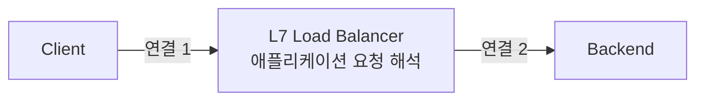
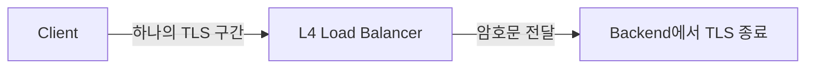
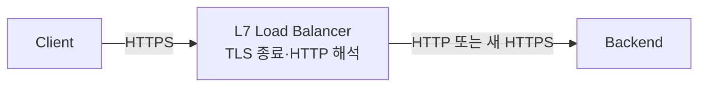

## 목차

- [[#1. 개요|1. 개요]]
- [[#2. 처리 정보와 연결 구조|2. 처리 정보와 연결 구조]]
- [[#3. L4 Load Balancing|3. L4 Load Balancing]]
- [[#4. L7 Load Balancing|4. L7 Load Balancing]]
- [[#5. TLS 처리의 차이|5. TLS 처리의 차이]]
- [[#6. 상위호환 관계가 아닌 이유|6. 상위호환 관계가 아닌 이유]]
- [[#7. 서비스별 적용 사례|7. 서비스별 적용 사례]]
- [[#8. 제품과 동작 모드의 구분|8. 제품과 동작 모드의 구분]]
- [[#9. 선택 기준|9. 선택 기준]]
- [[#10. 관련 문서|10. 관련 문서]]
- [[#11. 출처|11. 출처]]

## 1. 개요

L4 Load Balancing은 전송 계층의 연결·주소·포트 정보를 중심으로 대상을 선택하고, L7 Load Balancing은 HTTP 같은 애플리케이션 프로토콜의 요청 의미를 해석하여 대상을 선택한다.

L7 통신도 TCP·UDP와 IP 위에서 전달되지만, L7 Load Balancing이 L4 Load Balancing의 완전한 상위호환이라는 뜻은 아니다. 두 방식은 더 낮고 높은 등급이 아니라 **서로 다른 깊이의 정보를 보고 서로 다른 역할을 수행하는 방식**이다.

## 2. 처리 정보와 연결 구조

```text
L7  HTTP Host·URL·Header·Cookie·요청 의미
L4  TCP·UDP, 출발지와 목적지 IP·Port, 연결·Flow
L3  IP 주소와 경로
L2  MAC 주소와 VLAN
```

L4는 연결이나 Flow를 하나의 단위로 Backend에 배정한다. L7 Reverse Proxy는 클라이언트의 연결을 받아 애플리케이션 메시지를 해석하고 Backend에 별도 연결을 만들 수 있다.



## 3. L4 Load Balancing

L4 Load Balancer는 일반적으로 프로토콜, 출발지·목적지 IP와 포트, 연결 상태 같은 정보를 이용한다. 애플리케이션 메시지의 문법을 알 필요 없이 같은 Flow를 같은 Target에 전달할 수 있다.

```text
TCP 443   → 전달 가능
TCP 3306  → 전달 가능
TCP 22    → 전달 가능
독자 TCP  → 전달 가능
UDP       → 제품이 지원하면 전달 가능
```

AWS NLB는 프로토콜과 출발지·목적지 IP·포트 등의 흐름 정보를 이용하여 Target을 선택하고, 하나의 TCP 연결은 수명 동안 같은 Target으로 보낸다.[^aws-how]

L4가 적합한 대표 상황은 다음과 같다.

- HTTP가 아닌 임의의 TCP·UDP 프로토콜
- 애플리케이션 내용을 볼 필요가 없는 대량 연결
- TLS를 Backend까지 그대로 전달하는 구성
- 게임·실시간 미디어처럼 낮은 지연이 중요한 Flow
- DB·SSH·VPN·MQTT 등 별도 프로토콜의 연결 분산

## 4. L7 Load Balancing

L7 Load Balancer는 지원하는 애플리케이션 프로토콜을 파싱하고 요청 내용에 따라 정책을 적용한다.

```http
GET /api/orders HTTP/1.1
Host: shop.example.com
Cookie: session=abc
```

다음과 같은 분산이 가능하다.

```text
Host: shop.example.com → Shopping Target Group
Host: api.example.com  → API Target Group
/images/*              → Image Target Group
/admin/*               → Admin Target Group
```

L7은 경로 기반 라우팅 외에도 Header 변경, Redirect, 인증 연동, WAF, Cookie 기반 세션 같은 애플리케이션 정책을 제공할 수 있다. 실제 지원 범위는 제품과 버전에 따라 다르다. AWS ALB는 OSI Application Layer에서 Listener Rule을 평가하여 요청 내용에 맞는 Target Group을 선택한다.[^aws-alb]

## 5. TLS 처리의 차이

L4 TLS Passthrough에서는 Load Balancer가 암호화된 애플리케이션 내용을 해석하지 않고 Backend로 전달할 수 있다.



HTTPS의 URL·Header를 기준으로 분산하려면 L7 Load Balancer가 일반적으로 TLS를 종료하고 HTTP를 해석한다. Backend 구간은 평문 HTTP 또는 새로운 HTTPS 연결로 구성할 수 있다.



그러나 **TLS 종료 여부만으로 L4와 L7을 구분하지 않는다.** 일부 L4 Load Balancer도 TLS Listener에서 암호화를 종료할 수 있다. TLS를 종료한 뒤에도 URL·Header를 해석하지 않고 연결 정보로만 Target을 선택한다면 처리 관점은 L4이다. 핵심 기준은 애플리케이션 메시지의 의미를 이용하는지 여부이다.

## 6. 상위호환 관계가 아닌 이유

### 지원 프로토콜의 범위

HTTP용 L7 Load Balancer는 MySQL·SSH·게임의 독자 패킷을 HTTP처럼 해석할 수 없다. 해당 프로토콜 전용 Proxy를 만들 수는 있지만 메시지 형식·인증·세션·버전 변화까지 이해해야 한다.

### 처리 비용과 책임

L7 처리는 다음 작업을 추가할 수 있다.

- TLS 복호화와 재암호화
- 애플리케이션 메시지 파싱
- Header·Cookie·경로 규칙 평가
- 클라이언트 연결과 Backend 연결 관리
- 인증·WAF·로그 정책 처리

애플리케이션 정보를 이용할 필요가 없다면 이 복잡성이 불필요할 수 있다. L4는 내용을 이해하지 않는 대신 다양한 TCP·UDP Flow를 투명하게 전달할 수 있다.

### 종단 간 특성의 변화

L7 Proxy가 연결과 TLS를 종료하면 클라이언트와 Backend 사이의 하나의 세션이 두 구간으로 나뉜다. 인증서·개인 키 관리, 원본 클라이언트 주소 전달, Timeout·Buffering과 재시도 정책을 Load Balancer에서도 책임져야 한다.

## 7. 서비스별 적용 사례

서비스 전체가 L4 또는 L7 하나만 사용하는 것은 아니다. 제어 요청과 실제 데이터 흐름의 특성에 따라 함께 사용할 수 있다.

| 서비스 | L7 적용 | L4 적용 |
|---|---|---|
| 온라인 게임 | 로그인·결제·상점 HTTP API | 실시간 게임 TCP·UDP 세션 |
| 화상 회의 | 사용자 인증·회의 생성 API | 실시간 음성·영상 미디어 Flow |
| 동영상 서비스 | HLS·DASH 파일과 CDN의 HTTP 요청 | 전용 실시간 미디어 전송 |
| 데이터베이스 | DB 전용 Proxy가 Query 의미를 해석하는 경우 | MySQL·PostgreSQL TCP 연결 분산 |
| 원격 접속 | 전용 Gateway가 인증·세션을 해석하는 경우 | SSH·RDP 연결 전달 |
| IoT | HTTP API·MQTT 전용 Gateway | 장시간 MQTT·독자 TCP 연결 |

저장된 동영상은 보통 HTTP·HTTPS 기반의 작은 Segment를 CDN에서 내려받으므로 L7 처리가 널리 쓰인다. 실시간 영상이라고 모두 L4인 것도 아니며, WebRTC·QUIC·HTTP/3처럼 프로토콜과 제품 지원에 따라 구조가 달라진다.

UDP라고 반드시 L4인 것도 아니다. HTTP/3는 UDP 기반 QUIC을 사용하지만 이를 이해하는 CDN·Load Balancer는 QUIC을 종료하고 HTTP 요청을 L7에서 처리할 수 있다.

## 8. 제품과 동작 모드의 구분

하나의 제품이 L4와 L7 기능을 모두 제공할 수 있다. 이 사실과 L7 방식이 L4의 상위호환이라는 주장은 다르다.

```text
HAProxy
├── mode tcp  → L4 방식
└── mode http → L7 방식

NGINX
├── stream    → TCP·UDP 처리
└── http      → HTTP 처리

클라우드 Load Balancer
├── NLB       → L4 중심
└── ALB       → L7 중심
```

HAProxy의 TCP Mode는 양방향 트래픽을 전달하고, HTTP Mode는 프로토콜을 분석하여 요청·응답 내용을 기준으로 허용·차단·변경·Backend 전환을 수행한다.[^haproxy-mode]

## 9. 선택 기준

다음 질문으로 선택 기준을 정리할 수 있다.

```text
요청의 Host·URL·Header·Cookie를 보고 판단해야 하는가?
├── 예  → L7 검토
└── 아니요
    ├── 임의 TCP·UDP나 독자 프로토콜인가? → L4 검토
    ├── TLS를 Backend까지 유지해야 하는가? → L4 Passthrough 검토
    └── 연결 단위 분산이면 충분한가?       → L4 검토
```

선택은 `L7이 더 고급이므로 우선`이 아니라, **분산 결정에 필요한 최소한의 정보를 어느 계층에서 얻을 수 있는가**를 기준으로 한다.

## 10. 관련 문서

- [[Load Balancing|로드 밸런싱]], [[OSI and TCP-IP Models|OSI 7계층과 TCP/IP 4계층]]
- [[Encapsulation|캡슐화]], [[Web Server]], [[NAT]]
- 관련 질문: [[3-Tier 아키텍처의 로드밸런서 도입 조건]]

## 11. 출처

[^aws-how]: AWS, [How Elastic Load Balancing works](https://docs.aws.amazon.com/elasticloadbalancing/latest/userguide/how-elastic-load-balancing-works.html). NLB의 Flow 선택과 ALB의 요청 선택 방식.
[^aws-alb]: AWS, [What is an Application Load Balancer?](https://docs.aws.amazon.com/elasticloadbalancing/latest/application/introduction.html). Application Layer의 Listener Rule과 Target Group 선택.
[^haproxy-mode]: HAProxy Technologies, [HAProxy Enterprise Configuration Manual](https://cdn.haproxy.com/documentation/haproxy-configuration-manual/new/latest/). TCP Mode와 HTTP Mode의 처리 범위.

## 둘러보기

[[Knowledge Base/index|전체 개념 목록]] · [[Networking 분류|Networking]]
