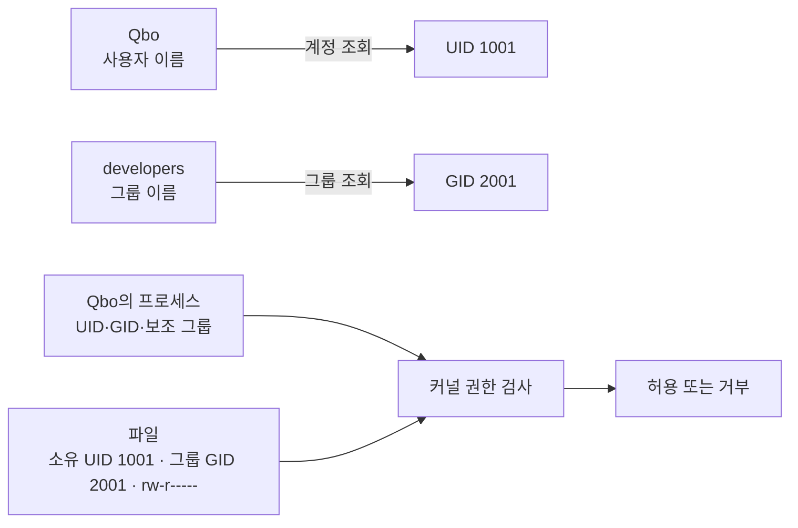

## 1. 개요

Linux 계정·권한 체계는 사용자와 그룹을 숫자 UID·GID로 식별하고, 프로세스의 자격 증명과 파일의 소유자·그룹·권한을 비교하여 자원 접근을 허용하거나 거부하는 방식이다.

사용자 이름과 그룹 이름은 사람이 관리하기 쉬운 표시이고, [[Kernel|커널]]의 실제 권한 판단은 숫자 식별자를 기준으로 이루어진다. 따라서 같은 이름의 계정을 다시 만들어도 UID가 다르면 기존 파일의 소유자로 인정되지 않으며, 다른 이름이라도 예전 UID를 재사용하면 해당 UID가 소유한 파일에 접근할 수 있다.[^credentials]



## 2. 사용자 이름과 UID

사용자 계정에는 사람이 입력하는 로그인 이름과 커널이 사용하는 숫자 UID(User ID)가 연결된다.

```text
사용자 이름    Qbo
UID            1001
홈 디렉터리    /home/Qbo
로그인 셸      /bin/bash
```

```bash
id Qbo
```

```text
uid=1001(Qbo) gid=1001(Qbo) groups=1001(Qbo),2001(developers)
```

파일시스템은 소유자를 이름 문자열이 아니라 숫자 UID로 기록한다. `ls -l`은 계정 조회 기능을 통해 숫자를 이름으로 바꾸어 보여 주고, `ls -ln`은 숫자를 그대로 표시한다.

```text
-rw-r----- 1 Qbo developers 2048 report.txt
-rw-r----- 1 1001 2001       2048 report.txt
```

UID 1001인 Qbo를 삭제하면 파일은 남을 수 있고, 이름으로 바꿀 계정 정보가 없다면 숫자 `1001`이 표시될 수 있다. 이후 이름이 같은 Qbo를 UID 3000으로 만들면 기존 파일의 소유자가 아니다. 반대로 다른 계정에 UID 1001을 부여하면 커널은 그 프로세스를 기존 파일 소유자와 같은 UID로 판단할 수 있으므로 UID 재사용은 보안과 데이터 인계 관점에서 관리해야 한다.

사용자 이름과 UID의 연결이 반드시 `/etc/passwd`에만 있는 것은 아니다. 로컬 파일뿐 아니라 LDAP 같은 디렉터리 서비스도 이름 조회에 참여할 수 있다. `getent passwd Qbo`는 시스템이 실제로 사용하는 계정 조회 경로를 통해 결과를 확인할 때 유용하다.

## 3. 기본 그룹과 보조 그룹

그룹은 여러 사용자에게 같은 파일·디렉터리 접근 권한을 부여하기 위한 단위이며 숫자 GID(Group ID)로 식별된다.

- **기본 그룹(primary group)**: 계정에 하나가 지정되는 기본 GID
- **보조 그룹(supplementary groups)**: 사용자가 추가로 속할 수 있는 여러 그룹

```text
Qbo
├─ 기본 그룹: Qbo          GID 1001
└─ 보조 그룹: developers  GID 2001
               docker      GID 2002
```

프로세스는 사용자의 유효 UID·GID와 보조 그룹 목록을 자격 증명으로 가진다. 자식 프로세스는 일반적으로 부모의 사용자·그룹 식별 정보를 상속한다.[^credentials]

새 파일의 그룹은 일반적으로 프로세스의 유효 기본 그룹에서 정해지지만, 상위 디렉터리에 setgid가 설정되어 있으면 그 디렉터리의 그룹을 상속할 수 있다. 공유 작업 디렉터리에서 파일 그룹을 일정하게 유지할 때 사용한다.

```bash
id Qbo
groups Qbo
getent group developers
```

### 사람 계정과 서비스 계정

사람이 로그인해 작업하는 Qbo 계정과 웹 애플리케이션을 실행하기 위한 `appsvc` 계정은 목적이 다르다.

| 구분 | 사람 계정 `Qbo` | 서비스 계정 `appsvc` |
|---|---|---|
| 목적 | 사용자의 로그인과 대화형 작업 | 특정 프로세스에 최소 권한 부여 |
| 인증 | 비밀번호·SSH 키 등 필요 | 사람의 로그인 인증이 필요하지 않을 수 있음 |
| 홈 | 일반적으로 `/home/Qbo` | 없거나 `/var/lib/myapp` 같은 상태 디렉터리 사용 |
| 셸 | `/bin/bash` 같은 로그인 셸 | `/usr/sbin/nologin` 등으로 대화형 로그인 제한 가능 |
| `sudo` | 직무상 필요한 명령만 정책에 따라 부여 | 일반적으로 부여하지 않음 |
| 그룹 | 기본 그룹 하나와 필요한 보조 그룹 | 애플리케이션이 접근해야 할 자원의 그룹만 부여 |

서비스 계정도 UID와 기본 GID를 가지며 필요하면 보조 그룹을 가질 수 있다. 비밀번호가 없어도 `systemd`는 서비스 설정의 `User=appsvc`와 `Group=appsvc`를 사용해 해당 신원으로 프로세스를 실행할 수 있다. 서비스 계정의 핵심은 사람이 대신 로그인하는 계정이 아니라 프로세스의 파일·소켓·장치 접근 범위를 제한하는 실행 신원이라는 점이다. 서비스 수명 관리는 [[Daemon|데몬]]에서 이어서 설명한다.

## 4. 로컬 계정 정보 파일

전통적인 로컬 계정 구성에서는 다음 파일을 사용한다.[^passwd]

| 파일 | 내용 | 일반적인 열람 범위 |
|---|---|---|
| `/etc/passwd` | 이름, UID, 기본 GID, 설명, 홈, 로그인 셸 | 일반 사용자도 읽을 수 있음 |
| `/etc/shadow` | 비밀번호 해시와 만료·잠금 정보 | root 등 제한된 주체만 읽음 |
| `/etc/group` | 그룹 이름, GID와 구성원 정보 | 일반적으로 읽을 수 있음 |
| `/etc/gshadow` | 보호가 필요한 그룹 관리 정보 | 제한된 주체만 읽음 |

`/etc/passwd`의 이름과 달리 현대 Linux에서는 실제 비밀번호 해시를 보통 `/etc/shadow`에 분리한다. `/etc/passwd`의 한 줄은 다음 필드를 가진다.

```text
name:x:UID:GID:comment:home:shell
```

```text
Qbo:x:1001:1001:Qbo:/home/Qbo:/bin/bash
```

여기서 `x`는 비밀번호 관련 정보가 shadow 파일에 있다는 표시이다. 비밀번호 원문을 저장한다는 뜻이 아니다. 계정 잠금과 로그인 셸 제한은 인증 경로에 영향을 주지만, 이미 실행 중인 프로세스나 SSH 키·서비스 등 다른 접근 방식까지 항상 하나의 설정으로 모두 차단한다고 단정하면 안 된다.

## 5. 파일 권한 표기

```text
-rw-r----- 1 Qbo developers 2048 Nov 9 report.txt
```

```text
-    rw-    r--    ---
│     │      │      └─ 기타 사용자(others)
│     │      └──────── 파일 그룹(group)
│     └─────────────── 파일 소유자(user)
└───────────────────── 파일 유형
```

맨 앞 문자는 권한이 아니라 파일 유형이다.

```text
-    일반 파일
d    디렉터리
l    심볼릭 링크 표시
```

권한은 소유자·그룹·기타 사용자 순서로 세 글자씩 나뉜다.

```text
r    read, 읽기
w    write, 쓰기
x    execute, 실행 또는 디렉터리 탐색
-    해당 권한 없음
```

예시에서 Qbo는 `rw-`로 읽기·쓰기가 가능하고, developers 그룹 구성원은 `r--`로 읽기만 가능하며, 나머지 사용자는 접근 권한이 없다.

커널은 세 묶음의 권한을 모두 합치지 않는다. 프로세스의 유효 UID가 파일 소유 UID와 같으면 소유자 권한을 적용하고, 그렇지 않으면서 파일 GID가 프로세스의 유효·보조 그룹과 일치하면 그룹 권한을 적용하며, 둘 다 아니면 기타 사용자 권한을 적용한다. 소유자 권한이 `---`인데 그룹 권한이 `r--`라고 해서 소유자가 그룹 권한을 대신 받는 것은 아니다.

## 6. 파일과 디렉터리에서 `rwx`의 차이

| 권한 | 일반 파일 | 디렉터리 |
|---|---|---|
| `r` | 파일 내용 읽기 | 내부 항목의 이름 목록 읽기 |
| `w` | 파일 내용 변경 | 내부 항목 생성·삭제·이름 변경 |
| `x` | 프로그램으로 실행 | 디렉터리 진입과 경로 탐색·통과 |

```text
drwxr-x--- Qbo developers project
```

- Qbo는 목록 확인·경로 탐색·내부 항목 변경이 가능하다.
- developers 그룹은 목록 확인과 경로 탐색은 가능하지만 내부 항목 생성·삭제는 불가능하다.
- 기타 사용자는 목록 확인과 진입이 불가능하다.

디렉터리 안의 파일을 생성·삭제하려면 일반적으로 그 디렉터리에 `w`와 `x`가 모두 필요하다. `w`만 있고 `x`가 없다면 경로를 탐색할 수 없어 실질적인 변경 작업을 수행할 수 없다.

| 디렉터리 권한 | 이름 목록 | 이름을 아는 내부 항목 접근 | 생성·삭제·이름 변경 |
|---|---:|---:|---:|
| `r--` | 가능 | 불가능 | 불가능 |
| `-w-` | 불가능 | 불가능 | 불가능 |
| `--x` | 불가능 | 조건부 가능 | 불가능 |
| `r-x` | 가능 | 가능 | 불가능 |
| `-wx` | 불가능 | 가능 | 가능 |
| `rwx` | 가능 | 가능 | 가능 |

`-wx`이면 목록을 볼 수 없어도 이름을 이미 아는 항목에 접근하거나 생성·삭제할 수 있다. 내부 파일의 내용을 읽을 수 있는지는 디렉터리 경로 통과 권한뿐 아니라 해당 파일의 읽기 권한도 별도로 충족해야 한다.

파일 삭제는 파일 내용을 수정하는 것보다 상위 디렉터리에서 이름을 제거하는 작업에 가깝다. 따라서 파일 자체에 쓰기 권한이 없어도 상위 디렉터리에 `w+x`가 있으면 삭제할 수 있는 경우가 있다. `/tmp` 같은 공유 디렉터리는 sticky bit를 사용해 다른 사용자가 소유한 항목을 마음대로 삭제하지 못하도록 제한한다.

## 7. 숫자 권한과 기호 권한

각 기본 권한은 다음 숫자로 표현한다.

```text
r = 4
w = 2
x = 1
```

```text
rw- = 4 + 2 = 6
r-- = 4     = 4
--- = 0     = 0
```

따라서 `rw-r-----`는 `640`이다.

```bash
chmod 640 report.txt
```

기호 방식으로도 변경할 수 있다.[^chmod]

```bash
chmod u+x script.sh      # 소유자에게 실행 권한 추가
chmod g-w report.txt     # 그룹 쓰기 권한 제거
chmod o= file.txt        # 기타 사용자의 모든 권한 제거
chmod u=rw,g=r,o= report.txt
```

```text
u    user, 소유자
g    group, 그룹
o    others, 기타 사용자
a    all, 전체
```

재귀 옵션 `-R`은 하위 항목 전체의 권한을 바꾸므로 대상 경로를 반드시 확인해야 한다. 파일과 디렉터리는 `x`의 의미가 다르기 때문에 모든 항목에 같은 숫자 권한을 재귀 적용하는 방식은 의도하지 않은 실행·탐색 권한을 만들 수 있다.

## 8. 소유자와 그룹 변경

```bash
chown alice report.txt
chown alice:developers report.txt
chgrp developers report.txt
```

- `chown`은 파일의 소유자 또는 소유자와 그룹을 변경한다.
- `chgrp`은 파일 그룹을 변경한다.

일반 사용자가 파일 소유권을 임의의 다른 사용자에게 넘기는 작업은 대개 제한되며, 그룹 변경도 자신이 속한 그룹과 시스템 정책의 영향을 받는다. 명령은 커널에 변경을 요청하고 최종 허용 여부는 운영체제의 권한 정책이 판단한다.[^coreutils]

## 9. 새 파일의 기본 권한과 `umask`

프로그램이 파일이나 디렉터리를 만들 때 요청한 기본 모드에서 `umask`에 표시된 권한을 제외해 최종 권한을 정한다.

일반적인 예시는 다음과 같다.

```text
일반 파일 기본 요청    666  rw-rw-rw-
디렉터리 기본 요청     777  rwxrwxrwx
umask                  022  ----w--w-

결과 파일              644  rw-r--r--
결과 디렉터리          755  rwxr-xr-x
```

일반 파일에 실행 권한을 자동으로 주지 않는 이유는 단순 데이터 파일이 뜻하지 않게 실행 가능해지는 것을 피하기 위해서이다. 실제 프로그램은 더 제한적인 권한을 직접 요청할 수 있으므로 `umask`만으로 모든 생성 권한이 결정된다고 단정하면 안 된다.

```bash
umask
umask 027
```

`umask`는 현재 셸과 그 자식 프로세스에 영향을 주며, 시스템 서비스는 별도 설정을 사용할 수 있다.

## 10. root·`sudo`·`su`

root는 UID 0인 관리자 계정이다. 현대 Linux는 강한 권한 일부를 capability로 나누기도 하지만 입문 단계에서는 시스템 전체 관리 계정으로 이해할 수 있다.

| 구분 | 의미 |
|---|---|
| `root` | UID 0인 관리자 계정 |
| `sudo command` | 정책이 허용한 명령을 다른 사용자, 기본적으로 root 권한으로 실행 |
| `su - user` | 해당 사용자의 로그인 셸로 전환 |
| `sudo -i` | sudo 정책을 거쳐 root 로그인 셸과 비슷한 환경 시작 |
| `sudoedit file` | 권한이 필요한 파일을 임시 사본 편집 흐름으로 수정 |

`sudo`는 현재 Bash 전체를 root로 바꾸지 않고 뒤에 지정된 명령을 높은 권한으로 실행한다.

```bash
sudo echo "test" > /etc/example.conf
```

이 명령에서 `echo`는 root로 실행되지만 `>`는 Qbo의 기존 Bash가 먼저 처리한다. Qbo가 대상 파일을 열 권한이 없으면 실패한다.

```text
Qbo의 Bash
├─ sudo를 통해 echo를 root로 실행
└─ > /etc/example.conf는 Qbo 권한으로 처리
```

파일을 여는 프로그램까지 root로 실행하려면 다음처럼 구성할 수 있다.

```bash
echo "test" | sudo tee /etc/example.conf > /dev/null
echo "test" | sudo tee -a /etc/example.conf > /dev/null
sudoedit /etc/example.conf
```

`tee`는 첫 번째 명령에서 덮어쓰고 `-a`를 사용하면 끝에 추가한다. `sudo sh -c 'echo "test" > /etc/example.conf'`처럼 root 셸이 리다이렉션을 처리하게 할 수도 있지만, 긴 명령과 중첩된 따옴표는 실수를 만들기 쉬우므로 목적과 입력을 확인해야 한다.

root도 읽기 전용 파일시스템, immutable 속성, SELinux·AppArmor 같은 추가 보안 정책과 커널 제약을 무조건 우회하는 것은 아니다. 권한 오류가 발생했다고 바로 `sudo`를 붙이기보다 어떤 주체가 어떤 자원에 왜 접근해야 하는지 확인해야 한다.

## 11. 특별 권한과 ACL

기본 `rwx` 외에도 다음 기능이 있다.[^special]

- **setuid**: 실행 파일의 소유자 유효 UID로 프로그램을 실행하는 데 사용
- **setgid**: 실행 파일에서는 파일 그룹의 유효 GID로 실행하며, 디렉터리에서는 새 항목이 디렉터리 그룹을 상속하도록 하는 데 주로 사용
- **sticky bit**: 공유 디렉터리에서 파일 소유자·디렉터리 소유자 등 허용된 주체만 삭제·이름 변경하도록 제한
- **POSIX ACL**: 소유자·그룹·기타 사용자 세 묶음보다 세밀하게 특정 사용자와 그룹에 권한 부여

```bash
ls -ld /tmp
getfacl report.txt
```

`/tmp`에서 흔히 보는 `drwxrwxrwt`의 마지막 `t`가 sticky bit이다. ACL이 설정된 파일은 `ls -l` 권한 뒤에 `+`가 표시될 수 있으며, 기본 권한만 보고 실제 접근 결과를 완전히 설명할 수 없을 수 있다.

## 12. 확인과 관리 명령

```bash
whoami                     # 현재 유효 사용자 이름
id                         # 현재 UID·GID·보조 그룹
id Qbo                     # 특정 계정 정보
getent passwd Qbo          # 시스템 계정 조회 경로로 사용자 확인
getent group developers    # 그룹 정보 확인
ls -l report.txt           # 이름으로 표시한 소유자·그룹·권한
ls -ln report.txt          # 숫자 UID·GID로 표시
stat report.txt            # 파일 속성 상세 확인
umask                      # 현재 기본 권한 마스크
```

```bash
sudo useradd -m -s /bin/bash Qbo       # 홈과 로그인 셸을 지정한 사람 계정
sudo passwd Qbo                       # 비밀번호 설정·변경
sudo groupadd developers              # 그룹 생성
sudo usermod -aG developers Qbo       # 기존 목록을 유지하며 보조 그룹 추가
sudo useradd -r -s /usr/sbin/nologin appsvc  # 시스템·서비스 계정 예시
sudo passwd -l appsvc                 # 비밀번호 인증 잠금
sudo userdel Qbo                      # 계정 삭제, 파일은 별도 확인
```

- `passwd`는 사용자 정보를 보는 명령이 아니라 비밀번호와 잠금·만료 상태를 관리한다. `passwd -S Qbo`로 상태를 볼 수 있다.
- `usermod -aG`의 `-a`는 기존 보조 그룹 목록에 추가한다. `-a` 없이 `-G`를 사용하면 기존 목록이 대체될 수 있다. `-g`는 기본 그룹 변경이다.
- `userdel -r`은 홈과 메일 스풀까지 제거할 수 있는 영향이 큰 작업이며, 다른 경로의 파일은 숫자 UID 소유로 남을 수 있다.
- `id`는 UID·GID·그룹을 확인한다. 현재 로그인 세션은 `who`나 `w`로 확인한다.
- `useradd`의 홈 생성 여부와 기본 셸은 배포판 설정에 따라 다를 수 있으므로 옵션과 `/etc/default/useradd`, `/etc/login.defs`를 함께 확인한다.[^useradd]

계정을 만들고 그룹을 변경하는 명령은 배포판과 관리 정책에 따라 사용 방식이 다를 수 있다. 운영 서버에서는 수동으로 `/etc/passwd`를 편집하기보다 배포판의 계정 관리 도구나 조직의 디렉터리 서비스를 사용하고 UID·GID 중복과 홈 디렉터리 소유권을 함께 확인한다.

## 13. 관련 문서

- [[Linux]], [[Linux Structure|리눅스 구조]], [[Linux Directory Structure|리눅스 디렉터리 구조]]
- [[CLI]], [[Linux Basic Commands|리눅스 기본 명령어]], [[Shell|셸]]
- [[Program and Process|프로그램과 프로세스]], [[Kernel|커널]]
- [[Daemon|데몬]]
- [[Security 분류|Security]]

## 14. 출처

[^credentials]: [Linux man-pages — `credentials(7)`](https://man7.org/linux/man-pages/man7/credentials.7.html)
[^passwd]: [Linux man-pages — `passwd(5)`](https://man7.org/linux/man-pages/man5/passwd.5.html), [`shadow(5)`](https://man7.org/linux/man-pages/man5/shadow.5.html), [`group(5)`](https://man7.org/linux/man-pages/man5/group.5.html)
[^chmod]: [GNU Coreutils — Setting Permissions](https://www.gnu.org/software/coreutils/manual/html_node/Setting-Permissions.html)
[^coreutils]: [GNU Coreutils — Changing File Attributes](https://www.gnu.org/software/coreutils/manual/coreutils.html#Changing-file-attributes)
[^special]: [GNU Coreutils — Mode Structure](https://www.gnu.org/software/coreutils/manual/html_node/Mode-Structure.html)
[^useradd]: [shadow-utils — `useradd(8)`](https://man7.org/linux/man-pages/man8/useradd.8.html), [`usermod(8)`](https://man7.org/linux/man-pages/man8/usermod.8.html), [`passwd(1)`](https://man7.org/linux/man-pages/man1/passwd.1.html)

## 둘러보기

[[Knowledge Base/index|전체 개념 목록]] · [[Security 분류|Security]]
