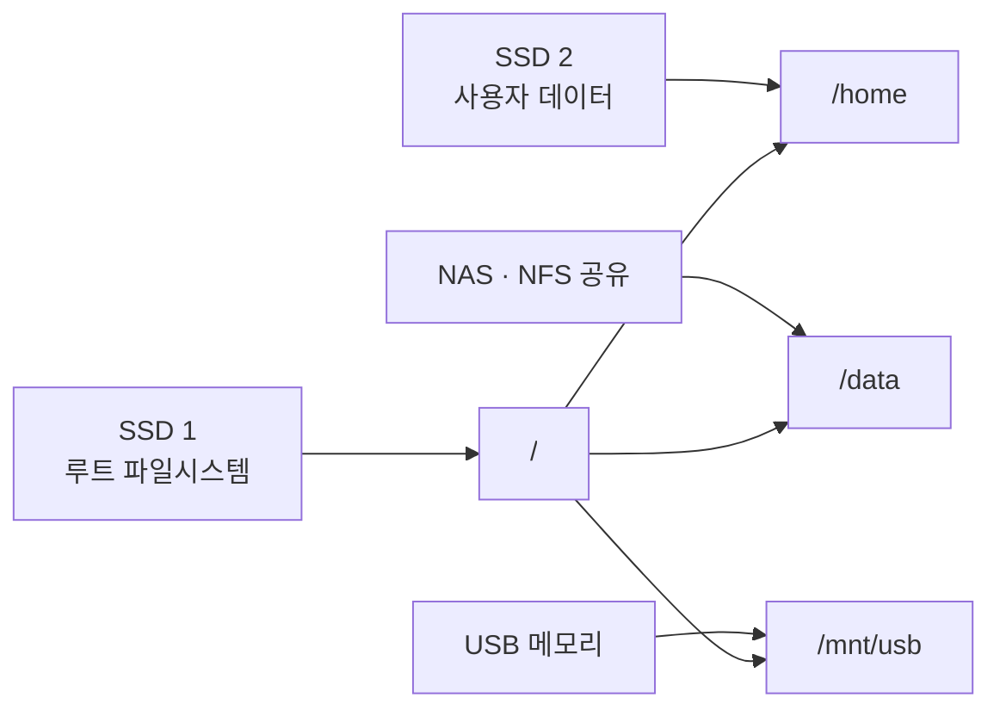

## 목차

- [[#1. 개요|1. 개요]]
- [[#2. 하나의 / 아래에 여러 파일시스템 연결|2. 하나의 / 아래에 여러 파일시스템 연결]]
- [[#3. /와 /root의 차이|3. /와 /root의 차이]]
- [[#4. 역할에 따른 기억 방법|4. 역할에 따른 기억 방법]]
- [[#5. 주요 디렉터리|5. 주요 디렉터리]]
- [[#6. “모든 것은 파일”의 정확한 의미|6. “모든 것은 파일”의 정확한 의미]]
- [[#7. 직접 구조를 확인하는 명령|7. 직접 구조를 확인하는 명령]]
- [[#8. 핵심 정리|8. 핵심 정리]]
- [[#9. 관련 문서|9. 관련 문서]]
- [[#10. 출처|10. 출처]]

## 1. 개요

Linux 디렉터리 구조는 여러 디스크·파티션·네트워크 및 가상 파일시스템을 하나의 루트 디렉터리 `/` 아래에 연결하고, 파일의 역할에 따라 표준화된 위치에 배치하는 계층 구조이다.

Linux가 이 구조를 사용하는 것은 리누스 토르발스 개인이 새로 선택한 방식이라기보다 Unix 계열의 단일 디렉터리 트리와 마운트 방식을 계승했기 때문이다. Linux 배포판은 Filesystem Hierarchy Standard(FHS)를 바탕으로 주요 디렉터리의 용도를 정하지만, 배포판과 설치 방식에 따라 세부 위치는 달라질 수 있다.[^fhs]

## 2. 하나의 `/` 아래에 여러 파일시스템 연결

Windows에서 `C:\`, `D:\`처럼 볼륨마다 드라이브 문자를 부여하는 방식과 달리, Linux는 전체 이름 공간을 `/`에서 시작한다. 이것이 물리적으로 하나의 디스크나 파일시스템만 사용한다는 뜻은 아니다.



파일시스템을 디렉터리에 연결하는 것을 **마운트(mount)**라고 하고, 연결되는 디렉터리를 **마운트 지점(mount point)**이라고 한다. `/home`, `/boot`, `/var`가 루트 파일시스템 안의 일반 디렉터리일 수도 있고 별도 파티션의 마운트 지점일 수도 있다.

```text
/home/gyubo/file.txt      SSD 2에 저장될 수 있음
/data/report.pdf          NAS에 저장될 수 있음
/mnt/usb/photo.jpg        USB 메모리에 저장될 수 있음
```

프로그램은 경로를 사용하고, [[Kernel|커널]]의 가상 파일시스템 계층이 그 경로에 연결된 실제 파일시스템을 찾아간다. 덕분에 프로그램은 파일이 로컬 SSD, 별도 파티션 또는 네트워크 스토리지에 있는지 매번 다른 방식으로 다룰 필요가 없다.

## 3. `/`와 `/root`의 차이

```text
/        전체 디렉터리 트리의 시작점인 루트 디렉터리
/root    관리자 계정 root의 홈 디렉터리
```

같은 단어가 사용되지만 전자는 위치이고 후자는 사용자 계정의 개인 공간이다. 일반 사용자 홈은 보통 `/home/사용자명`에 있지만, root 계정은 `/root`를 사용한다. `/home`을 별도 파일시스템으로 구성했거나 마운트하지 못한 복구 상황에서도 root가 자신의 홈에 접근할 수 있다는 운영상 이점도 있다.

## 4. 역할에 따른 기억 방법

디렉터리를 모두 개별적으로 암기하기보다 역할별로 묶으면 구조를 이해하기 쉽다.

| 역할 | 디렉터리 | 핵심 질문 |
|---|---|---|
| 사용자 파일 | `/home`, `/root` | 사용자별 개인 파일의 위치 |
| 설정 | `/etc` | 프로그램의 동작 설정 |
| 프로그램·라이브러리 | `/usr`, `/bin`, `/sbin`, `/lib` | 실행 코드와 공통 자료의 위치 |
| 변하는 운영 데이터 | `/var`, `/run` | 실행 중 생성·변경되는 자료 |
| 장치·커널 정보 | `/dev`, `/proc`, `/sys` | 하드웨어와 커널 상태의 노출 방식 |
| 임시·외부 연결 | `/tmp`, `/mnt`, `/media` | 임시 파일과 추가 파일시스템의 위치 |
| 부팅 | `/boot` | 커널과 부트로더 파일의 위치 |

## 5. 주요 디렉터리

### `/home` — 일반 사용자의 개인 공간

일반 사용자의 문서와 개인 설정을 보관한다.

```text
/home/gyubo/
├── Documents/
├── Downloads/
├── .bashrc
└── .ssh/
```

모든 계정이 반드시 `/home` 아래에 홈을 갖는 것은 아니다. 서비스 계정은 홈 디렉터리가 없거나 다른 경로를 사용할 수 있다. 프로그램에서는 경로를 `/home/이름`으로 가정하기보다 해당 사용자의 `$HOME`이나 계정 정보를 확인하는 편이 안전하다.

### `/root` — root 사용자의 홈

시스템 최고 관리자 계정인 root의 개인 설정과 작업 파일을 보관한다. 전체 트리의 시작점 `/`와는 다른 디렉터리이다.

### `/etc` — 시스템과 프로그램의 설정

호스트에 적용되는 시스템 전역 설정 파일을 보관한다. 실행 프로그램 자체를 두는 위치가 아니며 장치 파일도 여기에 두지 않는다.[^fhs-root]

```text
/etc/ssh/sshd_config     SSH 서버 설정
/etc/fstab               부팅 시 마운트할 파일시스템 설정
/etc/hosts               이름과 주소의 정적 연결
/etc/passwd              계정 기본 정보
/etc/nginx/nginx.conf    NGINX 설정 사례
```

### `/usr` — 사용자 공간 프로그램과 공유 데이터

이름 때문에 사용자 홈으로 오해하기 쉽지만, 현대 Linux에서는 운영체제가 제공하는 사용자 공간 프로그램·라이브러리·공유 데이터를 주로 보관한다.

```text
/usr/bin       일반 실행 프로그램
/usr/sbin      시스템 관리 프로그램
/usr/lib       라이브러리
/usr/share     문서·로케일 등 아키텍처 독립 데이터
/usr/local     관리자가 패키지 관리자 밖에서 직접 설치한 로컬 프로그램
```

`/usr`의 이름과 역할은 Unix 역사 속에서 변해 왔다. 현재 구조에서는 개인 파일을 `/home`에 두고, `/usr`는 여러 사용자가 함께 사용하는 비교적 정적인 프로그램과 데이터를 담는 영역으로 이해하는 것이 적절하다.

### `/var` — 계속 변하는 운영 데이터

`var`는 variable에서 나온 이름으로, 프로그램이 실행되면서 추가·변경하는 로그·상태·캐시·대기열 등을 보관한다.[^fhs-var]

```text
/var/log       로그
/var/lib       프로그램이 유지하는 상태 데이터
/var/cache     다시 만들 수 있는 캐시
/var/spool     처리 대기 중인 메일·인쇄 작업 등
```

다음 비교로 기억할 수 있다.

```text
/etc    어떻게 동작할지 정하는 설정
/var    동작하면서 만들어지고 변하는 데이터
```

### `/bin` — 기본 명령 프로그램

`bin`은 binary에서 나온 이름이며 `ls`, `cp`, `mv`, `cat` 같은 기본 실행 프로그램이 배치되던 위치이다.

전통적으로 복구와 초기 부팅에도 필요한 프로그램을 `/bin`에, 나머지 일반 프로그램을 `/usr/bin`에 나누었다. 현대의 많은 배포판은 `usr merge`를 적용해 `/bin`을 `/usr/bin`을 가리키는 심볼릭 링크로 구성한다.[^debian]

```text
/bin → /usr/bin
```

따라서 `/bin/ls`와 `/usr/bin/ls`가 같은 실행 파일을 가리킬 수 있다.

### `/dev` — 장치 접근을 위한 특수 파일

`dev`는 device를 뜻하며 커널의 장치 드라이버와 연결된 장치 파일을 제공한다.

```text
/dev/sda       디스크 장치의 전통적인 이름 사례
/dev/sda1      해당 디스크의 파티션 사례
/dev/tty       터미널 장치
/dev/null      기록한 데이터를 버리는 특수 장치
/dev/random    난수 데이터 인터페이스
```

`/dev/sda`는 디스크 내용이 일반 파일로 복사되어 있는 장소가 아니다. 프로그램이 파일과 비슷한 읽기·쓰기 인터페이스로 커널 드라이버에 접근하도록 만든 특수한 통로이다. 실제 장치 이름은 NVMe, 가상 디스크와 장치 구성에 따라 `/dev/nvme0n1`, `/dev/vda` 등으로 달라질 수 있다.

### `/proc` — 프로세스와 커널 정보의 가상 파일시스템

`procfs`는 실행 중인 프로세스와 커널 상태를 파일·디렉터리 형태로 보여 준다.[^proc]

```text
/proc/1          PID 1 정보
/proc/1234       PID 1234 정보
/proc/cpuinfo    CPU 정보
/proc/meminfo    메모리 정보
/proc/mounts     마운트 정보
```

이 파일들은 일반적으로 디스크에 저장된 정적 문서가 아니다. 사용자가 읽으면 커널이 현재 메모리에 있는 상태를 바탕으로 내용을 제공한다. `/proc`는 프로세스만이 아니라 시스템 전체의 일부 커널 정보도 포함한다.

### `/tmp` — 임시 파일

프로그램이 작업 도중 잠시 필요한 파일을 보관한다. 재부팅이나 시스템 정책에 따라 삭제될 수 있으므로 중요한 자료를 영구 보관하면 안 된다.

여러 사용자가 파일을 만들 수 있지만 일반적으로 sticky bit가 설정되어 다른 사용자가 소유한 파일을 마음대로 지우지 못하게 한다. 재부팅 뒤에도 유지할 필요가 있는 임시 데이터에는 배포판 정책에 따라 `/var/tmp`를 사용할 수 있다.

### `/boot` — 부팅에 필요한 정적 파일

커널 이미지, `initramfs`, 부트로더 관련 파일 등을 보관한다.[^fhs-root]

```text
/boot/vmlinuz-*       Linux 커널 이미지
/boot/initramfs-*     초기 사용자 공간 이미지의 일반적인 이름 사례
/boot/grub/           GRUB 관련 파일
```

파일명과 EFI System Partition의 마운트 위치는 배포판에 따라 다를 수 있다. 구체적인 부팅 관계는 [[BIOS and UEFI|BIOS·UEFI]]와 [[Bootloader|부트로더]]에서 다룬다.

## 6. “모든 것은 파일”의 정확한 의미

Unix 계열에서 말하는 “모든 것은 파일이다”는 모든 대상이 디스크의 일반 파일이라는 뜻이 아니다. 장치, 파이프와 일부 커널 정보처럼 성격이 다른 대상에도 파일과 비슷한 이름·열기·읽기·쓰기 인터페이스를 적용한다는 설계 관점에 가깝다.

| 경로 사례 | 실제 성격 |
|---|---|
| `/home/gyubo/a.txt` | 저장장치의 일반 파일 |
| `/dev/null` | 커널이 제공하는 특수 장치 파일 |
| `/proc/meminfo` | 커널 상태를 보여 주는 가상 파일 |
| `/mnt/data/report.pdf` | 다른 디스크나 네트워크 파일시스템에 있을 수 있는 일반 파일 |

모든 커널 기능이 파일 인터페이스 하나로만 제공되는 것도 아니다. 시스템 호출, 소켓, Netlink 등 다른 인터페이스도 사용하므로 이 문장을 절대적인 구현 규칙으로 해석하면 안 된다.

## 7. 직접 구조를 확인하는 명령

```bash
pwd             # 현재 디렉터리
ls -la /        # 루트 바로 아래의 항목
findmnt         # 파일시스템과 마운트 지점
lsblk           # 블록 장치와 파티션·마운트 관계
df -hT          # 마운트된 파일시스템의 형식과 사용량
```

`ls /`만 보면 하나의 트리로 보이지만 `findmnt`와 `lsblk`를 함께 보면 그 아래에 여러 물리·가상 파일시스템이 연결된 구조를 확인할 수 있다.

## 8. 핵심 정리

```text
/        전체 트리의 시작
/home    일반 사용자의 개인 파일
/root    root 사용자의 홈
/etc     시스템과 프로그램 설정
/usr     프로그램·라이브러리·공유 데이터
/var     로그·상태·캐시처럼 변하는 데이터
/bin     기본 실행 명령, 현대에는 /usr/bin과 통합되기도 함
/dev     장치 접근을 위한 특수 파일
/proc    프로세스와 커널 정보를 보여 주는 가상 파일시스템
/tmp     임시 파일
/boot    커널과 부트로더 관련 파일
```

## 9. 관련 문서

- [[Linux]], [[Linux Structure|리눅스 구조]], [[Kernel|커널]]
- [[Disk|디스크]], [[Partition|파티션]], [[Filesystem|파일시스템]], [[Mount|마운트]]
- [[Disk]], [[Storage]], [[File Storage|파일 스토리지]]
- [[BIOS and UEFI|BIOS·UEFI]], [[Bootloader|부트로더]]
- [[Shell|셸]], [[Terminal|터미널]]
- [[CLI]], [[Linux Basic Commands|리눅스 기본 명령어]]
- [[Linux Accounts and Permissions|리눅스 계정과 권한]]

## 10. 출처

[^fhs]: [Linux Foundation — Filesystem Hierarchy Standard 3.0](https://refspecs.linuxfoundation.org/FHS_3.0/fhs.html)
[^fhs-root]: [Filesystem Hierarchy Standard — Root filesystem requirements](https://specifications.freedesktop.org/fhs/latest/rootRequirements.html)
[^fhs-var]: [Linux Foundation FHS 3.0 — `/var` hierarchy](https://refspecs.linuxfoundation.org/FHS_3.0/fhs.html#thevarhierarchy)
[^proc]: [Linux Kernel Documentation — Filesystems, procfs](https://docs.kernel.org/filesystems/)
[^debian]: [Debian Administrator's Handbook — Organization of the Filesystem Hierarchy](https://www.debian.org/doc/manuals/debian-handbook/sect.filesystem-hierarchy.ko.html)

## 둘러보기

[[Knowledge Base/index|전체 개념 목록]] · [[Compute 분류|Compute]]
