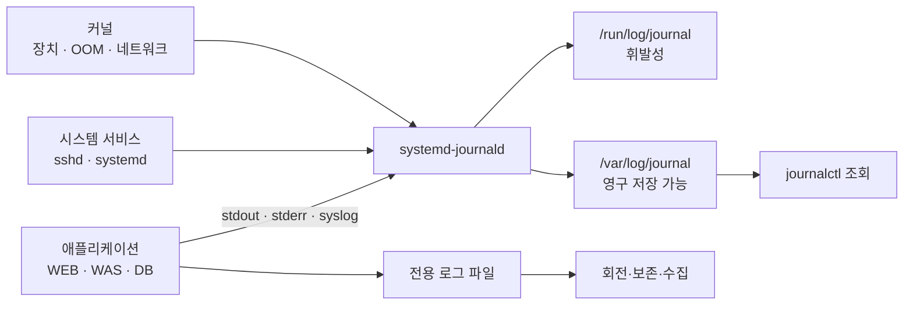

## 목차

- [[#1. 개요|1. 개요]]
- [[#2. 로그를 남기는 이유|2. 로그를 남기는 이유]]
- [[#3. 발생 지점과 수집 경로|3. 발생 지점과 수집 경로]]
- [[#4. 로그 레벨|4. 로그 레벨]]
- [[#5. 시간순 상관관계와 원인 검증|5. 시간순 상관관계와 원인 검증]]
- [[#6. 민감정보를 남기지 않는 설계|6. 민감정보를 남기지 않는 설계]]
- [[#7. journalctl 화면의 해석|7. journalctl 화면의 해석]]
- [[#8. 실무 확인 순서|8. 실무 확인 순서]]
- [[#9. 관련 문서|9. 관련 문서]]
- [[#10. 출처|10. 출처]]

## 1. 개요

Linux 로그(Log)는 커널·서비스·애플리케이션이 특정 시점에 발생한 사건과 상태를 기록하여 장애 분석, 보안 감사, 운영 관찰과 데이터 분석에 활용할 수 있게 한 정보이다.

로그는 원인을 자동으로 확정하는 답안지가 아니다. 여러 계층의 시간·요청 식별자·상태를 연결해 원인 가설을 만들고 실제 상태로 검증하기 위한 증거이다.

## 2. 로그를 남기는 이유

- 장애가 처음 발생한 계층과 영향을 받은 범위 추적
- 서비스의 처리량·지연·오류율 관찰과 경보
- 로그인·권한 변경 같은 보안 사건 감사
- 사용 흐름과 주문·결제 같은 비즈니스 사건 분석
- 변경 전후 결과와 자동화 작업의 실행 이력 확인

운영 디버그 메시지와 비즈니스 이벤트는 목적과 보존 정책이 다를 수 있다. 분석할 값은 `key=value`나 JSON 같은 구조화된 형태로 남기면 검색·집계와 계층 간 연결이 쉬워진다.

## 3. 발생 지점과 수집 경로



`systemd-journald`는 커널 메시지, Syslog 메시지, 서비스의 표준 출력·오류 등을 수집하고 구조화된 Journal에 저장한다. `journalctl`은 그 내용을 조회하는 명령이다. 로그 동작 자체를 제어하는 프로그램이라는 설명은 정확하지 않다.[^journald][^journalctl]

`/var/log`는 전통적인 로그 저장 위치이다. 배포판과 설정에 따라 `syslog`, `messages`, `auth.log`, `secure`, `nginx/` 등이 존재할 수 있다. Journal은 `/var/log/journal`에 영구 저장하거나 `/run/log/journal`에 재부팅 시 사라지는 형태로 저장할 수 있다.

## 4. 로그 레벨

Syslog의 심각도는 숫자가 작을수록 심각하다.[^syslog]

| 숫자 | 이름 | 의미 |
|---:|---|---|
| 0 | `emerg` | 시스템을 사용할 수 없는 긴급 상황 |
| 1 | `alert` | 즉시 조치가 필요한 상황 |
| 2 | `crit` | 심각한 오류 |
| 3 | `err` | 오류 |
| 4 | `warning` | 잠재적 문제 |
| 5 | `notice` | 정상이나 주목할 사건 |
| 6 | `info` | 일반적인 운영 정보 |
| 7 | `debug` | 상세 진단 정보 |

애플리케이션은 `TRACE`, `DEBUG`, `INFO`, `WARN`, `ERROR`, `FATAL`처럼 다른 이름을 사용할 수 있다. 레벨은 사건의 의미를 분류하지만, 같은 `ERROR`라도 사용자 한 명의 요청 실패와 전체 서비스 중단은 영향 범위가 다르다.

## 5. 시간순 상관관계와 원인 검증

```text
10:14:20 kernel: Out of memory
10:14:21 myapp: database connection refused
10:14:21 nginx: 502 Bad Gateway
```


시간상 먼저 나온 OOM은 유력한 시작점이지만 세 줄만으로 DB가 종료됐다고 확정할 수 없다. 어떤 PID가 종료됐는지, DB 포트가 실제로 닫혔는지, 애플리케이션 설정은 정상인지 확인해야 한다. 서버 간 시간이 맞지 않으면 순서가 왜곡되므로 시간 동기화와 표준 시간대도 중요하다.

한 요청이 WEB·WAS·DB를 통과한다면 `request_id`나 `trace_id`를 각 계층에 전달해 같은 요청의 로그를 묶을 수 있다.

## 6. 민감정보를 남기지 않는 설계

```text
나쁜 예:  Authorization: Bearer eyJhbGci...
나쁜 예:  card=1234-5678-9012-3456

개선 예:  event=payment_failed transaction_id=tx-9281 card_last4=3456
          request_id=req-71fa reason=issuer_declined
```

비밀번호, 개인키, API 키, 세션 쿠키, 인증 토큰, 카드 번호 전체와 불필요한 개인정보는 로그에 기록하지 않는다. 로그는 여러 시스템에 복제되고 접근자가 많으며 장기간 보관될 수 있기 때문이다. 필요한 식별은 내부 ID·거래 ID·마스킹·복원할 수 없는 지문을 사용하고 접근 권한과 보존 기간을 제한한다.

## 7. `journalctl` 화면의 해석

```bash
journalctl -u nginx --since "10 minutes ago" -p warning
```

```text
Nov 10 10:14:21 host nginx[1842]: upstream timed out, client: 10.0.0.12
│             │    │     │       └─ 메시지
│             │    │     └───────── PID
│             │    └─────────────── 실행 주체·식별자
│             └──────────────────── 호스트
└────────────────────────────────── 시각
```

| 목적 | 명령 | 해석 |
|---|---|---|
| 특정 서비스 | `journalctl -u sshd` | 해당 systemd 단위와 연결된 로그 |
| 최근 시간 | `journalctl --since "10 minutes ago"` | 분석할 시간 범위 축소 |
| 현재 부팅 | `journalctl -b` | 이전 부팅 기록과 분리 |
| 커널 | `journalctl -k` | 장치·OOM 등 커널 메시지 |
| 심각도 | `journalctl -p err` | 오류 이상 필터, 영향 범위는 별도 판단 |
| 실시간 | `journalctl -f` | 새 항목을 계속 표시 |

텍스트 파일은 다음처럼 볼 수 있다.

```bash
tail -f /var/log/nginx/error.log
grep -i 'error' /var/log/myapp/app.log
```

로그 파일을 무한히 쌓으면 디스크가 가득 찰 수 있으므로 크기·기간에 따라 회전하고 오래된 파일을 압축·삭제·외부 보관하는 정책이 필요하다. Journal은 자체 용량 제한을, 텍스트 파일은 `logrotate` 같은 도구를 사용할 수 있다.

## 8. 실무 확인 순서

```text
장애 시각과 사용자 영향 확인
  → WEB·WAS·DB·커널 중 최초 이상 징후 탐색
  → request_id·호스트·PID로 같은 사건 연결
  → 로그에서 원인 가설 수립
  → 프로세스·포트·CPU·메모리·I/O 상태로 검증
  → 조치 후 같은 지표와 실제 요청으로 회복 확인
```

로그가 없다는 사실도 정상의 증거는 아니다. 로그 설정·권한·디스크 용량·수집 경로가 잘못되어 기록 자체가 누락됐을 수 있다.

## 9. 관련 문서

- [[Daemon|데몬]] · [[Program and Process|프로그램과 프로세스]] · [[Linux Directory Structure|Linux 디렉터리 구조]]
- [[CPU Monitoring|CPU 모니터링]] · [[Memory Monitoring|메모리 모니터링]]
- [[Web Server|WEB]] · [[Web Application Server|WAS]] · [[Database|DB]]
- [[Security 분류|Security]]

## 10. 출처

[^journald]: systemd, [`systemd-journald`](https://www.freedesktop.org/software/systemd/man/latest/systemd-journald.service.html).
[^journalctl]: systemd, [`journalctl`](https://www.freedesktop.org/software/systemd/man/latest/journalctl.html).
[^syslog]: IETF, [RFC 5424 — The Syslog Protocol](https://www.rfc-editor.org/rfc/rfc5424), §6.2.1 Severity.

## 둘러보기

[[Knowledge Base/index|전체 개념 목록]] · [[Compute 분류|Compute]]
