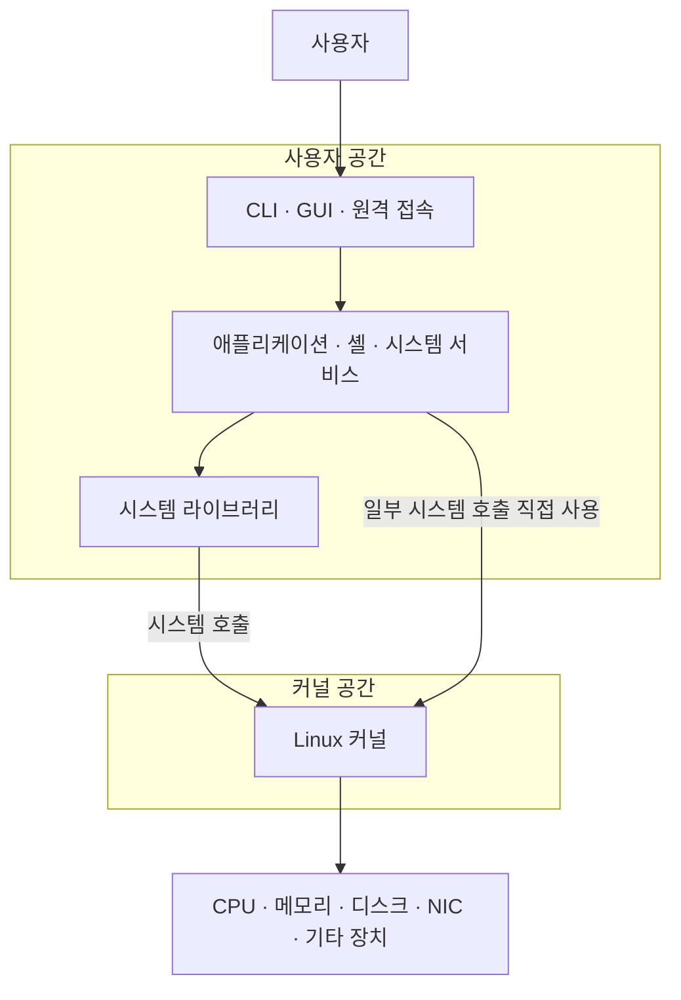
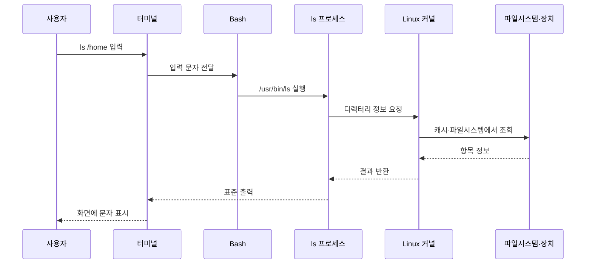
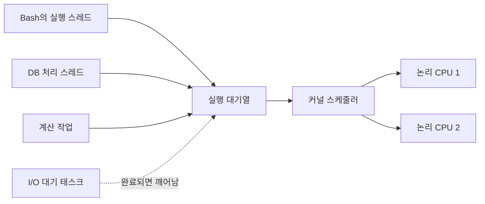

## 1. 개요

Linux 구조는 물리 하드웨어를 [[Kernel|커널]]이 관리하고, 사용자 공간의 라이브러리·서비스·셸·애플리케이션이 시스템 호출을 통해 커널 기능을 사용하는 계층 구조이다.

Linux는 커널 하나만을 뜻하기도 하지만 실제 서버에서 사용하는 Linux 시스템은 여러 종류의 소프트웨어가 역할을 나누어 구성된다. 각 계층을 구분하면 명령을 입력했을 때 어디에서 해석되고, 파일과 네트워크 요청이 어떤 경로로 하드웨어에 도달하는지 이해할 수 있다.



## 2. 부팅 구조와 실행 구조의 구분

컴퓨터가 켜지는 과정의 계층과 Linux가 실행된 뒤의 계층은 구분해야 한다.


| 단계 | 역할 | Linux와의 관계 |
|---|---|---|
| [[Firmware\|펌웨어]] | 전원 직후 플랫폼과 부팅 장치 초기화 | Linux보다 먼저 실행되는 별도 소프트웨어 |
| [[BIOS and UEFI\|BIOS·UEFI]] | 부팅 항목을 선택해 운영체제 로더 실행 | 플랫폼 펌웨어 방식 |
| [[Bootloader\|부트로더]] | 커널과 `initramfs`를 메모리에 적재 | 커널보다 먼저 실행되는 별도 프로그램 |
| [[Kernel\|Linux 커널]] | CPU·메모리·장치 관리 체계 시작 | Linux 시스템의 핵심 |
| PID 1 | 사용자 공간의 서비스와 로그인 환경 시작 | 커널이 실행하는 첫 사용자 공간 프로세스 |

펌웨어와 부트로더는 Linux 실행을 준비하지만, 부팅이 끝난 뒤 모든 프로그램의 요청이 계속 부트로더를 거치는 것은 아니다. 실행 중인 프로그램은 시스템 호출을 통해 커널과 상호작용한다.

## 3. 커널 공간과 사용자 공간

CPU는 보호 수준을 이용해 운영체제 핵심 기능과 일반 프로그램의 권한을 나눈다. Linux에서는 이를 이해하기 쉽게 커널 공간과 사용자 공간으로 구분한다.

### 커널 공간

커널이 높은 권한으로 실행되는 영역이다. 주요 역할은 다음과 같다.

- **프로세스와 스케줄링**: 실행 가능한 태스크를 논리 CPU에 배정
- **메모리 관리**: 프로세스별 가상 주소 공간과 실제 RAM 연결·보호
- **파일시스템**: 서로 다른 저장장치와 파일시스템을 공통 인터페이스로 제공
- **네트워크**: TCP/IP 처리와 소켓을 NIC 드라이버에 연결
- **장치 관리**: 디스크·NIC·USB 등 장치 드라이버와 하드웨어 제어
- **권한 검사**: 프로세스의 사용자·그룹과 요청 대상의 권한 확인

### 사용자 공간

Bash, `ls`, NGINX, `sshd`, 데이터베이스처럼 일반 프로그램이 실행되는 영역이다. 사용자 공간이라는 이름이 단순히 ‘일반 사용자 계정만 쓰는 곳’이라는 뜻은 아니다. `root` 권한으로 실행한 프로그램도 일반적으로 사용자 공간 프로세스이며, 보호된 작업은 커널에 요청해야 한다.

사용자 공간을 분리하면 한 프로그램이 임의의 메모리나 하드웨어를 직접 조작하는 일을 제한할 수 있다. 프로그램에 문제가 생겨도 항상 커널 전체가 함께 중단되는 것은 아니지만, 커널 취약점이나 높은 권한의 잘못된 작업까지 완전히 막아 주는 경계는 아니다.

## 4. 시스템 호출이라는 경계

System call(시스템 호출)은 사용자 프로그램이 커널 기능을 요청하는 공식 인터페이스이다. 파일 열기, 프로세스 생성, 메모리 매핑, 네트워크 송수신과 같은 작업에 사용된다.[^syscall]

예를 들어 사용자가 `ls /home`을 입력하면 다음 흐름이 만들어진다.



커널은 `ls`라는 명령어 이름을 해석하지 않는다. [[Shell|셸]]이 명령을 해석해 외부 프로그램을 실행하고, 실행된 프로그램이 시스템 호출로 커널에 필요한 작업을 요청한다.

## 5. 라이브러리와 기본 도구

프로그램이 모든 시스템 호출 규약과 공통 기능을 직접 구현하면 개발과 호환성 유지가 어렵다. 시스템 라이브러리는 프로그램이 사용할 함수와 실행 기반을 제공하고, 필요한 경우 그 내부에서 시스템 호출을 수행한다. GNU/Linux 배포판에서는 glibc가 대표적인 C 라이브러리이며 다른 구현도 사용할 수 있다.

`ls`, `cat`, `cp` 같은 기본 명령은 커널에 내장된 명령어가 아니라 사용자 공간의 별도 프로그램이다. 많은 배포판에서 GNU Coreutils가 이러한 프로그램을 제공한다.[^coreutils] 반면 `cd`, `export`, `alias`는 현재 셸의 상태를 직접 변경해야 하므로 셸 내장 명령으로 구현된다.

```text
Linux 커널              자원 관리와 시스템 호출 제공
시스템 라이브러리        공통 함수와 커널 인터페이스 연결
기본 명령 도구           파일 조회·복사·텍스트 처리
셸                      명령 해석과 프로그램 실행
애플리케이션·서버         실제 사용자·업무 기능 제공
```

## 6. 프로세스·스레드·태스크와 스케줄링

[[Program and Process|프로그램]]은 저장된 코드이고 프로세스는 프로그램이 실행되는 자원·격리 환경이다. 프로세스 안의 스레드는 CPU 명령을 실제로 이어서 수행하는 실행 흐름이다.

Linux 커널은 실행 단위를 태스크라는 관점에서 관리한다. 각 태스크의 상태와 스케줄링 정보는 `task_struct`에 표현된다. 독립적인 주소 공간을 가진 프로세스의 실행 흐름도, 같은 주소 공간을 공유하는 스레드도 커널에는 각각 스케줄링 가능한 태스크로 보일 수 있다.



논리 CPU가 2개라면 같은 순간에 두 실행 흐름만 CPU 명령을 처리할 수 있지만, 커널이 실행 대상을 빠르게 바꾸어 더 많은 작업을 같은 기간에 진행시킨다. 네트워크·디스크·사용자 입력을 기다리는 태스크는 CPU를 사용하지 않다가 조건이 충족되면 다시 실행 가능한 상태가 된다.

## 7. 시스템 서비스와 데몬

`ls`처럼 목적을 마치고 종료되는 프로그램도 있고, `sshd`와 NGINX처럼 요청을 기다리며 장시간 실행되는 프로그램도 있다.

- `sshd`는 SSH 접속을 기다리고 처리하는 데몬이다.
- NGINX는 설정에 따라 웹 서버, 리버스 프록시 또는 애플리케이션 계층 로드밸런서로 동작한다.
- systemd 같은 서비스 관리자는 이러한 프로그램을 시작·중지·재시작하고 상태와 의존 관계를 관리할 수 있다.

데몬은 장시간 실행되며 요청이나 사건을 기다리는 프로세스라는 실행 형태에 초점이 있고, 서비스는 시스템이 제공하는 기능 또는 운영체제가 관리하는 단위에 초점이 있다. `sshd`는 SSH 서비스를 제공하는 데몬 프로세스라고 설명할 수 있다.

## 8. 터미널·셸·CLI의 위치

[[Terminal|터미널]]은 문자 입력과 출력을 전달·표시하고, [[Shell|셸]]은 명령을 해석해 내장 기능을 수행하거나 외부 프로그램을 실행한다. CLI는 사용자가 문자 명령으로 시스템과 상호작용하는 인터페이스 방식 전체를 가리킨다.

```text
사용자
  ↓
터미널 에뮬레이터     입력·출력과 화면 표시
  ↓
셸                   명령·변수·파이프·리다이렉션 해석
  ↓
내장 명령 또는 외부 프로그램
  ↓
시스템 호출
  ↓
Linux 커널
```

MobaXterm으로 SSH 접속하는 경우에는 터미널 화면과 SSH 클라이언트가 로컬 Windows에 있고, `sshd`·셸·명령 프로그램은 원격 Linux 서버에서 실행될 수 있다.

## 9. 실제 서버에서 하나의 요청이 처리되는 위치

NGINX가 실행 중인 Linux 서버에 요청이 들어오는 상황을 계층에 연결하면 다음과 같다.

1. NIC가 네트워크 프레임을 수신한다.
2. 커널의 장치 드라이버와 네트워크 스택이 패킷을 처리한다.
3. 커널이 해당 소켓을 기다리던 NGINX 태스크를 깨운다.
4. 스케줄러가 NGINX 실행 흐름에 CPU 시간을 배정한다.
5. NGINX가 요청을 해석해 파일을 읽거나 다른 서버로 전달한다.
6. 파일·소켓 작업은 다시 시스템 호출을 거쳐 커널이 처리한다.
7. 응답 데이터가 커널 네트워크 스택과 NIC를 통해 외부로 전송된다.

물리 장비, 커널, 사용자 프로그램은 추상적인 개념으로만 분리된 것이 아니다. 실제 요청 하나가 NIC 인터럽트와 메모리, 커널 코드, CPU에서 실행되는 사용자 프로그램을 차례로 거친다.

## 10. 관련 문서

- 전체 개념: [[Linux]]
- 파일 체계: [[Linux Directory Structure|리눅스 디렉터리 구조]]
- 부팅 계층: [[Firmware|펌웨어]] · [[BIOS and UEFI|BIOS·UEFI]] · [[Bootloader|부트로더]]
- 실행 계층: [[Kernel|커널]] · [[Program and Process|프로그램과 프로세스]] · [[Memory|메모리]] · [[CPU]]
- 명령 환경: [[Terminal|터미널]] · [[Shell|셸]] · [[Shell Script|셸 스크립트]]
- 명령줄 인터페이스: [[CLI]]
- 원격 접속: [[SSH]]
- 서버와 장치: [[Server]] · [[Disk]] · [[NIC]] · [[Networking]]

## 11. 출처

[^syscall]: [Linux Kernel Documentation — System Call API](https://docs.kernel.org/userspace-api/index.html)
[^coreutils]: [GNU Project — Coreutils Manual](https://www.gnu.org/software/coreutils/manual/coreutils.html)

- [Linux Kernel Documentation](https://docs.kernel.org/)
- [GNU Project — Bash Reference Manual](https://www.gnu.org/software/bash/manual/bash.html)
- [UEFI Forum — UEFI Specification 2.11, Boot Manager](https://uefi.org/specs/UEFI/2.11/03_Boot_Manager.html)

## 둘러보기

[[Knowledge Base/index|전체 개념 목록]] · [[Compute 분류|Compute]]
