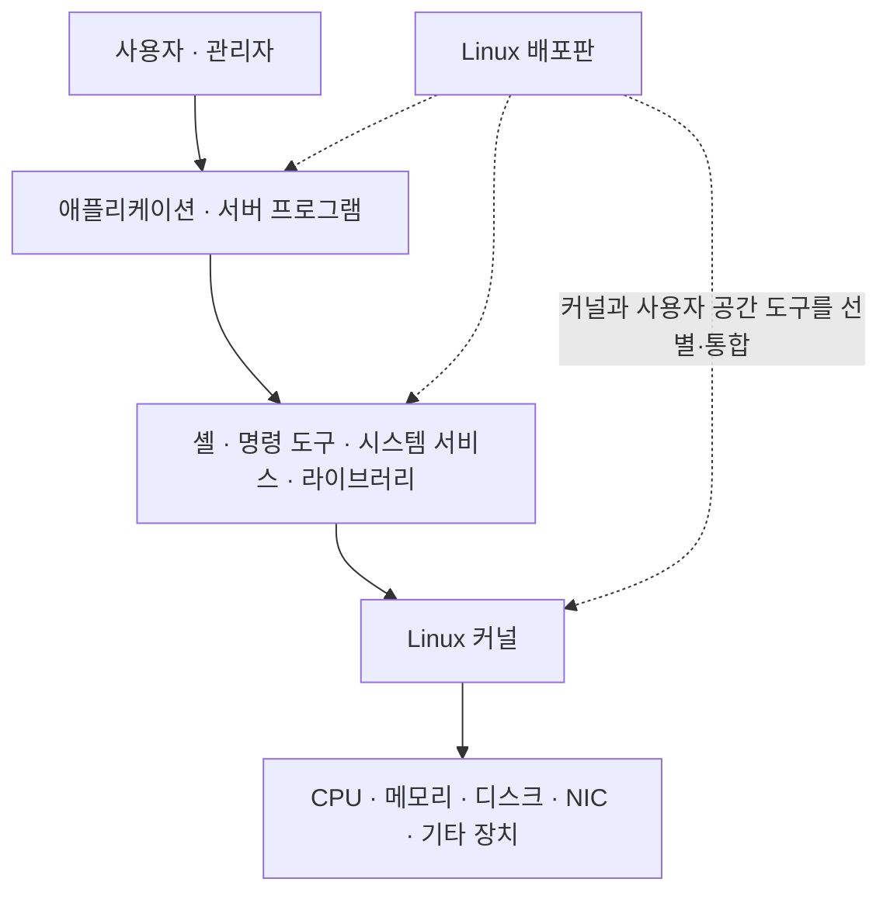
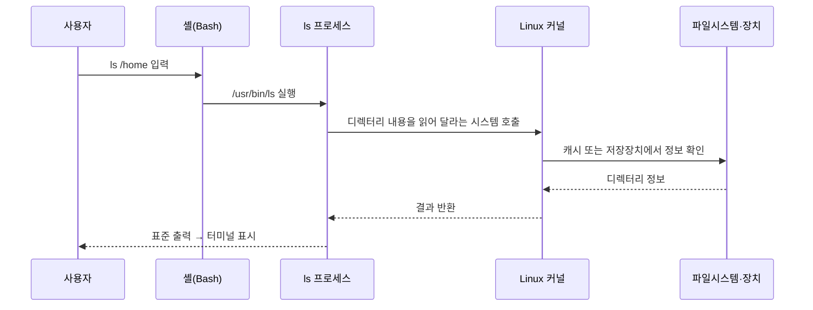
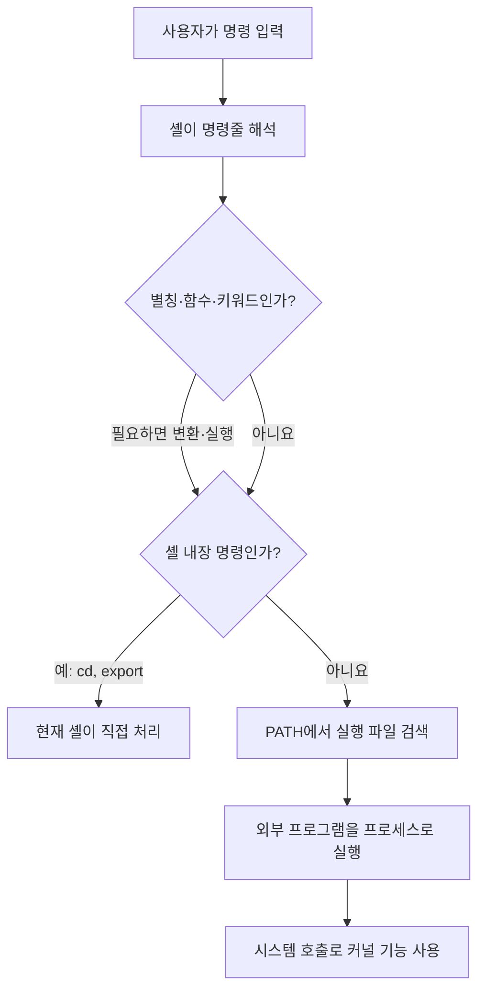

## 1. 개요

Linux(리눅스)는 본래 하드웨어 자원을 관리하고 프로그램에 실행 기반을 제공하는 오픈 소스 [[Kernel|커널]]을 뜻하며, 일상적으로는 이 커널과 시스템 도구·라이브러리·패키지 관리자를 묶은 운영체제 전체를 가리키기도 한다.

스마트폰·PC·서버의 모습은 서로 다르지만, Linux 커널은 CPU 실행 시간, 메모리, 파일시스템, 네트워크와 장치 접근을 관리하고 사용자 프로그램이 이를 안전하게 이용할 수 있는 인터페이스를 제공한다. 커널만으로 사용자가 로그인하고 명령을 입력하는 완성된 환경이 만들어지는 것은 아니다. 셸, 기본 명령, 시스템 서비스와 설치·업데이트 도구가 함께 있어야 우리가 사용하는 Linux 시스템이 된다.[^kernel]

## 2. Linux 커널·운영체제·배포판의 구분

`Linux`라는 말은 문맥에 따라 범위가 달라지므로 다음 세 층을 구분하면 혼동이 줄어든다.



| 구분 | 의미 | 예시 |
|---|---|---|
| Linux 커널 | 하드웨어 자원을 관리하고 시스템 호출을 제공하는 운영체제 핵심 | 프로세스 스케줄링, 가상 메모리, 파일시스템, 네트워크, 장치 드라이버 |
| 사용자 공간 | 커널 밖에서 실행되는 라이브러리·셸·명령·서비스·애플리케이션 | glibc, Bash, GNU Coreutils, systemd, NGINX |
| Linux 배포판 | 커널과 사용자 공간 소프트웨어를 골라 설치·업데이트 가능한 제품으로 통합한 체계 | Ubuntu, Debian, Red Hat Enterprise Linux, Rocky Linux |

배포판은 단순히 커널의 외형만 바꾼 버전이 아니다. 어떤 커널과 패키지를 제공할지, 기본 설정과 디렉터리 구성, 패키지 형식, 업데이트·보안 지원 정책을 어떻게 운영할지까지 묶는다. 같은 Linux 커널 계열을 사용해도 배포판마다 `apt`, `dnf` 같은 패키지 관리 방식과 지원 기간이 다를 수 있다.

Linux 커널과 GNU 도구는 서로 다른 프로젝트이다. 많은 서버 배포판은 Linux 커널과 Bash·Coreutils 등 GNU 프로젝트의 사용자 공간 도구를 함께 제공한다. 그래서 전체 시스템을 GNU/Linux라고 부르는 관점도 있으며, Android처럼 Linux 커널을 사용하지만 전형적인 GNU 사용자 공간을 사용하지 않는 계열도 있다.[^gnu-linux]

## 3. 프로그램·프로세스·커널의 관계

[[Program and Process|프로그램]]은 실행할 명령과 데이터를 담아 디스크 등에 저장해 둔 코드이고, [[Program and Process|프로세스]]는 그 프로그램이 메모리에 올라가 실제로 실행 중인 상태이다. 같은 프로그램을 여러 번 실행하면 프로그램 파일 하나를 바탕으로 여러 프로세스가 생길 수 있다.

```text
/usr/bin/ls            실행 파일인 프로그램
     │ 실행
     ├─ ls 프로세스 1   터미널 A에서 실행 중인 인스턴스
     └─ ls 프로세스 2   터미널 B에서 실행 중인 인스턴스
```

커널은 모든 프로세스의 최상위 부모 프로세스가 아니다. 커널은 프로세스보다 아래에서 CPU 시간과 메모리·장치 접근을 관리하는 특권 소프트웨어이다. 부팅 과정에서 커널이 시작하는 첫 사용자 공간 프로세스가 PID 1이며, 현대의 많은 배포판에서는 `systemd`가 이 역할을 맡는다. PID 1은 이후 시스템 서비스와 로그인 환경을 시작하지만 커널 자체는 일반 사용자 프로세스처럼 PID를 가진 프로그램이 아니다.

사용자 프로그램은 하드웨어를 마음대로 직접 조작하지 않고 시스템 호출을 통해 커널에 작업을 요청한다. 예를 들어 `ls`는 디렉터리 항목을 읽고 결과를 출력하기 위해 파일시스템과 출력에 관한 시스템 호출을 사용한다.



커널이 `ls`라는 단어의 의미를 직접 이해하는 것은 아니다. 셸이 명령 이름을 해석하고 실행 파일을 찾으며, 실행된 `ls` 프로그램이 커널의 공통 인터페이스를 사용한다.

## 4. 전원을 켠 뒤 Linux가 시작되는 과정

[[BIOS and UEFI|BIOS와 UEFI]]도 프로그램이다. 운영체제보다 먼저 실행되어 플랫폼을 초기화하고 다음에 실행할 [[Bootloader|부트로더]]를 찾는 [[Firmware|펌웨어]]이며, 일반적으로 메인보드의 비휘발성 [[Flash Memory|플래시 메모리]]에 저장된다. 펌웨어는 하드웨어를 초기화한 뒤 부팅 순서와 부팅 항목을 확인하고 운영체제 로더에 제어권을 넘긴다.[^uefi]

현대 UEFI 시스템의 일반적인 흐름은 다음과 같다. 실제 경로는 펌웨어 방식, 배포판과 부트로더 구성에 따라 달라질 수 있다.


1. 전원이 들어오면 CPU는 정해진 시작 지점에서 메인보드 펌웨어 코드를 실행한다.
2. BIOS 또는 UEFI가 메모리·CPU·저장장치 등 부팅에 필요한 하드웨어를 초기화한다.
3. 펌웨어가 부팅 항목을 선택하고 GRUB 같은 부트로더를 실행한다.
4. 부트로더가 선택한 Linux 커널과 초기 사용자 공간인 `initramfs`를 메모리에 적재하고 커널에 제어권을 넘긴다.[^grub]
5. 커널이 메모리 관리, 스케줄러와 장치 드라이버를 준비하고 실제 루트 파일시스템에 접근할 환경을 만든다.
6. 커널이 PID 1을 시작하고, PID 1이 서비스·네트워크·로그인 환경 등을 구성한다.

Linux에서 GRUB 설정을 수정할 수 있는 이유는 GRUB이 Linux 커널에 포함되어서가 아니다. 부팅이 끝난 뒤 Linux가 디스크의 GRUB 설정 파일과 부트 영역에 접근할 수 있고, 관리 프로그램을 이용해 다음 부팅에 사용할 설정이나 부트로더 파일을 변경할 수 있기 때문이다. 부팅 시점에는 GRUB이 Linux보다 먼저 실행된다.

## 5. 터미널과 셸의 역할

[[Terminal|터미널]]은 문자 입력을 전달하고 결과를 화면에 표시하는 입출력 통로이고, [[Shell|셸]]은 입력된 명령을 해석하여 셸 기능을 수행하거나 다른 프로그램을 실행하는 명령 해석기이다. 터미널과 셸은 보통 함께 보이지만 서로 다른 프로그램이다.

```text
키보드
  ↓
터미널 에뮬레이터  ← 문자 입력·출력과 화면 표시
  ↓
셸(Bash)           ← 명령 해석, 변수·파이프·리다이렉션 처리
  ↓
내장 명령 또는 외부 프로그램
  ↓
Linux 커널         ← 시스템 호출 처리와 자원 관리
```

`xterm`은 X Window System에서 사용하는 전통적인 터미널 에뮬레이터이다. MobaXterm은 PuTTY 기반 터미널 에뮬레이터와 SSH 클라이언트, X 서버, SFTP 탐색기 등의 기능을 묶은 원격 작업 도구이다.[^xterm][^mobaxterm] MobaXterm으로 SSH 접속했다면 화면은 로컬 Windows에 있지만 Bash와 명령은 원격 Linux 서버에서 실행될 수 있다.

### 물리 터미널에서 터미널 에뮬레이터로


*DEC VT100 터미널. 키보드 입력과 문자 화면을 중앙 컴퓨터에 연결해 사용하던 물리 장비의 사례. 사진: Jason Scott, [Wikimedia Commons](https://commons.wikimedia.org/wiki/File:DEC_VT100_terminal.jpg), [CC BY 2.0](https://creativecommons.org/licenses/by/2.0/).*

과거의 물리 터미널은 직렬 통신 등으로 중앙 컴퓨터에 연결되어 키 입력을 보내고 중앙 컴퓨터가 돌려준 문자와 커서 이동 명령을 표시했다. xterm 같은 현대 프로그램은 이 동작과 제어 문자를 소프트웨어로 재현하므로 **터미널 에뮬레이터**라고 부른다. VT100에도 화면과 통신을 제어하는 전자 회로와 펌웨어가 있었지만, 일반 애플리케이션과 셸은 연결된 호스트 컴퓨터에서 실행되었다.

## 6. 셸이 명령을 처리하는 방법

Bash 같은 셸은 그 자체가 사용자 공간 프로그램이자 명령 해석기이다. 사용자가 한 줄을 입력하면 셸은 문법과 변수·별칭·리다이렉션 등을 해석하고, 명령의 종류에 따라 직접 처리하거나 외부 실행 파일을 찾아 실행한다.[^bash]



일반적인 명령은 크게 다음 두 부류로 이해할 수 있다.

| 구분 | 처리 방식 | 예시 |
|---|---|---|
| 셸 내장 명령 | 셸 실행 파일 안에 구현되어 현재 셸이 직접 처리 | `cd`, `export`, `alias`, `read`, `jobs`, `exit` |
| 외부 프로그램 | 파일시스템의 별도 실행 파일을 찾아 새 프로세스로 실행 | `/usr/bin/ls`, `/usr/bin/cat`, `/usr/bin/grep` |

`cd`는 현재 셸 자신의 작업 디렉터리를 바꿔야 하므로 내장 명령이어야 한다. 외부 `cd` 프로세스가 자신의 디렉터리만 바꾸고 종료한다면 부모인 셸의 위치는 바뀌지 않는다. 반면 `ls`는 디렉터리 정보를 출력하고 종료하는 별도의 프로그램으로 구현할 수 있다.[^bash-builtins][^ls]

실제로 셸이 받아들이는 대상에는 두 부류 외에도 별칭, 셸 함수, `if`·`for` 같은 키워드가 있다. 따라서 모든 명령이 별도 프로그램인 것은 아니다.

```bash
type cd
type -a ls
```

환경에 따라 다음과 같은 결과를 볼 수 있다.

```text
cd is a shell builtin
ls is aliased to 'ls --color=auto'
ls is /usr/bin/ls
```

- 첫 번째 줄은 `cd`가 Bash 내부에 구현되었다는 뜻이다.
- 두 번째 줄은 사용자가 입력한 `ls`를 셸이 먼저 `ls --color=auto`로 치환한다는 뜻이다.
- 세 번째 줄은 별칭 적용 뒤 실제로 실행할 외부 프로그램이 `/usr/bin/ls`라는 뜻이다.

`--color=auto`는 출력 대상이 터미널일 때만 파일 종류에 맞춘 색상 제어 문자를 넣는다. `type`은 가장 먼저 선택할 명령을 확인하고, `type -a`는 같은 이름으로 찾을 수 있는 후보를 모두 보여 준다. `pwd`, `echo`처럼 내장 명령과 외부 프로그램이 둘 다 존재하는 이름도 있으며, 일반적으로 Bash는 내장 명령을 먼저 사용한다.

## 7. 현재까지의 핵심 정리

- Linux 커널은 모든 프로세스의 부모가 아니라 하드웨어 자원과 프로세스 실행을 관리하는 운영체제 핵심이다.
- Linux 배포판은 커널만 수정한 것이 아니라 커널·도구·라이브러리·패키지와 지원 정책을 통합한 시스템이다.
- BIOS·UEFI, 부트로더, Linux 커널과 PID 1은 서로 다른 프로그램·계층이며 순서대로 다음 단계에 제어권을 넘긴다.
- 터미널은 문자 입출력 화면이고 셸은 명령을 해석하는 프로그램이다.
- 셸의 일반적인 명령은 내장 명령과 외부 프로그램으로 나누어 이해할 수 있으며, 별칭·함수·키워드도 존재한다.
- 외부 프로그램은 시스템 호출을 사용해 커널에 파일·메모리·네트워크·출력 작업을 요청한다.

## 8. 관련 문서

- [[Linux Structure|리눅스 구조]]
- [[Linux Directory Structure|리눅스 디렉터리 구조]]
- [[CLI|명령줄 인터페이스]]
- [[Linux Basic Commands|리눅스 기본 명령어]]
- [[Linux Accounts and Permissions|리눅스 계정과 권한]]
- [[SSH]]
- [[Kernel|커널]], [[Firmware|펌웨어]], [[BIOS and UEFI|BIOS·UEFI]], [[Flash Memory|플래시 메모리]], [[Bootloader|부트로더]]
- [[Program and Process|프로그램과 프로세스]], [[Compilation|컴파일]], [[Terminal|터미널]], [[Shell|셸]]
- [[Server]], [[CPU]], [[Memory]], [[Disk]], [[NIC]]
- [[Virtualization]], [[Virtual Machine]], [[Bare Metal]]
- [[Shell Script]]

## 9. 출처

[^kernel]: [The Linux Kernel Archives — About Linux Kernel](https://www.kernel.org/linux.html), [Linux Kernel Documentation](https://docs.kernel.org/)
[^gnu-linux]: [GNU Project — Linux and the GNU System](https://www.gnu.org/gnu/linux-and-gnu.html). Linux 커널과 GNU 사용자 공간이 서로 다른 프로젝트라는 설명.
[^uefi]: [UEFI Forum — UEFI Specification 2.11, Boot Manager](https://uefi.org/specs/UEFI/2.11/03_Boot_Manager.html)
[^grub]: [GNU Project — GNU GRUB Manual](https://www.gnu.org/software/grub/manual/grub/grub.html)
[^xterm]: [Thomas E. Dickey — XTerm](https://www.invisible-island.net/xterm/)
[^mobaxterm]: [Mobatek — MobaXterm Documentation](https://mobaxterm.mobatek.net/documentation.html)
[^bash]: [GNU Project — Bash Reference Manual, What is a shell?](https://www.gnu.org/software/bash/manual/bash.html#What-is-a-Shell_003f)
[^bash-builtins]: [GNU Project — Bash Reference Manual, Shell Builtin Commands](https://www.gnu.org/software/bash/manual/bash.html#Shell-Builtin-Commands)
[^ls]: [GNU Project — Coreutils Manual, `ls` invocation](https://www.gnu.org/software/coreutils/manual/html_node/ls-invocation.html)

## 둘러보기

[[Knowledge Base/index|전체 개념 목록]] · [[Compute 분류|Compute]]
