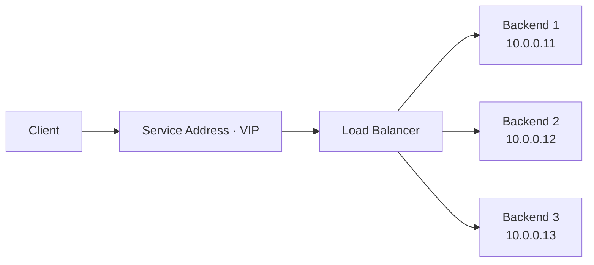
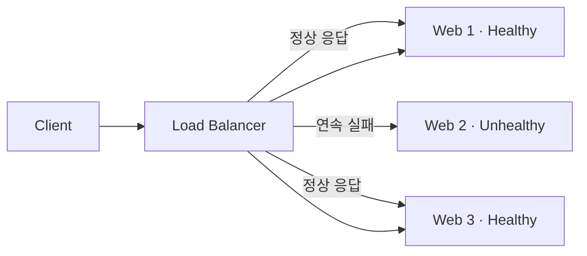
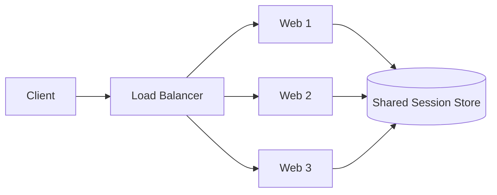
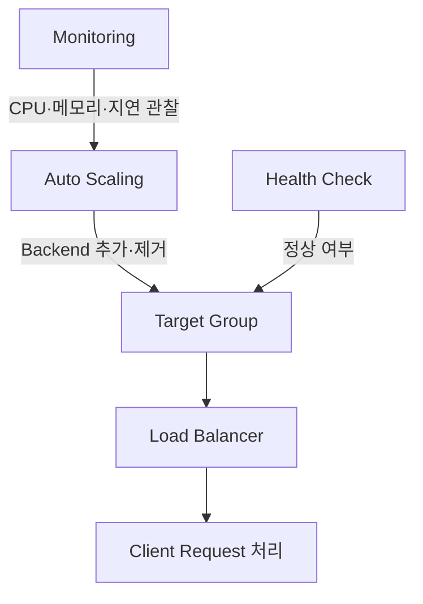
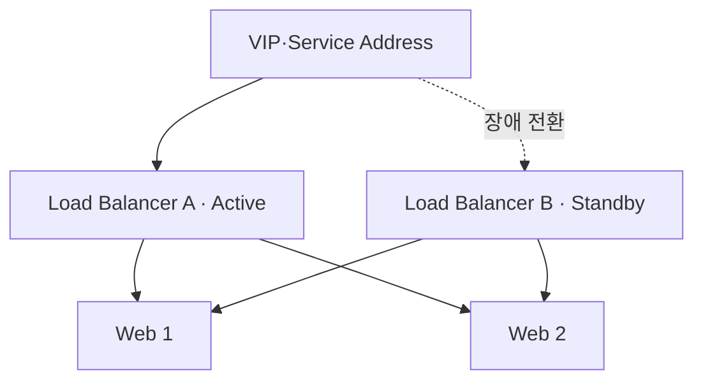

## 목차

- [[#1. 개요|1. 개요]]
- [[#2. 등장 배경과 핵심 가치|2. 등장 배경과 핵심 가치]]
- [[#3. 구성 요소와 요청 흐름|3. 구성 요소와 요청 흐름]]
- [[#4. 헬스 체크|4. 헬스 체크]]
- [[#5. 제품별 헬스 체크의 차이|5. 제품별 헬스 체크의 차이]]
- [[#6. 세션과 Stateless Backend|6. 세션과 Stateless Backend]]
- [[#7. 분산 알고리즘|7. 분산 알고리즘]]
- [[#8. 모니터링과 Auto Scaling의 역할|8. 모니터링과 Auto Scaling의 역할]]
- [[#9. Load Balancer의 고가용성|9. Load Balancer의 고가용성]]
- [[#10. Zadara zCompute Load Balancer|10. Zadara zCompute Load Balancer]]
- [[#11. 흔한 오해|11. 흔한 오해]]
- [[#12. 관련 문서|12. 관련 문서]]
- [[#13. 출처|13. 출처]]

## 1. 개요

Load Balancing은 여러 Backend를 하나의 서비스 진입점 뒤에 배치하고, 상태와 정책에 따라 연결이나 요청을 적절한 대상으로 분산하는 방식이다.

Load Balancer의 역할은 트래픽을 정확히 같은 양으로 나누는 데 그치지 않는다. 여러 서버를 사용자에게 하나의 서비스처럼 보이게 만들고, 장애 서버를 제외하며, 서버의 추가·교체가 사용자 접속 주소에 직접 드러나지 않도록 분리한다.[^aws-how]

## 2. 등장 배경과 핵심 가치

서버 한 대의 CPU·메모리·네트워크 성능을 키우는 Scale Up에는 비용과 물리적 한계가 있다. 같은 역할의 서버를 여러 대로 늘리는 Scale Out을 적용하면 다음 문제가 새로 생긴다.

- 사용자가 어느 서버로 접속해야 하는가?
- 특정 서버가 고장 나면 어떻게 제외하는가?
- 서버를 추가·제거해도 사용자 주소를 유지할 수 있는가?
- 서버별 성능과 현재 부하가 다르면 어떻게 분산하는가?
- 로그인 세션과 장시간 연결을 어떻게 유지하는가?

Load Balancer는 **서비스 주소와 실제 처리 서버를 분리**하여 이 문제를 해결한다.



쉽게 설명하면 사용자는 대표 번호 하나로 전화하고, Load Balancer가 현재 응대할 수 있는 담당자에게 연결하는 구조이다. 실제 구현에서는 연결 상태·프로토콜·암호화와 세션을 함께 고려하므로 단순 전화 교환보다 복잡하다.

## 3. 구성 요소와 요청 흐름

제품마다 이름은 다르지만 일반적인 구성 요소는 다음과 같다.

| 구성 요소 | 의미 |
|---|---|
| Service Address·VIP | 사용자가 접속하는 단일 주소 |
| Listener | 요청을 받을 프로토콜과 포트 |
| Rule | 요청을 어느 Backend Group으로 보낼지 정하는 정책 |
| Target Group·Pool | 같은 역할을 수행하는 Backend 집합 |
| Target·Backend | 실제 요청을 처리하는 서버·VM·컨테이너·IP |
| Health Check | Target이 요청을 받을 수 있는지 판단하는 검사 |

예를 들어 `443` Listener가 HTTPS 요청을 받고 `/api` 경로는 API Target Group, `/images` 경로는 Image Target Group으로 보낼 수 있다. 이와 같은 애플리케이션 정보 기반 분산은 [[L4 and L7 Load Balancing|L4·L7 Load Balancing]]에서 자세히 구분한다.

## 4. 헬스 체크

Health Check는 서버를 치료하는 기능이 아니라 **새 요청을 보내도 되는지 판단하여 분배 대상에 포함하거나 제외하는 기능**이다.



일반적인 설정 항목은 다음과 같다.

- 점검 프로토콜과 포트
- HTTP 점검 경로와 성공 응답 코드
- 점검 주기와 응답 제한 시간
- 비정상 판정에 필요한 연속 실패 횟수
- 복구 판정에 필요한 연속 성공 횟수

한 번의 실패만으로 서버를 제외하지 않는 이유는 순간적인 지연이나 패킷 손실을 장애로 오판하지 않기 위해서이다. 반대로 임계값을 너무 크게 잡으면 실제 장애를 늦게 감지한다.

### Liveness와 Readiness

Liveness는 프로세스 자체가 살아 있는지를, Readiness는 지금 사용자 요청을 받아도 되는지를 나타낸다.

```text
웹 프로세스 실행 중
DB 연결 실패

Liveness  → 정상일 수 있음
Readiness → 비정상
```

`/health`가 웹 프로세스의 존재만 확인하고 항상 `200 OK`를 반환하면 Load Balancer는 DB 연결이 끊어진 서버도 정상으로 오판한다. Load Balancer는 애플리케이션 내부 사정을 추측하지 않고 설정된 검사 결과를 믿는다.

Readiness 검사는 핵심 요청 처리에 반드시 필요한 의존성을 확인해야 한다. 반면 중요하지 않은 외부 API까지 모두 검사하면 외부 서비스 하나의 장애로 모든 Backend가 동시에 제외되는 연쇄 장애가 생길 수 있다.

## 5. 제품별 헬스 체크의 차이

여러 제품이 `Health Check`라는 이름을 사용하지만 실행 주체와 검사 방식은 다르다.

### AWS ALB

AWS가 운영하는 관리형 Load Balancer의 각 노드가 Target Group의 Target에 HTTP·HTTPS 또는 gRPC 검사를 수행한다. 점검 경로·포트·주기·Timeout·성공 코드와 Healthy·Unhealthy 임계값을 설정할 수 있다. 모든 Target이 비정상이면 트래픽을 모든 Target으로 보내는 Fail-open 동작이 발생할 수 있다.[^aws-health]

### HAProxy

사용자가 운영하는 HAProxy 프로세스가 TCP 연결 또는 HTTP 요청을 주기적으로 보내는 Active Check를 수행할 수 있다. 실제 사용자 트래픽에서 발생한 연결·응답 오류를 관찰하는 Passive Check와 Agent Check도 지원한다. `inter`, `fall`, `rise` 등으로 주기와 장애·복구 기준을 조정한다.[^haproxy-health]

### NGINX와 NGINX Plus

NGINX Open Source는 실제 요청에서 발생한 오류를 관찰하는 Passive Check를 사용할 수 있다. 별도 점검 요청을 주기적으로 보내는 Active Health Check는 공식 배포판 기준 NGINX Plus 기능이다.[^nginx-health]

| 구분 | AWS ALB | HAProxy | NGINX Open Source | NGINX Plus |
|---|---|---|---|---|
| 운영 형태 | AWS 관리형 | 직접 운영 | 직접 운영 | 상용 제품 직접 운영 |
| 주기적 Active Check | 지원 | 지원 | 공식 기본 기능으로는 미지원 | 지원 |
| Passive Check | 관리형 내부 동작과 별개 | 지원 | 지원 | 지원 |
| LB 자체 고가용성 | AWS가 관리 | 사용자가 설계 | 사용자가 설계 | 사용자가 설계 |

## 6. 세션과 Stateless Backend

사용자 로그인 세션이 Web 1의 메모리에만 있다면 다음 요청이 Web 2로 전달될 때 로그인 상태를 찾지 못할 수 있다.

Sticky Session은 쿠키나 연결 정보를 이용하여 일정 시간 같은 사용자의 여러 요청을 같은 Backend로 보내 이 문제를 완화한다.

```text
사용자 A 요청 1 ─┐
사용자 A 요청 2 ─┼→ Web 1
사용자 A 요청 3 ─┘
```

그러나 Web 1이 고장 나면 다른 서버에는 세션이 없을 수 있으므로 근본적인 고가용성 해결책은 아니다. 세션을 Redis·DB 같은 공용 저장소에 두거나 Token 기반으로 설계하면 어느 Backend가 요청을 받아도 처리할 수 있다.



이처럼 특정 Backend의 로컬 상태에 덜 의존하는 구성을 Stateless Backend라고 부른다. 실제 애플리케이션이 완전히 무상태라는 뜻이 아니라, 공유해야 하는 상태를 개별 서버 밖에서 관리한다는 의미에 가깝다.

## 7. 분산 알고리즘

Health Check가 `요청을 보내도 되는가`를 판단한다면 분산 알고리즘은 `정상 서버 중 어디에 보낼 것인가`를 판단한다.

| 알고리즘 | 선택 기준 | 적합한 상황과 한계 |
|---|---|---|
| Round Robin | 순서대로 반복 | 서버 성능과 요청 비용이 비슷할 때 단순함 |
| Least Connections | 현재 연결 수가 가장 적은 서버 | 장시간 연결에 유용하지만 연결별 부하 차이는 알지 못함 |
| Least Outstanding Requests | 처리 중인 요청 수가 적은 서버 | HTTP 요청 단위 부하에 유용 |
| Weighted | 서버별 설정 가중치 | vCPU·성능이 다른 서버에 비율 적용 |
| Hash 기반 | 출발지·목적지·Cookie 등 | 같은 흐름·사용자를 같은 대상으로 보낼 때 유용 |
| 응답 시간 기반 | 최근 지연이 짧은 서버 | 실제 속도를 반영하지만 급격한 쏠림을 제어해야 함 |

연결 수가 가장 적다고 실제 부하가 가장 낮은 것은 아니다.

```text
Web 1: 가벼운 연결 100개, CPU 40%
Web 2: 일반 연결 20개, CPU 30%
Web 3: 무거운 작업 5개, CPU 99%
```

Least Connections만 보면 Web 3를 선택하지만 실제 자원 상태는 가장 나쁠 수 있다. Load Balancer는 자신이 만든 연결 수·진행 중 요청·응답 시간은 알 수 있지만 VM 내부의 CPU·메모리·JVM Heap을 자동으로 알지 못할 수 있다.

## 8. 모니터링과 Auto Scaling의 역할

Load Balancer가 모든 VM 지표를 직접 분석하는 대신 역할을 나누는 경우가 많다.



- Load Balancer: 연결·요청 분산과 비정상 서버 제외
- Monitoring: CPU·메모리·지연·오류율 관찰
- Auto Scaling: 용량이 부족하면 서버 수 조절
- Application: 자신이 요청을 처리할 준비가 되었는지 보고

비유하면 Load Balancer는 현재 차량을 어느 차선으로 보낼지 판단하고, Auto Scaling은 차선 자체가 부족할 때 도로를 추가한다.

## 9. Load Balancer의 고가용성

Backend를 여러 대 두어도 Load Balancer가 한 대라면 그 장비가 단일 장애점이 된다.



직접 운영하는 HAProxy·NGINX는 VRRP·Floating IP·DNS·외부 Load Balancer 등으로 이중화를 설계해야 한다. 관리형 Load Balancer는 제공자가 내부 노드와 장애 전환을 운영하지만, 여러 Zone 사용·Target 분산·DNS와 인증서 같은 사용자 책임은 남는다.

비정상 Backend를 제외한다고 이미 진행 중인 모든 연결이 안전하게 다른 서버로 이동하는 것은 아니다. 연결 유지 방식, Connection Draining, 애플리케이션 재시도와 세션 저장 위치를 함께 설계한다.

## 10. Zadara zCompute Load Balancer

Zadara Cloud Services의 zCompute Load Balancer는 Load Balancer·Listener·Target Group과 Health Check를 사용하는 관리형 서비스이며 AWS ELB 호환 개념과 API를 제공한다. 공개 가이드에서는 HTTP Target Group을 사용하는 ALB와 TCP Target Group을 사용하는 NLB를 구분한다.[^zadara-overview][^zadara-lb]

Health Check에서는 Traffic Port 또는 별도 포트, 5~300초의 검사 주기, 2~60초의 Timeout, Healthy·Unhealthy 임계값과 HTTP 경로·성공 코드를 설정할 수 있다. Target은 VM Instance 또는 같은 리전에서 Load Balancer가 도달할 수 있는 IP로 등록할 수 있다.[^zadara-lb]

공식 가이드의 범위에서 사용 개념이 AWS ELB와 비슷하다고 설명할 수 있지만, 내부 구현까지 AWS와 같다고 단정하지 않는다.

자다라 문서의 ZELB(Zadara Elastic Load Balancer)는 대규모 Object Storage의 Virtual Controller를 분산하는 별도 구조이다. 일반 zCompute VM·IP Target용 Load Balancer와 구분한다.[^zelb]

## 11. 흔한 오해

- **Load Balancer는 트래픽을 똑같이 나누는 장비라는 생각**: 상태와 알고리즘에 따라 의도적으로 다르게 분산할 수 있다.
- **Health Check가 서버를 복구한다는 생각**: 요청을 보낼 대상에서 제외하거나 다시 포함하는 판단이다.
- **포트가 열리면 애플리케이션도 정상이라는 생각**: DB 연결과 실제 업무 처리 상태는 별도일 수 있다.
- **연결 수가 가장 적으면 부하도 가장 낮다는 생각**: 연결별 작업 비용과 VM 내부 상태가 다를 수 있다.
- **Sticky Session이면 장애 후에도 세션이 유지된다는 생각**: 선택된 서버가 고장 나면 로컬 세션을 잃을 수 있다.
- **Backend가 여러 대면 고가용성이라는 생각**: Load Balancer 자체와 세션 저장소·DB도 장애점이 될 수 있다.
- **L7 Load Balancer가 L4의 완전한 상위호환이라는 생각**: 지원 프로토콜과 처리 목적이 다르다.

## 12. 관련 문서

- [[L4 and L7 Load Balancing|L4·L7 Load Balancing]], [[OSI and TCP-IP Models|OSI 7계층과 TCP/IP 4계층]]
- [[3-Tier Architecture|3-Tier 아키텍처]], [[3-Tier 아키텍처의 로드밸런서 도입 조건]]
- [[Web Server]], [[Web Application Server]], [[NAT]]

## 13. 출처

[^aws-how]: AWS, [How Elastic Load Balancing works](https://docs.aws.amazon.com/elasticloadbalancing/latest/userguide/how-elastic-load-balancing-works.html). 정상 Target 선택과 ALB·NLB 분산 방식.
[^aws-health]: AWS, [Health checks for Application Load Balancer target groups](https://docs.aws.amazon.com/elasticloadbalancing/latest/application/target-group-health-checks.html). ALB Health Check 설정과 Target 상태·Fail-open 동작.
[^haproxy-health]: HAProxy Technologies, [Health checks](https://www.haproxy.com/documentation/haproxy-configuration-tutorials/reliability/health-checks/). Active·Passive·Agent Check와 임계값 설정.
[^nginx-health]: F5 NGINX, [HTTP Health Checks](https://docs.nginx.com/nginx/admin-guide/load-balancer/http-health-check/). NGINX Open Source의 Passive Check와 NGINX Plus의 Active Check.
[^zadara-overview]: Zadara, [Zadara Cloud Services Overview](https://guides.zadarastorage.com/cs-compute-guide/latest/cloud-services-overview.html). 관리형 Load Balancer와 AWS ELB 호환 서비스 개요.
[^zadara-lb]: Zadara, [zCompute Load Balancer User Guide](https://guides.zadarastorage.com/cs-lb-guide/latest/setup-lb.html). ALB·NLB, Target Group과 Health Check 설정.
[^zelb]: Zadara, [ZELB — VPSA Object Storage Load Balancing](https://guides.zadarastorage.com/zios-guide/latest/load-balancing.html). Object Storage 전용 ZELB 구조.

## 둘러보기

[[Knowledge Base/index|전체 개념 목록]] · [[Networking 분류|Networking]]
