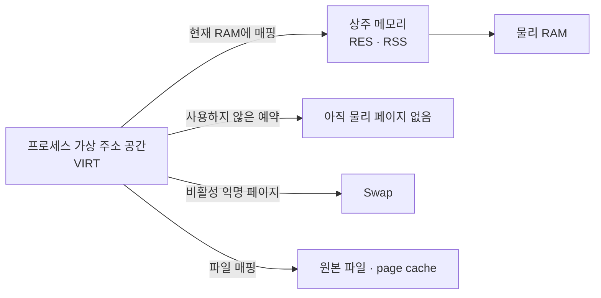
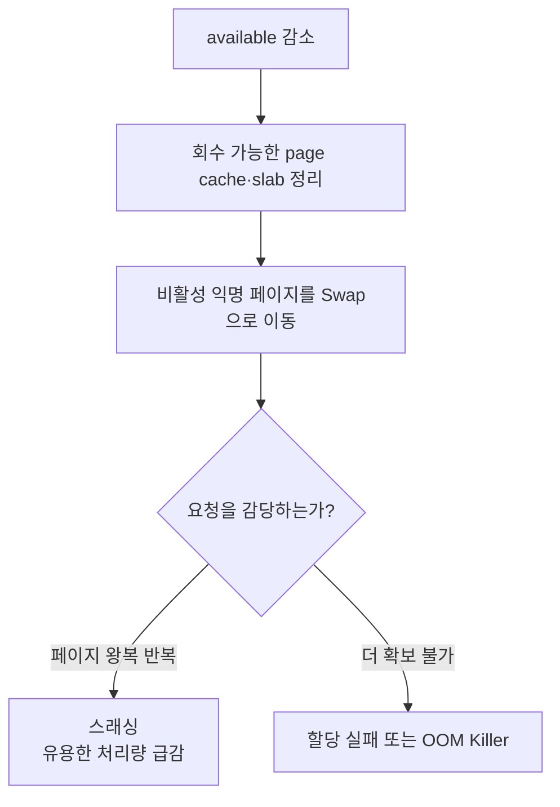

## 목차

- [[#1. 개요|1. 개요]]
- [[#2. 물리 메모리와 가상 주소 공간|2. 물리 메모리와 가상 주소 공간]]
- [[#3. free -h 화면의 해석|3. free -h 화면의 해석]]
- [[#4. top의 프로세스 메모리|4. top의 프로세스 메모리]]
- [[#5. vmstat 1로 보는 압박과 Swap|5. vmstat 1로 보는 압박과 Swap]]
- [[#6. 프로세스별 변화 확인|6. 프로세스별 변화 확인]]
- [[#7. 상세 메모리: /proc|7. 상세 메모리: /proc]]
- [[#8. 메모리 압박·스래싱·OOM|8. 메모리 압박·스래싱·OOM]]
- [[#9. 메모리 누수의 판단|9. 메모리 누수의 판단]]
- [[#10. 실무 확인 순서|10. 실무 확인 순서]]
- [[#11. 관련 문서|11. 관련 문서]]
- [[#12. 출처|12. 출처]]

## 1. 개요

메모리 모니터링은 Linux의 물리 RAM·페이지 캐시·가상 주소 공간·Swap과 프로세스별 상주 메모리를 구분하고, 회수·교체·OOM의 추세를 함께 확인하여 실제 메모리 압박을 판단하는 과정이다.

RAM 모듈과 CPU·DIMM의 물리 구조는 [[Memory|메모리]]에서 다룬다. 이 문서는 운영체제 화면에서 그 자원이 어떻게 보이는지 설명한다.

## 2. 물리 메모리와 가상 주소 공간



가상 메모리는 단순히 디스크를 RAM처럼 쓰는 기능이 아니다. 각 프로세스에 독립적인 주소 공간을 제공하고 필요한 페이지를 RAM·Swap·파일과 연결하는 체계이다. 프로그램이 예약한 주소를 처음 실제로 사용할 때 페이지 폴트가 발생하고 커널이 물리 페이지를 연결할 수 있다. 예약이 실제 제공을 보장하지는 않으며 메모리를 확보하지 못하면 할당 실패나 OOM으로 이어질 수 있다.[^concepts][^overcommit]

## 3. `free -h` 화면의 해석

```bash
free -h
```

```text
               total        used        free      shared  buff/cache   available
Mem:            16Gi         12Gi        500Mi       300Mi       3.5Gi        3.2Gi
Swap:            4Gi        1.0Gi        3.0Gi
```

| 항목 | 의미 | 해석 주의점 |
|---|---|---|
| `total` | 커널 예약 등을 제외한 사용 가능한 전체 RAM | 장착한 DIMM 총합과 약간 다를 수 있음 |
| `used` | 현재 사용 중이거나 즉시 제공하기 어려운 양 | 최신 `free`에서는 `total - available`로 계산 |
| `free` | 아무 용도로도 사용하지 않는 완전히 빈 RAM | 작다는 이유만으로 부족이라 판단하지 않음 |
| `shared` | 주로 `tmpfs` 등 공유 메모리 | 프로세스 공유 메모리와 함께 원인 확인 |
| `buff/cache` | 버퍼, page cache, 회수 가능한 일부 커널 캐시 | 전부 즉시 회수 가능한 것은 아님 |
| `available` | Swap 없이 새 프로그램에 제공할 수 있다고 추정한 양 | 메모리 여유 판단에서 우선 확인 |

Linux는 빈 RAM을 최근 읽은 파일의 page cache로 활용해 디스크 접근을 줄인다. 따라서 `free` 500MiB보다 `available` 3.2GiB가 현재 여유를 더 잘 나타낸다. `available`은 빈 RAM과 회수 가능한 캐시를 고려하되 모든 캐시를 회수할 수는 없다는 점까지 반영한 추정치이다.[^free][^proc]

Swap 1GiB를 사용 중이라는 사실만으로 장애는 아니다. 과거에 밀려난 페이지가 다시 필요하지 않아 그대로 남아 있을 수 있다. 현재 `si·so`가 지속되는지, `available`이 감소하는지, 응답 지연이 있는지를 함께 본다.

## 4. `top`의 프로세스 메모리

```text
MiB Mem : 16384 total, 500 free, 12288 used, 3596 buff/cache
MiB Swap: 4096 total, 3072 free, 1024 used. 3276 avail Mem

 PID USER  VIRT   RES   SHR S %MEM COMMAND
8201 Qbo   30.0g  6.0g 1.0g S 37.5 java
```

| 항목 | 의미 |
|---|---|
| `VIRT` | 예약·매핑된 전체 가상 주소 공간. RAM, Swap, 파일 매핑, 아직 물리 페이지가 없는 영역을 포함할 수 있음 |
| `RES` | 현재 물리 RAM에 상주하는 메모리. RSS 관점의 첫 확인값 |
| `SHR` | `RES` 중 공유 가능하게 보이는 부분. 실제 공유량의 완벽한 측정값은 아님 |
| `%MEM` | 전체 물리 RAM 대비 해당 프로세스의 상주 메모리 비율 |
| `S` | 프로세스 상태. 메모리 압박과 함께 `D`, `R` 등을 확인 |

`VIRT 30GiB`는 RAM 30GiB를 사용한다는 뜻이 아니다. Java가 예약된 주소에 실제 데이터를 기록하면 물리 페이지가 연결되어 `RES`가 증가한다. 프로세스들의 `RES`에는 공유 페이지가 중복되어 보일 수 있으므로 단순 합계가 시스템 전체 실제 사용량과 일치하지 않을 수 있다.[^top]

## 5. `vmstat 1`로 보는 압박과 Swap

```bash
vmstat 1
```

```text
procs -----------memory---------- ---swap-- -----io---- -system-- ------cpu-----
 r  b   swpd   free   buff  cache   si   so    bi    bo   in   cs us sy id wa st
 1  0 1048576 512000 122880 3670016  0    0    10    20 1200 2200 20  5 65 10  0
 2  3 2097152 102400  40960  524288 512 1024  900  1600 2400 5100 10 12  8 70  0
```

| 항목 | 의미 |
|---|---|
| `swpd` | 현재 사용 중인 Swap 크기 |
| `free` | 완전히 빈 RAM |
| `buff`, `cache` | 버퍼와 캐시 |
| `si` | 초당 Swap에서 RAM으로 읽어 온 양 |
| `so` | 초당 RAM에서 Swap으로 내보낸 양 |
| `bi`, `bo` | 블록 장치에서 읽고 쓴 양 |
| `r` | 실행 가능 상태로 CPU를 기다리는 작업 수 |
| `b` | 중단 불가능 대기 상태 작업 수 |
| `wa` | I/O 대기와 관련해 유휴로 계산된 CPU 시간 |

`swpd`가 0이 아니어도 `si·so`가 거의 없고 `available`이 안정적이면 현재 압박은 낮을 수 있다. 반대로 `si·so`가 지속되고 `b·wa`가 함께 증가하며 응답이 느려지면 페이지 교체와 스토리지 대기를 의심한다. 첫 출력 행은 부팅 이후 평균일 수 있으므로 이후 반복 행을 본다.[^vmstat]

## 6. 프로세스별 변화 확인

### `pidstat -r`

```bash
pidstat -r 1
```

```text
Time      UID   PID  minflt/s majflt/s     VSZ     RSS %MEM Command
15:10:01 1001  8201   420.00     0.00 31457280 6291456 37.5 java
```

- `minflt/s`: 저장장치 읽기 없이 해결된 minor page fault 비율
- `majflt/s`: 파일·Swap 등에서 페이지를 읽어야 했던 major page fault 비율
- `VSZ`: 가상 주소 공간 크기
- `RSS`: RAM에 상주하는 크기

page fault 자체는 정상적인 demand paging에서도 생긴다. `majflt/s` 증가가 실제 지연과 함께 나타나는지 확인한다.[^pidstat]

### `ps`

```bash
ps -eo pid,user,vsz,rss,%mem,stat,comm --sort=-rss | head
```

```text
 PID USER       VSZ     RSS %MEM STAT COMMAND
8201 Qbo   31457280 6291456 37.5 Sl   java
```

`VSZ`와 `RSS`의 기본 단위는 도구·환경에 따라 KiB일 수 있으므로 헤더와 매뉴얼을 확인한다. `ps`는 순간 목록에 적합하고 증가 추세는 반복 측정이나 모니터링 시스템으로 본다.

## 7. 상세 메모리: `/proc`

```bash
grep -E 'MemTotal|MemAvailable|Cached|SwapTotal|SwapFree' /proc/meminfo
```

```text
MemTotal:       16777216 kB
MemAvailable:    3355443 kB
Cached:          3145728 kB
SwapTotal:       4194304 kB
SwapFree:        3145728 kB
```

특정 PID의 상세 합계는 다음처럼 확인할 수 있다.

```bash
cat /proc/8201/smaps_rollup
```

```text
Rss:             6291456 kB
Pss:             5767168 kB
Private_Clean:     65536 kB
Private_Dirty:   5242880 kB
Swap:             262144 kB
```

- `Rss`: 해당 매핑들이 RAM에 상주하는 전체 크기
- `Pss`: 공유 페이지를 공유한 프로세스 수에 따라 나눈 비례 상주 크기
- `Private_*`: 다른 프로세스와 공유하지 않는 부분
- `Swap`: 해당 프로세스 매핑 중 Swap에 있는 부분

두 프로세스가 같은 1GiB 라이브러리 페이지를 공유하면 각 RSS에 중복될 수 있지만 PSS는 각자의 몫으로 나누어 계산한다. `smaps` 계열 조회는 비용이 더 들 수 있고 다른 사용자의 정보에는 권한이 필요할 수 있다.[^proc]

## 8. 메모리 압박·스래싱·OOM



스래싱은 실행에 필요한 페이지를 RAM과 Swap 사이에서 반복 교체하느라 실제 업무 처리가 거의 진행되지 않는 상태이다. CPU가 완전히 멈춘 것이 아니라 페이지 I/O를 기다리는 시간이 커진다.

커널 OOM Killer는 단순히 우선순위가 낮은 프로세스를 고르지 않는다. 현재 메모리·Swap 사용량을 바탕으로 한 badness 점수와 `/proc/PID/oom_score_adj` 등을 고려한다. 값의 범위는 `-1000`부터 `1000`이며 `-1000`은 커널 OOM 선택에서 제외한다. 핵심 서비스를 무조건 보호하면 다른 복구 경로가 사라질 수 있으므로 임의 변경보다 서비스·플랫폼 정책을 먼저 확인한다.[^oom]

```bash
cat /proc/8201/oom_score
cat /proc/8201/oom_score_adj
journalctl -k | grep -i -E 'out of memory|killed process|oom'
```

컨테이너에서는 호스트 RAM이 남아 있어도 cgroup의 `memory.max` 같은 제한을 넘으면 해당 범위에서 OOM이 발생할 수 있다.[^cgroup]

## 9. 메모리 누수의 판단

```text
시간       myapp RES    buff/cache    available
09:00        2GiB          6GiB          7GiB
12:00        4GiB          5GiB          5GiB
15:00        7GiB          3GiB          2GiB
18:00       10GiB          1GiB        300MiB
재시작       2GiB            -           8GiB
```

동일한 처리량에서도 프로세스 `RES`가 계속 늘고 `available`이 줄며 재시작 후 반복적으로 회복되면 누수를 의심할 수 있다. 그러나 애플리케이션 내부 캐시, 사용자 세션 증가, JVM 힙의 고수위 유지도 비슷하게 보일 수 있으므로 증가가 안정화되는지, GC 뒤에도 유지되는지, 업무량과 비례하는지 확인한다.

JVM의 `-Xmx`는 Java 힙의 최대 크기이지 프로세스 전체 RSS 제한이 아니다. 스레드 스택, metaspace, JIT 코드, direct buffer 같은 네이티브 메모리가 추가된다. JVM 힙 한도 초과로 발생하는 `OutOfMemoryError`와 Linux·cgroup OOM이 프로세스를 강제 종료하는 사건도 구분한다.

## 10. 실무 확인 순서

```text
1. free -h                  available과 Swap 전체 상태
2. vmstat 1                si·so, b, wa의 지속 여부
3. top 또는 ps             큰 RES와 증가 프로세스
4. pidstat -r 1            page fault와 RSS 변화
5. /proc/PID/smaps_rollup   PSS·private·swap 상세
6. journalctl -k            OOM·커널 회수 결과
7. 애플리케이션 도구        JVM heap·GC·native memory 등 원인 검증
```

한 번의 수치보다 시간에 따른 추세, 정상 기준선, 실제 요청 지연을 함께 기록한다. 캐시를 무조건 비워 숫자를 낮추는 것은 원인 해결이 아니며 성능을 악화시킬 수 있다.

## 11. 관련 문서

- [[Memory|메모리]] · [[Program and Process|프로그램과 프로세스]] · [[Kernel|커널]]
- [[CPU Monitoring|CPU 모니터링]] · [[Disk|디스크]] · [[Linux Logging|Linux 로그]]
- [[Virtual Machine|가상 머신]] · [[Container 분류|Container]] · [[Server|서버]]

## 12. 출처

[^concepts]: Linux Kernel, [Memory concepts](https://docs.kernel.org/admin-guide/mm/concepts.html).
[^overcommit]: Linux Kernel, [Overcommit Accounting](https://docs.kernel.org/mm/overcommit-accounting.html).
[^free]: Linux man-pages, [`free(1)`](https://man7.org/linux/man-pages/man1/free.1.html).
[^proc]: Linux Kernel, [The `/proc` Filesystem](https://docs.kernel.org/filesystems/proc.html).
[^top]: Linux man-pages, [`top(1)`](https://man7.org/linux/man-pages/man1/top.1.html).
[^vmstat]: Linux man-pages, [`vmstat(8)`](https://man7.org/linux/man-pages/man8/vmstat.8.html).
[^pidstat]: Linux man-pages, [`pidstat(1)`](https://man7.org/linux/man-pages/man1/pidstat.1.html).
[^oom]: Linux Kernel, [`oom_score_adj`](https://docs.kernel.org/filesystems/proc.html#proc-pid-oom-adj-proc-pid-oom-score-adj-adjust-the-oom-killer-score).
[^cgroup]: Linux Kernel, [Control Group v2 — Memory](https://docs.kernel.org/admin-guide/cgroup-v2.html#memory).

## 둘러보기

[[Knowledge Base/index|전체 개념 목록]] · [[Compute 분류|Compute]]
