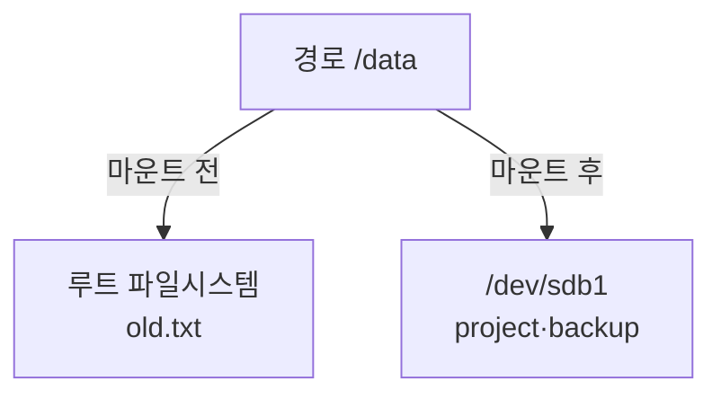
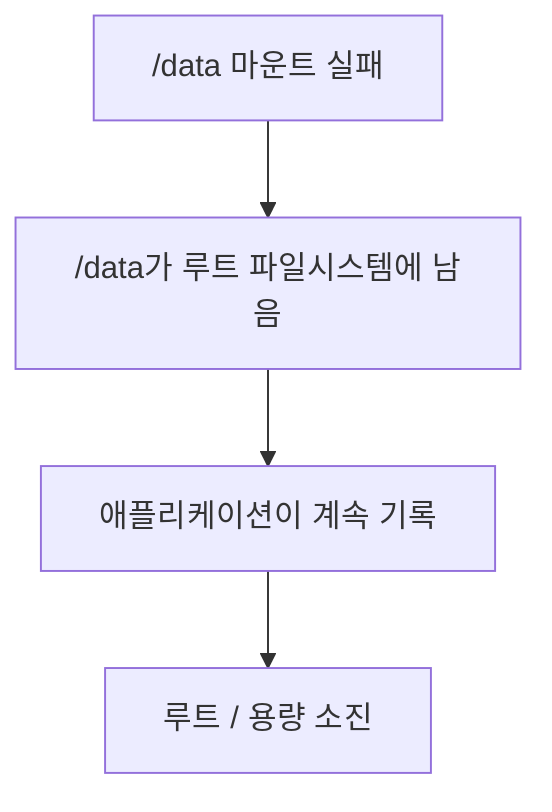

## 목차

- [[#1. 개요|1. 개요]]
- [[#2. 마운트 지점의 기존 데이터|2. 마운트 지점의 기존 데이터]]
- [[#3. 마운트와 언마운트|3. 마운트와 언마운트]]
- [[#4. 같은 파일시스템의 여러 경로|4. 같은 파일시스템의 여러 경로]]
- [[#5. 재부팅과 영구 마운트|5. 재부팅과 영구 마운트]]
- [[#6. 마운트 실패의 장애 영향|6. 마운트 실패의 장애 영향]]
- [[#7. 관련 문서|7. 관련 문서]]
- [[#8. 출처|8. 출처]]

## 1. 개요

Mount(마운트)는 블록 장치나 네트워크에 존재하는 파일시스템을 Linux의 단일 디렉터리 트리 중 특정 경로에 연결하는 작업이다.


디스크를 마운트한다는 표현을 많이 쓰지만, 더 정확하게는 **장치에서 발견한 파일시스템을 디렉터리에 연결한다**는 뜻이다.[^mount]

## 2. 마운트 지점의 기존 데이터

루트 파일시스템에 이미 `/data/old.txt`가 있고 `/dev/sdb1`에는 `project`와 `backup` 디렉터리가 있다고 가정한다.

```text
루트 파일시스템          /dev/sdb1
└── /data               ├── project
    └── old.txt          └── backup
```

다음 명령을 실행하면:

```bash
sudo mount /dev/sdb1 /data
```

`/data` 경로는 `/dev/sdb1`의 파일시스템 루트를 가리킨다.

```text
/data
├── project
└── backup
```

기존 `old.txt`는 삭제되거나 새 디스크로 이동하지 않는다. 루트 파일시스템에 그대로 있지만 마운트된 파일시스템이 경로상 위를 덮어 보여 주므로 가려진다. `umount /data`로 연결을 해제하면 다시 보인다.[^mount]



마운트 후 `/data/new.txt`를 만들면 데이터는 `/dev/sdb1`에 기록된다. 경로는 같아도 어느 파일시스템이 그 경로에 연결돼 있는지가 실제 저장 위치를 결정한다.

## 3. 마운트와 언마운트

```bash
sudo mkdir -p /data
sudo mount /dev/sdb1 /data
findmnt /data
```

```bash
sudo umount /data
```

명령 이름은 `unmount`가 아니라 `umount`이다. 프로세스가 해당 파일을 열고 있거나 작업 디렉터리로 사용 중이면 `target is busy`로 해제되지 않을 수 있다. 이때 강제로 해제하기 전에 `lsof`, `fuser`, 서비스 상태로 사용 주체를 확인해야 한다.

| 명령 | 확인 대상 |
|---|---|
| `findmnt /data` | `/data`에 연결된 원본과 옵션 |
| `mountpoint /data` | `/data`가 실제 마운트 지점인지 |
| `df -hT /data` | 해당 경로의 파일시스템 종류와 사용량 |
| `lsblk -f` | 장치·파티션·파일시스템·마운트 관계 |

## 4. 같은 파일시스템의 여러 경로

같은 파일시스템을 여러 마운트 지점에 연결할 수 있다.[^mount]

```bash
sudo mount /dev/sdb1 /data
sudo mount /dev/sdb1 /mnt/test
```

`/data/example.txt`와 `/mnt/test/example.txt`는 같은 파일시스템의 같은 파일을 가리킬 수 있다. 특정 디렉터리를 다른 경로에서도 보이게 하는 bind mount도 있다.

```bash
sudo mount --bind /data/project /srv/project
```

중복 마운트는 컨테이너·격리·서비스 경로 구성에 유용하지만, 목적 없이 사용하면 운영자가 저장 위치를 혼동할 수 있다.

## 5. 재부팅과 영구 마운트

명령으로 만든 마운트는 현재 실행 중인 커널의 마운트 이름공간에 등록된다. 일반적으로 재부팅하면 사라지므로 자동 연결이 필요하면 [[Fstab|`/etc/fstab`]] 또는 systemd mount unit을 사용한다.

```text
mount 명령
└── 현재 부팅에서만 연결

/etc/fstab
└── 부팅 시 같은 연결을 다시 생성하도록 기술
```

## 6. 마운트 실패의 장애 영향

`/data`에 별도 대용량 디스크가 연결되어야 하는데 마운트가 실패하면 `/data`는 루트 파일시스템의 평범한 디렉터리로 남는다. 애플리케이션이 이를 모르고 계속 기록하면 루트 파일시스템이 가득 찰 수 있다.



서비스 시작 전에 `mountpoint`나 `findmnt`로 필수 마운트를 확인하고, systemd 의존 관계를 구성하는 이유이다. 마운트 지점에 기존 데이터가 있는지도 점검해야 한다.

## 7. 관련 문서

- [[Disk|디스크]] · [[Partition|파티션]] · [[Filesystem|파일시스템]]
- [[Fstab|fstab]] · [[Disk Capacity Check|디스크 용량 확인]] · [[Linux Directory Structure|Linux 디렉터리 구조]]

## 8. 출처

[^mount]: util-linux, [mount(8)](https://man7.org/linux/man-pages/man8/mount.8.html), 단일 디렉터리 트리에 파일시스템을 연결하는 의미, 기존 내용이 가려지는 동작, UUID와 다중 마운트.

## 둘러보기

[[Knowledge Base/index|전체 개념 목록]] · [[Storage 분류|Storage]]
