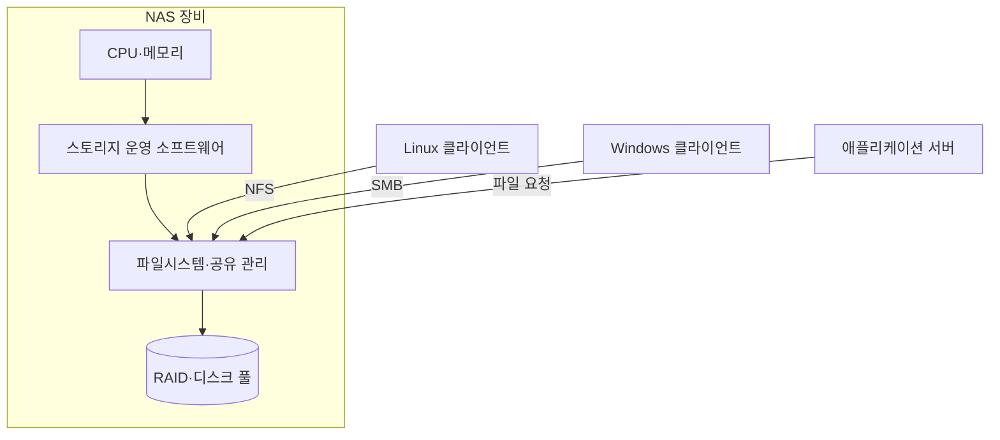
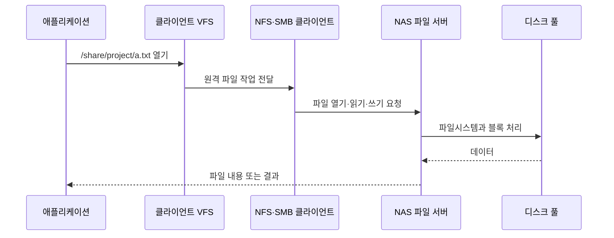
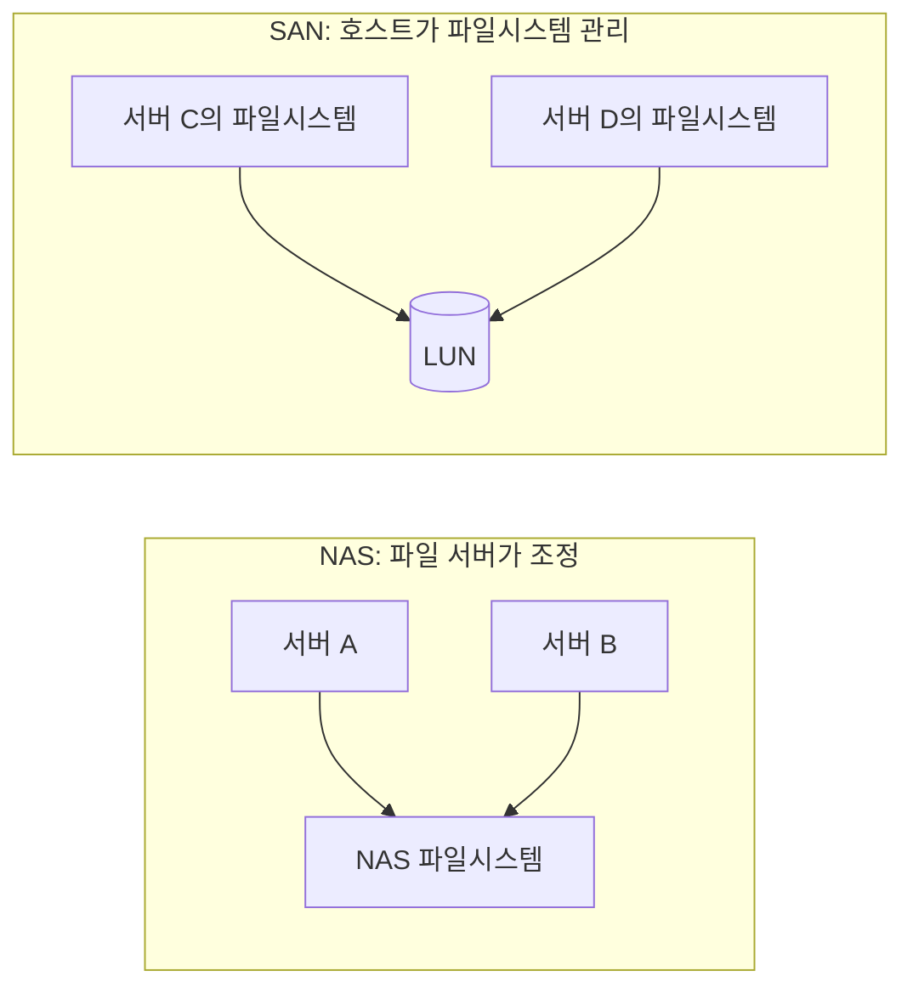

## 목차

- [[#1. 개요|1. 개요]]
- [[#2. 스토리지 장비의 실체|2. 스토리지 장비의 실체]]
- [[#3. 파일 제공 과정|3. 파일 제공 과정]]
- [[#4. 여러 사용자의 동시 접근|4. 여러 사용자의 동시 접근]]
- [[#5. NAS와 SAN의 차이|5. NAS와 SAN의 차이]]
- [[#6. 관련 문서|6. 관련 문서]]
- [[#7. 출처|7. 출처]]

## 1. 개요

NAS(Network Attached Storage)는 네트워크를 통해 파일과 디렉터리를 제공하는 스토리지 시스템이다. 사용자는 원격 디스크의 블록을 직접 다루지 않고, `project/report.pdf`와 같은 파일 경로를 요청한다.

NAS는 주로 [[NFS]] 또는 [[SMB]]를 제공한다. Linux에서 NFS를 많이 사용하고 Windows에서 SMB를 많이 사용하는 경향은 있지만, 운영체제와 프로토콜이 반드시 일대일로 묶이는 것은 아니다.

## 2. 스토리지 장비의 실체

스토리지 장비도 CPU, 메모리, 네트워크 인터페이스, 운영 소프트웨어와 여러 디스크를 갖춘 특수 목적의 컴퓨터이다. 일반 서버보다 저장장치 연결, 장애 대응, 캐시, 경로 이중화와 데이터 보호에 초점을 맞춘다.

위 사진은 2007년에 촬영된 소형 NAS의 사례이다. 현대 기업용 NAS의 규모와 이중화 구성을 대표하지는 않지만, 여러 디스크와 네트워크 인터페이스를 하나의 장비에 넣는 기본 모습을 확인할 수 있다. 사진: Simon Hämmerle, [Wikimedia Commons 원본](https://commons.wikimedia.org/wiki/File:Network_Attached_Storage.jpg), [CC BY-SA 2.5](https://creativecommons.org/licenses/by-sa/2.5/). 추가 편집 없이 사용했다.

장비 내부에는 결국 HDD나 SSD가 있지만, 외부 사용자는 블록 번호가 아니라 파일 이름과 폴더를 본다. 따라서 NAS를 “원격 블록 스토리지”라고 부르기보다 **원격 파일시스템을 제공하는 서비스**라고 이해하는 편이 정확하다.

## 3. 파일 제공 과정

파일 이름, 디렉터리, 권한과 잠금의 최종 관리는 NAS 쪽 파일시스템과 파일 서비스가 담당한다. 클라이언트는 네트워크 프로토콜로 해당 작업을 요청한다.

## 4. 여러 사용자의 동시 접근

NAS는 여러 사용자가 같은 파일을 다룰 수 있도록 인증, 권한, 잠금과 캐시 일관성을 처리한다. 그렇다고 충돌이 자동으로 모두 해결되는 것은 아니다. 같은 문서를 동시에 수정하는 애플리케이션은 별도의 충돌 처리 방식이 필요할 수 있다.

- NFS 환경에서는 UID·GID와 디렉터리 권한의 일치가 중요하다.
- SMB 환경에서는 사용자 계정, SID, Windows ACL과 Active Directory 연동이 자주 사용된다.
- 프로토콜과 버전에 따라 잠금, 장애 후 재연결과 캐시 정책이 달라진다.

## 5. NAS와 SAN의 차이

NAS에서는 서버 A와 서버 B가 같은 `project` 공유를 열어 파일을 함께 사용할 수 있다. 반면 [[SAN]]에서 같은 LUN을 두 서버가 일반 파일시스템으로 동시에 쓰면 메타데이터가 충돌할 수 있다.

하나의 스토리지 제품이 NFS·SMB와 iSCSI를 함께 제공할 수도 있다. 이때 NAS인가 SAN인가를 장비 외형으로 구분하기보다, 해당 연결이 파일을 제공하는지 블록을 제공하는지 살펴보아야 한다.

## 6. 관련 문서

- [[File Storage|파일 스토리지]]
- [[NFS]]
- [[SMB]]
- [[SAN]]
- [[VFS]]

## 7. 출처

- IBM, [What is network attached storage (NAS)?](https://www.ibm.com/think/topics/network-attached-storage)
- IBM, [SAN vs. NAS](https://www.ibm.com/think/topics/san-vs-nas)

## 둘러보기

[[Storage 분류|← Storage 분류]] · [[Knowledge Base/index|Knowledge Base]]

