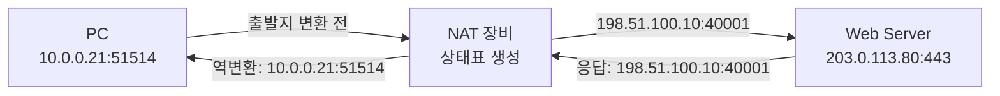

## 목차

- [[#1. 개요|1. 개요]]
- [[#2. 등장 배경과 핵심 요소|2. 등장 배경과 핵심 요소]]
- [[#3. 변환 상태표와 응답 경로|3. 변환 상태표와 응답 경로]]
- [[#4. SNAT와 DNAT|4. SNAT와 DNAT]]
- [[#5. PAT와 공인 주소 공유|5. PAT와 공인 주소 공유]]
- [[#6. 라우팅·방화벽과의 구분|6. 라우팅·방화벽과의 구분]]
- [[#7. 장애와 고가용성|7. 장애와 고가용성]]
- [[#8. 적용 사례와 한계|8. 적용 사례와 한계]]
- [[#9. 흔한 오해|9. 흔한 오해]]
- [[#10. 관련 문서|10. 관련 문서]]
- [[#11. 출처|11. 출처]]

## 1. 개요

NAT(Network Address Translation)는 패킷의 IP 주소와 필요에 따라 포트 번호를 변환하고, 변환 전후의 대응 관계를 관리하는 기능이다.

NAT는 사설 주소를 공인 주소로 바꾸는 용도로 널리 쓰이지만, 본질은 서로 다른 주소 영역 사이에서 패킷 헤더의 주소 정보를 다시 쓰는 데 있다. 라우팅·방화벽과 한 장비에서 함께 동작할 수 있지만 세 기능의 책임은 다르다.[^rfc2663]

## 2. 등장 배경과 핵심 요소

IPv4 주소의 부족과 조직 내부 주소 체계의 독립성 때문에 여러 내부 호스트가 적은 수의 공인 주소를 공유할 필요가 커졌다. RFC 1918의 사설 주소는 조직 내부에서 반복하여 사용할 수 있고, Traditional NAT는 내부 사설 주소를 외부 주소로 변환하여 외부 네트워크와 통신하게 한다.[^rfc1918][^rfc3022]

NAT 동작은 다음 세 요소로 나눌 수 있다.

1. 패킷 헤더의 주소·포트 변경
2. 변경 전후의 대응 관계를 보관하는 상태표
3. 응답 패킷에 역변환을 적용하는 처리

쉽게 설명하면 NAT는 주소를 고쳐 쓰는 접수대이면서, 돌아온 응답을 원래 요청자에게 돌려주기 위한 임시 장부를 함께 관리한다.

## 3. 변환 상태표와 응답 경로

내부 PC가 외부 웹 서버에 접속하는 예는 다음과 같다.



NAT 장비는 다음과 같은 대응 관계를 기억한다.

```text
10.0.0.21:51514 ↔ 198.51.100.10:40001
```

외부 서버의 응답이 공인 주소와 변환된 포트로 돌아오면 NAT 장비는 상태표를 조회하여 원래 내부 주소와 포트로 되돌린다. 주소와 포트를 변경하면 관련 IP·TCP·UDP 체크섬도 일관되게 조정해야 한다.[^rfc3022]

이 상태가 없으면 같은 공인 주소로 돌아온 응답을 어느 내부 호스트에 전달해야 하는지 판단할 수 없다.

## 4. SNAT와 DNAT

SNAT(Source NAT)는 주로 출발지 주소를 바꾼다. 내부 호스트가 외부로 나갈 때 사설 출발지 주소를 공인 주소로 바꾸는 구성이 대표적이다.

```text
변환 전: 10.0.0.21:51514 → 203.0.113.80:443
변환 후: 198.51.100.10:40001 → 203.0.113.80:443
```

DNAT(Destination NAT)는 목적지 주소를 바꾼다. 외부의 공인 주소·포트로 들어온 연결을 내부 서버로 보내는 Port Forwarding이 대표적이다.

```text
변환 전: Client → 198.51.100.10:443
변환 후: Client → 10.0.0.11:443
```

일상적으로 `NAT`라고만 말할 때 외부로 나가는 SNAT·PAT 구성을 가리키는 경우가 많지만, NAT 전체가 SNAT만을 뜻하는 것은 아니다. Port Forwarding은 DNAT의 대표적인 사용 방식이다.

내부에서 먼저 시작한 연결은 장비가 동적 상태를 만들 수 있다. 반대로 외부에서 먼저 들어오는 연결은 공인 주소 뒤의 어느 내부 서버로 보낼지 알 수 없으므로 미리 정의한 DNAT 규칙이 필요하다. 외부에 공개하지 않을 내부 VM에는 해당 DNAT 규칙을 만들지 않는 것이 일반적이다.

## 5. PAT와 공인 주소 공유

여러 내부 호스트가 같은 출발지 포트를 사용해도 NAT 장비는 외부 포트를 서로 다르게 배정할 수 있다.

```text
10.0.0.21:51000 ↔ 198.51.100.10:40001
10.0.0.22:51000 ↔ 198.51.100.10:40002
10.0.0.23:51000 ↔ 198.51.100.10:40003
```

IP 주소뿐 아니라 TCP·UDP 포트까지 변환하여 여러 연결을 구분하는 방식을 NAPT 또는 PAT라고 부른다. 가정용 공유기에서 흔히 사용하는 `NAT`는 실제로 이 형태인 경우가 많다.[^rfc2663]

공인 주소 한 개로 만들 수 있는 변환 상태는 포트 범위, 프로토콜, 구현과 동시 연결 수 제한의 영향을 받는다. 많은 사용자가 매우 많은 외부 연결을 만들면 사용 가능한 변환 포트나 상태표 자원이 부족해질 수 있다.

## 6. 라우팅·방화벽과의 구분

NAT·라우팅·방화벽은 한 장비에서 함께 동작할 수 있지만 판단 목적이 다르다.

| 기능 | 핵심 질문 |
|---|---|
| 라우팅 | 목적지 IP로 가려면 어느 다음 홉과 인터페이스로 보낼 것인가? |
| NAT | 패킷의 주소·포트를 어떤 값으로 변환할 것인가? |
| 방화벽 | 이 통신을 정책상 허용할 것인가? |

NAT 때문에 외부에서 내부 주소로 바로 접근하기 어려워지는 효과가 생길 수 있지만, NAT는 허용·차단 정책을 완전히 대신하지 않는다. DNAT 규칙이 있어도 방화벽이 차단할 수 있고, 방화벽이 허용해도 필요한 변환·경로가 없으면 통신할 수 없다.

가정용 공유기 한 대가 라우터·스위치·Wi-Fi AP·NAT·Stateful Firewall을 모두 수행하므로 기능들이 하나처럼 보일 뿐이다. 기업망과 클라우드에서는 성능·장애 범위·보안 책임을 나누기 위해 별도 장비나 관리형 서비스로 분리할 수 있다.

## 7. 장애와 고가용성

동적으로 생성된 NAT 상태표가 사라지면 기존 연결은 대부분 유지될 수 없다.

```text
NAT 장비 재부팅
    ↓
동적 변환 상태 소실
    ↓
돌아온 응답의 원래 내부 목적지를 알 수 없음
    ↓
기존 HTTPS·SSH·DB 연결의 시간 초과 또는 재연결
```

설정에 저장된 정적 DNAT 규칙은 재부팅 후 다시 적용될 수 있지만, 재부팅 전에 맺어진 TCP 연결의 동적 상태가 자동으로 복구된다는 뜻은 아니다.

고가용성 NAT·방화벽 제품은 Active와 Standby 장비 사이에서 연결·변환 상태를 동기화할 수 있다. 그러나 제품과 구성에 따라 동기화 범위와 전환 중 손실 가능성이 다르다.

Stateful NAT를 지나는 왕복 트래픽은 같은 상태 정보를 참조해야 한다. 요청은 장비 A를 지났지만 응답은 상태를 공유하지 않는 장비 B로 돌아오는 비대칭 경로라면 B가 역변환을 수행하지 못할 수 있다.

## 8. 적용 사례와 한계

대표적인 NAT 적용 사례는 다음과 같다.

- 가정·기업의 여러 사설 호스트가 공인 IPv4 주소를 공유하는 인터넷 접속
- 공인 주소와 내부 서버 사이의 Port Forwarding
- 서로 주소 대역이 겹치는 네트워크 사이의 임시 주소 변환
- 클라우드 Private Subnet의 외부 통신을 위한 NAT Gateway
- 서버 마이그레이션 중 동일 사설 주소를 가진 두 환경의 관리 경로 구분

NAT는 주소 부족을 완화하고 내부 주소 체계를 독립적으로 운영하게 하지만, 종단 간 주소 투명성을 약화하고 상태 관리·로그 추적·일부 프로토콜 처리를 복잡하게 만든다. 패킷 본문에 주소 정보를 담는 프로토콜은 NAT Traversal이나 Application Layer Gateway 같은 추가 처리가 필요할 수 있다.[^rfc2663]

## 9. 흔한 오해

- **NAT와 방화벽이 같은 기능이라는 생각**: NAT는 주소 변환이고 방화벽은 허용·차단 정책이다.
- **NAT는 외부에서 내부를 숨기기 위해 만들어졌다는 생각**: 대표적인 등장 배경은 IPv4 주소 절약과 주소 영역 연결이다.
- **사설 VM은 NAT를 사용하지 않는다는 생각**: 외부에서 들어오는 DNAT는 없어도 외부로 나갈 때 SNAT·PAT를 사용할 수 있다.
- **NAT 상태표는 단순 로그라는 생각**: 응답을 원래 내부 연결로 복원하는 실제 전달 정보이다.
- **정적 DNAT가 복구되면 기존 연결도 유지된다는 생각**: 새 연결을 받을 규칙과 기존 연결의 동적 상태는 다르다.
- **라우팅이 정상이면 NAT 응답도 돌아온다는 생각**: 역방향 패킷이 해당 변환 상태를 가진 장비를 지나야 한다.

## 10. 관련 문서

- [[Networking|네트워크]], [[Router|라우터]], [[Default Gateway|기본 게이트웨이]]
- [[IP Address and Subnet|IP 주소와 서브넷]], [[Encapsulation|캡슐화]]
- [[온프레미스의 EIP 대응 구성]], [[서버 마이그레이션의 네트워크 준비와 전환 시점]]

## 11. 출처

[^rfc1918]: IETF, [RFC 1918 — Address Allocation for Private Internets](https://www.rfc-editor.org/rfc/rfc1918.html). 사설 IPv4 주소 범위와 사용 목적.
[^rfc2663]: IETF, [RFC 2663 — IP Network Address Translator Terminology and Considerations](https://www.rfc-editor.org/rfc/rfc2663.html). NAT·NAPT 용어와 동작·제약.
[^rfc3022]: IETF, [RFC 3022 — Traditional IP Network Address Translator](https://www.rfc-editor.org/rfc/rfc3022.html). Traditional NAT의 변환 상태와 패킷 처리.

## 둘러보기

[[Knowledge Base/index|전체 개념 목록]] · [[Networking 분류|Networking]]
