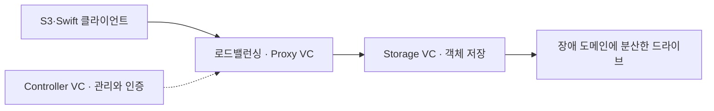

## 목차

- [[#1. 개요|1. 개요]]
- [[#2. 요청 처리와 저장 용량을 따로 확장하는 구조|2. 요청 처리와 저장 용량을 따로 확장하는 구조]]
- [[#3. 요청 계층과 저장 계층의 구성|3. 요청 계층과 저장 계층의 구성]]
- [[#4. 구성과 주요 기능|4. 구성과 주요 기능]]
- [[#5. 장애 도메인과 저장 효율|5. 장애 도메인과 저장 효율]]
- [[#6. 클라이언트 접근|6. 클라이언트 접근]]
- [[#7. ZIOS와의 관계|7. ZIOS와의 관계]]
- [[#8. Amazon S3와의 비교|8. Amazon S3와의 비교]]
- [[#9. 관련 문서|9. 관련 문서]]
- [[#10. 출처|10. 출처]]

## 1. 개요

NGOS(NextGen Object Storage)는 Zadara의 [[Object Storage|오브젝트 스토리지]] 서비스이다.

공식 사용자 가이드에서는 버전 23.03에서 도입되었으며, 기존 [[ZIOS|VPSA Object Storage]]와 함께 제공되는 서비스로 설명한다.[^1]

[[Object Storage|오브젝트 스토리지]]는 데이터를 오브젝트 단위로 저장하고 API로 접근하는 방식이다. NGOS는 S3 및 Swift 호환 REST API를 제공한다. 여기서 S3 호환은 AWS S3의 모든 기능이 동일하다는 뜻은 아니며, 지원되는 API와 동작 범위를 확인해야 한다.[^2]

## 2. 요청 처리와 저장 용량을 따로 확장하는 구조

오브젝트 스토리지는 데이터를 보관하는 일과 API 요청을 받아 처리하는 일을 함께 수행한다. 데이터가 많아지는 것과 요청 수가 많아지는 것은 같은 변화가 아니다. NGOS는 요청을 처리하는 Proxy VC와 저장을 담당하는 Storage VC를 구분해 이러한 역할을 구성한다.[^v-intro]

예를 들어 큰 영상 파일을 오래 보관하는 서비스와 작은 이미지를 매우 자주 읽는 서비스는 같은 총 용량이라도 요청 처리 요구가 다를 수 있다. 드라이브와 저장 계층을 늘리는 선택은 공간과 저장 자원을, Proxy VC를 늘리는 선택은 요청 처리 자원을 확장하는 데 관련된다.

분리된 계층은 함께 동작하므로 어느 한쪽만 늘려도 모든 성능이 같은 비율로 늘어나는 것은 아니다. 이 구조의 의미는 무제한 성능보다 서로 다른 역할의 자원을 구분해 구성할 수 있다는 데 있다. 원격 복제를 사용하는 경우에는 저장된 데이터를 다른 위치로 전달하는 별도 경로도 추가된다.[^d-replication]

## 3. 요청 계층과 저장 계층의 구성

NGOS의 API 엔드포인트 뒤에는 요청을 받아 처리하는 계층과 객체를 저장하는 계층이 있다. 공식 소개는 Cluster Controller VC, Proxy VC, Storage VC를 구분한다. Controller VC는 관리·상태·인증·로드밸런싱 등의 기능을 담당하고, Proxy VC는 S3·Swift 요청의 진입점이며, Storage VC는 할당된 드라이브의 객체 데이터와 메타데이터를 관리한다. VC는 전용 CPU·RAM을 가진 가상 머신으로 설명된다.[^v-intro]

이는 기능 역할을 단순화한 개념도다. 공식 소개에서 Ring은 데이터의 배치 위치를 나타내는 매핑을 관리하는 구성이다. 객체의 키와 API 요청이 물리 저장 자원의 위치로 연결되려면 이런 배치 정보가 필요하며, 클라이언트가 드라이브 주소를 직접 고르는 구조가 아니다.[^v-intro] 클라이언트가 데이터를 올리면 인증과 권한 확인, 키와 메타데이터 처리, 데이터 보호 정책에 맞는 저장 작업이 연결된다. 관리 화면에서 사용자를 만드는 작업과 대형 객체를 전송하는 작업은 같은 제품 안에서도 서로 다른 부하를 만든다. Account·User·Container는 사용자와 데이터의 논리적 구분이고 VC·물리 노드·드라이브는 서비스를 구현하는 자원이다. 이름이 같은 account에 속한 객체가 반드시 물리 서버 한 대에만 저장된다는 뜻은 아니다.

컨테이너 복제 기능을 사용하는 구성에서는 원격 위치로 전달하는 비동기 경로가 추가되며 Replicator VC 같은 자원이 별도 역할을 가질 수 있다. 지원 버전과 복제 구성에 따라 확인해야 하므로 최초 도입 버전의 기능표를 현재 모든 기능의 목록으로 사용하면 안 된다.[^d-replication]

## 4. 구성과 주요 기능

공식 가이드에서 설명하는 주요 기능은 다음과 같다.[^1]

- 저장장치를 추가하는 방식의 용량 확장
- 클라이언트 요청을 처리하는 Proxy VC 추가를 통한 처리 성능 확장
- 사용자 정의 오브젝트 메타데이터
- 미러링 및 이레이저 코딩을 이용한 저장 데이터 보호
- [[Object Storage|오브젝트 스토리지]]와 계정 수준의 멀티테넌시
- 사용량 보고와 계량

저장 용량을 늘리는 것과 요청 처리 성능을 늘리는 것은 서로 다른 확장 대상이다. 구체적인 확장 단위와 제한은 사용 중인 서비스 버전에서 확인해야 한다. 자원을 별도로 확장할 수 있다는 설명이 무제한 확장이나 성능의 선형 증가를 보장하는 것은 아니다.

## 5. 장애 도메인과 저장 효율

서로 다른 드라이브에 데이터를 나누었다고 모든 장애가 독립적인 것은 아니다. 같은 물리 노드가 멈추면 그 노드에 속한 여러 자원이 동시에 영향을 받을 수 있다. NGOS는 스토리지 노드를 장애 도메인에 배치하고 보호 정책에 맞춰 VC 집합을 분산하는 구조를 설명한다.[^v-intro]

미러링은 같은 데이터의 복사본을 유지하고, 이레이저 코딩은 데이터를 조각과 복구용 부호로 나누어 일부 조각 손실 뒤 복구할 수 있게 한다. 두 방식은 사용 가능한 용량 비율뿐 아니라 쓰기·복구에 필요한 연산과 네트워크 부하가 다르다. 용량 효율이 높은 방식이 모든 작은 쓰기와 모든 장애 상황에서 더 빠르다는 뜻은 아니다. 실제 정책의 최소 드라이브·장애 도메인 조건과 허용되는 장애 조합을 함께 읽어야 한다. 용량 효율의 단순 예로 데이터 10 GiB를 두 벌 저장하면 원시 공간 약 20 GiB가 필요하고, 4개 데이터 조각에 2개 복구 조각을 같은 크기로 더하면 약 15 GiB가 필요하다. 이는 메타데이터·예약·정렬·여유 공간을 제외한 산술 예시이며 실제 사용 가능 용량의 견적은 아니다. 장애 내성도 단순 조각 수뿐 아니라 서로 다른 장애 도메인에 어떻게 놓였는지에 달린다.

보호 정책은 저장 계층의 장애를 버티기 위한 구성이고 사용자에 의한 삭제를 되돌리는 시간 이력과는 목적이 다르다. 계정 권한, 객체 버전·보존과 외부 복구 체계를 결합해야 사용자의 실수와 매체 손실을 서로 다른 시나리오로 다룰 수 있다.

## 6. 클라이언트 접근

S3 호환 클라이언트에서는 보통 접속할 엔드포인트, Access Key, Secret Key, 리전 등의 정보를 설정한다. 공식 문서에는 AWS CLI, S3 Browser 등의 설정 예시가 있다.[^2]

AWS CLI를 사용하더라도 실제 요청 대상은 설정한 Zadara 엔드포인트이므로 AWS S3를 사용 중인 것과는 구분해야 한다.

## 7. ZIOS와의 관계

Zadara Command Center 관리 가이드는 Object Storage의 엔진 유형을 NGOS: NextGen Object Storage, [[ZIOS]]: VPSA Object Storage로 구분한다. 따라서 두 이름을 같은 제품의 완전한 동의어로 사용하지 않는 편이 정확하다.[^3] NGOS 소개 문서도 두 계열의 데이터 보호 정책과 기능 차이를 별도로 비교한다.[^v-intro]

다만 이 구분만으로 전환 절차나 데이터 호환성까지 판단할 수는 없다. 업그레이드와 마이그레이션 가능 여부는 실제 환경의 버전과 공식 절차를 확인해야 한다.

## 8. Amazon S3와의 비교

Amazon S3는 AWS가 제공하는 [[Object Storage|오브젝트 스토리지]] 서비스이고, S3 호환 API는 클라이언트가 오브젝트를 다루는 인터페이스를 뜻한다. NGOS에서 S3 호환 클라이언트를 사용해도 데이터가 자동으로 AWS에 저장되는 것은 아니다.[^2][^aws-s3]

| 항목 | NGOS | Amazon S3 |
|---|---|---|
| 서비스 환경 | Zadara 클라우드의 [[Object Storage\|오브젝트 스토리지]] | AWS의 관리형 [[Object Storage\|오브젝트 스토리지]] |
| 접근 | 서비스 엔드포인트와 Zadara에서 발급한 자격 증명 | AWS S3 엔드포인트와 AWS의 접근 제어 체계 |
| 클라이언트 | 지원 API 범위에서 AWS CLI·S3 호환 도구 사용 | AWS CLI·SDK 등으로 접근 |
| 관리 관점 | 구성과 권한에 따라 드라이브·Proxy VC 등의 자원 관리 | 사용자가 물리 드라이브나 스토리지 컨트롤러를 직접 구성하지 않음 |
| 기능 | 해당 NGOS 버전의 지원 API·기능 확인 필요 | AWS가 문서화한 스토리지 클래스와 수명 주기 등 서비스 기능 |

이 표는 서비스와 접근 방식의 비교이며 성능 우열을 의미하지 않는다. S3 호환이라는 이유만으로 AWS IAM 정책, 이벤트 연동, 스토리지 클래스 등이 그대로 동작한다고 가정해서는 안 된다. 실제 이전 전에는 사용하는 API, 인증·서명, 리전, 주소 지정 방식과 애플리케이션 동작을 확인해야 한다.[^2]
미러링·이레이저 코딩은 저장장치나 장애 도메인 손실에 대비하는 중복성이다. 실수로 삭제한 데이터의 과거 시점을 복구하는 독립적인 백업과 같은 의미는 아니다. 버전 관리·보존·복구 체계는 별도의 기능과 정책을 기준으로 설계한다.[^v-intro]

## 9. 관련 문서

- [[ZIOS]]
- [[VPSA]]: 블록·[[File Storage|파일 스토리지]]

- [[Data Lake]]

- [[Storage]]

## 10. 출처

[^1]: [Zadara — NextGen Object Storage User Guide](https://guides.zadara.com/ngos-guide/latest/index.html)
[^2]: [Zadara — Using Object Storage Clients](https://guides.zadara.com/ngos-guide/latest/object-storage-clients.html)
[^3]: [Zadara — Object Storage, Command Center Admin Guide](https://guides.zadara.com/admin-guide/latest/object-storage-vpsas.html)

[^aws-s3]: [AWS — What is Amazon S3?](https://docs.aws.amazon.com/AmazonS3/latest/userguide/Welcome.html)

[^v-intro]: [Zadara — NGOS Introduction](https://guides.zadara.com/ngos-guide/latest/introduction.html)

[^d-replication]: [Zadara — NGOS Replication](https://guides.zadara.com/ngos-guide/latest/ngos-replication.html)

## 둘러보기

[[Knowledge Base/index|전체 개념 목록]] · [[Storage 분류|Storage]]
