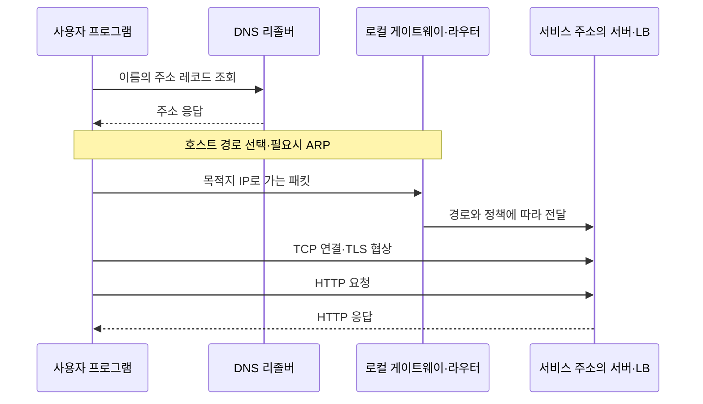

## 목차

- [[#1. 개요|1. 개요]]
- [[#2. 네트워크 장비별 역할|2. 네트워크 장비별 역할]]
- [[#3. 계층으로 나눠야 하는 이유|3. 계층으로 나눠야 하는 이유]]
- [[#4. IP·서브넷·MAC·포트의 역할|4. IP·서브넷·MAC·포트의 역할]]
- [[#5. 웹 접속의 통신 경로|5. 웹 접속의 통신 경로]]
- [[#6. VLAN·서브넷·VPC·보안 정책의 관계|6. VLAN·서브넷·VPC·보안 정책의 관계]]
- [[#7. 네트워크의 발전과 가상 네트워크|7. 네트워크의 발전과 가상 네트워크]]
- [[#8. 관련 문서|8. 관련 문서]]
- [[#9. 출처|9. 출처]]

## 1. 개요

Networking(네트워킹)은 장치와 네트워크 사이에서 규약에 따라 데이터를 전달하고 통신 경로와 접근을 관리하는 기술과 활동이다.

[[Server]]가 프로그램을 실행하고 [[Storage]]가 데이터를 기록하더라도, 필요한 대상에 요청이 도달하지 않으면 서비스는 완성되지 않는다. 네트워크는 케이블·광모듈·NIC·스위치·라우터 같은 장비와, 주소·경로·프로토콜·정책을 함께 다룬다. 클라우드의 VPC와 가상 NIC도 최종적으로는 호스트와 물리 네트워크의 동작 위에 구현된다.

## 2. 네트워크 장비별 역할

| 요소 | 주된 역할 | 역할을 혼동하면 생기는 문제 |
|---|---|---|
| NIC | 호스트의 네트워크 인터페이스와 프레임 송수신 | IP 설정이 맞아도 링크 단절·드롭을 놓칠 수 있음 |
| L2 스위치 | 같은 VLAN의 Ethernet 프레임을 MAC 주소 정보로 전달 | 다른 IP 네트워크로의 라우팅이 자동이라고 생각함 |
| 라우터·L3 스위치 | 목적지 IP와 경로표에 따라 다음 홉으로 전달 | 경로와 방화벽 허용을 같은 것으로 생각함 |
| 방화벽 | 주소·프로토콜·포트·연결 상태 등 정책으로 통신 제어 | 케이블이 연결되면 모든 통신이 가능하다고 생각함 |
| 로드밸런서 | 여러 서비스 대상에 연결·요청 분산 | 라우팅만으로 애플리케이션의 정상 동작까지 확인된다고 생각함 |
| DNS 리졸버·권한 서버 | 이름에 대한 레코드 조회·응답 | IP로 접속되면 DNS까지 정상이라고 생각함 |

여러 역할이 하나의 장비에 들어갈 수도 있다. L3 스위치가 라우팅을 하거나 가상 방화벽이 VM으로 실행될 수 있으므로 “어떤 장비인가”와 “어떤 기능을 수행하는가”를 구분한다.[^cisco]

## 3. 계층으로 나눠야 하는 이유

네트워크 계층 구분은 장애를 위치와 기능으로 나누는 설명 도구이다. OSI 7계층과 TCP/IP 모델은 분류 방식이 달라 정확히 같은 칸을 일대일 대응시키기보다 해당 기능이 무엇인지 이해하는 것이 중요하다.

| 실무에서 보는 구간 | 핵심 질문 | 대표 정보 |
|---|---|---|
| 물리·링크 | 신호가 통하고 같은 링크에서 전달되는가? | 케이블·링크·MAC·VLAN |
| 네트워크 | 목적지 네트워크에 갈 경로가 있는가? | IP·서브넷·라우팅·다음 홉 |
| 전송 | 상대 프로그램의 통신 지점에 연결되는가? | TCP·UDP·포트·연결 상태 |
| 애플리케이션 | 요청의 의미와 응답이 올바른가? | HTTP·DNS·DB 프로토콜·인증 |

IP는 목적지까지 패킷을 전달하는 기반이고 TCP는 그 위에서 순서 있는 바이트 스트림과 재전송·흐름 제어 등을 제공한다. TCP 연결 성공이 애플리케이션의 업무 성공을 의미하지는 않는다. UDP에는 TCP와 같은 연결·전달 보장이 내장되어 있지 않지만 상위 프로토콜이 필요한 제어를 구현할 수 있다.[^tcp]

## 4. IP·서브넷·MAC·포트의 역할

IPv4 주소는 32비트이며 `10.20.30.0/24` 같은 CIDR 표기는 앞의 24비트가 프리픽스임을 뜻한다. 단순한 예에서 `10.20.30.10/24`와 `10.20.30.20/24`는 같은 프리픽스에 있지만, 주소만 같게 맞춘다고 서로 다른 VLAN·격리된 가상 네트워크가 자동으로 연결되지는 않는다. CIDR은 주소를 유연하게 묶고 경로를 집약하는 배경에서 도입되었다.[^cidr]

MAC 주소는 Ethernet 링크에서 다음 전달 대상을 식별하는 데 쓰이고, IP 주소는 네트워크 간 전달에 쓰인다. TCP·UDP 포트는 호스트 안에서 서비스 통신을 구별한다. 예를 들어 `10.20.30.10:443`은 주소와 서비스 포트를 함께 표현한다. 같은 숫자의 TCP 포트와 UDP 포트는 서로 다른 전송 프로토콜의 통신 지점이다.

IPv4 호스트가 Ethernet으로 다른 서브넷에 보낼 때는 보통 경로표가 선택한 게이트웨이의 MAC 주소를 ARP로 알아낸다. 원격 목적지 서버의 MAC을 로컬 망에서 직접 찾아 전 인터넷을 통과시키는 방식이 아니다. IPv6의 이웃 탐색은 ARP와 별도 프로토콜이다.[^arp]

사설 IPv4 대역 `10.0.0.0/8`, `172.16.0.0/12`, `192.168.0.0/16`은 조직 내부에서 재사용할 수 있다. 사설 주소라는 이유만으로 안전한 것은 아니며, 외부와 통신하려면 별도의 연결·경로·주소 변환 등 환경에 맞는 구성이 필요하다. 조직 간 망 연결에서는 주소 중복이 경로 설계를 어렵게 할 수 있다.[^private]

예를 들어 `10.20.30.10/24`가 같은 링크의 `10.20.30.20`으로 보내면 직접 연결 경로를 선택하고 대상의 MAC 주소를 ARP로 알아낼 수 있다. `10.20.40.20`으로 보내면 일치하는 경로의 다음 홉을 선택하며 더 구체적인 경로가 없으면 기본 경로를 사용할 수 있다. 서브넷 마스크는 주소의 프리픽스 범위를 판단하는 데 쓰이고 기본 게이트웨이는 기본 경로의 다음 홉이지 모든 패킷이 무조건 지나는 장비가 아니다.

일반적인 Ethernet 라우팅에서 라우터는 들어온 프레임의 헤더 등을 제거하고 IP 경로를 선택한 뒤 다음 링크의 MAC 주소를 사용해 새 프레임을 만든다. NAT·터널 같은 변환이 없는 기본 예에서는 IP 출발지·목적지는 유지되지만 링크별 MAC 주소는 달라진다. IPv4 TTL은 전달 과정에서 감소하고 소진된 패킷은 폐기되어 순환 경로를 무한히 돌지 않도록 한다.[^ip]

## 5. 웹 접속의 통신 경로

다음은 IPv4·Ethernet·TCP 기반 HTTPS 접속의 단순화한 예이다. HTTP/3처럼 UDP 기반 QUIC를 사용하는 경우에는 전송 연결의 동작이 달라진다.

DNS는 이름에 대한 레코드를 제공하며 요청 본문 전체를 대신 전달하지 않는다. 캐시와 TTL 때문에 레코드 변경 직후 모든 클라이언트가 동시에 새 주소를 보지는 않을 수 있다.[^dns] TLS는 통신 구간의 기밀성과 무결성·서버 인증 등에 관여한다. 인증서가 유효한지, 접속 이름과 맞는지, 실제로 어느 장비에서 TLS가 종료되는지 구분한다.[^tls]

응답 방향도 경로와 정책을 통과해야 한다. 요청이 도착했다는 사실만으로 응답 경로까지 올바르다고 확정하지 않는다. NAT가 있으면 변환된 주소·포트와 연결 상태 때문에 로그에서 보이는 출발지가 원래 사용자 주소와 다를 수 있다.

## 6. VLAN·서브넷·VPC·보안 정책의 관계

VLAN은 L2 브로드캐스트 도메인을 논리적으로 나누는 수단이고, IP 서브넷은 주소와 라우팅 경계를 표현한다. 흔히 VLAN별 서브넷을 대응시키지만 두 개념의 정의가 같은 것은 아니다. VLAN 사이 통신은 필요한 L3 경로와 정책을 거친다.[^vlan]

클라우드의 VPC는 가상 네트워크 격리·주소·경로·접근 통제의 관리 단위이다. 서브넷에 VM을 넣고 Security Group을 허용했어도 경로표와 게이트웨이·대상 서비스 수신 설정이 빠지면 통신은 실패할 수 있다. 특정 클라우드의 “퍼블릭 서브넷”도 VM마다 무조건 공인 주소를 가진다는 뜻은 아니다.[^vpc]

[[3-Tier Architecture]]에서는 인터넷에서 WEB으로 필요한 요청만 받고, WEB에서 WAS, WAS에서 DB로 필요한 연결만 허용하는 구조를 설계할 수 있다. “계층을 분리했다”는 설명은 실제 네트워크 정책과 자격 증명 설정으로 구현되어야 한다.

연결 상태를 기억하는 stateful 정책과 각 방향의 패킷 규칙을 독립적으로 평가하는 stateless 정책은 반환 트래픽 처리 방식이 다르다. AWS Security Group은 stateful, Network ACL은 stateless인 구체적인 예이다. 다른 제품도 항상 같은 동작이라고 가정하지 않는다.[^policy] NAT는 주소·포트 변환이고 방화벽은 허용·차단 정책이므로 NAT만으로 보안을 보장할 수 없다.

L4 로드밸런서는 전송 계층 연결·주소·포트 관점으로, L7 로드밸런서는 HTTP Host·경로 같은 애플리케이션 정보를 활용하는 관점으로 구분한다. TLS 종료와 프로토콜 지원에 따라 볼 수 있는 정보가 달라진다. 분산과 헬스 체크는 별도 기능이다.

## 7. 네트워크의 발전과 가상 네트워크

컴퓨터 네트워크는 떨어진 컴퓨터의 데이터와 프로그램을 함께 사용하려는 요구에서 발전했다. 패킷 교환은 데이터를 나누어 여러 통신이 연결 자원을 공유하게 하는 중요한 기반이 되었다. 인터넷 개발 참여자들의 기록에 따르면 1969년 말 초기 ARPANET에는 네 대의 호스트가 연결되어 있었다. 이후 서로 다른 네트워크를 연결하는 기술이 발전하면서 인터넷으로 이어졌다.[^history]

네트워크와 인터넷은 같은 뜻이 아니다. 집이나 회사 안에서 장치들을 연결한 LAN도 네트워크이고, 인터넷은 여러 네트워크가 상호 연결된 체계이다. 웹은 그 위에서 HTTP 등으로 정보를 주고받는 서비스이다. 따라서 인터넷 연결 없이도 사내 파일 서버나 DB 서버에 접속하는 네트워크를 구성할 수 있다.[^cisco][^history]

가상화와 클라우드에서는 케이블·스위치만 직접 다루는 대신 가상 NIC, 가상 스위치, VPC 같은 논리 자원을 함께 사용한다. 실제 통신은 물리 호스트와 네트워크를 통해 이루어지지만, 사용자는 소프트웨어로 주소·경로·격리 범위를 구성한다. 가상 네트워크도 물리 연결을 대신하는 마법의 통로가 아니라 그 위에 구현된 연결·관리 구조이다.[^vpc]

네트워크의 성능을 설명할 때는 대역폭과 지연을 구분한다. 대역폭은 전달할 수 있는 데이터량의 한도이고, 지연은 데이터가 이동하거나 응답이 돌아오기까지 걸리는 시간이다. 넓은 대역폭은 큰 파일 전송에 도움이 되지만, 멀리 떨어진 DB와 작은 요청을 반복하면 왕복 대기가 전체 시간을 좌우할 수 있다. 이 차이는 네트워크가 단순히 “연결된다”는 사실을 넘어 서비스 동작에 영향을 주는 이유이다.

## 8. 관련 문서

- [[Server]], [[Storage]], [[3-Tier Architecture]]
- [[Web Server]], [[Web Application Server]], [[Database]]
- [[CDN]], [[SNMP]], [[iSCSI]]
- [[서버 마이그레이션의 네트워크 준비와 전환 시점]]

## 9. 출처

[^history]: [Internet Society — A Brief History of the Internet](https://www.internetsociety.org/internet/history-internet/brief-history-internet/)

[^cisco]: [Cisco — Networking basics](https://www.cisco.com/site/us/en/learn/topics/small-business/networking-basics.html)
[^tcp]: [IETF — RFC 9293: TCP](https://www.rfc-editor.org/rfc/rfc9293.html)
[^cidr]: [IETF — RFC 4632: CIDR](https://www.rfc-editor.org/rfc/rfc4632.html)
[^arp]: [IETF — RFC 826: ARP](https://www.rfc-editor.org/rfc/rfc826.html)
[^private]: [IETF — RFC 1918: Private Internets](https://www.rfc-editor.org/rfc/rfc1918.html)
[^dns]: [IETF — RFC 1034: DNS Concepts](https://www.rfc-editor.org/rfc/rfc1034.html)
[^tls]: [IETF — RFC 8446: TLS 1.3](https://www.rfc-editor.org/rfc/rfc8446.html)
[^vlan]: [Cisco — VLAN configuration concepts](https://www.cisco.com/c/en/us/td/docs/switches/lan/c9000/lyr2-fwd/vlan/vlan-configuration-guide/configure-vlan.html)
[^vpc]: [AWS — VPC route tables](https://docs.aws.amazon.com/vpc/latest/userguide/VPC_Route_Tables.html)

[^ip]: [IETF — RFC 791: IPv4 and TTL](https://www.rfc-editor.org/rfc/rfc791.html)
[^policy]: [AWS — Network ACLs와 Security Group의 stateless/stateful 차이](https://docs.aws.amazon.com/vpc/latest/userguide/vpc-network-acls.html)

## 둘러보기

[[Knowledge Base/index|전체 개념 목록]] · [[Networking 분류|Networking]]
