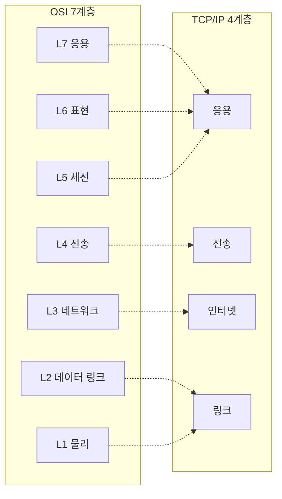

## 목차

- [[#1. 개요|1. 개요]]
- [[#2. 계층 분리의 목적|2. 계층 분리의 목적]]
- [[#3. OSI 7계층|3. OSI 7계층]]
- [[#4. TCP/IP 4계층|4. TCP/IP 4계층]]
- [[#5. 두 모델의 대응과 차이|5. 두 모델의 대응과 차이]]
- [[#6. 웹 요청의 계층별 전달|6. 웹 요청의 계층별 전달]]
- [[#7. 장비와 장애의 계층별 해석|7. 장비와 장애의 계층별 해석]]
- [[#8. 흔한 오해|8. 흔한 오해]]
- [[#9. 관련 문서|9. 관련 문서]]
- [[#10. 출처|10. 출처]]

## 1. 개요

OSI 7계층과 TCP/IP 4계층은 네트워크 통신에 필요한 기능을 역할별로 나누어 설명하는 계층 모델이다.

OSI(Open Systems Interconnection) 모델은 서로 다른 통신 표준을 공통 구조 안에서 설명하기 위한 7계층 참조 모델이다. TCP/IP 모델은 실제 인터넷에서 사용하는 프로토콜 모음을 애플리케이션·전송·인터넷·링크의 네 계층으로 설명하는 방식이다.[^x200][^rfc1122]

두 모델은 경쟁 제품도 아니고, 하나만 현실이고 다른 하나는 틀린 이론인 것도 아니다. OSI 7계층은 기능과 장애 지점을 세밀하게 설명하기 좋고, TCP/IP 4계층은 실제 인터넷 프로토콜의 구현 관계를 간결하게 설명하기 좋다.

## 2. 계층 분리의 목적

통신 기능을 계층으로 나누면 각 계층이 아래 계층의 서비스를 이용하면서 자신의 역할에 집중할 수 있다. 상위 계층은 하위 계층의 구체적인 구현을 모두 알 필요가 없다.[^x200]

예를 들어 웹 브라우저는 광섬유의 빛 신호나 스위치의 MAC 주소 테이블을 직접 관리하지 않는다. HTTP 요청을 만들면 운영체제와 NIC가 TCP·IP·Ethernet 처리를 나누어 수행한다. Ethernet 대신 Wi-Fi를 사용해도 HTTP와 TCP를 그대로 사용할 수 있고, 웹 브라우저를 바꾸어도 케이블과 스위치를 다시 설계할 필요가 없다.

계층 분리는 다음 이점을 제공한다.

- **역할 분리**: 주소 지정, 경로 선택, 신뢰성, 데이터 표현과 애플리케이션 의미를 구분한다.
- **상호 운용성**: 서로 다른 장비와 운영체제가 같은 프로토콜 규약으로 통신한다.
- **변경 범위 축소**: 한 계층의 기술을 바꾸어도 다른 계층에 미치는 영향을 줄인다.
- **장애 구분**: 링크 단절, IP 경로, 포트 연결, TLS와 HTTP 오류를 순서대로 분리한다.

계층은 설명과 설계를 돕는 모델이다. 실제 구현은 성능과 기능 때문에 여러 계층을 함께 처리하거나 계층 사이의 정보를 참조할 수 있다. RFC 1122도 엄격한 계층 구조가 실제 구현을 완전히 설명하지는 못한다고 밝힌다.[^rfc1122]

## 3. OSI 7계층

ITU-T X.200과 ISO/IEC 7498-1은 OSI 참조 모델을 일곱 계층으로 정의한다.[^x200]

| 계층 | 이름 | 핵심 역할 | 대표 예시 |
|---|---|---|---|
| L7 | Application·응용 | 사용자 프로그램이 이용하는 네트워크 서비스와 요청의 의미 | HTTP, DNS, SMTP, SSH |
| L6 | Presentation·표현 | 데이터 형식 변환, 인코딩, 직렬화, 압축과 암호화 같은 표현 처리 | JSON, UTF-8, 이미지 형식, 암호화·복호화 기능 |
| L5 | Session·세션 | 통신 대화의 설정·유지·종료와 동기화 | 세션 관리, 대화 제어, 체크포인트 개념 |
| L4 | Transport·전송 | 프로그램 사이의 종단 간 전달, 포트 구분과 신뢰성·순서·흐름 제어 | TCP, UDP, 포트 번호 |
| L3 | Network·네트워크 | 논리 주소와 서로 다른 네트워크 사이의 경로 선택 | IP, ICMP, 라우터 |
| L2 | Data Link·데이터 링크 | 같은 링크에서 프레임 전달, 링크 주소와 오류 검출 | Ethernet, MAC, VLAN, L2 스위치 |
| L1 | Physical·물리 | 비트를 전기·빛·무선 신호로 송수신 | 케이블, 광섬유, 커넥터, 무선 신호 |

### 표현 계층과 보안의 구분

L6의 이름은 `표현 계층`이며 `보안 계층`이 아니다. 암호화는 데이터를 표현하는 방법과 관련되므로 교육용 대응표에서 TLS를 L5·L6 부근에 놓기도 하지만, 실제 인터넷 프로토콜 구조에서 TLS를 OSI의 한 계층에 정확히 고정하는 표준적인 대응은 없다.

보안 기능은 여러 계층에 존재할 수 있다.

- L2의 MACsec
- L3의 IPsec
- TCP 위에서 동작하는 TLS
- 애플리케이션 프로토콜인 SSH와 HTTPS의 인증·암호화 기능

따라서 `L6 = 보안`으로 외우기보다 **표현 계층은 데이터 형식과 표현을 다루며, 보안 기능은 여러 계층에 걸칠 수 있다**고 이해하는 편이 정확하다.

### 세션·표현 계층의 실제 위치

현대 인터넷 애플리케이션에서도 세션 유지, 인증 상태, 직렬화, 압축과 암호화 기능은 필요하다. 다만 TCP/IP 모델에서는 이 기능을 별도 계층으로 고정하지 않고 애플리케이션 프로토콜·라이브러리·프레임워크가 담당하는 경우가 많다.

예를 들어 HTTP Cookie나 인증 Token은 애플리케이션의 세션 상태를 관리할 수 있고, JSON 라이브러리는 데이터 표현을 처리하며, TLS 라이브러리는 암호화와 인증을 제공한다. OSI의 L5·L6 기능이 사라진 것이 아니라 구현 위치가 TCP/IP 응용 계층 안으로 합쳐진 것이다.

## 4. TCP/IP 4계층

TCP/IP는 특정 프로토콜 하나가 아니라 인터넷에서 함께 사용하는 프로토콜 모음이다. RFC 1122는 Link·Internet·Transport 계층을 다루고, RFC 1123은 Application과 지원 프로토콜을 다룬다.[^rfc1122][^rfc1123]

| TCP/IP 계층 | 핵심 역할 | 대표 프로토콜과 요소 | OSI의 대략적인 범위 |
|---|---|---|---|
| Application·응용 | 애플리케이션의 요청 의미, 데이터 형식과 세션 기능 | HTTP, DNS, SSH, TLS, JSON | L5·L6·L7 |
| Transport·전송 | 애플리케이션 사이의 종단 간 전달과 포트 구분 | TCP, UDP | L4 |
| Internet·인터넷 | IP 주소와 네트워크 사이의 패킷 전달 | IP, ICMP, 라우팅 | L3 |
| Link·링크 | 현재 연결망에서 프레임과 실제 신호 전달 | Ethernet, Wi-Fi, MAC, VLAN, NIC, 케이블 | L1·L2 |

자료에 따라 물리 계층과 데이터 링크 계층을 분리한 5계층 Internet Model을 사용하기도 한다. IETF의 단일 표준 문서가 TCP/IP 계층 수와 이름을 OSI처럼 하나의 참조 모델로 고정한 것은 아니므로, `4계층`과 `5계층` 표기가 함께 나타날 수 있다.[^rfc4949]

## 5. 두 모델의 대응과 차이



이 대응은 기능을 비교하기 위한 근사치이며 정확한 일대일 변환표가 아니다.

- **OSI 모델**: 통신 기능을 일곱 단계로 세밀하게 나눈 참조 모델이다.
- **TCP/IP 모델**: 실제 Internet Protocol Suite를 중심으로 기능을 묶어 설명한다.
- **OSI L5·L6·L7**: TCP/IP에서는 대부분 응용 계층과 관련 라이브러리에 포함된다.
- **OSI L1·L2**: TCP/IP 4계층에서는 링크 계층으로 묶는다.

쉽게 설명하면 OSI는 건물의 전기·배관·공조·출입·업무 공간을 세부 설비별로 설명한 도면에 가깝고, TCP/IP는 실제 운영에서 함께 관리하는 설비 묶음으로 정리한 안내도에 가깝다. 두 그림의 칸 수가 다르더라도 같은 통신 기능을 서로 다른 상세도로 바라볼 수 있다.

## 6. 웹 요청의 계층별 전달

TCP 기반 HTTPS 요청을 단순화하면 다음 순서로 캡슐화된다. HTTP/3처럼 QUIC와 UDP를 사용하는 경우에는 전송 구조가 달라질 수 있다.

```text
HTTP 요청과 TLS 데이터
↓ TCP 헤더 추가 · 출발지/목적지 포트
TCP Segment
↓ IP 헤더 추가 · 출발지/목적지 IP
IP Packet
↓ Ethernet 헤더 추가 · 출발지/다음 홉 MAC
Ethernet Frame
↓ NIC가 비트열을 신호로 변환
전기·빛·무선 신호
```

- **포트 번호**는 목적지 호스트 안의 애플리케이션 통신 지점을 구분한다.
- **IP 주소**는 여러 네트워크를 지나 도달할 종단 인터페이스를 식별하고 경로 선택에 사용한다.
- **MAC 주소**는 현재 Ethernet 링크에서 다음으로 전달할 인터페이스를 식별한다.

이 세 주소는 경기도·성남시·분당구처럼 하나의 주소를 계층적으로 나눈 값이 아니다. 서로 다른 범위와 대상을 가리키는 별도의 주소 체계이다. 다른 서브넷의 서버로 보낼 때 첫 프레임의 목적지 MAC 주소에는 원격 서버가 아니라 [[Default Gateway|기본 게이트웨이]]의 MAC 주소가 들어간다.

캡슐화와 홉마다 바뀌는 값은 [[Encapsulation|캡슐화]]에서 자세히 다룬다.

## 7. 장비와 장애의 계층별 해석

장비 이름과 계층 번호를 완전히 같은 의미로 보면 안 된다. 일반적인 전달 기준은 다음과 같지만 실제 장비는 보안·QoS·가속 기능을 위해 여러 계층의 헤더를 확인할 수 있다.

| 구간 | 일반적으로 확인하는 정보 | 대표 장비·기능 | 장애 예시 |
|---|---|---|---|
| L1 | 링크 신호와 비트 | NIC PHY, 케이블, 광모듈 | Link Down, 광신호 손실 |
| L2 | MAC, Ethernet, VLAN | L2 Switch, vSwitch | VLAN 불일치, MAC 학습 문제 |
| L3 | IP와 경로 | Router, L3 Switch | 잘못된 서브넷·게이트웨이·라우팅 |
| L4 | TCP·UDP와 포트 | Stateful Firewall, L4 Load Balancer | 포트 차단, TCP 연결 실패 |
| L5–L7 | TLS, HTTP, DNS와 애플리케이션 의미 | Reverse Proxy, L7 Load Balancer, 애플리케이션 | 인증서·Host·경로·인증 오류 |

`L2 Switch`, `L3 Switch`, `L4 Load Balancer`, `L7 Load Balancer`라는 이름은 그 장비가 주로 어떤 정보를 이용해 핵심 결정을 내리는지를 강조한다. 장비가 해당 계층 하나만 처리한다는 뜻은 아니다. 자세한 처리 범위는 [[네트워크 장비별 처리 계층]]에서 비교한다.

장애를 확인할 때는 아래 계층부터 점검하면 원인 범위를 줄이기 쉽다.

```text
링크가 올라왔는가?
→ VLAN과 로컬 프레임 전달이 가능한가?
→ IP·서브넷·게이트웨이·경로가 맞는가?
→ TCP·UDP 포트가 허용되고 대기 중인가?
→ TLS·HTTP·인증과 애플리케이션 응답이 정상인가?
```

아래 계층이 정상이라는 사실은 위 계층의 성공을 보장하지 않는다. `ping`이 성공해도 TCP 포트가 닫혀 있거나 HTTP 애플리케이션이 오류를 반환할 수 있다.

## 8. 흔한 오해

- **L6이 보안 계층이라는 생각**: L6은 표현 계층이다. 암호화와 인증은 여러 계층에서 구현될 수 있다.
- **L7이 표현 계층이라는 생각**: L7은 응용 계층이며 HTTP·DNS·SSH처럼 애플리케이션이 이용하는 프로토콜을 설명한다.
- **현실에서는 OSI의 L5·L6이 필요 없다는 생각**: 기능은 여전히 필요하며 TCP/IP 응용 계층의 프로토콜과 라이브러리 안에 구현된다.
- **OSI와 TCP/IP가 정확히 일대일로 대응한다는 생각**: 두 모델의 목적과 묶는 방식이 달라 대응표는 근사치이다.
- **스위치는 L2, 라우터는 L3만 처리한다는 생각**: 핵심 전달 기준은 맞지만 관리·보안·가속 기능은 상위 계층 정보도 확인할 수 있다.
- **한 계층이 정상이라면 전체 통신도 정상이라는 생각**: 물리 링크, IP 경로, 포트 연결과 애플리케이션 응답은 각각 따로 확인해야 한다.

## 9. 관련 문서

- [[Networking|네트워크]] · [[Encapsulation|캡슐화]]
- [[NIC]] · [[Switch|스위치]] · [[Router|라우터]]
- [[IP Address and Subnet|IP 주소와 서브넷]] · [[Default Gateway|기본 게이트웨이]] · [[VLAN]]
- [[네트워크 장비별 처리 계층]] · [[연결 거부와 시간 초과의 차이]] · [[ping 실패와 서비스 연결의 차이]]

## 10. 출처

[^x200]: ITU-T, [Recommendation X.200 — Open Systems Interconnection Basic Reference Model](https://www.itu.int/rec/T-REC-X.200/en/). OSI 7계층과 계층 분리 원칙.
[^rfc1122]: IETF, [RFC 1122 — Requirements for Internet Hosts: Communication Layers](https://www.rfc-editor.org/rfc/rfc1122.html). Link·Internet·Transport 계층과 엄격한 계층 모델의 한계.
[^rfc1123]: IETF, [RFC 1123 — Requirements for Internet Hosts: Application and Support](https://www.rfc-editor.org/rfc/rfc1123.html). Internet Protocol Suite의 응용·지원 프로토콜 요구사항.
[^rfc4949]: IETF, [RFC 4949 — Internet Security Glossary, Version 2](https://www.rfc-editor.org/rfc/rfc4949.html). Internet Protocol Suite 계층 명칭이 문헌마다 일관되지 않을 수 있다는 설명.

- IETF, [RFC 9293 — Transmission Control Protocol](https://www.rfc-editor.org/rfc/rfc9293.html). TCP의 종단 간 바이트 스트림, 세그먼트와 포트 번호.

## 둘러보기

[[Knowledge Base/index|전체 개념 목록]] · [[Networking 분류|Networking]]
