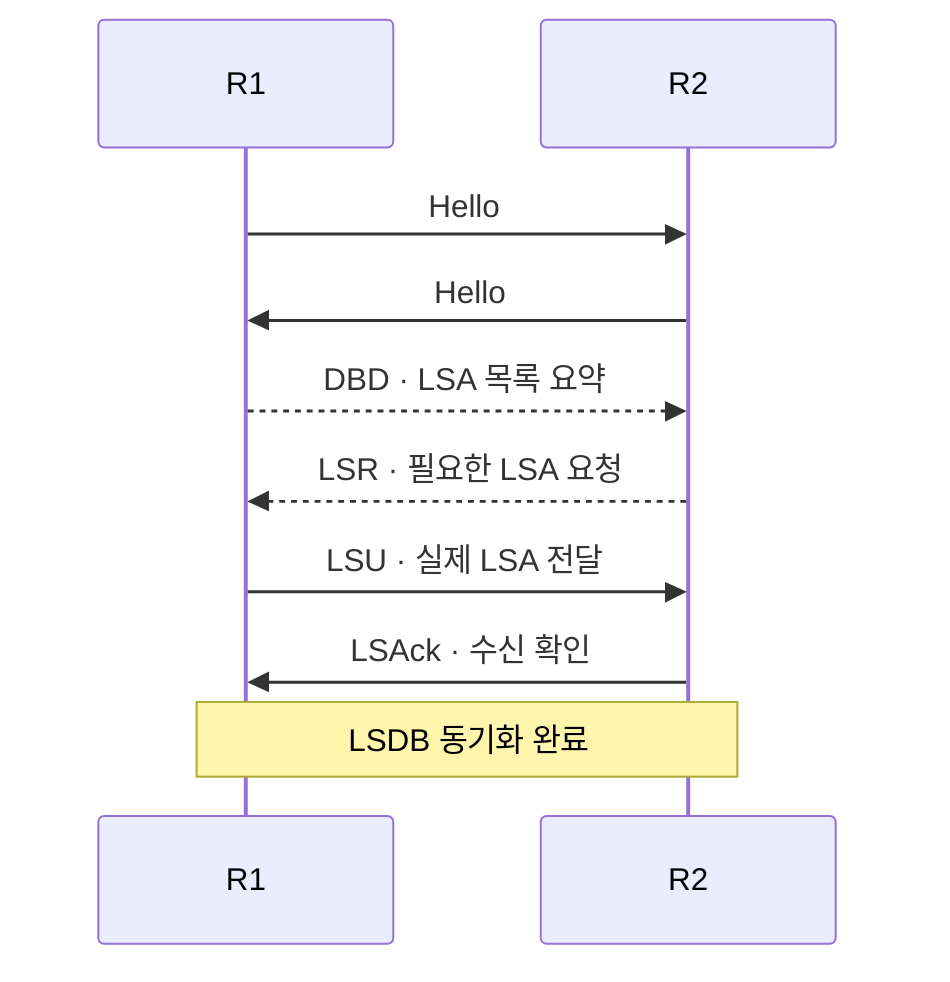
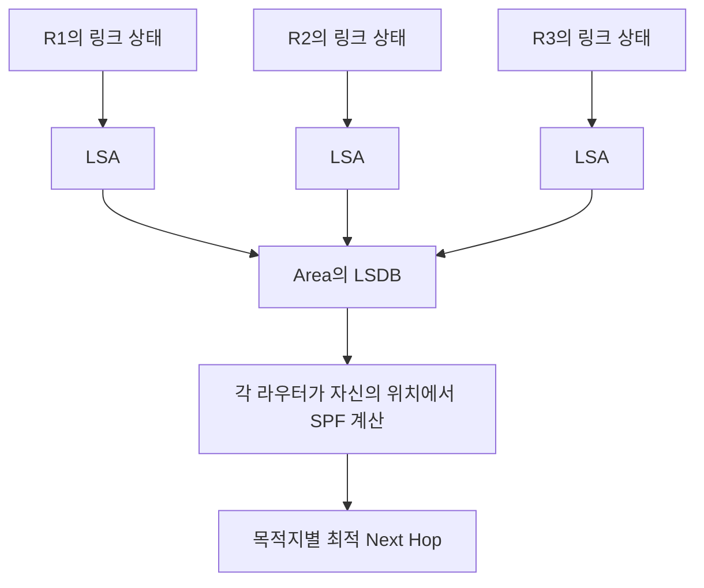
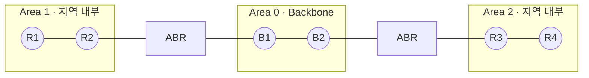
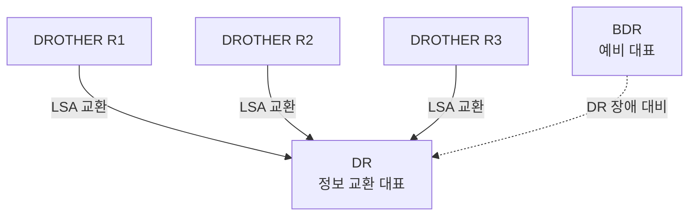
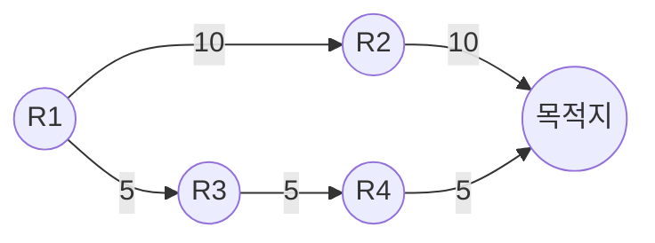

## 목차

- [[#1. 개요|1. 개요]]
- [[#2. OSPF의 본질|2. OSPF의 본질]]
- [[#3. 이웃 관계와 LSDB 동기화|3. 이웃 관계와 LSDB 동기화]]
- [[#4. LSA·LSDB·SPF의 연결|4. LSA·LSDB·SPF의 연결]]
- [[#5. Area와 Area 0|5. Area와 Area 0]]
- [[#6. DR과 BDR|6. DR과 BDR]]
- [[#7. Cost와 ECMP|7. Cost와 ECMP]]
- [[#8. 장애 수렴과 BFD|8. 장애 수렴과 BFD]]
- [[#9. OSPFv2와 OSPFv3|9. OSPFv2와 OSPFv3]]
- [[#10. IS-IS와의 차이|10. IS-IS와의 차이]]
- [[#11. 관련 문서|11. 관련 문서]]
- [[#12. 출처|12. 출처]]

## 1. 개요

OSPF(Open Shortest Path First)는 하나의 AS 내부에서 라우터들이 링크 상태를 공유하고 최단 경로 트리를 계산하는 Link-State IGP이다.[^rfc2328]

OSPF는 경로를 중앙에서 지시하는 서버가 아니다. 각 라우터에서 실행되는 OSPF 프로세스들이 이웃을 맺고 같은 Area의 토폴로지 정보를 공유한 뒤, 각자 자신의 위치를 출발점으로 경로를 계산한다.

## 2. OSPF의 본질

OSPF의 전체 흐름은 다음과 같다.

OSPF 프로세스는 CPU와 메모리를 이용해 이웃 관계, LSA와 LSDB를 관리한다. 실제 사용자 패킷은 OSPF 메시지를 매번 주고받지 않는다. OSPF 계산 결과가 FIB에 반영된 뒤 ASIC·NPU 또는 운영체제 커널의 데이터 평면이 패킷을 전달한다.

## 3. 이웃 관계와 LSDB 동기화

라우터는 Hello 메시지를 이용해 이웃의 존재와 OSPF 관계를 맺을 조건을 확인한다. Area, Hello·Dead Timer, 인증과 네트워크 유형 등 필요한 조건이 맞지 않으면 정상적인 인접 관계를 형성하지 못할 수 있다.

새 이웃과 처음 연결될 때는 서로의 LSDB가 같은지 확인하고 빠진 정보를 보충한다.

- **DBD(Database Description)**: 자신이 보유한 LSA의 목록을 요약한다.
- **LSR(Link State Request)**: 빠진 LSA를 요청한다.
- **LSU(Link State Update)**: 하나 이상의 LSA를 전달한다.
- **LSAck(Link State Acknowledgment)**: 정상 수신을 확인한다.

처음에는 기준이 되는 LSDB를 맞추고, 이후에는 변경된 링크 상태를 증분으로 Flooding한다. 주기적인 갱신과 확인 절차도 있어 정보 누락과 오래된 상태를 정리한다. 세부 상태 이름을 외우기보다 **이웃 확인 → 목록 비교 → 누락 요청 → 실제 정보 전달 → 수신 확인**의 목적을 이해하는 편이 중요하다.

## 4. LSA·LSDB·SPF의 연결

LSA(Link-State Advertisement)는 라우터와 네트워크의 연결 상태를 알리는 정보 단위이다. 라우터는 수신한 LSA를 LSDB에 반영하고, LSDB가 바뀌면 필요한 SPF 계산을 수행한다.

LSDB는 최종 경로 목록만 담은 표가 아니라 토폴로지를 계산할 수 있는 지도에 가깝다. 같은 Area의 라우터들은 일관된 LSDB를 유지하려고 하지만 각자의 출발점이 다르므로 계산 결과의 Next Hop은 달라질 수 있다.

## 5. Area와 Area 0

OSPF는 큰 네트워크를 Area로 나누어 LSDB와 LSA Flooding의 범위를 제한한다. Area 내부의 세부 변화는 해당 Area 안에서 처리하고, 다른 Area에는 도달에 필요한 정보가 전달된다. RFC 2328은 Area 기능이 라우팅 보호 수준을 더하고 라우팅 프로토콜 트래픽을 줄이도록 설계되었다고 설명한다.[^rfc2328]

- **Area 0**: 여러 Area 사이를 연결하는 OSPF Backbone Area이다.
- **Internal Router**: 모든 OSPF 인터페이스가 같은 Area에 속하는 라우터이다.
- **ABR(Area Border Router)**: Area 0과 다른 Area처럼 둘 이상의 Area를 연결한다.
- **ASBR(Autonomous System Boundary Router)**: 다른 라우팅 영역이나 프로토콜에서 얻은 외부 경로를 OSPF로 들여오는 경계 역할을 한다.

Area는 단순히 IP 대역을 보기 좋게 분류하는 이름이 아니다. 라우팅 정보의 범위와 계산 부담을 나누는 설계 경계이다.

## 6. DR과 BDR

하나의 Ethernet broadcast network에 라우터가 많이 연결되면 모든 라우터가 서로 완전한 인접 관계를 맺을 경우 관계 수가 빠르게 증가한다. OSPF는 이 구간에서 DR과 BDR을 선출하여 LSA 교환 구조를 단순화한다.

- **DR(Designated Router)**: 해당 다중 접속 구간의 OSPF 정보 교환을 대표한다.
- **BDR(Backup Designated Router)**: DR 장애 시 역할을 이어받을 예비 대표이다.
- **DROTHER**: DR과 BDR이 아닌 나머지 OSPF 라우터이다.

DR은 사용자 트래픽이 반드시 거쳐야 하는 중앙 라우터가 아니다. 패킷의 실제 전달 경로는 FIB가 정하며, R1에서 R2로 바로 전달할 수 있다면 DR을 우회해도 정상이다. DR·BDR은 제어 평면의 OSPF 정보 교환 역할이다.

DR·BDR 선출에는 인터페이스 우선순위와 Router ID가 사용된다. 우선순위 0인 인터페이스는 선출 대상에서 제외된다. 실제 선출 결과는 기존 DR·BDR 상태와 선출 시점도 함께 고려하므로 단순히 Router ID가 가장 큰 장비가 언제나 즉시 DR을 빼앗는다고 이해하면 안 된다.

## 7. Cost와 ECMP

OSPF는 목적지까지 이어지는 인터페이스 Cost의 합을 비교하여 낮은 경로를 선호한다. 기본 Cost 산출에는 인터페이스 대역폭과 참조 대역폭이 사용될 수 있으며 운영자가 설계 의도에 맞게 조정할 수 있다.

위쪽 경로는 Cost 20, 아래쪽 경로는 Cost 15이므로 아래쪽 경로가 선택된다. Hop 수만 세는 방식이 아니다. Cost가 같은 여러 경로는 ECMP로 FIB에 함께 설치할 수 있다.[^rfc2328]

OSPF Cost는 링크의 현재 혼잡도를 실시간으로 측정하여 자동 반영하는 지표가 아니다. 기본값과 운영자가 정한 정책을 바탕으로 경로 선호를 표현한다.

## 8. 장애 수렴과 BFD

링크 장애가 발생하면 직접 연결된 장비가 이를 감지하고 새 LSA를 Flooding한다. 각 라우터는 변경된 LSDB로 SPF를 다시 계산하고 RIB·FIB를 갱신한다. 이 과정이 끝나 네트워크가 안정된 상태를 회복하는 것을 수렴이라고 한다.

OSPF Hello는 이웃 관계를 만들고 유지하면서 생존 상태를 확인한다. BFD는 라우팅 프로토콜과 독립적으로 두 Forwarding Engine 사이의 양방향 경로 장애를 빠르게 감지하여 OSPF에 알릴 수 있다.[^rfc5880] BFD가 경로를 계산하거나 LSA를 대신 만드는 것은 아니다.

Fast Reroute를 사용하면 루프 없는 예비 Next Hop을 미리 준비하여 전체 SPF 수렴이 끝나기 전에 로컬에서 우회할 수 있다. 이후 OSPF가 정상적인 전체 수렴을 완료한다.[^rfc5286]

## 9. OSPFv2와 OSPFv3

OSPFv2는 IPv4 라우팅을 위한 표준으로 널리 사용된다. OSPFv3는 처음에 IPv6 지원을 위해 정의되었다. OSPFv3에서도 Flooding, DR 선출, Area와 SPF 같은 기본 메커니즘은 유지되지만 주소 처리와 LSA 구조, 링크 단위 처리 등은 변경되었다.[^rfc5340]

버전 숫자만 보고 OSPFv3가 OSPFv2를 모든 환경에서 단순히 대체하는 상위호환이라고 이해하면 안 된다. 실제 주소군 지원과 인증 방식은 장비 운영체제와 적용 표준을 함께 확인해야 한다.

## 10. IS-IS와의 차이

OSPF와 [[IS-IS]]는 모두 Link-State IGP이며 LSDB와 SPF라는 같은 핵심 원리를 사용한다.

| 구분 | OSPF | IS-IS |
|---|---|---|
| 링크 정보 | LSA | LSP |
| 계층 구조 | Area와 Area 0 | Level 1과 Level 2 |
| 제어 메시지 전달 | IP 위에서 전달 | 같은 링크의 L2에서 직접 전달 |
| 확장 방식 | LSA와 규격 확장 | TLV·Sub-TLV 확장 |
| 상대적으로 흔한 환경 | 기업·캠퍼스 네트워크 | 대형 사업자·통신사 백본 |

두 프로토콜 모두 대규모 네트워크를 구성할 수 있다. 선택은 조직의 기존 기술, 운영 경험, 장비 지원, 자동화와 다른 프로토콜의 연동 방식을 기준으로 판단한다.

## 11. 관련 문서

- [[IGP]] · [[IS-IS]] · [[BGP]]
- [[Router|라우터]] · [[Backbone Network|백본 네트워크]]
- [[Internet Routing|인터넷의 통신 구조]]

## 12. 출처

[^rfc2328]: IETF, [RFC 2328 — OSPF Version 2](https://www.rfc-editor.org/rfc/rfc2328.html). OSPFv2의 LSDB, SPF, Area, DR·BDR, Cost와 ECMP 등 기본 동작.
[^rfc5340]: IETF, [RFC 5340 — OSPF for IPv6](https://www.rfc-editor.org/rfc/rfc5340.html). OSPFv3의 IPv6 지원과 OSPFv2 대비 변경 사항.
[^rfc5880]: IETF, [RFC 5880 — Bidirectional Forwarding Detection](https://www.rfc-editor.org/rfc/rfc5880.html). 독립적인 양방향 전달 경로 장애 감지.
[^rfc5286]: IETF, [RFC 5286 — Basic Specification for IP Fast Reroute: Loop-Free Alternates](https://www.rfc-editor.org/rfc/rfc5286.html). 예비 Next Hop을 통한 빠른 로컬 복구.

## 둘러보기

[[Knowledge Base/index|전체 개념 목록]] · [[Networking 분류|Networking]]
