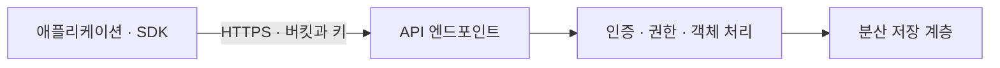

## 1. 개요

오브젝트 스토리지(Object Storage)는 데이터와 메타데이터를 오브젝트 단위로 관리하고, 이름이나 키를 이용해 API로 접근하는 저장 방식이다.

이미지, 영상, 백업 데이터와 데이터 분석용 자료 등의 저장에 활용한다.[^1]

## 2. 버킷과 오브젝트

Amazon S3에서는 오브젝트를 버킷(bucket) 안에 저장하고 키(key)로 식별한다. 오브젝트는 데이터와 메타데이터를 포함한다. 예를 들어 버킷 `study` 안에 `images/server.png`라는 키로 데이터를 저장할 수 있다.[^2]

키에 포함된 `/`는 일반적인 S3 버킷에서 디렉터리처럼 보여주기 위한 접두사 구분에 활용된다. 파일시스템의 실제 디렉터리 계층과 동일하게 해석해서는 안 된다. 예외로 S3 directory bucket은 계층형 네임스페이스를 사용한다. 일반 버킷의 접두사 설명을 모든 버킷 유형에 적용하면 안 된다.[^v-directory]

## 3. API 앞단과 저장 노드의 역할을 나누어 보기

개념적으로 로드밸런서·API 프록시는 클라이언트 연결을 받아 요청을 전달하고, 인증·메타데이터 기능은 사용자 권한과 객체 이름·속성·위치 정보를 다루며, 데이터 노드·드라이브는 실제 바이트나 보호용 조각을 보관한다. 한 프로세스가 여러 역할을 겸할 수도 있으므로 반드시 세 종류의 전용 물리 서버가 필요하다는 뜻은 아니다. 구현 예로 [[NGOS]]는 Proxy VC와 Storage VC를 구분하고 물리 스토리지 노드의 드라이브를 사용한다. [[ZIOS]]의 Proxy+Storage VC는 또 다른 역할 조합이다.[^d-ngos-arch][^d-zios-arch]

| 관측한 현상 | 먼저 구분할 계층과 의미 |
|---|---|
| 이름 해석 실패·TLS 검증 오류 | DNS·엔드포인트·인증서 신뢰 등 API 도달 전 경로 |
| HTTP 403 | 인증·서명·권한 등 요청 거부의 상세 오류 코드 확인 |
| HTTP 404 | 버킷·키·버전·주소와 조회 권한에 따른 응답 차이 확인 |
| HTTP 5xx·반복 timeout | 서비스 처리·후단 의존성·네트워크와 재시도 규약 비교 |
| PUT만 느림 | 요청 크기·병렬성·클라이언트 CPU·전송·후단 쓰기 지연 분리 |

이는 HTTP/S3 문제를 구분하는 해석 표이다. 예를 들어 AWS S3의 오류 문서는 상태 코드와 별도 오류 이름·본문을 제공하므로 상태 숫자 하나만으로 원인을 확정하면 안 된다. Zadara 등 다른 엔드포인트의 실제 오류 규약은 해당 제품 문서를 따른다.[^d-errors]

## 4. HTTP 요청이 저장 객체로 바뀌는 흐름

애플리케이션은 오브젝트를 사용할 때 파일시스템 경로를 연다는 가정 대신 서비스 엔드포인트·버킷·키와 API 작업을 지정한다. 예를 들어 PUT은 객체를 저장하고 GET은 가져오며, 요청에는 인증 정보와 콘텐츠 관련 헤더가 포함될 수 있다. 서비스는 요청의 인증·권한을 검사하고 키가 가리키는 객체의 데이터와 메타데이터를 처리한다. 저장 계층은 여러 노드와 디스크에 데이터를 분산할 수 있지만 클라이언트가 그 물리 디스크 위치를 직접 지정하지는 않는다.[^2][^3]

이 그림은 일반적인 역할을 설명한다. HTTP API를 사용한다는 이유로 모든 제품이 같은 인증 방식이나 오류 코드를 제공하는 것은 아니다. 요청 주소가 맞아도 서명·리전·시간·권한 조건이 다르면 데이터 접근이 실패할 수 있으므로 전송 경로와 인증 경로를 구별한다.

## 5. 접근 방식

클라이언트는 엔드포인트와 자격 증명 등을 설정하고 오브젝트의 업로드·다운로드·삭제·목록 조회를 수행한다. 보통 HTTP 기반 API를 사용한다.

파일시스템처럼 임의 위치의 바이트를 수정하는 기능을 당연히 제공한다고 가정하면 안 된다. 예를 들어 S3 GetObject의 Range는 일부 바이트를 읽는 기능이며, 기존 객체의 임의 위치를 덮어쓰는 기능과 다르다.[^v-range] S3 directory bucket에는 조건에 맞는 append 기능도 있으므로 “오브젝트는 항상 전체 교체만 가능”이라고 일반화해서는 안 된다.[^v-append]

## 6. 큰 객체·다수 객체·재시도의 설계

큰 파일을 한 요청으로 전송하면 연결이 끊겼을 때 다시 보내야 할 데이터가 커진다. S3 multipart upload는 객체를 여러 파트로 나눠 전송하고 마지막에 완료 작업으로 하나의 객체를 만드는 방식이다. 파트별 병렬 처리와 재전송이 가능하지만 업로드 완료 전의 파트와 완성된 객체는 상태가 다르다. 중단된 업로드의 정리도 별도 관리 대상이다.[^d-multipart]

반대로 작은 객체가 매우 많으면 총 바이트보다 요청 수·연결 수·인증 처리와 목록 조회의 비용이 중요해진다. 목록 결과를 한 번에 모두 받는다고 가정하지 않고 페이지 단위 처리와 키 설계를 고려한다. 데이터 레이크에서 너무 잘게 나뉜 파일을 읽는 분석 작업이 비효율적일 수 있는 이유도 요청당 고정 비용과 관련된다.

재시도는 일시적 네트워크 오류를 완화하지만, 실패한 응답을 받았다고 서버가 요청을 처리하지 않았다고 단정할 수는 없다. 클라이언트는 작업의 의미와 객체 키·버전, 최종 상태 조회를 함께 고려해야 한다. S3 성능 지침은 연결의 수평 확장, 범위 읽기와 재시도를 별도로 설명한다. 이 원칙은 참고할 수 있지만 S3의 수치 한도와 재시도 규약은 다른 호환 제품에 자동 적용되지 않는다.[^d-perf]

## 7. 오류·처리량·보호 기능을 해석하기

오브젝트 접근 문제는 크게 이름 해석·TCP/TLS 연결, 인증과 정책, 버킷·키 존재, 서비스 처리 상태로 나누어 볼 수 있다. 예를 들어 연결 자체가 되지 않는 현상과 API가 접근 거부를 반환하는 현상은 같은 종류의 문제가 아니다. HTTP 오류 상태와 요청 ID·클라이언트 로그를 함께 보면 어떤 계층에서 실패했는지 좁힐 수 있다.

성능은 객체 크기·동시성·네트워크 대역폭과 클라이언트 CPU 사용량을 함께 본다. 대형 객체의 처리량이 충분해도 작은 객체 요청의 지연은 높을 수 있고, 서버의 사용량이 낮아도 클라이언트가 한 연결로 순차 요청하면 집계 성능을 사용하지 못할 수 있다. S3는 DNS 시간·요청 지연·전송 속도와 503 응답 등을 나누어 측정하도록 안내한다.[^d-perf]

데이터의 여러 복사본이나 이레이저 코딩은 매체 장애에 대한 내구성 설계이고, 버전 관리는 같은 키의 이전 내용을 보존하는 기능이며, 복제는 다른 위치에 데이터를 전달하는 기능이다. 각 기능이 어느 장애와 실수를 해결하는지 구분해야 보존 기간·삭제 권한·복원 경로를 설계할 수 있다. 단순한 “오브젝트를 저장한다”는 설명에서 실제 데이터 보호 체계로 넘어갈 때 필요한 관점이다. 내구성은 데이터를 잃지 않고 유지하는 성질이고 가용성은 필요한 시점에 요청을 처리할 수 있는 성질이다. 데이터 조각은 보존되어 있어도 API 진입점이나 네트워크 장애로 일시적으로 읽지 못할 수 있으므로 둘은 같은 지표가 아니다.

S3의 버전 관리 버킷에서는 버전 ID 없이 삭제하면 과거 객체를 즉시 모두 지우는 대신 delete marker가 현재 버전이 될 수 있다. 이때 일반 GET이 404를 반환해도 과거 버전이 보존되어 있을 수 있다. 반대로 과거 버전을 포함한 보존 데이터는 용량·비용에 영향을 준다. 이는 Amazon S3의 규약이며 모든 오브젝트 제품에 자동 적용하지 않는다.[^d-delete]

## 8. S3와 Zadara 제품

Amazon S3는 서비스 이름이고, S3 호환은 그 API에 맞춰 접근할 수 있다는 의미이다. 같은 클라이언트를 사용할 수 있어도 지원 기능과 접근 권한 체계가 모두 같지는 않다. 정합성 모델·성능·IAM 호환성 역시 개별 제품의 명세로 확인한다.

- [[NGOS]]: Zadara의 NextGen Object Storage
- [[ZIOS]]: Zadara의 VPSA Object Storage
- Amazon S3: AWS의 관리형 오브젝트 스토리지

NGOS·ZIOS는 S3 및 Swift API 접근을 제공한다. 실제 지원 기능은 각 제품 버전의 가이드로 확인한다.[^3][^4]

## 9. 블록·파일 방식과의 차이

[[Block Storage|블록 스토리지]]는 블록 장치를, [[File Storage|파일 스토리지]]는 파일과 디렉터리 접근을 제공한다. 오브젝트 스토리지는 API로 오브젝트를 다루므로 기존 디스크·파일 공유를 사용하는 애플리케이션을 그대로 연결할 수 있는지 확인해야 한다.

성능은 구현과 작업 크기, 동시성, 네트워크 등에 따라 달라진다. 저장 방식만으로 어느 제품이 무조건 빠르다고 판단하지 않는다.

오브젝트 메타데이터는 콘텐츠 유형 같은 시스템 속성과 사용자 정의 속성을 포함할 수 있다. 파일시스템의 소유자·권한·잠금·디렉터리 의미가 그대로 제공된다는 뜻은 아니며, 제품의 API 모델을 기준으로 해석한다.[^2]

## 10. 관련 문서

- [[Block Storage|블록 스토리지]]
- [[File Storage|파일 스토리지]]
- [[NGOS]]
- [[ZIOS]]

- [[Data Lake]]
- [[Data Warehouse]]
- [[Microsoft Azure]]

- [[Storage]]

## 11. 출처

[^1]: [AWS — Block, File, Object Storage 비교](https://aws.amazon.com/compare/the-difference-between-block-file-object-storage/)
[^2]: [AWS — What is Amazon S3?](https://docs.aws.amazon.com/AmazonS3/latest/userguide/Welcome.html)
[^3]: [Zadara — NGOS 클라이언트 가이드](https://guides.zadara.com/ngos-guide/latest/object-storage-clients.html)
[^4]: [Zadara — ZIOS 클라이언트 가이드](https://guides.zadara.com/zios-guide/latest/object-storage-clients.html)

[^v-directory]: [AWS — Working with directory buckets](https://docs.aws.amazon.com/AmazonS3/latest/userguide/directory-buckets-overview.html)

[^v-range]: [AWS — GetObject](https://docs.aws.amazon.com/AmazonS3/latest/API/API_GetObject.html)

[^v-append]: [AWS — Appending data to objects in directory buckets](https://docs.aws.amazon.com/AmazonS3/latest/userguide/directory-buckets-objects-append.html)

[^d-multipart]: [AWS — Multipart upload overview](https://docs.aws.amazon.com/AmazonS3/latest/userguide/mpuoverview.html)

[^d-perf]: [AWS — S3 performance guidelines](https://docs.aws.amazon.com/AmazonS3/latest/userguide/optimizing-performance-guidelines.html)

[^d-delete]: [AWS — Working with delete markers](https://docs.aws.amazon.com/AmazonS3/latest/userguide/DeleteMarker.html)

[^d-errors]: [AWS S3 — Error responses](https://docs.aws.amazon.com/AmazonS3/latest/API/ErrorResponses.html)

[^d-ngos-arch]: [Zadara — NGOS Introduction: VC architecture](https://guides.zadara.com/ngos-guide/latest/introduction.html)

[^d-zios-arch]: [Zadara — ZIOS Introduction: Proxy+Storage architecture](https://guides.zadara.com/zios-guide/latest/introduction.html)

## 둘러보기

[[Knowledge Base/index|전체 개념 목록]] · [[Storage 분류|Storage]]
