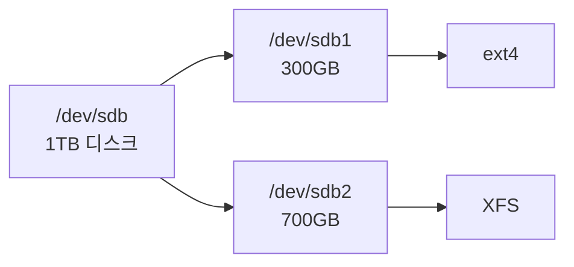
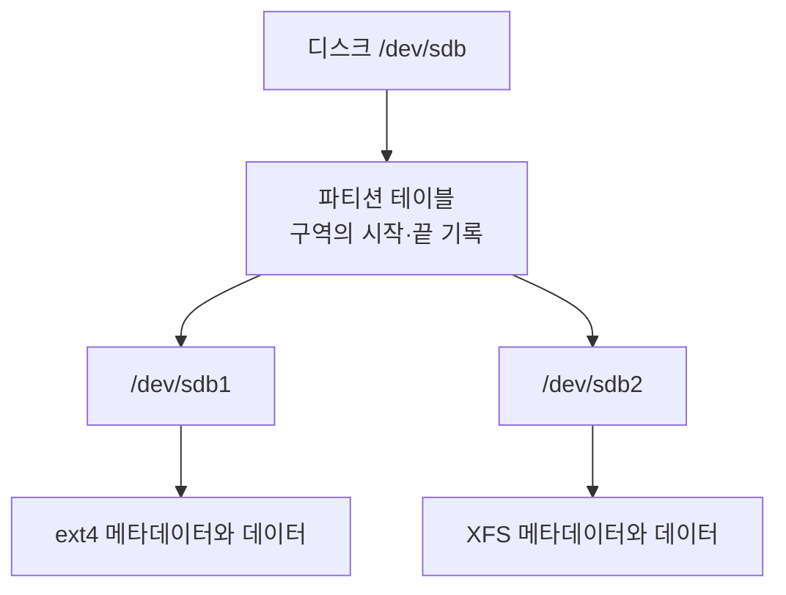
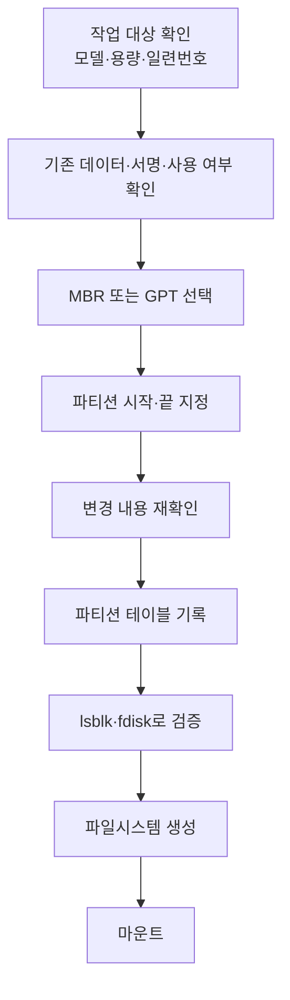
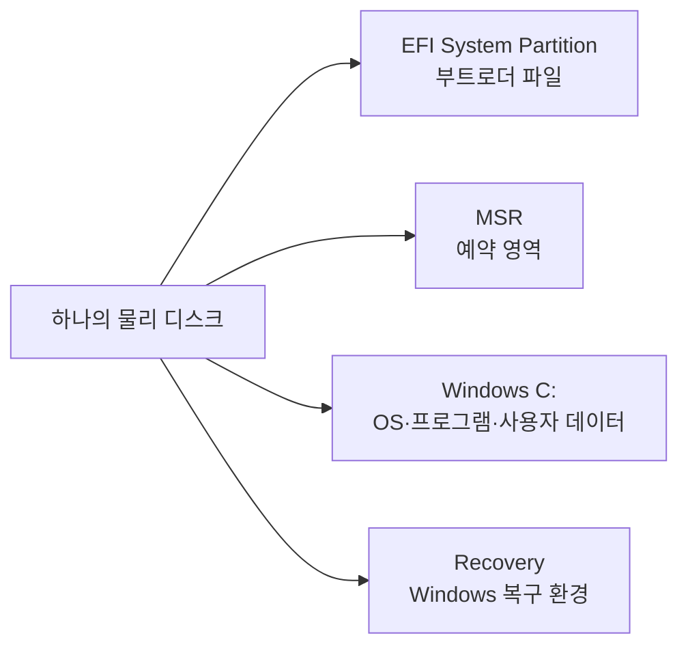

## 목차

- [[#1. 개요|1. 개요]]
- [[#2. 파티션 테이블과 파일시스템의 차이|2. 파티션 테이블과 파일시스템의 차이]]
- [[#3. MBR과 GPT|3. MBR과 GPT]]
- [[#4. 파티션 경계 변경이 데이터에 미치는 영향|4. 파티션 경계 변경이 데이터에 미치는 영향]]
- [[#5. Linux에서 장치와 파티션 확인|5. Linux에서 장치와 파티션 확인]]
- [[#6. 새 파티션을 만드는 흐름|6. 새 파티션을 만드는 흐름]]
- [[#7. Windows 운영체제 디스크의 예|7. Windows 운영체제 디스크의 예]]
- [[#8. 관련 문서|8. 관련 문서]]
- [[#9. 출처|9. 출처]]

## 1. 개요

Partition(파티션)은 하나의 블록 장치에서 서로 겹치지 않는 논리 블록 주소 범위를 구분하여 독립된 저장 영역처럼 사용하게 하는 구조이다.

파티션은 디스크에 물리적인 벽을 세우는 작업이 아니다. 파티션 테이블에 각 영역의 시작·끝 주소와 유형을 기록하면 운영체제가 `/dev/sdb1`, `/dev/sdb2`처럼 별도의 블록 장치로 제공한다.



파티션 1이 가득 찼다고 파티션 2의 빈 공간을 자동으로 가져다 쓰지는 못한다. 두 영역은 같은 디스크에 있어도 서로 다른 주소 범위이기 때문이다.

## 2. 파티션 테이블과 파일시스템의 차이

파티션 테이블은 디스크 전체의 **구획도**이고, 파일시스템 메타데이터는 각 구획 안의 **파일 관리대장**이다.

| 계층 | 답하는 질문 |
|---|---|
| 파티션 테이블 | 각 파티션의 시작·종료 블록 |
| [[Filesystem\|파일시스템]] | 빈 블록과 파일 데이터·권한의 기록 방식 |



모든 파티션에 파일시스템이 있는 것은 아니다. 파티션은 일반 파일시스템 외에도 swap, LVM Physical Volume, RAID 구성원, Raw Device 등으로 사용될 수 있다.

## 3. MBR과 GPT

MBR(Master Boot Record)과 GPT(GUID Partition Table)는 파티션의 위치와 유형을 기록하는 서로 다른 파티션 테이블 형식이다. BIOS·UEFI는 펌웨어와 부팅 인터페이스이고 MBR·GPT는 디스크 구조이므로 같은 개념은 아니다. 다만 전통적으로 BIOS와 MBR, 현대 시스템에서는 UEFI와 GPT를 함께 사용하는 구성이 일반적이다.

| 관점 | MBR | GPT |
|---|---|---|
| 주소 표현 | 전통적으로 32비트 LBA | 64비트 LBA |
| 512바이트 논리 섹터 기준 범위 | 약 2TiB | 현실적으로 훨씬 큰 디스크 지원 |
| 기본 파티션 | 4개, 그 이상은 확장·논리 파티션 필요 | 일반적인 구현에서 128개 |
| 파티션 정보 보호 | 디스크 앞부분에 집중 | 앞·뒤에 주요 구조를 두고 CRC로 손상 검출 |
| 현대 PC 부팅 | Legacy BIOS 구성에서 흔함 | UEFI 구성에서 일반적 |

MBR의 약 2TiB 한계는 32비트로 표현할 수 있는 섹터 수와 512바이트 논리 섹터 크기에서 나온다. 흔히 “2TB 한계”라고 부르지만 엄밀한 단위와 장치의 논리 섹터 크기에 따라 표현이 달라질 수 있다.

GPT의 백업 헤더와 파티션 항목은 **파티션 구조 정보**의 복구에 도움을 주는 것이지, 사용자 파일을 복제하는 백업이 아니다.

## 4. 파티션 경계 변경이 데이터에 미치는 영향

파티션 삭제는 우선 파티션 테이블에서 구획 정보를 없애는 작업이다. 데이터 블록이 즉시 모두 0으로 바뀌지는 않을 수 있지만 운영체제가 파일시스템의 정확한 시작 위치를 찾지 못해 접근할 수 없게 된다.

| 변경 | 일반적인 영향 |
|---|---|
| 파티션 항목만 삭제 | 데이터 흔적은 남을 수 있지만 장치와 파일시스템을 찾지 못함 |
| 같은 시작·끝으로 재생성 | 덮어쓰지 않았다면 다시 인식될 가능성이 있으나 복구 수단으로 의존하면 위험 |
| 시작 위치 변경 | 파일시스템의 기준점이 달라져 인식 실패·손상 가능성이 큼 |
| 끝을 먼저 축소 | 뒤쪽 데이터와 메타데이터가 잘릴 수 있음 |
| 끝을 확장 | 파티션 뒤에 연속된 빈 공간이 필요하며 파일시스템도 별도로 확장해야 함 |
| `mkfs` 실행 | 새 메타데이터가 기존 파일시스템 구조를 덮어써 복구가 어려워짐 |

파일시스템 축소를 지원하는 경우에는 파일시스템이 사용하는 범위를 먼저 줄인 뒤 파티션 끝을 줄여야 한다. 확장은 일반적으로 파티션을 먼저 늘리고 파일시스템을 확장한다. ext4와 XFS처럼 파일시스템별 지원 범위가 다르며 XFS는 일반적인 직접 축소를 지원하지 않는다.[^xfs]

운영 중인 디스크에서는 백업, 서비스 중지, 언마운트, 파일시스템 검사, 복구 계획이 함께 필요하다. 장치 이름만 보고 작업 대상을 판단하면 다른 데이터 디스크를 초기화할 수 있으므로 크기·모델·일련번호·기존 서명·마운트·LVM·RAID 상태를 교차 확인해야 한다.

## 5. Linux에서 장치와 파티션 확인

다음 출력에서는 `disk`가 전체 디스크, `part`가 그 안의 파티션이다.

```bash
lsblk -o NAME,TYPE,SIZE,FSTYPE,MOUNTPOINTS
```

```text
NAME   TYPE   SIZE FSTYPE MOUNTPOINTS
sda    disk   100G
├─sda1 part     1G xfs    /boot
└─sda2 part    99G xfs    /
sdb    disk   500G
└─sdb1 part   500G ext4   /data
sdc    disk     1T
```

이 출력에서 `/dev/sdc`에는 파티션·인식된 파일시스템·마운트 지점이 보이지 않는다. 그러나 이것만으로 빈 디스크라고 확정하면 안 된다. Raw Device, LVM, RAID, 인식되지 않은 형식 또는 남은 서명이 있을 수 있다.

```bash
lsblk -f
sudo fdisk -l /dev/sdc
sudo blkid /dev/sdc
sudo wipefs -n /dev/sdc
sudo pvs
cat /proc/mdstat
swapon --show
```

`wipefs -n`은 발견한 서명을 지우지 않고 보여 주는 확인 방식이다. 실제 초기화·삭제 명령은 대상 검증과 백업 없이 실행하지 않는다.

## 6. 새 파티션을 만드는 흐름

`fdisk /dev/sdb`처럼 전체 디스크를 대상으로 파티션 테이블을 편집한다. `fdisk`에서는 일반적으로 메모리에서 변경안을 만든 뒤 `w`로 기록하고, `q`로 저장하지 않고 종료할 수 있다. 다른 도구는 반영 방식이 다를 수 있으므로 도구별 동작을 확인해야 한다.[^fdisk]



파티션 테이블을 기록한 뒤 커널이 변경 사항을 자동으로 다시 읽지 못하면 `partprobe`가 필요할 수 있다. 사용 중인 장치라면 즉시 다시 읽지 못할 수 있으므로 운영 환경에서는 작업 중단이나 재부팅 계획까지 고려한다.

## 7. Windows 운영체제 디스크의 예

현대적인 Windows UEFI·GPT 기본 구성은 ESP, MSR, Windows 파티션, 복구 파티션으로 이루어진다.[^windows]



C 파티션이 디스크 대부분을 할당받았다는 말은 Windows가 그 용량을 이미 모두 채웠다는 뜻이 아니다. C의 전체 범위 안에서 사용 중인 공간과 빈 공간이 다시 파일시스템에 의해 관리된다.

```text
C:에 할당된 공간 500GB
├── 실제 파일이 사용하는 공간 150GB
└── C: 내부 빈 공간 350GB
```

Windows 디스크 관리에서는 일반적으로 C 바로 뒤에 연속된 미할당 공간이 있어야 C를 확장할 수 있다. 다른 물리 디스크를 D나 E로 추가해도 C의 파티션 크기가 자동으로 늘어나지는 않는다. 더 큰 SSD로 시스템 디스크를 복제하고 파티션을 확장하는 작업은 디스크·SSD 마이그레이션 또는 디스크 클로닝이라고 부를 수 있다.

## 8. 관련 문서

- [[Disk|디스크]] · [[Filesystem|파일시스템]] · [[Block Storage|블록 스토리지]]
- [[BIOS and UEFI|BIOS·UEFI]] · [[Bootloader|부트로더]] · [[Linux Directory Structure|Linux 디렉터리 구조]]

## 9. 출처

[^fdisk]: util-linux, [fdisk(8)](https://man7.org/linux/man-pages/man8/fdisk.8.html), 파티션 테이블 편집과 기록 동작. [lsblk(8)](https://man7.org/linux/man-pages/man8/lsblk.8.html), 블록 장치 계층과 파일시스템 정보 확인.
[^xfs]: Red Hat, [Increasing the size of an XFS file system](https://docs.redhat.com/en/documentation/red_hat_enterprise_linux/9/html/managing_file_systems/increasing-the-size-of-an-xfs-file-system_managing-file-systems), XFS 확장과 축소 제약.
[^windows]: Microsoft Learn, [UEFI/GPT-based hard drive partitions](https://learn.microsoft.com/windows-hardware/manufacture/desktop/configure-uefigpt-based-hard-drive-partitions?view=windows-11), ESP·MSR·Windows·Recovery 파티션의 기본 배치와 역할.

## 둘러보기

[[Knowledge Base/index|전체 개념 목록]] · [[Storage 분류|Storage]]

